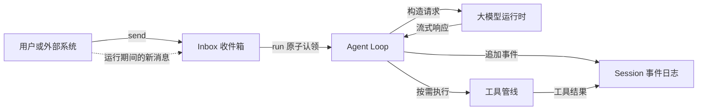
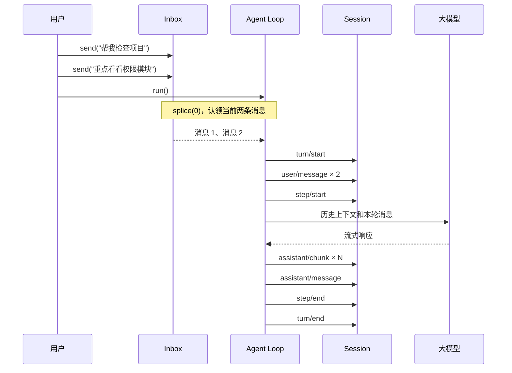
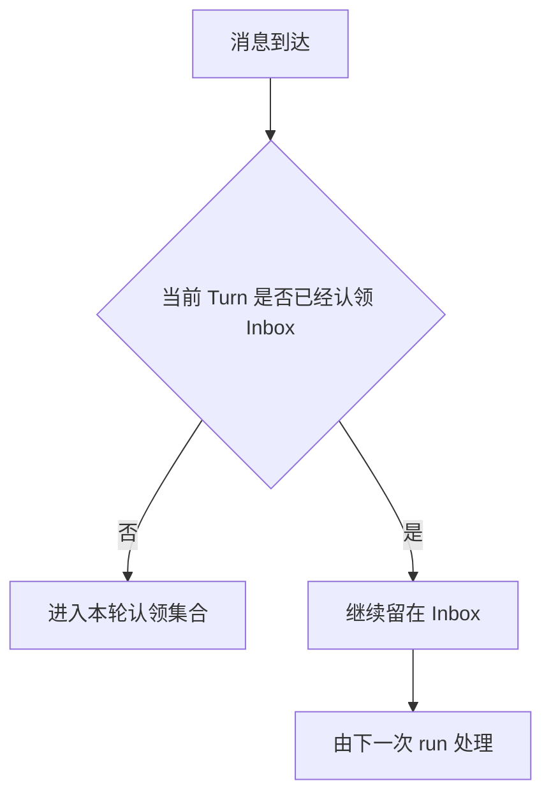
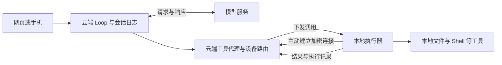
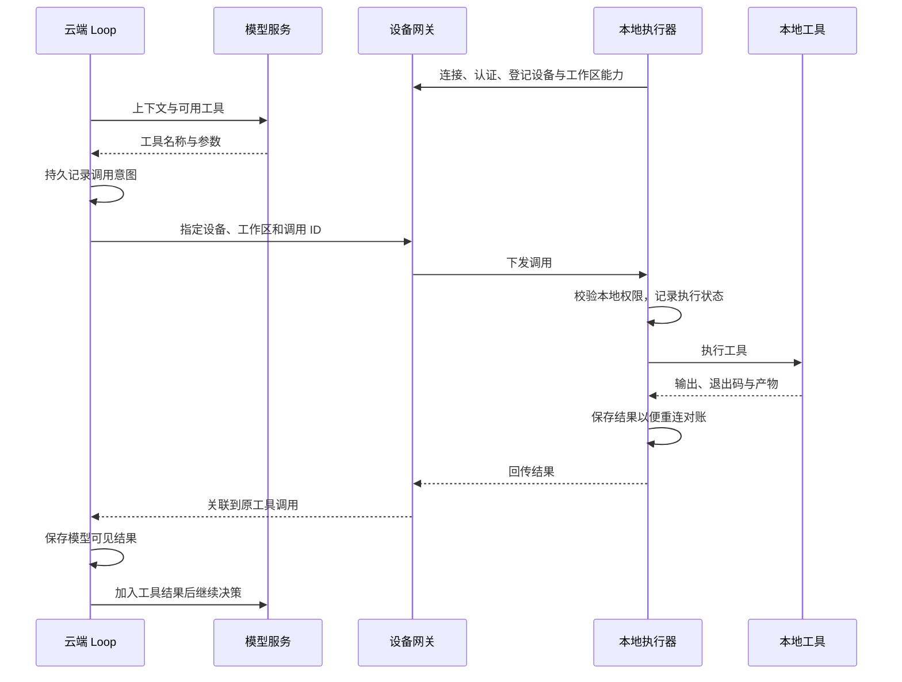
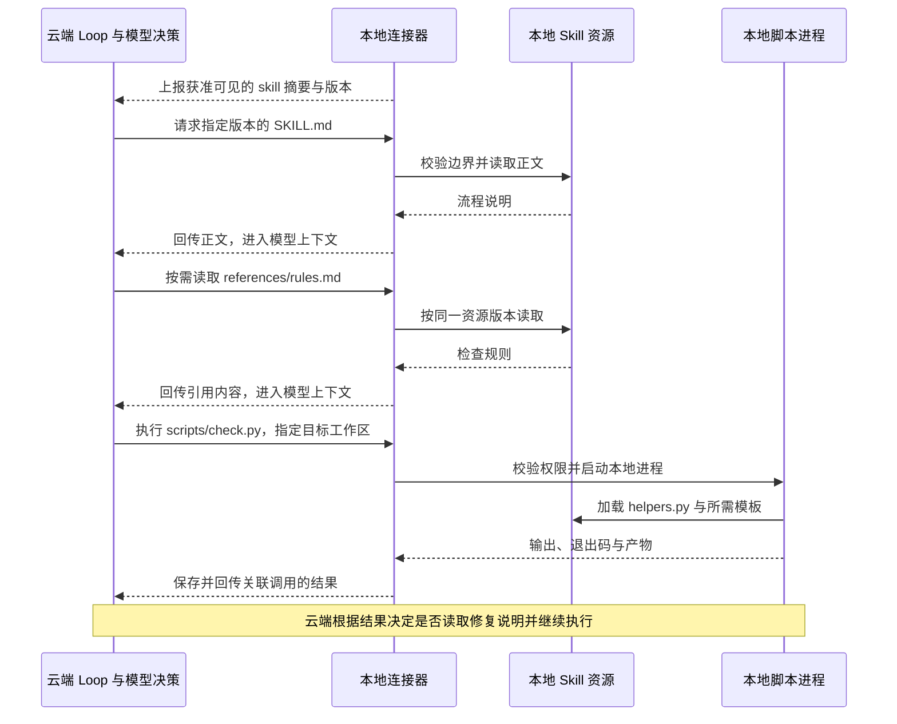

# 第 6 课 QA：Inbox 驱动的 Agent Loop

## Q1：Inbox 驱动是什么意思？

Inbox 驱动就是：用户输入先进入 Agent 自己的收件箱，某次 `run()` 再原子认领当时已经排队的全部消息，用这些消息启动一个独立 Turn。Agent 运行期间新到达的消息不会混进当前 Turn，而是留给下一次 `run()`。



可以用三句话记住各组件的职责：

```text
Inbox 决定“下一轮要处理什么”
Session 决定“过去已经发生什么”
Agent Loop 决定“这一轮如何执行”
```

## Q2：一次 Inbox 驱动的 Turn 是怎么运行的？

假设用户连续发送两条消息，然后宿主调用 `run()`：



本课实现中，`send()` 只负责排队，`run()` 才负责消费。Inbox 本身不会自动唤醒 Agent；何时调用 `run()` 由宿主决定。

## Q3：为什么不让 `send()` 直接调用模型？

直接调用会让运行期间新输入的归属变得模糊。例如模型正在准备写文件时，用户又发送“不要修改代码”。系统必须明确这句话属于当前 Turn 还是下一个 Turn。

Inbox 驱动给出了一条确定规则：



这样不会在一次已经开始的模型请求中途偷偷改变输入集合。

## Q4：什么叫“原子认领”？

关键代码是：

```ts
// 一次取出并删除当前收件箱中的全部消息。
const claimed = this.#inbox.splice(0)
```

`splice(0)` 在一个同步执行段内同时完成“取出当前消息”和“从 Inbox 删除”。同一条消息不会既被当前 Turn 消费，又留给下一 Turn。

这里的原子性是单 JavaScript 进程、单事件循环内的同步原子性，不是数据库事务，也不是跨进程分布式锁。

## Q5：为什么一次认领全部消息，而不是只取一条？

批量认领可以把用户短时间内补充的多条说明放进同一 Turn：

```text
帮我分析这个异常
重点检查恢复逻辑
先不要修改代码
```

模型可以一次看到完整意图，避免为每句话分别启动模型请求。代价是宿主需要决定何时调用 `run()`；如果太早运行，后续补充仍会进入下一 Turn。实际产品通常会结合发送动作、短暂防抖或显式“开始执行”按钮决定触发时机。

## Q6：Inbox、claimed、Session 和模型上下文有什么区别？

| 对象 | 内容 | 生命周期 | 能否用于恢复 |
|---|---|---|---|
| Inbox | 尚未被 Turn 认领的输入 | 当前 Agent 进程 | 当前实现不能 |
| claimed | 当前 Turn 认领的输入快照 | 当前 `run()` | 通过后续 Session 事件体现 |
| Session | 用户、模型、工具及生命周期事实 | 持久事件日志 | 能 |
| 模型上下文 | 从 Session 投影出的模型可见消息 | 每个 Step 重新构造 | 由 Session 间接恢复 |

消息经过以下边界后，才成为可恢复的会话事实：

```text
send
  ↓
Inbox：尚未提交
  ↓ run 认领
user/message：写入 Session
  ↓
模型上下文投影
```

## Q7：进程在 `send()` 之后、`run()` 之前崩溃，消息会丢吗？

会。当前实现的 Inbox 是进程内数组：

```ts
readonly #inbox: Message[] = []
```

它没有写入 Session Store。只有被 `run()` 认领并追加为 `user/message` 的消息才能从 Session JSONL 冷恢复。

如果业务要求输入零丢失，可以先把命令写入持久 Inbox、数据库或消息队列，再由 Agent 使用消费游标认领。这样会引入幂等键、确认、租约、重复投递和失败重试等额外复杂度。

## Q8：运行期间收到的新消息会怎样？

`run()` 开始时先用 `splice(0)` 固定本轮输入。此后调用 `send()` 的消息进入已经清空的 Inbox，因此只会由下一次 `run()` 处理。

```text
Inbox = [A, B]
run() 认领 → claimed = [A, B]，Inbox = []
运行期间 send(C) → Inbox = [C]
当前 Turn 仍只处理 A、B
下次 run() 才处理 C
```

这正是 Inbox 驱动最重要的竞态边界。

## Q9：为什么禁止同一个 Agent 并发执行两个 `run()`？

同一个 Session 使用连续 `seq`，Agent Loop 还维护 Turn、Step、取消控制器和工具生命周期。如果两个 `run()` 并行执行，可能产生如下交错：

```text
turn 1/start
turn 2/start
turn 1/step/start
turn 2/step/start
...
```

这会破坏单 Agent 串行决策语义，也让当前取消操作不知道应该取消哪个 Turn。因此 `run()` 在状态为 `running` 时明确拒绝重入。

需要并行处理时，应创建多个 Agent 或多个 Session，而不是让同一个 Agent Loop 并发修改同一条会话日志。

## Q10：一个 Turn 和一个 Step 有什么区别？

- Turn：从认领一批用户输入开始，到最终完成、失败、取消或阻塞结束。
- Step：Turn 内的一次模型决策。

没有工具调用时，一个 Turn 通常只有一个 Step：

```text
Turn 1
└── Step 1：模型直接回答
```

存在工具调用时，一个 Turn 可以包含多个 Step：

```text
Turn 1
├── Step 1：模型决定调用搜索工具
├── 工具执行与结果
└── Step 2：模型读取工具结果并生成最终回答
```

Inbox 决定 Turn 的输入边界；工具循环决定一个 Turn 内需要多少个 Step。

## Q11：取消为什么仍要写入 `step/end` 和 `turn/end`？

取消是正常生命周期的一种结果，不应留下永远处于运行中的日志。模型流收到取消信号后，会被归一化成取消终止帧，Agent 随后追加闭合事件：

```text
step/start
assistant/chunk × N
取消
step/end
turn/end { aborted/user }
```

这样 UI、恢复器和生命周期投影都能确定该 Turn 已经结束，而不是把它误判为仍在执行。

## Q12：模型出错、达到上限和请求工具时分别怎么结束？

| 模型结束原因 | Turn 结果 | 含义 |
|---|---|---|
| `stop` | `completed` | 正常完成 |
| `max-tokens` | `max-tokens` | 输出达到限制 |
| `error` | `error` | 保存结构化失败 |
| `aborted` | `aborted/user` | 用户或外部信号取消 |
| `tool-calls` | 继续下一 Step，或在无工具管线时 `blocked` | 等待工具执行 |

无论走哪条路径，都应该让 Step 和 Turn 形成可验证的闭合生命周期。

## Q13：恢复 Session 后，下一个 Turn 为什么不会从 1 开始？

Inbox 不负责恢复 Turn 编号。Agent 会扫描 Session 中已有事件，找出历史最大 Turn 编号，再加一：

```text
历史最大 Turn = 7
冷恢复后的下一次 run → Turn 8
```

因此恢复依赖的是持久化 Session，而不是旧 Agent 对象的内存状态。

## Q14：Inbox 驱动和 Actor Mailbox 有什么关系？

两者核心思想相近：对象持有私有状态和消息收件箱，并串行处理消息。

```text
Agent ≈ 状态 + Inbox + 串行处理循环
```

但本课实现只是简化版本：

- 没有自动调度器，必须显式调用 `run()`；
- Inbox 不持久化；
- 不支持跨进程投递；
- 一次认领一批消息，而经典 Actor 通常逐条处理消息；
- Session 事件日志承担了额外的审计与恢复职责。

所以可以把它理解成“借用了 Actor Mailbox 思想的 Agent Turn 调度器”，但不能直接等同于完整 Actor 系统。

## Q15：Inbox 和 Kafka、Redis 一类消息队列有什么区别？

| 维度 | 本课 Inbox | 外部消息队列 |
|---|---|---|
| 位置 | Agent 进程内 | 独立基础设施 |
| 持久性 | 无 | 通常有 |
| 消费者 | 当前 Agent | 可有多个消费者 |
| 投递保证 | 进程内数组语义 | 至少一次、至多一次等 |
| 重复处理 | 默认不会 | 经常需要幂等处理 |
| 复杂度 | 低 | 较高 |

单进程教学、桌面应用或可接受未提交输入丢失时，内存 Inbox 足够。分布式 Agent Server、长任务或严格可靠性场景，则应考虑持久命令队列。

## Q16：能不能把新消息直接插入正在运行的模型上下文？

通常不能直接插入已经发出的 HTTP 请求。即使模型提供方支持双向实时协议，也必须定义明确的中断和重规划语义：

1. 取消当前模型请求；
2. 保存当前 Turn 的取消结果；
3. 将新消息作为下一 Turn 输入；
4. 重新构造上下文并发起请求。

否则模型可能已经决定执行工具，而新限制只在 UI 中出现，没有真正参与该次决策。

## Q17：如果 `run()` 认领消息后立刻异常，消息会不会丢？

需要区分异常发生的位置：

- 写入 `user/message` 之后失败：消息已经成为 Session 事实，可以恢复和诊断；
- 认领之后、写入 Session 之前发生进程级崩溃：内存 Inbox 已清空，消息可能丢失；
- 模型返回规范化错误或取消：Session 会记录闭合的失败 Turn。

生产级实现若要求消除“认领后、提交前”的窗口，需要采用持久 Inbox，并通过事务、租约或至少一次投递加幂等键完成可靠认领。

## Q18：为什么新消息不应该悄悄加入当前 Turn？

因为一次模型决策应该对应一个稳定输入快照。否则审计日志无法回答：模型调用工具时究竟看到了哪些用户要求？

稳定输入边界带来以下能力：

- 可以重放同一个 Turn；
- 可以解释某次工具调用的依据；
- 可以复现竞态问题；
- 可以精确计算每次请求的上下文和用量；
- 可以在权限审计中证明新限制是否已经进入模型决策。

## Q19：如何测试 Inbox 驱动的关键竞态？

至少覆盖以下场景：

1. Inbox 为空时调用 `run()`，不产生任何事件；
2. 连续发送多条消息，一次 `run()` 全部认领；
3. 同一个 Agent 并发调用 `run()`，第二次明确失败；
4. 当前 Turn 运行期间发送新消息，新消息留给下一 Turn；
5. 取消慢模型流，仍产生 `step/end` 和 `turn/end`；
6. 模型异常被归一化成结构化失败；
7. 冷恢复后 Turn 编号连续增长；
8. 工具调用产生多个 Step，但仍属于同一个 Turn。

## Q20：怎么判断第 6 课真正理解并完成了？

运行：

```bash
cd harness-lab
bun run typecheck
bun test src/agent.test.ts
bun run demo:agent
```

然后使用 VS Code 的“05 · 智能体循环”调试配置，在以下位置设置断点：

1. `sendContent()` 向 Inbox 追加消息的位置；
2. `run()` 中的 `this.#inbox.splice(0)`；
3. `turn/start` 和 `user/message` 的追加位置；
4. `runModelStep()` 的流式读取位置；
5. `turn/end` 原因映射位置；
6. `finally` 中恢复 `idle` 状态的位置。

重点观察：`claimed` 是本轮固定输入，而运行期间新消息仍停留在 `#inbox` 中。只要能清楚解释这条边界，就抓住了 Inbox 驱动的核心。

## Q21：DeepSeek Harness、OpenHands 和 Codex 的 Agent Loop 分别运行在哪端？

模型、Loop、工具是三个可以分别部署的部分。模型生成下一步动作；Loop 组装上下文、请求模型、调度工具并决定是否继续；工具执行器实际访问文件、进程和其他服务。调用云端模型不等于 Loop 在云端，看到本地工具执行也不能据此断定 Loop 在本地。

| 产品与模式 | Loop 所在位置 | 界面与执行的边界 |
|---|---|---|
| DeepSeek Harness，本地启动 `dsh` | 本机 Node.js 宿主进程 | Web 浏览器负责交互，headless 不需要 HTTP 服务 |
| DeepSeek Harness，宿主部署到服务器 | 服务器上的 Node.js 宿主进程 | 浏览器在哪打开，不决定 Loop 在哪运行 |
| OpenHands SDK，`LocalConversation` | 调用 SDK 的 Python 进程内 | 由 Conversation 编排 Agent 的步骤 |
| OpenHands SDK，`RemoteConversation` | 远端 Agent Server 进程，通常在容器或服务器内 | 客户端通过 HTTP / WebSocket 委托执行 |
| Codex CLI、本地模式的桌面端 / IDE | 本机 Codex Agent 运行时 | 富客户端可以通过 app-server 接入；远程连接模式下应看 app-server 所在主机 |
| Codex Cloud | OpenAI 托管的云端环境 | 本地界面用于提交、查看和继续任务 |

本表核对于 2026-10-16。DeepSeek Harness 依据子模块 `99f6f02fecdb7dff40c3fbc9470f5907c29f74ca`，不是将 harness-lab 的教学 `run()` 语义套到上游；OpenHands 对比当前 Software Agent SDK，不混用旧 V0。Codex 按执行模式区分，不能仅凭桌面、网页或 CLI 入口判断位置。

依据：[Harness 架构](deepseek-harness/docs/architecture.md)、[具体 Loop](deepseek-harness/packages/core/agent-loop/src/agent.ts)、[OpenHands Conversation](https://docs.openhands.dev/sdk/arch/conversation)、[Codex CLI](https://developers.openai.com/codex/cli)、[Codex App Server](https://developers.openai.com/codex/app-server)、[Codex Cloud](https://developers.openai.com/codex/cloud)。

## Q22：Loop 放本地和云端，各有什么取舍？

| 维度 | 本地 Loop | 云端 Loop |
|---|---|---|
| 使用个人环境 | 直接使用本地代码、依赖、内网和已授权登录态 | 需要在云端重建环境，或连接本地执行器 |
| 持续运行 | 受电脑休眠、进程退出影响 | 适合后台调度，但可靠恢复仍依赖持久化、队列和所有权设计 |
| 跨设备 | 需要同步或远程连接 | 多个界面可以接入同一会话，仍需身份和并发控制 |
| 工具延迟 | 本地调用没有跨网往返 | 远程调用本地工具会增加往返；频繁小调用更明显 |
| 运维与成本 | 客户端兼容、升级和本机资源占用 | 集中升级方便，额外承担服务、存储、带宽和隔离成本 |
| 数据边界 | 日志可以留本地；发给云端模型的内容仍会上传 | 上下文和工具结果通常经过云端，上传范围需要明确 |

Loop 通常主要承担编排和 I/O，而模型推理由模型服务承担。把 Loop 搬到云端，不直接等于模型变快或更聪明。

例如手机发起任务、云端负责规划、Mac 负责改代码：Mac 休眠后，云端只能保存进度或做不依赖 Mac 的步骤，不能继续调用已离线的本地工具。全云端与“云端 Loop＋本地工具”的持续运行能力必须分别判断。

## Q23：云端 Loop、本地工具，怎样实现？

建议让本地执行器主动建立加密长连接，云端通过连接下发工具调用。这样不需要给每台电脑开放公网入口。以下为通用设计，不表示仓库已有完整设备网关。



一次“修改代码并运行测试”的时序如下。图中记录状态不代表执行动作和写日志可以跨系统原子提交。



本地执行器不必保存完整对话或再次跑模型循环；它负责工具能力、本地权限、执行进程与执行记录。协议至少区分稳定的逻辑调用 ID 和每次投递的尝试 ID，并携带会话、设备、工作区、工具、参数、截止时间与权限上下文。多租户身份必须由认证和授权决定，不能相信消息中自报的用户或设备 ID。

## Q24：断线、重试和取消，哪些地方最容易出问题？

| 发生位置 | 能确定什么 | 处理原则 |
|---|---|---|
| 本地离线，还没派发 | 未执行 | 等待上线或明确失败；过期调用不再执行 |
| 已发送，没收到确认 | 不知道本地是否接收或执行 | 重连先按调用 ID 对账，不把超时当作未执行 |
| 本地完成，但结果未送达 | 本地若有持久结果，可以补传 | 返回原结果，不重复执行同一逻辑调用 |
| 副作用发生后、本地结果落盘前崩溃 | 可能执行过，结果未知 | 先查外部状态；写操作不能盲目重试 |
| 用户取消或调用超时 | 取消意图已产生，不代表进程停止 | 传递取消、处理子进程并确认终态；已发生副作用不自动回滚 |
| 旧连接或旧执行者重新上线 | 可能带回迟到结果 | 用所有权代次、租约围栏和调用状态校验，禁止旧尝试覆盖新状态 |

稳定复现“命令完成却被当成失败”的路径：让测试命令正常退出，在本地结果已保存、回传之前断开连接，再恢复连接。应查到同一调用已完成并补传原结果；不能重新跑命令。进一步在副作用完成、执行记录持久化之前终止执行器，应暴露“结果未知”，而不是伪造未执行或成功。

去重可以减少重复投递导致的重复执行，但不能保证任意 Shell 命令恰好执行一次。外部写操作若有业务幂等键或事务查询接口，应结合它们恢复；缺少证据时保留未知。

权限在本地执行器再次落实：限定工作区、工具、路径和命令范围；审批绑定具体调用与参数，不能只凭请求来自云端就放行。工具输出按不可信数据处理，本地凭证也不应因调试日志被带回云端。

## Q25：在 DeepSeek Harness 中，应该在哪层接入？

第一版可以新增工具级代理插件：在云端 `ctx.tools` 注册工具 schema，执行器通过网关调用本地能力，复用既有工具管线与模型循环。需要复用上层文件、Shell 和终端工具时，也可以实现远程 `ctx.fs` / `ctx.subprocess` 提供方，但必须覆盖持久进程、PTY、取消、附件和临时文件等实际消费边界。

依据：[工具注册与执行管线](deepseek-harness/packages/core/tools/README.zh.md)、[E2B 执行环境适配](deepseek-harness/packages/e2b/README.zh.md)。E2B POC 展示了执行环境与 Loop 的分离，不是已有的本地设备反向连接实现。

MCP 可以复用工具发现与调用协议，但不会自动解决电脑可达性、设备路由、断线恢复和副作用对账。本仓库的 [MCP Client](deepseek-harness/packages/mcp/mcp-client/README.zh.md) 支持 stdio 和 Streamable HTTP；云端不能直接访问另一台电脑的 localhost，也不能把该电脑的 stdio 当作云端子进程。[MCP 官方传输说明](https://blog.modelcontextprotocol.io/posts/2025-12-19-mcp-transport-future/#official-and-custom-transports)

对会话评估的影响见[长对话效果评估 QA：Q11](LONG_CONVERSATION_EFFECT_EVALUATION_QA.md#q11agent-loop-放本地云端或采用混合架构对会话评估有什么影响)。完整图文入口见[部署与评估专题](reference/agent-loop-deployment-and-evaluation.html)。

## Q26：Skill 的加载、引用和脚本执行，分别是谁负责？

把一个检查项目的 skill 拆开看：

```text
check-project/
├── SKILL.md                  使用条件与操作流程
├── references/
│   ├── rules.md              检查规则
│   └── repair-guide.md       修复说明
├── scripts/
│   ├── check.py              检查入口
│   ├── repair.py             修复入口
│   └── helpers.py            脚本公共模块
└── assets/
    └── report-template.md    报告模板
```

| 阶段 | 谁负责 | 实际发生什么 |
|---|---|---|
| 发现 | 宿主的 skill 提供方与目录服务 | 找到可用 skill，把名称、描述等摘要交给 Agent 选择 |
| 加载正文 | Agent 通过 loader 或读取工具请求，宿主返回内容 | 读取所选 `SKILL.md`，把使用流程加入模型上下文 |
| 读取引用 | Agent 按说明决定，通过文件或资源读取工具获取 | 按需读取 `references/rules.md` 等内容；链接本身不保证内容已加载 |
| 执行脚本 | Agent 发起工具调用，执行器启动解释器或进程 | 执行选中的脚本，获取输出、退出码和产物；不是把源码当作提示词执行 |
| 继续流程 | Loop 请求模型作下一步决策 | 根据结果决定是否读取修复指南、执行修复和复查 |

Skill 通常描述工作流程，不会因为被选中就自动执行目录内全部脚本。多个引用也不必一次性全部进入上下文。例如 `check.py` 导入 `helpers.py` 时，Python 按模块规则加载公共代码；Agent 不一定读过两份源码。脚本若自行读取模板或规则文件，这次读取属于脚本执行，不能因此认定模型也看到了文件全文。

Codex 的官方说明使用逐步披露：先发现名称与描述，选择后加载 `SKILL.md`，再按需使用资源。[官方 Skill 文档](https://learn.chatgpt.com/docs/build-skills)。具体框架的发现位置与加载 API 不同，不能据此假定三家协议相同。

## Q27：三种架构下，Skill 资源分别放在哪，怎样读取和执行？

下表是常见部署方案，不是三个产品已经共同实现的统一协议。

| 阶段 | 本地 Loop＋本地工具 | 云端 Loop＋云端工具 | 云端 Loop＋本地工具 |
|---|---|---|---|
| 资源准备 | 在本机安装 skill 目录，或从仓库发现 | 在云端执行环境检出、安装或挂载 skill 资源 | Skill 可以完整留在本机；本地连接器提供目录、资源读取与执行通道 |
| 发现 | 本地提供方生成可用目录 | 云端提供方生成可用目录 | 本地上报获准可见的名称、描述、版本与设备关联 |
| 加载正文 | 本地读取 `SKILL.md`，交给 Loop 使用 | 云端读取 `SKILL.md`，交给 Loop 使用 | 云端通过连接器读取本地正文，内容回传后进入云端上下文 |
| 引用 Markdown | 相对 skill 资源基底读取本地文件 | 相对云端资源基底读取文件；远程资料通过相应资源接口获取 | 经连接器按 skill 身份、版本、相对路径读取；不能直接打开云端机器上同名路径 |
| 脚本与依赖 | 本地进程使用本机脚本、模块、模板和运行时 | 云端进程使用已部署的脚本、模块、模板和运行时 | 本地进程执行，公共模块与依赖可留本机；云端接收结果与产物引用 |
| 故障影响 | 本地缺文件、缺依赖或进程退出会阻断流程 | 云端资源缺失、镜像或网络限制会阻断流程 | 还需处理设备离线、跨端版本不一致、调用重投与结果补传 |

“所有 skill 都必须下载到 Loop 宿主磁盘”不是必要条件。必要的是：说明和引用能由 Agent 获得，脚本及其依赖能由选定的执行器访问。在 Loop 与执行器同机时，安装在同一环境通常最简单；在混合架构中，Markdown 内容经过云端上下文，也不等于整个目录已复制到云端。

云端准备资源时，不能只复制 `SKILL.md`，却遗漏被引用的 Markdown、脚本导入的公共模块和模板。完整资源也可以来自挂载或受控资源服务，不一定要打包下载。个人电脑上的用户 skill 不会因为任务切到云端而自动同步，产品必须明确分发方式。

## Q28：云端 Loop 使用完整留在本机的 Skill，一次流程怎样走？



这条设计不要求本地连接器再运行一个模型 Loop。另一个可选方案是把说明与引用同步到云端、脚本留本机；它减少部分跨端读取，但需要固定同一资源包版本，防止新版说明调用旧版脚本。混合方案中读取 Markdown 是跨端内容传输；脚本凭证即使留本机，输出仍可能携带敏感内容，上传范围由产品明确。

## Q29：多文件 Skill 的路径、版本和评估记录怎样保持一致？

先分清两个基底：skill 目录用于找规则、脚本与模板，工作区目录用于找本次处理的项目。启动检查脚本时应分别指定脚本位置与目标项目，不能依赖某个偶然的 cwd，也不能沿用作者电脑上的绝对路径。脚本自身的模块导入与资源定位还必须符合所用语言的规则；分发目录正确不代表代码自动具备可移植性。

当资源由 URL 或提供方管理时，相对引用交给对应资源读取机制解析，不能一律当成本机文件路径。执行端要能取得脚本使用的模块、模板与数据；云端可读的资源并不天然能被本地脚本访问，跨端使用时还需要同步、下载或传入内容。凭证通过执行环境注入，不打包进 skill。

为保持复现条件，建议固定每次调用使用的资源包快照或不可变版本，记录实际读取的文件及内容摘要、执行的脚本与依赖环境、参数、设备、工作区、输出和产物。外部引用若会变化，需要保存实际读取内容或不可变引用。只保留名称或哈希却无法取得内容，不足以重建证据；也不能因为目录里有某份规则，就认定模型当时已读过它。

例如模型读取了新版 `SKILL.md`，本地却执行旧版 `check.py`，新增参数可能不受支持。可控复现：说明中增加脚本不认识的参数，保持执行端旧版不变再调用；版本固定或能力校验应在执行前暴露不一致，而不是让评估器事后将其归为模型能力问题。

本仓库已通过 `ctx.skills` 分离来源提供方，通过资源基底表达目录、URL 或提供方管理的资源；完整本地设备代理和不可变多文件版本协议仍需另外实现。当前文件系统提供方会在后续加载时重新读取正文，目录摘要也不覆盖所有引用和脚本内容，因此现有目录机制不能当作完整资源包版本锁。[Skill 子系统](deepseek-harness/docs/subsystems/skills.md)、[文件系统提供方](deepseek-harness/packages/skill/skill-filesystem/README.zh.md)、[面向模型的 loader](deepseek-harness/packages/skill/tool-skill/README.zh.md)。

网页对照见[部署与评估专题：Skill 的加载、引用与执行](reference/agent-loop-deployment-and-evaluation.html#skills)。
