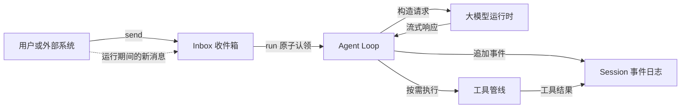
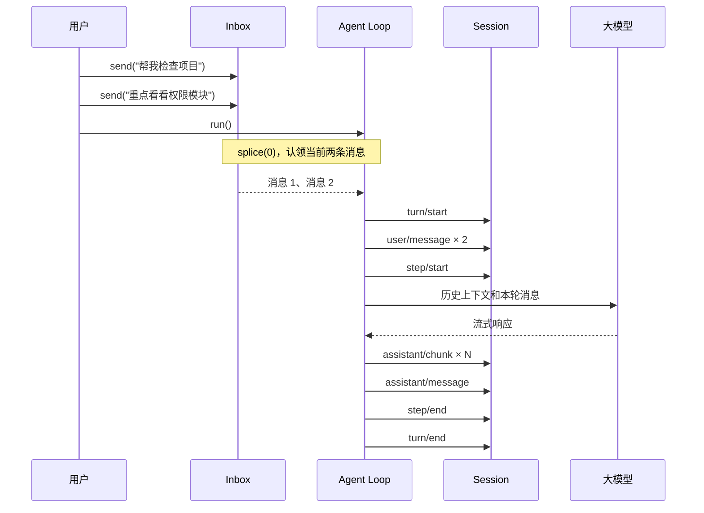
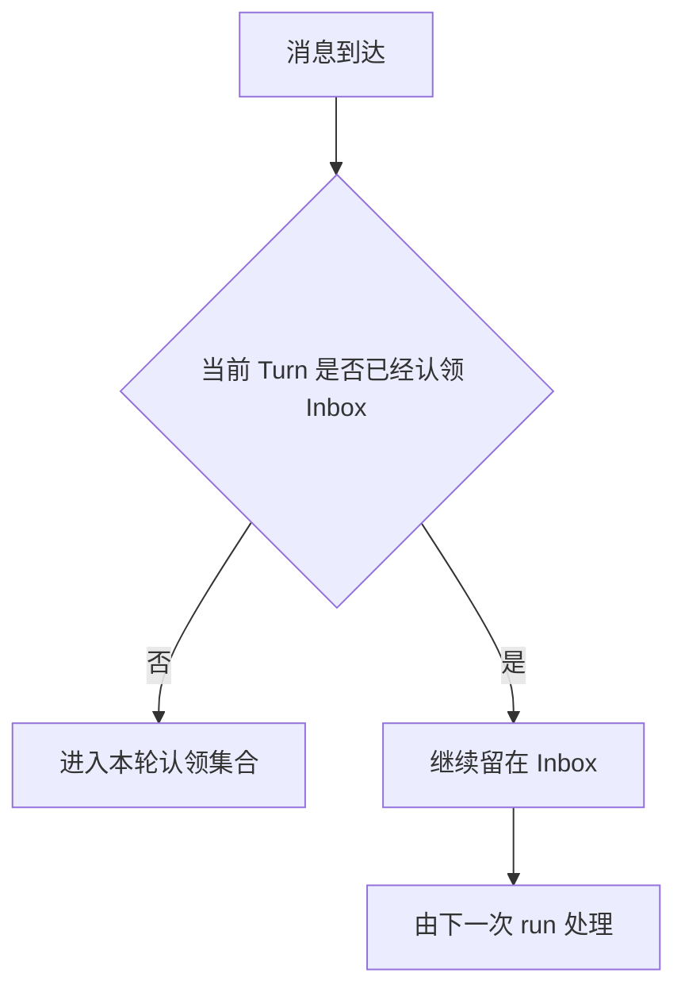

# 第 6 课 QA：Inbox 驱动的 Agent Loop

## Q1：Inbox 驱动是什么意思？

Inbox 驱动就是：用户输入先进入 Agent 自己的收件箱，某次 `run()` 再原子认领当时已经排队的全部消息，用这些消息启动一个独立 Turn。Agent 运行期间新到达的消息不会混进当前 Turn，而是留给下一次 `run()`。



可以用三句话记住各组件的职责：

```text
Inbox 决定“下一轮要处理什么”
Session 决定“过去已经发生什么”
Agent Loop 决定“这一轮如何执行”
```

## Q2：一次 Inbox 驱动的 Turn 是怎么运行的？

假设用户连续发送两条消息，然后宿主调用 `run()`：



本课实现中，`send()` 只负责排队，`run()` 才负责消费。Inbox 本身不会自动唤醒 Agent；何时调用 `run()` 由宿主决定。

## Q3：为什么不让 `send()` 直接调用模型？

直接调用会让运行期间新输入的归属变得模糊。例如模型正在准备写文件时，用户又发送“不要修改代码”。系统必须明确这句话属于当前 Turn 还是下一个 Turn。

Inbox 驱动给出了一条确定规则：



这样不会在一次已经开始的模型请求中途偷偷改变输入集合。

## Q4：什么叫“原子认领”？

关键代码是：

```ts
// 一次取出并删除当前收件箱中的全部消息。
const claimed = this.#inbox.splice(0)
```

`splice(0)` 在一个同步执行段内同时完成“取出当前消息”和“从 Inbox 删除”。同一条消息不会既被当前 Turn 消费，又留给下一 Turn。

这里的原子性是单 JavaScript 进程、单事件循环内的同步原子性，不是数据库事务，也不是跨进程分布式锁。

## Q5：为什么一次认领全部消息，而不是只取一条？

批量认领可以把用户短时间内补充的多条说明放进同一 Turn：

```text
帮我分析这个异常
重点检查恢复逻辑
先不要修改代码
```

模型可以一次看到完整意图，避免为每句话分别启动模型请求。代价是宿主需要决定何时调用 `run()`；如果太早运行，后续补充仍会进入下一 Turn。实际产品通常会结合发送动作、短暂防抖或显式“开始执行”按钮决定触发时机。

## Q6：Inbox、claimed、Session 和模型上下文有什么区别？

| 对象 | 内容 | 生命周期 | 能否用于恢复 |
|---|---|---|---|
| Inbox | 尚未被 Turn 认领的输入 | 当前 Agent 进程 | 当前实现不能 |
| claimed | 当前 Turn 认领的输入快照 | 当前 `run()` | 通过后续 Session 事件体现 |
| Session | 用户、模型、工具及生命周期事实 | 持久事件日志 | 能 |
| 模型上下文 | 从 Session 投影出的模型可见消息 | 每个 Step 重新构造 | 由 Session 间接恢复 |

消息经过以下边界后，才成为可恢复的会话事实：

```text
send
  ↓
Inbox：尚未提交
  ↓ run 认领
user/message：写入 Session
  ↓
模型上下文投影
```

## Q7：进程在 `send()` 之后、`run()` 之前崩溃，消息会丢吗？

会。当前实现的 Inbox 是进程内数组：

```ts
readonly #inbox: Message[] = []
```

它没有写入 Session Store。只有被 `run()` 认领并追加为 `user/message` 的消息才能从 Session JSONL 冷恢复。

如果业务要求输入零丢失，可以先把命令写入持久 Inbox、数据库或消息队列，再由 Agent 使用消费游标认领。这样会引入幂等键、确认、租约、重复投递和失败重试等额外复杂度。

## Q8：运行期间收到的新消息会怎样？

`run()` 开始时先用 `splice(0)` 固定本轮输入。此后调用 `send()` 的消息进入已经清空的 Inbox，因此只会由下一次 `run()` 处理。

```text
Inbox = [A, B]
run() 认领 → claimed = [A, B]，Inbox = []
运行期间 send(C) → Inbox = [C]
当前 Turn 仍只处理 A、B
下次 run() 才处理 C
```

这正是 Inbox 驱动最重要的竞态边界。

## Q9：为什么禁止同一个 Agent 并发执行两个 `run()`？

同一个 Session 使用连续 `seq`，Agent Loop 还维护 Turn、Step、取消控制器和工具生命周期。如果两个 `run()` 并行执行，可能产生如下交错：

```text
turn 1/start
turn 2/start
turn 1/step/start
turn 2/step/start
...
```

这会破坏单 Agent 串行决策语义，也让当前取消操作不知道应该取消哪个 Turn。因此 `run()` 在状态为 `running` 时明确拒绝重入。

需要并行处理时，应创建多个 Agent 或多个 Session，而不是让同一个 Agent Loop 并发修改同一条会话日志。

## Q10：一个 Turn 和一个 Step 有什么区别？

- Turn：从认领一批用户输入开始，到最终完成、失败、取消或阻塞结束。
- Step：Turn 内的一次模型决策。

没有工具调用时，一个 Turn 通常只有一个 Step：

```text
Turn 1
└── Step 1：模型直接回答
```

存在工具调用时，一个 Turn 可以包含多个 Step：

```text
Turn 1
├── Step 1：模型决定调用搜索工具
├── 工具执行与结果
└── Step 2：模型读取工具结果并生成最终回答
```

Inbox 决定 Turn 的输入边界；工具循环决定一个 Turn 内需要多少个 Step。

## Q11：取消为什么仍要写入 `step/end` 和 `turn/end`？

取消是正常生命周期的一种结果，不应留下永远处于运行中的日志。模型流收到取消信号后，会被归一化成取消终止帧，Agent 随后追加闭合事件：

```text
step/start
assistant/chunk × N
取消
step/end
turn/end { aborted/user }
```

这样 UI、恢复器和生命周期投影都能确定该 Turn 已经结束，而不是把它误判为仍在执行。

## Q12：模型出错、达到上限和请求工具时分别怎么结束？

| 模型结束原因 | Turn 结果 | 含义 |
|---|---|---|
| `stop` | `completed` | 正常完成 |
| `max-tokens` | `max-tokens` | 输出达到限制 |
| `error` | `error` | 保存结构化失败 |
| `aborted` | `aborted/user` | 用户或外部信号取消 |
| `tool-calls` | 继续下一 Step，或在无工具管线时 `blocked` | 等待工具执行 |

无论走哪条路径，都应该让 Step 和 Turn 形成可验证的闭合生命周期。

## Q13：恢复 Session 后，下一个 Turn 为什么不会从 1 开始？

Inbox 不负责恢复 Turn 编号。Agent 会扫描 Session 中已有事件，找出历史最大 Turn 编号，再加一：

```text
历史最大 Turn = 7
冷恢复后的下一次 run → Turn 8
```

因此恢复依赖的是持久化 Session，而不是旧 Agent 对象的内存状态。

## Q14：Inbox 驱动和 Actor Mailbox 有什么关系？

两者核心思想相近：对象持有私有状态和消息收件箱，并串行处理消息。

```text
Agent ≈ 状态 + Inbox + 串行处理循环
```

但本课实现只是简化版本：

- 没有自动调度器，必须显式调用 `run()`；
- Inbox 不持久化；
- 不支持跨进程投递；
- 一次认领一批消息，而经典 Actor 通常逐条处理消息；
- Session 事件日志承担了额外的审计与恢复职责。

所以可以把它理解成“借用了 Actor Mailbox 思想的 Agent Turn 调度器”，但不能直接等同于完整 Actor 系统。

## Q15：Inbox 和 Kafka、Redis 一类消息队列有什么区别？

| 维度 | 本课 Inbox | 外部消息队列 |
|---|---|---|
| 位置 | Agent 进程内 | 独立基础设施 |
| 持久性 | 无 | 通常有 |
| 消费者 | 当前 Agent | 可有多个消费者 |
| 投递保证 | 进程内数组语义 | 至少一次、至多一次等 |
| 重复处理 | 默认不会 | 经常需要幂等处理 |
| 复杂度 | 低 | 较高 |

单进程教学、桌面应用或可接受未提交输入丢失时，内存 Inbox 足够。分布式 Agent Server、长任务或严格可靠性场景，则应考虑持久命令队列。

## Q16：能不能把新消息直接插入正在运行的模型上下文？

通常不能直接插入已经发出的 HTTP 请求。即使模型提供方支持双向实时协议，也必须定义明确的中断和重规划语义：

1. 取消当前模型请求；
2. 保存当前 Turn 的取消结果；
3. 将新消息作为下一 Turn 输入；
4. 重新构造上下文并发起请求。

否则模型可能已经决定执行工具，而新限制只在 UI 中出现，没有真正参与该次决策。

## Q17：如果 `run()` 认领消息后立刻异常，消息会不会丢？

需要区分异常发生的位置：

- 写入 `user/message` 之后失败：消息已经成为 Session 事实，可以恢复和诊断；
- 认领之后、写入 Session 之前发生进程级崩溃：内存 Inbox 已清空，消息可能丢失；
- 模型返回规范化错误或取消：Session 会记录闭合的失败 Turn。

生产级实现若要求消除“认领后、提交前”的窗口，需要采用持久 Inbox，并通过事务、租约或至少一次投递加幂等键完成可靠认领。

## Q18：为什么新消息不应该悄悄加入当前 Turn？

因为一次模型决策应该对应一个稳定输入快照。否则审计日志无法回答：模型调用工具时究竟看到了哪些用户要求？

稳定输入边界带来以下能力：

- 可以重放同一个 Turn；
- 可以解释某次工具调用的依据；
- 可以复现竞态问题；
- 可以精确计算每次请求的上下文和用量；
- 可以在权限审计中证明新限制是否已经进入模型决策。

## Q19：如何测试 Inbox 驱动的关键竞态？

至少覆盖以下场景：

1. Inbox 为空时调用 `run()`，不产生任何事件；
2. 连续发送多条消息，一次 `run()` 全部认领；
3. 同一个 Agent 并发调用 `run()`，第二次明确失败；
4. 当前 Turn 运行期间发送新消息，新消息留给下一 Turn；
5. 取消慢模型流，仍产生 `step/end` 和 `turn/end`；
6. 模型异常被归一化成结构化失败；
7. 冷恢复后 Turn 编号连续增长；
8. 工具调用产生多个 Step，但仍属于同一个 Turn。

## Q20：怎么判断第 6 课真正理解并完成了？

运行：

```bash
cd harness-lab
bun run typecheck
bun test src/agent.test.ts
bun run demo:agent
```

然后使用 VS Code 的“05 · 智能体循环”调试配置，在以下位置设置断点：

1. `sendContent()` 向 Inbox 追加消息的位置；
2. `run()` 中的 `this.#inbox.splice(0)`；
3. `turn/start` 和 `user/message` 的追加位置；
4. `runModelStep()` 的流式读取位置；
5. `turn/end` 原因映射位置；
6. `finally` 中恢复 `idle` 状态的位置。

重点观察：`claimed` 是本轮固定输入，而运行期间新消息仍停留在 `#inbox` 中。只要能清楚解释这条边界，就抓住了 Inbox 驱动的核心。
