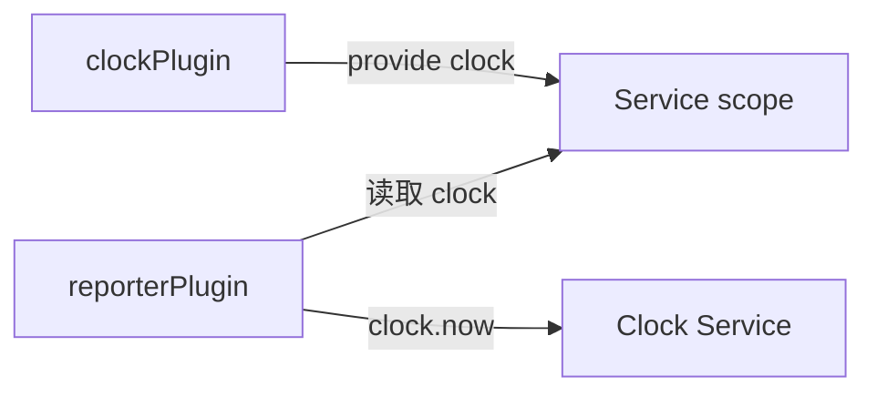
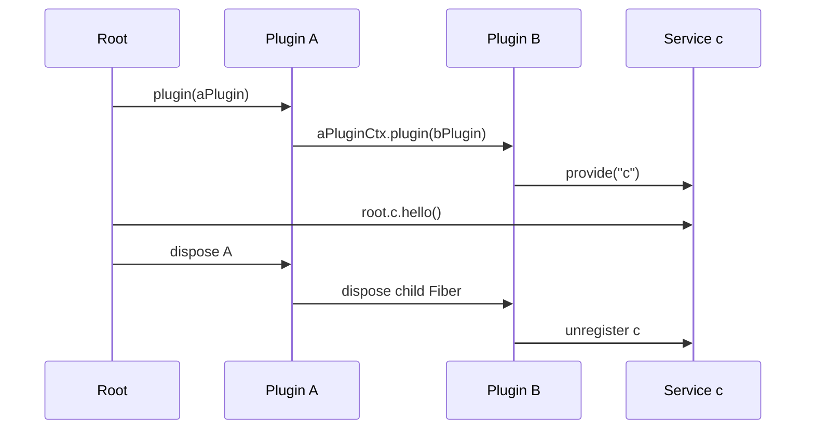
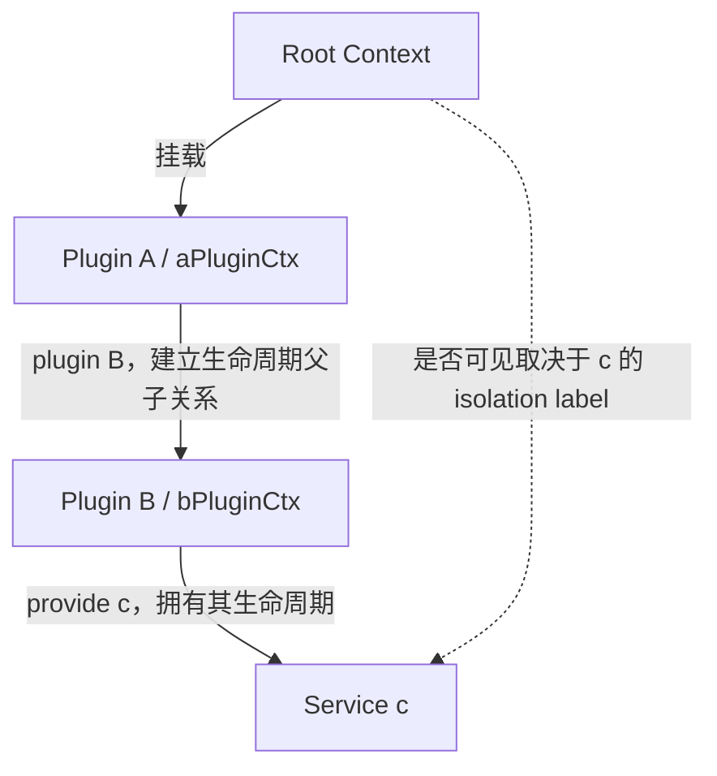

# PluginContext、跨插件 Service 与作用域隔离

本文解释以下几个容易混淆的问题：

- 插件通过 `provide()` 发布的能力，其他插件能否调用？
- A 在自己的 PluginContext 中挂载 B，B 发布的 Service，root 能否调用？
- 嵌套挂载是否等于可见性隔离？
- 如何隔离一个或一批 Service？
- 生命周期所有权与 Service 可见性有什么区别？

> 本文主要描述真实 Cordis 的 `ctx.plugin()`、`ctx.provide()` 和 `ctx.isolate()` 语义。第 2 课的 `harness-lab/src/context.ts` 是教学用最小实现，目前只有 `HarnessContext.mount()`，还没有嵌套 `PluginContext.mount/plugin()` 和 Service isolation。

## 1. 先区分两个 Context

### Root Context

Root Context 是整个应用的根运行环境，负责连接插件、服务和事件系统。

### PluginContext

每次挂载插件时，Cordis 都会为该插件创建一个带独立 Fiber 生命周期的 Context。它记录当前插件拥有的 Effect、Service 和子插件。

```text
Root Context
├── Plugin A Fiber
│   └── aPluginCtx
└── Plugin B Fiber
    └── bPluginCtx
```

最重要的区别是：

```text
Root Context   管理整个运行环境
PluginContext  管理某个插件的资源所有权和生命周期
```

PluginContext 隔离生命周期，但不会自动隔离 Service 的可见性。

## 2. `provide()` 发布的能力可以跨插件调用

一个插件发布 `clock`：

```ts
const clockPlugin = {
  name: 'clock',
  provide: 'clock',

  apply(ctx: Context) {
    ctx.provide('clock', {
      now: () => new Date().toISOString(),
    })
  },
}
```

另一个插件消费它：

```ts
const reporterPlugin = {
  name: 'reporter',
  inject: ['clock'],

  apply(ctx: Context) {
    console.log(ctx.clock.now())
  },
}
```

调用关系：



消费者可以使用 Service，但 Service 的所有权仍属于提供者。提供者卸载时，Cordis 会撤销该 Service。

## 3. 嵌套挂载不等于 Service 隔离

考虑下面的嵌套关系：

```text
root
└── pluginA
    └── aPluginCtx.plugin(pluginB)
        └── bPluginCtx.provide("c")
```

对应代码：

```ts
import { Context } from '@deepseek-ai/cordis'

interface CService {
  hello(): string
}

declare module '@deepseek-ai/cordis' {
  interface Context {
    c: CService
  }
}

const bPlugin = {
  name: 'plugin-b',
  provide: 'c',

  apply(bPluginCtx: Context) {
    bPluginCtx.provide('c', {
      hello: () => 'hello from plugin B',
    })
  },
}

const aPlugin = {
  name: 'plugin-a',

  apply(aPluginCtx: Context) {
    aPluginCtx.plugin(bPlugin)
  },
}

const root = new Context()
await root.plugin(aPlugin)

console.log(root.c.hello())
// hello from plugin B
```

默认情况下，root 可以调用 `c`。

原因是 `aPluginCtx.plugin(bPlugin)` 只建立生命周期父子关系，没有改变 `c` 的 isolation label：

```text
生命周期树

root
└── A
    └── B
        └── owns c


Service 可见性

默认 c scope
└── c
    ├── root 可见
    ├── A 可见
    └── B 可见
```

因此必须分别回答两个问题：

| 问题 | 由什么决定？ |
|---|---|
| A 卸载时 B 是否一起卸载？ | `aPluginCtx.plugin(bPlugin)` 建立的 Fiber 父子关系 |
| root 能否读取 B 提供的 `c`？ | root 与 B 对 `c` 是否使用同一个 isolation label |

## 4. 嵌套挂载的生命周期效果

B 在 A 的 PluginContext 下挂载，因此 B 是 A 的子 Fiber：



A 卸载后，B 及其 `c` 会一起消失：

```text
卸载 A
  ↓
卸载子 Fiber B
  ↓
执行 B 的 Effects
  ↓
撤销 B provide 的 c
```

## 5. 使用 `isolate()` 隔离 Service

如果只希望 A 的子树看到 B 提供的 `c`，需要显式隔离 `c`：

```ts
const aPlugin = {
  name: 'plugin-a',

  apply(aPluginCtx: Context) {
    const isolatedCtx = aPluginCtx.isolate('c')

    isolatedCtx.plugin(bPlugin)

    isolatedCtx.plugin({
      name: 'c-consumer',
      inject: ['c'],

      apply(consumerCtx: Context) {
        console.log(consumerCtx.c.hello())
      },
    })
  },
}
```

此时的可见范围：

```text
root scope
└── c：不存在

A isolated c scope
├── B
│   └── provide c
└── consumer
    └── 可以读取 c
```

结果：

```ts
consumerCtx.c // 可以访问
isolatedCtx.c // 可以访问
root.c        // 不能访问隔离区中的 c
```

判断规则：

```text
aPluginCtx.plugin(bPlugin)
  + bPluginCtx.provide("c")
  + 没有 isolate("c")
  = root 默认可以访问 c

aPluginCtx.isolate("c").plugin(bPlugin)
  + bPluginCtx.provide("c")
  = root 不能访问子作用域中的 c
```

## 6. root 和子作用域可以分别提供同名 Service

隔离后，root 和 A 的子树可以分别拥有一个名为 `c` 的实现：

```ts
const root = new Context()

root.provide('c', {
  hello: () => 'root c',
})

const isolatedCtx = root.isolate('c')

isolatedCtx.plugin({
  name: 'child-c-provider',
  provide: 'c',

  apply(ctx: Context) {
    ctx.provide('c', {
      hello: () => 'child c',
    })
  },
})
```

调用结果：

```ts
root.c.hello()        // root c
isolatedCtx.c.hello() // child c
```

这不是覆盖关系，而是两个独立作用域：

```text
root c scope
└── c → root c

child c scope
└── c → child c
```

## 7. 如何批量隔离多个 Service

Cordis 的原生 `isolate()` 一次接收一个 Service 名称：

```ts
ctx.isolate('database')
```

不支持直接传数组：

```ts
ctx.isolate(['database', 'cache']) // 不支持
```

可以连续调用：

```ts
const workspaceCtx = root
  .isolate('database')
  .isolate('cache')
  .isolate('filesystem')
```

也可以封装辅助函数：

```ts
function isolateServices(
  context: Context,
  serviceNames: readonly string[],
): Context {
  return serviceNames.reduce(
    (currentContext, serviceName) =>
      currentContext.isolate(serviceName),
    context,
  )
}
```

使用：

```ts
const WORKSPACE_SERVICES = [
  'database',
  'cache',
  'filesystem',
  'sessionStore',
] as const

const workspaceCtx = isolateServices(
  root,
  WORKSPACE_SERVICES,
)

workspaceCtx.plugin(workspaceBundle)
```

## 8. 多个 Context 如何加入同一个隔离作用域

下面两个调用会产生不同的 label：

```ts
const contextA = root.isolate('database')
const contextB = root.isolate('database')
```

因此它们不是同一个隔离区。

如果多个 Context 需要共享同一个隔离 Service，需要复用同一个 `Symbol`：

```ts
const databaseScope = Symbol('workspace.database')

const contextA = root.isolate('database', databaseScope)
const contextB = root.isolate('database', databaseScope)
```

批量共享时，可以为每个 Service 保存固定 label：

```ts
const workspaceLabels = {
  database: Symbol('workspace.database'),
  cache: Symbol('workspace.cache'),
  filesystem: Symbol('workspace.filesystem'),
}

function joinServiceScope(
  context: Context,
  labels: Readonly<Record<string, symbol>>,
): Context {
  return Object.entries(labels).reduce(
    (currentContext, [serviceName, label]) =>
      currentContext.isolate(serviceName, label),
    context,
  )
}

const contextA = joinServiceScope(root, workspaceLabels)
const contextB = joinServiceScope(root, workspaceLabels)
```

此时：

```text
contextA.database scope = contextB.database scope
contextA.cache scope    = contextB.cache scope
root.database scope     ≠ 上述隔离 scope
```

## 9. 为什么不建议“隔离整个插件”

Cordis 的隔离单位是 Service，而不是 Plugin。

一个插件可能同时：

```text
提供 database
消费 logger
消费 events
消费 telemetry
```

实际需求通常是：

```text
database  按 workspace 隔离
cache     按 workspace 隔离
logger    使用全局实现
events    使用全局事件系统
telemetry 使用全局后端
```

如果隐式隔离插件涉及的所有能力，可能连 `logger`、`events` 等基础服务也隔离掉。因此更推荐维护明确的 Service 白名单：

```ts
const WORKSPACE_SCOPED_SERVICES = [
  'database',
  'cache',
  'filesystem',
  'sessionStore',
] as const
```

## 10. 最终心智模型



请记住三句话：

1. `provide()` 负责发布跨插件可调用的能力。
2. `aPluginCtx.plugin(bPlugin)` 建立生命周期父子关系，不自动隔离 Service。
3. `isolate('c')` 才决定 `c` 的作用域；批量隔离可以通过连续调用或辅助函数实现。

## 11. 常见问题 QA

### Q1：B 提供的 `c` 为什么能被 root 看见？B 明明是 A 的子插件

因为插件树和 Service scope 是两套不同结构：

```text
插件树决定：谁跟随谁卸载
Service scope 决定：谁能解析到哪个实现
```

`aPluginCtx.plugin(bPlugin)` 只让 B 成为 A 的子 Fiber。只要没有对 `c` 调用 `isolate()`，root、A 和 B 对 `c` 使用的就是同一个 isolation label，因此都能解析到 B 提供的实现。

### Q2：root 能看到 `c`，是否意味着 root 拥有 `c`？

不是。

```text
可见者：root、A、B
所有者：B Fiber
```

B 的 Fiber 负责登记和撤销 `c`。A 被卸载时会先卸载子 Fiber B，随后 B 提供的 `c` 才会消失。

### Q3：A 可以在挂载 B 后立即调用 `aPluginCtx.c` 吗？

应等待 B 完成挂载，并且 A 必须正确声明依赖或将消费逻辑放到另一个注入 `c` 的子插件里。

推荐写法：

```ts
await aPluginCtx.plugin(bPlugin)

await aPluginCtx.plugin({
  name: 'c-consumer',
  inject: ['c'],

  apply(ctx: Context) {
    console.log(ctx.c.hello())
  },
})
```

不要依赖“异步加载应该已经结束”的时间猜测。

### Q4：`inject: ['c']` 与 `ctx.get('c')` 有什么区别？

`inject` 是插件对依赖关系的正式声明。Cordis 可以据此控制插件的激活、停用和重新激活：

```text
c 可用   → 依赖 c 的插件激活
c 消失   → 依赖 c 的插件卸载或进入非激活状态
c 恢复   → 依赖插件重新检查并激活
```

直接读取或通过 reflect 获取更适合诊断、动态能力探测等场景，不应代替正常插件的依赖声明。

### Q5：root 先提供了 `c`，B 又在默认 scope 提供 `c`，会发生什么？

同一个 scope 中不能同时注册两个同名 Service，B 的注册会失败：

```text
root default c scope
├── root 已提供 c
└── B 再提供 c → 冲突
```

如果确实需要两个实现，应先为其中一个子树隔离 `c`：

```ts
const childCtx = aPluginCtx.isolate('c')
childCtx.plugin(bPlugin)
```

### Q6：隔离以后，子 Context 找不到自己的 `c`，会回退到 root 的 `c` 吗？

不会。

`isolate('c')` 的含义不是“优先读取子实现，否则读取父实现”，而是把 `c` 切换到另一个明确的 scope label：

```text
root.c label  = root-label
child.c label = child-label
```

子 scope 没有提供 `c` 时，读取会失败，不能越过隔离边界回退到 root 的实现。

### Q7：为什么连续两次 `root.isolate('c')` 得到的 Context 不能互相看到 `c`？

因为不传 label 时，每次调用都会创建新的 `Symbol('c')`：

```ts
const left = root.isolate('c')
const right = root.isolate('c')

// left 与 right 的 c label 不同
```

需要共享时必须显式复用 label：

```ts
const label = Symbol('shared.c')

const left = root.isolate('c', label)
const right = root.isolate('c', label)
```

### Q8：共享同一个 label，会共享所有 Service 吗？

不会。label 是按 Service 名称配置的：

```ts
const sharedC = Symbol('shared.c')

const left = root.isolate('c', sharedC)
const right = root.isolate('c', sharedC)
```

这里只有 `c` 共享作用域。`logger`、`events`、`database` 等其他 Service 仍使用各自原来的 label。

### Q9：批量隔离是原子操作吗？

前文的 `reduce()` 辅助函数不是事务，它只是依次创建一串派生 Context：

```text
root
  → isolate database
  → isolate cache
  → isolate filesystem
```

这些调用本身只构造 Context，不注册外部资源，通常不存在需要回滚的中间副作用。但如果批量隔离之后还要挂载一组插件，插件挂载失败的回滚应由 Fiber/Effect 生命周期负责，而不是由 `isolateServices()` 负责。

### Q10：隔离 Context 会复制 Service 实例吗？

不会。`isolate()` 只改变指定 Service 的解析 label，不会复制 Service 对象：

```text
没有隔离的 Service → 继续解析原 scope 中的同一实例
被隔离的 Service   → 转到新 label，等待该 scope 的 provider
```

例如只隔离 `database`，`logger` 仍可能是全局共享的同一个实例。

### Q11：B 卸载后，调用方之前保存的 `c` 引用还能用吗？

不要假设还能用。

Cordis 会撤销 Service 注册，并通知声明依赖的 Fiber 重新检查状态；但 JavaScript 变量中已经保存的对象引用不会被语言自动删除：

```ts
const cached = ctx.c

// B 卸载后：
// ctx.c 不能再解析
// cached 仍是一个 JavaScript 引用
```

对于数据库、进程、连接池等有状态 Service，其 disposer 应把实例置为关闭状态，使迟到调用明确失败。消费者也不应该越过 Fiber 生命周期长期缓存依赖。

### Q12：A 卸载时，B 和 A 自己的 Effect 谁先清理？

原则是先收敛子生命周期和后注册资源，再清理它们依赖的父资源。具体清理由 Fiber 的 Effect 栈管理，采用逆注册顺序。

推荐的依赖方向是：

```text
A 创建基础资源
  ↓
A 挂载依赖这些资源的 B

卸载时：
B 先停止
  ↓
A 再释放基础资源
```

这与普通函数中的 `try/finally`、资源栈和结构化并发遵循相同原则。

### Q13：Event 会跟着 `isolate('c')` 一起隔离吗？

不会。`isolate('c')` 只改变名为 `c` 的 Service 的作用域。

```text
c       → 新 scope
events  → 原 scope
logger  → 原 scope
```

如果事件系统本身也是一个可隔离 Service，并且确实需要独立事件域，必须单独隔离对应的 Service 名称。不要把 Service isolation 误解为整个 Context 的完全沙箱。

### Q14：能否通过隔离实现每个 workspace 一套数据库和缓存？

可以，这正是典型用法：

```ts
const workspaceLabels = {
  database: Symbol('workspace-42.database'),
  cache: Symbol('workspace-42.cache'),
  sessionStore: Symbol('workspace-42.sessionStore'),
}

const workspaceCtx = joinServiceScope(
  root,
  workspaceLabels,
)

workspaceCtx.plugin(workspaceBundle)
```

同时保留全局能力：

```text
全局共享：logger、telemetry、模型目录
工作区隔离：database、cache、sessionStore、filesystem
```

### Q15：第 2 课的最小 `HarnessContext` 能直接运行这些例子吗？

不能全部运行。

当前最小实现支持：

```text
root.mount(plugin)
pluginContext.provide/get/on/effect
全局 Service Map
插件级逆序清理
```

它暂不支持：

```text
pluginContext.mount/plugin(childPlugin)
Fiber 父子树
ctx.isolate(serviceName, label)
inject 驱动的自动激活与失活
```

因此本文中的嵌套挂载和隔离示例属于真实 Cordis 语义。如果要把它们纳入第 2 课实验，需要先扩展教学内核，而不能假装当前 `PluginContext` 已经具备这些 API。
