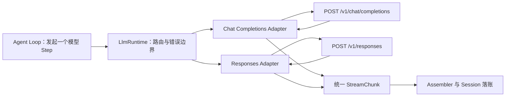

# Turn、Step、Stream 与 Tool 生命周期

本文说明 DeepSeek Harness 风格 Agent 中 `Turn`、`Step`、模型流、Session Event 和工具调用之间的关系。

外部模型接口见 [第 10 节：Chat Completions API 与 Responses API](#model-api-protocols)，包含请求报文、工具结果回传、SSE 映射和上下文延续。这里的模型 API 与第 15 课的 Agent Server API 是两个边界。

## 1. 核心概念

### Session

Session 是 append-only 的持久化事实日志。运行期间发生的重要事实都追加成 `SessionEvent`，恢复时通过重放日志重建状态。

典型事件包括：

```text
turn/start
user/message
step/start
assistant/chunk
assistant/message
tool/call
tool/result
step/end
turn/end
```

### Turn

Turn 表示从一次用户输入开始，到 Agent 给出最终答案、失败或被取消为止的一次完整任务。

一个 Turn 可以包含多个 Step：

```text
用户输入
  ↓
Turn
  ├─ Step 1：模型决定调用工具，并完成工具执行
  ├─ Step 2：模型读取工具结果，可能继续调用工具
  └─ Step N：模型给出最终答案
```

### Step

本文采用下面的定义：

> Step 是一次模型决策，以及完成该决策要求的全部工具调用。

因此，工具结果属于发起工具调用的相同 Step：

```text
step/start(step=1)
  LLM stream
  assistant/message（含 tool-call）
  tool/call
  tool/result
step/end(step=1)
```

但是，这个 `tool/result` 会在下一个 Step 中被模型消费：

```text
step/start(step=2)
  构造模型请求：
    - user/message
    - Step 1 assistant/message
    - Step 1 tool/result
  调用 LLM
```

换句话说：

> `tool/result` 归属于产生它的 Step N，但进入 Step N+1 的模型上下文。

### StreamChunk

`StreamChunk` 是一次模型请求返回的实时增量，不代表工具执行事件。

常见变体：

```text
block-start
reasoning-delta
text-delta
tool-call-delta
block-end
usage
finish
```

每条 Chunk 都可以被记录为一条独立的：

```text
SessionEvent<assistant/chunk>
```

## 2. Content Block 生命周期

模型响应由一个或多个 Content Block 组成。每个 Block 都使用相同的生命周期：

```text
block-start
  delta × 0..N
block-end
```

不同 Block 使用不同的 delta：

| Block 类型 | 增量类型 | 拼接内容 |
|---|---|---|
| `reasoning` | `reasoning-delta` | 推理文本 |
| `text` | `text-delta` | 用户可见回答 |
| `tool-call` | `tool-call-delta` | 工具名和原始 JSON 参数 |

一个具体的 `block-start` 只会进入与其 `blockType` 对应的 delta，不会同时进入三种 delta。

### 多条 reasoning-delta

`reasoning-delta` 可以有任意多条：

```text
assistant/chunk: block-start(index=0, blockType=reasoning)
assistant/chunk: reasoning-delta(index=0, text="先检查")
assistant/chunk: reasoning-delta(index=0, text="用户提供的")
assistant/chunk: reasoning-delta(index=0, text="参数是否完整")
assistant/chunk: block-end(
  index=0,
  block=reasoning("先检查用户提供的参数是否完整")
)
```

Assembler 根据 `index` 找到对应 Block，并按到达顺序拼接文本：

```ts
// 将同一个 reasoning block 的增量依次追加。
reasoningText += chunk.text
```

最终形成完整内容块：

```json
{
  "type": "reasoning",
  "text": "先检查用户提供的参数是否完整"
}
```

delta 的边界由模型服务和网络缓冲决定，可能是单个字符、几个 token 或较长文本。业务逻辑不能依赖 delta 数量，也不能把一条 delta 当作完整句子。

### 为什么没有 reasoning-end

协议使用统一的 `block-end`，而不是分别定义：

```text
reasoning-end
text-end
tool-call-end
```

这使所有内容块共享一套状态机。`block-end` 携带已经组装完成的完整 Block。

如果 Provider 不提供显式 Block 结束标记，Provider Adapter 应在以下时机合成 `block-end`：

- 下一个 Block 开始时；
- 收到 `finish` 时；
- 流异常终止时，按照失败策略关闭或丢弃未完成 Block。

## 3. 为什么 tool-call 使用 delta

模型生成的工具参数通常也是流式到达的：

```text
tool-call-delta: id="call-1", name="read_file", argumentsDelta="{"
tool-call-delta: id="call-1", argumentsDelta="\"path\""
tool-call-delta: id="call-1", argumentsDelta=":"
tool-call-delta: id="call-1", argumentsDelta="\"README.md\""
tool-call-delta: id="call-1", argumentsDelta="}"
```

Assembler 拼接原始参数：

```json
{"path":"README.md"}
```

在 `block-end` 时得到完整工具调用：

```json
{
  "type": "tool-call",
  "id": "call-1",
  "name": "read_file",
  "arguments": "{\"path\":\"README.md\"}"
}
```

不能在收到第一条 delta 后立即执行工具，因为此时：

- JSON 可能尚未闭合；
- 参数还未完成；
- Schema 还不能可靠校验；
- 权限和 Sandbox 判断可能依赖完整参数。

正确顺序是：

```text
拼接 tool-call-delta
  ↓
block-end：得到完整 ToolCallBlock
  ↓
解析 arguments JSON
  ↓
Schema 校验
  ↓
权限审批与 Sandbox 判断
  ↓
tool/call
  ↓
执行工具
  ↓
tool/result
```

## 4. 为什么 tool/call 和 tool/result 之间没有 StreamChunk

模型产生完整 `tool-call` 后，这一次模型请求已经结束：

```text
LLM streaming
  tool-call-delta × N
  block-end(tool-call)
  finish(tool-calls)
LLM streaming 结束

Harness 执行工具
  tool/call
  运行 read、write、shell 等工具
  tool/result
```

工具执行期间没有模型响应，因此不会产生 `assistant/chunk`。

如果工具需要报告实时进度，应使用独立的工具进度事件，例如：

```text
tool/call
tool/progress
tool/progress
tool/result
```

工具 stdout 或进度不能伪装成 `StreamChunk`，否则无法区分模型输出和工具输出。

## 5. assistant/chunk 与 assistant/message

`assistant/chunk` 是实时增量；`assistant/message` 是所有 Chunk 组装出的最终模型消息。

例如：

```text
assistant/chunk: block-start(reasoning)
assistant/chunk: reasoning-delta("先检查")
assistant/chunk: block-end(reasoning)

assistant/chunk: block-start(text)
assistant/chunk: text-delta("结果是")
assistant/chunk: text-delta("...")
assistant/chunk: block-end(text)

assistant/chunk: usage(...)
assistant/chunk: finish(stop)
```

最终组装为：

```json
{
  "type": "assistant/message",
  "content": [
    { "type": "reasoning", "text": "先检查" },
    { "type": "text", "text": "结果是..." }
  ]
}
```

`assistant/message` 不是又一次模型输出，而是当前模型响应的规范化最终结果。它适合用于：

- 构造下一次模型请求；
- Session 恢复；
- 上下文压缩；
- 对完整工具调用做校验和执行。

## 6. 完整示例：读取两个文件并总结

用户输入：

```text
检查 package.json 和 tsconfig.json，然后告诉我项目的运行环境。
```

### Turn 开始

```text
turn/start { turn: 1 }

user/message {
  role: "user",
  content: [
    { type: "text", text: "检查 package.json 和 tsconfig.json，然后告诉我项目的运行环境。" }
  ]
}
```

### Step 1：模型决定读取两个文件

```text
step/start { turn: 1, step: 1 }

assistant/chunk: block-start(index=0, blockType=reasoning)
assistant/chunk: reasoning-delta(index=0, text="用户要求检查")
assistant/chunk: reasoning-delta(index=0, text=" package.json")
assistant/chunk: reasoning-delta(index=0, text=" 和 tsconfig.json。")
assistant/chunk: reasoning-delta(index=0, text="需要分别读取")
assistant/chunk: reasoning-delta(index=0, text="这两个文件，")
assistant/chunk: reasoning-delta(index=0, text="然后综合判断运行环境。")
assistant/chunk: block-end(
  index=0,
  block=reasoning("用户要求检查 package.json 和 tsconfig.json。需要分别读取这两个文件，然后综合判断运行环境。")
)

assistant/chunk: block-start(index=1, blockType=tool-call)
assistant/chunk: tool-call-delta(index=1, id="call-package", name="read_file", argumentsDelta="{")
assistant/chunk: tool-call-delta(index=1, id="call-package", argumentsDelta="\"path\"")
assistant/chunk: tool-call-delta(index=1, id="call-package", argumentsDelta=":")
assistant/chunk: tool-call-delta(index=1, id="call-package", argumentsDelta="\"package.json\"")
assistant/chunk: tool-call-delta(index=1, id="call-package", argumentsDelta="}")
assistant/chunk: block-end(
  index=1,
  block=tool-call(
    id="call-package",
    name="read_file",
    arguments="{\"path\":\"package.json\"}"
  )
)

assistant/chunk: block-start(index=2, blockType=tool-call)
assistant/chunk: tool-call-delta(index=2, id="call-tsconfig", name="read_file", argumentsDelta="{\"")
assistant/chunk: tool-call-delta(index=2, id="call-tsconfig", argumentsDelta="path")
assistant/chunk: tool-call-delta(index=2, id="call-tsconfig", argumentsDelta="\":\"")
assistant/chunk: tool-call-delta(index=2, id="call-tsconfig", argumentsDelta="tsconfig.json")
assistant/chunk: tool-call-delta(index=2, id="call-tsconfig", argumentsDelta="\"}")
assistant/chunk: block-end(
  index=2,
  block=tool-call(
    id="call-tsconfig",
    name="read_file",
    arguments="{\"path\":\"tsconfig.json\"}"
  )
)

assistant/chunk: usage {
  inputTokens: 820,
  outputTokens: 96,
  cacheReadTokens: 500,
  reasoningTokens: 43
}

assistant/chunk: finish {
  reason: { kind: "tool-calls" }
}
```

Harness 将 Chunk 组装成完整消息：

```json
{
  "type": "assistant/message",
  "turn": 1,
  "step": 1,
  "content": [
    {
      "type": "reasoning",
      "text": "用户要求检查 package.json 和 tsconfig.json。需要分别读取这两个文件，然后综合判断运行环境。"
    },
    {
      "type": "tool-call",
      "id": "call-package",
      "name": "read_file",
      "arguments": "{\"path\":\"package.json\"}"
    },
    {
      "type": "tool-call",
      "id": "call-tsconfig",
      "name": "read_file",
      "arguments": "{\"path\":\"tsconfig.json\"}"
    }
  ]
}
```

随后执行工具。工具执行阶段没有模型 StreamChunk：

```text
tool/call {
  turn: 1,
  step: 1,
  callId: "call-package",
  name: "read_file",
  arguments: "{\"path\":\"package.json\"}"
}

tool/call {
  turn: 1,
  step: 1,
  callId: "call-tsconfig",
  name: "read_file",
  arguments: "{\"path\":\"tsconfig.json\"}"
}

tool/result {
  turn: 1,
  step: 1,
  callId: "call-package",
  content: "{\"type\":\"module\",\"engines\":{\"node\":\">=24.0.0\"}}"
}

tool/result {
  turn: 1,
  step: 1,
  callId: "call-tsconfig",
  content: "{\"compilerOptions\":{\"target\":\"ES2024\",\"module\":\"NodeNext\"}}"
}

step/end { turn: 1, step: 1 }
```

两个只读工具可以并发执行，但 Session 可以按原始工具调用顺序提交结果，以得到稳定、可重放的日志顺序。

### Step 2：模型消费工具结果并回答

Step 2 的模型请求包含：

```text
messages = [
  user/message,
  Step 1 assistant/message（包含两个 tool-call），
  Step 1 tool/result(call-package)，
  Step 1 tool/result(call-tsconfig)
]
```

第二次流式响应：

```text
step/start { turn: 1, step: 2 }

assistant/chunk: block-start(index=0, blockType=reasoning)
assistant/chunk: reasoning-delta(index=0, text="package.json 声明了")
assistant/chunk: reasoning-delta(index=0, text=" Node.js 最低版本为 24，")
assistant/chunk: reasoning-delta(index=0, text="并且项目使用 ESM。")
assistant/chunk: reasoning-delta(index=0, text="tsconfig 又声明了")
assistant/chunk: reasoning-delta(index=0, text=" ES2024 和 NodeNext，")
assistant/chunk: reasoning-delta(index=0, text="因此它是现代 Node.js TypeScript 项目。")
assistant/chunk: block-end(
  index=0,
  block=reasoning("package.json 声明了 Node.js 最低版本为 24，并且项目使用 ESM。tsconfig 又声明了 ES2024 和 NodeNext，因此它是现代 Node.js TypeScript 项目。")
)

assistant/chunk: block-start(index=1, blockType=text)
assistant/chunk: text-delta(index=1, text="这是一个")
assistant/chunk: text-delta(index=1, text="基于 Node.js 24+")
assistant/chunk: text-delta(index=1, text=" 的 TypeScript 项目。")
assistant/chunk: text-delta(index=1, text="项目采用 ESM，")
assistant/chunk: text-delta(index=1, text="编译目标是 ES2024，")
assistant/chunk: text-delta(index=1, text="模块解析方式是 NodeNext。")
assistant/chunk: block-end(
  index=1,
  block=text("这是一个基于 Node.js 24+ 的 TypeScript 项目。项目采用 ESM，编译目标是 ES2024，模块解析方式是 NodeNext。")
)

assistant/chunk: usage {
  inputTokens: 1260,
  outputTokens: 118,
  cacheReadTokens: 700,
  reasoningTokens: 52
}

assistant/chunk: finish {
  reason: { kind: "stop" }
}

assistant/message {
  turn: 1,
  step: 2,
  content: [
    { type: "reasoning", text: "package.json 声明了……" },
    { type: "text", text: "这是一个基于 Node.js 24+ 的 TypeScript 项目……" }
  ]
}

step/end { turn: 1, step: 2 }

turn/end {
  turn: 1,
  reason: { kind: "completed" }
}
```

## 7. 修正版架构与时序图


## 8. 完整时序摘要

```text
turn/start
user/message

├─ step/start #1
│  ├─ reasoning block
│  │  ├─ block-start
│  │  ├─ reasoning-delta × N
│  │  └─ block-end
│  ├─ tool-call block #1
│  │  ├─ block-start
│  │  ├─ tool-call-delta × N
│  │  └─ block-end
│  ├─ tool-call block #2
│  │  ├─ block-start
│  │  ├─ tool-call-delta × N
│  │  └─ block-end
│  ├─ usage（可选）
│  ├─ finish(tool-calls)
│  ├─ assistant/message
│  ├─ tool/call × N
│  ├─ tool/result × N
│  └─ step/end #1
│
├─ step/start #2
│  ├─ 构造请求，包含 Step 1 的 tool/result
│  ├─ reasoning block
│  │  ├─ block-start
│  │  ├─ reasoning-delta × N
│  │  └─ block-end
│  ├─ text block
│  │  ├─ block-start
│  │  ├─ text-delta × N
│  │  └─ block-end
│  ├─ usage（可选）
│  ├─ finish(stop)
│  ├─ assistant/message
│  └─ step/end #2
│
└─ turn/end(completed)
```

## 9. 关键不变量

实现和调试时应维持以下约束：

1. 一个 Turn 可以包含多个 Step。
2. 一个 Step 只有一次模型请求，但可以执行该请求产生的多个工具调用。
3. 每个 `assistant/chunk` 都属于明确的 `(turn, step)`。
4. 每个 Content Block 都遵循 `block-start → delta × N → block-end`。
5. `tool-call-delta` 只能组装参数，不能直接触发工具执行。
6. 工具执行开始前必须获得完整 ToolCallBlock，并完成解析、校验和权限判断。
7. `tool/call` 与对应 `tool/result` 归属于相同 Step。
8. `tool-call` 与对应 `tool/result` 是不可拆分的因果组。
9. `step/end` 时不应存在未完成的工具调用。
10. Step N 的 `tool/result` 由 Step N+1 的模型请求消费。
11. `assistant/chunk` 是流式事实，`assistant/message` 是其最终组装结果。
12. `usage` 可能缺失；实现不能假设每次请求一定报告 usage。
13. 正常模型流应有一个 `finish`；连接异常时由 Adapter 或 Agent 转换为 `error` 或 `aborted`。
14. `max-tokens` 只说明当前响应到达上限，是否继续由 Agent 策略决定。

<a id="model-api-protocols"></a>

## 10. Chat Completions API 与 Responses API

<a id="model-api-worked-example"></a>

### 10.0 先看具体例子：读取 package.json，判断项目的模块类型

用户发送：“帮我读取 package.json，告诉我这个项目使用 ESM 还是 CommonJS。”工作区的文件内容固定为 `{"name":"demo","type":"module"}`。期望最后回答：“这个项目使用 ESM，因为 package.json 中的 type 是 module。”

我们把整次任务固定成：第一次请求模型提出读文件 → Harness 真正读文件 → 第二次请求模型解释结果。下面是手写的教学报文，方便逐条对照；不是线上抓包。`your-model-id` 要换成所选接口支持的模型。

#### A. Chat Completions：调用放在 assistant 消息里，结果放在 tool 消息里

**第 1 步：Harness 向 `/v1/chat/completions` 发送下面的请求。** tools 只是告诉模型“有这个工具可以申请”，此时还没读文件。

```json
{
  "model": "your-model-id",
  "stream": false,
  "messages": [{ "role": "user", "content": "帮我读取 package.json，告诉我这个项目使用 ESM 还是 CommonJS。" }],
  "tools": [{
    "type": "function",
    "function": {
      "name": "read_file",
      "description": "读取工作区中的文本文件",
      "strict": true,
      "parameters": {
        "type": "object",
        "properties": { "path": { "type": "string" } },
        "required": ["path"],
        "additionalProperties": false
      }
    }
  }]
}
```

**第 2 步：模型返回“我要读 package.json”。** 响应的关键字段如下。`arguments` 是 JSON 字符串，模型此时没有读到文件内容。

```json
{
  "choices": [{
    "index": 0,
    "message": {
      "role": "assistant",
      "content": null,
      "tool_calls": [{
        "id": "call_read_1",
        "type": "function",
        "function": { "name": "read_file", "arguments": "{\"path\":\"package.json\"}" }
      }]
    },
    "finish_reason": "tool_calls"
  }]
}
```

**第 3 步：Harness 校验路径和权限，然后本地执行读文件。** 工具实际返回字符串 `{"name":"demo","type":"module"}`。这一步发生在自己的程序里，不是再调用一次模型 API。

**第 4 步：Harness 再向同一个端点发送请求。** 这次把“用户问题、模型申请、实际结果”一起发回去。为突出这三条消息，本例第二次请求不再提供 tools，让模型直接解释已有结果。

```json
{
  "model": "your-model-id",
  "stream": false,
  "messages": [
    { "role": "user", "content": "帮我读取 package.json，告诉我这个项目使用 ESM 还是 CommonJS。" },
    {
      "role": "assistant",
      "content": null,
      "tool_calls": [{
        "id": "call_read_1",
        "type": "function",
        "function": { "name": "read_file", "arguments": "{\"path\":\"package.json\"}" }
      }]
    },
    { "role": "tool", "tool_call_id": "call_read_1", "content": "{\"name\":\"demo\",\"type\":\"module\"}" }
  ]
}
```

**第 5 步：模型返回最终解释。** 读取 `choices[0].message.content`，这次 `finish_reason` 是 stop。整次任务用了两次模型请求。

```json
{
  "choices": [{
    "index": 0,
    "message": { "role": "assistant", "content": "这个项目使用 ESM，因为 package.json 中的 type 是 module。" },
    "finish_reason": "stop"
  }]
}
```

#### B. Responses：调用和结果各自是一个 Item

**第 1 步：Harness 向 `/v1/responses` 发送下面的请求。** 同一个工具，函数定义少了一层 function，用户问题改放 input。这里选择手动传历史，设置 store 为 false。

```json
{
  "model": "your-model-id",
  "stream": false,
  "store": false,
  "input": [{ "role": "user", "content": "帮我读取 package.json，告诉我这个项目使用 ESM 还是 CommonJS。" }],
  "tools": [{
    "type": "function",
    "name": "read_file",
    "description": "读取工作区中的文本文件",
    "strict": true,
    "parameters": {
      "type": "object",
      "properties": { "path": { "type": "string" } },
      "required": ["path"],
      "additionalProperties": false
    }
  }]
}
```

**第 2 步：模型仍然只提出读文件申请。** 这次申请是 output 中独立的 function_call Item，响应关键字段如下。本例固定输出只有这一项；实际返回若还有 reasoning 等可回传 Items，下一次也要保留。

```json
{
  "id": "resp_read_1",
  "status": "completed",
  "output": [{
    "id": "fc_read_1",
    "type": "function_call",
    "call_id": "call_read_1",
    "name": "read_file",
    "arguments": "{\"path\":\"package.json\"}"
  }]
}
```

**第 3 步：Harness 执行同一次本地读文件，拿到同一份结果。** 注意上面的 completed 只说明“这次响应已经生成完”，此时用户的问题还没回答。

**第 4 步：Harness 再向 `/v1/responses` 发请求。** 手动历史包含原问题、调用 Item 和结果 Item。本例同样不再提供 tools，让模型解释结果。结果中的 call_id 必须是 `call_read_1`，不是 `fc_read_1`，也不是 `resp_read_1`。

```json
{
  "model": "your-model-id",
  "stream": false,
  "store": false,
  "input": [
    { "role": "user", "content": "帮我读取 package.json，告诉我这个项目使用 ESM 还是 CommonJS。" },
    {
      "id": "fc_read_1",
      "type": "function_call",
      "call_id": "call_read_1",
      "name": "read_file",
      "arguments": "{\"path\":\"package.json\"}"
    },
    { "type": "function_call_output", "call_id": "call_read_1", "output": "{\"name\":\"demo\",\"type\":\"module\"}" }
  ]
}
```

**第 5 步：模型返回最终解释。** 这次 output 中是 message Item，正文在 output_text 内容块里。也用了两次模型请求。

```json
{
  "id": "resp_answer_2",
  "status": "completed",
  "output": [{
    "id": "msg_answer_2",
    "type": "message",
    "role": "assistant",
    "status": "completed",
    "content": [{
      "type": "output_text",
      "text": "这个项目使用 ESM，因为 package.json 中的 type 是 module。",
      "annotations": []
    }]
  }]
}
```

两套报文都经过同一个任务过程：第一次模型请求产生工具申请，自己的程序读文件，第二次模型请求产生回答。[请求与工具结果格式依据](https://developers.openai.com/api/docs/guides/function-calling)

#### C. 改成流式后，究竟在拼什么？

把第一次请求的 stream 改成 true。假设模型把函数参数拆成下面两段，适配器解析 SSE 后读到的关键字段如下。这里省略了块创建、结束等其他事件，只对照两段参数。

```text
Chat 第 1 段：choices[0].delta.tool_calls[0]
  {"index":0,"id":"call_read_1","function":{"name":"read_file","arguments":"{\"path\":"}}
Chat 第 2 段：choices[0].delta.tool_calls[0]
  {"index":0,"function":{"arguments":"\"package.json\"}"}}

Responses 第 1 段：response.function_call_arguments.delta
  {"item_id":"fc_read_1","output_index":0,"delta":"{\"path\":"}
Responses 第 2 段：response.function_call_arguments.delta
  {"item_id":"fc_read_1","output_index":0,"delta":"\"package.json\"}"}
```

Responses 的工具名和 call_id 由对应的 output_item.added 事件取得，不能从参数 delta 里猜。两种适配器最终都要组装出下面这个内部块，再交给工具管线：

```json
{
  "type": "tool-call",
  "id": "call_read_1",
  "name": "read_file",
  "arguments": "{\"path\":\"package.json\"}"
}
```

收到第一段时只有 `{"path":`，连 JSON 都不完整，不能开始读文件。第二段到达并确认调用完整后，才解析出 path，再校验、执行。调用名和参数流事件的具体结构见 [函数调用流式示例](https://developers.openai.com/api/docs/guides/function-calling)。

#### D. 这些具体报文落到 Turn / Step 后长什么样？

```text
Turn 1 开始：用户要求判断 ESM / CommonJS
  Step 1
    HTTP 请求 1：问题 + read_file 工具定义
    模型响应：read_file，参数 package.json，调用 ID call_read_1
    assistant/message：含上面的 tool-call 块
    tool/call：call_read_1
    tool/result：call_read_1 → {"name":"demo","type":"module"}
  Step 1 结束
  Step 2
    HTTP 请求 2：问题 + 先前调用 + 对应文件结果
    模型响应：“这个项目使用 ESM，因为 package.json 中的 type 是 module。”
    assistant/message：含最终文本
  Step 2 结束
Turn 1 完成
```

具体数一下：一个 Turn、两个 Step、两次模型 HTTP 请求、一次本地读文件。Chat 和 Responses 改变的是上面两次 HTTP 的报文形状，工具管线收到的完整调用仍是同一份。

### 10.1 两种 API 在哪一层？

这里把“chat 模式 API”理解为 **Chat Completions API**；“response api”的正式名称是 **Responses API**，路径中的 `responses` 也是复数。两者都是调用模型的外部协议。Chat Completions 也能请求工具调用，Responses 也能只生成一段文本，不能按“聊天 / Agent”把它们划成两类产品模式。



上图是两种协议的接入位置，**不表示教学项目已经实现两个适配器**。例如模型要读文件时，差异集中在如何发送工具定义、接收调用参数、回传结果；Agent 的权限判断和文件读取仍走同一条工具管线。

### 10.2 请求和响应字段对照

以下路径以 OpenAI 官方 HTTP API 为例；兼容服务的 base URL 前缀由部署决定，不能盲目重复拼接 `/v1`。两种 API 都可以在 HTTP POST 中设置 `stream: true` 接收 SSE。

| 比较项 | Chat Completions | Responses |
|---|---|---|
| 官方端点 | `POST /v1/chat/completions` | `POST /v1/responses` |
| 输入历史 | `messages` 数组 | `input` 字符串或 Item 数组 |
| 系统指令 | `messages` 中的 system/developer 消息，取决于模型支持 | 可用顶层 `instructions` |
| 输出结构 | `choices[i].message` | `output` Item 数组，区分 message、reasoning、function_call 等 |
| 读取正文 | `choices[i].message.content` | 遍历 message Item 的 `content`，取 `output_text` 内容块；SDK 提供 `response.output_text` 便捷属性 |
| 函数定义 | `tools[].function.{name, parameters, ...}` | `tools[].{name, parameters, ...}`，不再包一层 function |
| 函数调用 | assistant 消息里的 `tool_calls[]` | 独立的 `function_call` Item |
| 函数结果 | `role: "tool"` 与 `tool_call_id` | `type: "function_call_output"` 与 `call_id` |
| 文本增量 | `choices[i].delta.content` | `response.output_text.delta` 事件的 `delta` |
| 输出上限 | OpenAI 使用 `max_completion_tokens`；部分兼容接口使用 `max_tokens` | `max_output_tokens` |
| 结构化输出 | `response_format` | `text.format` |
| 用量名称 | `prompt_tokens` / `completion_tokens` | `input_tokens` / `output_tokens` |
| 历史延续 | 调用方重新发送所需 messages | 可手动回传 Items，或使用 `previous_response_id` / Conversations API |

这些字段不能靠更换 URL 自动转换。具体模型是否接受工具、采样参数和推理设置，还要按模型能力校验。[官方迁移说明](https://developers.openai.com/api/docs/guides/migrate-to-responses)

### 10.3 同一个纯文本问题，两套报文长什么样？

以下是协议示意，`your-model-id` 要换成目标接口支持的模型 ID；响应只展示理解协议所需的字段，不是实际调用记录。

Chat Completions 请求体：

```json
{
  "model": "your-model-id",
  "messages": [
    { "role": "system", "content": "用中文简短回答。" },
    { "role": "user", "content": "解释什么是 Step。" }
  ],
  "stream": false,
  "store": false
}
```

响应的关键结构：

```json
{
  "choices": [{
    "index": 0,
    "message": { "role": "assistant", "content": "Step 是一次模型决策及其工具执行。" },
    "finish_reason": "stop"
  }]
}
```

Responses 请求体：

```json
{
  "model": "your-model-id",
  "instructions": "用中文简短回答。",
  "input": [{ "role": "user", "content": "解释什么是 Step。" }],
  "stream": false,
  "store": false
}
```

响应的关键结构：

```json
{
  "id": "resp_1",
  "status": "completed",
  "output": [{
    "id": "msg_1",
    "type": "message",
    "role": "assistant",
    "status": "completed",
    "content": [{ "type": "output_text", "text": "Step 是一次模型决策及其工具执行。", "annotations": [] }]
  }]
}
```

不要固定读取 `output[0].content[0].text`：第一个 Item 可能是 reasoning 或 function_call。SDK 的 `output_text` 只方便取正文，不能替代工具调用解析或完整历史保存。[输出结构依据](https://developers.openai.com/api/docs/guides/migrate-to-responses)

### 10.4 同一次读文件，工具闭环怎么变？

设模型要执行 `read_file({"path":"package.json"})`，工具返回字符串 `{"type":"module"}`。以下对照只展开变化的字段；后续请求仍要带上 model、所需指令和 tools。

函数定义在 Chat Completions 中是：

```json
{
  "type": "function",
  "function": {
    "name": "read_file",
    "description": "读取工作区文本文件",
    "strict": true,
    "parameters": {
      "type": "object",
      "properties": { "path": { "type": "string" } },
      "required": ["path"],
      "additionalProperties": false
    }
  }
}
```

Responses 使用相同参数 Schema，但把 `name`、`description`、`strict`、`parameters` 放到 `type: "function"` 同一层。

Chat Completions 的下一请求 `messages` 包含用户问题、assistant 调用和 tool 结果：

```json
[
  { "role": "user", "content": "读取 package.json 并说明模块类型。" },
  {
    "role": "assistant",
    "content": null,
    "tool_calls": [{
      "id": "call_1",
      "type": "function",
      "function": { "name": "read_file", "arguments": "{\"path\":\"package.json\"}" }
    }]
  },
  { "role": "tool", "tool_call_id": "call_1", "content": "{\"type\":\"module\"}" }
]
```

Responses 手动管理历史时，下一请求 `input` 包含对应 Items：

```json
[
  { "role": "user", "content": "读取 package.json 并说明模块类型。" },
  {
    "type": "function_call",
    "id": "fc_1",
    "call_id": "call_1",
    "name": "read_file",
    "arguments": "{\"path\":\"package.json\"}"
  },
  { "type": "function_call_output", "call_id": "call_1", "output": "{\"type\":\"module\"}" }
]
```

`fc_1` 是 Item ID，`call_1` 才是调用与结果的关联 ID。规范化成 Harness ToolCallBlock 时，应把 `call_id` 用于工具结果配对，原生 Item ID 另存回放元数据。

上例假设模型只返回 function_call。真实推理模型还可能返回 reasoning 等 Items；手动延续时要保留本次输出中可回传的完整 Items，不能只抽出调用或把推理摘要当作原生推理状态。两种 API 都可能一次返回多个函数调用，需要逐个执行、逐个回传对应 ID 的结果。[函数调用依据](https://developers.openai.com/api/docs/guides/function-calling)

在 Harness 中，两者仍对应同一个闭环：

```text
Step 1：模型返回函数调用 → 组装完整参数 → 校验与审批 → 执行 read_file
Step 2：适配器序列化调用与结果 → 再请求模型 → 模型给出总结
```

Responses 的平台内置工具由平台执行，可能在一次 API 请求中产生多个工具相关 Item；这不意味着 Harness 也执行过对应本地工具。适配器要单独表示这类事实，不能把它们误投给本地 Tool Registry。[内置工具边界依据](https://developers.openai.com/api/docs/guides/migrate-to-responses)

### 10.5 两种 SSE 怎样翻译成 StreamChunk？

Chat Completions 通过 `choices[].delta` 携带增量。下面是简化文本流，usage 帧可在 `finish_reason` 之后到达：

```text
data: {"choices":[{"index":0,"delta":{"content":"你好"},"finish_reason":null}]}

data: {"choices":[{"index":0,"delta":{},"finish_reason":"stop"}]}

data: {"choices":[],"usage":{"prompt_tokens":10,"completion_tokens":2,"total_tokens":12}}

data: [DONE]
```

OpenAI Chat 流需要设置 `stream_options: {"include_usage": true}` 才请求额外 usage 帧；兼容提供方支持情况要核对。适配器应暂存结束原因，继续收 usage，再按内部约定输出 `usage → finish`，不能看到 `finish_reason` 就立刻停止读取。中途断流时仍可能收不到 usage。[Chat 流式参考](https://developers.openai.com/api/reference/resources/chat/subresources/completions/streaming-events)

Responses 使用带类型的事件，例如：

```text
response.created
response.output_item.added
response.content_part.added
response.output_text.delta × N
response.output_text.done
response.content_part.done
response.output_item.done
response.completed
```

上面是事件类型顺序示意，不是完整 SSE 报文。文本增量事件的 `data` JSON 包含如下关键字段：

```json
{
  "type": "response.output_text.delta",
  "item_id": "msg_1",
  "output_index": 0,
  "content_index": 0,
  "delta": "你好",
  "sequence_number": 4
}
```

不能把 Responses 交给只识别 `choices[].delta` 或等待 `[DONE]` 的 Chat 解析器。[流式事件依据](https://developers.openai.com/api/docs/guides/streaming-responses)

| 外部事实 | Chat Completions 适配 | Responses 适配设计 | 内部结果 |
|---|---|---|---|
| 正文开始与增量 | 首次 content 时创建块，按 choice 隔离 | 按 Item 与 content part 定位，处理 output_text.delta | `block-start`、`text-delta` |
| 函数参数增量 | 按 choice 与 tool_calls 的 index 分组，累积 function.arguments | 按 Item 定位，处理 function_call_arguments.delta / done | `tool-call-delta`，参数完整后 `block-end` |
| 正文完成 | 提供方无显式块结束时，由适配器合成 | 利用 content_part.done / output_item.done 等完成事实 | 每块只关闭一次，不把 done 全文再拼一次 |
| reasoning | DeepSeek 扩展 reasoning_content；其他提供方可能用不同字段 | 区分可见推理摘要与原生 reasoning Item | 可展示部分进入 reasoning 块；原生状态另保留 |
| usage | prompt/completion 及缓存明细 | input/output 及缓存明细 | 按统一 TokenUsage 语义转换；未知字段不能填成零 |
| 正常完成 | 根据 stop / tool_calls 等 finish_reason 判定 | response.completed 后检查有没有待执行的自定义 function_call | `finish(stop)` 或 `finish(tool-calls)` |
| 截断或失败 | length / 错误 / 提前断流 | response.incomplete、response.failed、error 或提前断流 | 区分上限、错误与取消；不能统一报 stop |

Responses 的 `completed` 表示**这次模型响应完成**。如果输出包含等待调用方执行的 function_call，Harness 仍需运行工具并进入下一 Step；它不等于 `turn/end(completed)`。`response.incomplete` 也要查看 incomplete_details，只有确认为输出上限才映射 `max-tokens`。

身份需要分清：外部 response ID、Item ID、工具 call_id、内部 block index 和 Session seq 各有用途。一个 Responses message Item 可以有多个 content part，因此不能把 `output_index` 直接当成所有内部块的唯一 index。Responses 的 `sequence_number` 也不能取代本地 Session 的 seq。

### 10.6 Responses 会自动替 Harness 保存会话吗？

模型上下文可以通过三种方式延续，但本地 Session Log 仍负责恢复 Agent 的任务事实：

| 延续方式 | 下一请求携带什么 | Harness 需要保留什么 |
|---|---|---|
| 手动 Items | 历史输入、可回传的完整输出 Items、新输入或工具结果 | 规范化内容与必要的原生回放元数据 |
| previous_response_id | 前一次响应 ID，加本次新增 input | 响应关联与本地完整任务日志；不能同时重复追加同一段历史 |
| Conversations API | conversation 标识和新增 input | 云端会话关联与本地完整任务日志 |

例如使用 `previous_response_id` 延续工具调用时，新增 input 可以只放 function_call_output，因为调用 Item 已属于前一次响应；前提是该响应仍可被提供方解析。使用这种方式时，上一请求的 `instructions` 不会自动继承，当前请求要重新提供所需指令。手动回传与服务端延续是可选的上下文方案，不能假设所有兼容网关都支持。[会话状态依据](https://developers.openai.com/api/docs/guides/conversation-state)、[指令延续依据](https://developers.openai.com/api/docs/guides/migrate-to-responses)

API 响应 ID 不能恢复本地审批、文件副作用、Job 状态或 Session seq。若响应不可继续引用，只有保存了足够的可回传上下文，才可能重新构造请求；仅保存 UI 正文无法保证推理上下文和工具链的原生保真度。

### 10.7 当前仓库做到哪里？如何核对？

| 范围 | 已有实现 | 本节新增说明的定位 |
|---|---|---|
| harness-lab 教学项目 | DeepSeekProvider 请求 baseURL + `/chat/completions`，将 SSE 转为统一 StreamChunk | Responses 的接入设计与协议对照；尚无 Responses Provider |
| deepseek-harness 上游源码 | 直接 DeepSeek 适配器，以及 llm-pi-ai 多提供方适配器 | pi-ai 支持 openai-completions / openai-responses 协议，由配置和模型 descriptor 决定分派 |

本地依据：[教学 DeepSeek Adapter](harness-lab/src/deepseek-provider.ts)、[教学 LLM 接口](harness-lab/src/llm.ts)、[上游 pi-ai 配置与回放说明](deepseek-harness/packages/llm/llm-pi-ai/README.zh.md)。其中 pi-ai 的 `openai-completions` 是 Chat Completions 协议名，不是旧式 `/v1/completions` 文本补全接口。

定位当前支持范围可在仓库根目录执行：

```sh
# 查看真实请求路径、请求序列化和 SSE 翻译入口。
rg -n 'chat/completions|serializeRequest|translateDeepSeek' harness-lab/src/deepseek-provider.ts
# 查看上游两种协议的配置与回放约定。
rg -n 'openai-completions|openai-responses|ReplayEnvelope' deepseek-harness/packages/llm/llm-pi-ai/README.zh.md
```

后续实现 Responses Adapter 时，可以用本节固定报文作为 fixture，稳定检查三处容易出错的地方：

1. 输入一条 output_text.delta：旧 Chat 解析器读不到 choices，因此漏掉正文；新适配器应输出对应 text-delta。
2. 输出一个带 `id=fc_1`、`call_id=call_1` 的调用：工具结果必须关联 call_1，不能关联 fc_1。
3. 输入包含 function_call 的 completed 响应：应进入工具执行和下一 Step，不能直接结束 Turn；再输入 incomplete 响应，不能报告正常完成。

这些是扩展时的验收场景，并非本次已运行的 Responses 测试。本文协议事实按 2026-10-20 核对官方文档，本地支持范围按当前检出的源码核对。
