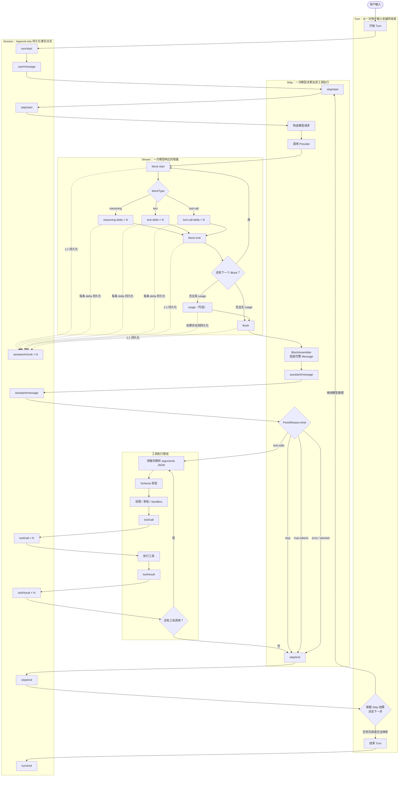

# Turn、Step、Stream 与 Tool 生命周期

本文说明 DeepSeek Harness 风格 Agent 中 `Turn`、`Step`、模型流、Session Event 和工具调用之间的关系。

## 1. 核心概念

### Session

Session 是 append-only 的持久化事实日志。运行期间发生的重要事实都追加成 `SessionEvent`，恢复时通过重放日志重建状态。

典型事件包括：

```text
turn/start
user/message
step/start
assistant/chunk
assistant/message
tool/call
tool/result
step/end
turn/end
```

### Turn

Turn 表示从一次用户输入开始，到 Agent 给出最终答案、失败或被取消为止的一次完整任务。

一个 Turn 可以包含多个 Step：

```text
用户输入
  ↓
Turn
  ├─ Step 1：模型决定调用工具，并完成工具执行
  ├─ Step 2：模型读取工具结果，可能继续调用工具
  └─ Step N：模型给出最终答案
```

### Step

本文采用下面的定义：

> Step 是一次模型决策，以及完成该决策要求的全部工具调用。

因此，工具结果属于发起工具调用的相同 Step：

```text
step/start(step=1)
  LLM stream
  assistant/message（含 tool-call）
  tool/call
  tool/result
step/end(step=1)
```

但是，这个 `tool/result` 会在下一个 Step 中被模型消费：

```text
step/start(step=2)
  构造模型请求：
    - user/message
    - Step 1 assistant/message
    - Step 1 tool/result
  调用 LLM
```

换句话说：

> `tool/result` 归属于产生它的 Step N，但进入 Step N+1 的模型上下文。

### StreamChunk

`StreamChunk` 是一次模型请求返回的实时增量，不代表工具执行事件。

常见变体：

```text
block-start
reasoning-delta
text-delta
tool-call-delta
block-end
usage
finish
```

每条 Chunk 都可以被记录为一条独立的：

```text
SessionEvent<assistant/chunk>
```

## 2. Content Block 生命周期

模型响应由一个或多个 Content Block 组成。每个 Block 都使用相同的生命周期：

```text
block-start
  delta × 0..N
block-end
```

不同 Block 使用不同的 delta：

| Block 类型 | 增量类型 | 拼接内容 |
|---|---|---|
| `reasoning` | `reasoning-delta` | 推理文本 |
| `text` | `text-delta` | 用户可见回答 |
| `tool-call` | `tool-call-delta` | 工具名和原始 JSON 参数 |

一个具体的 `block-start` 只会进入与其 `blockType` 对应的 delta，不会同时进入三种 delta。

### 多条 reasoning-delta

`reasoning-delta` 可以有任意多条：

```text
assistant/chunk: block-start(index=0, blockType=reasoning)
assistant/chunk: reasoning-delta(index=0, text="先检查")
assistant/chunk: reasoning-delta(index=0, text="用户提供的")
assistant/chunk: reasoning-delta(index=0, text="参数是否完整")
assistant/chunk: block-end(
  index=0,
  block=reasoning("先检查用户提供的参数是否完整")
)
```

Assembler 根据 `index` 找到对应 Block，并按到达顺序拼接文本：

```ts
// 将同一个 reasoning block 的增量依次追加。
reasoningText += chunk.text
```

最终形成完整内容块：

```json
{
  "type": "reasoning",
  "text": "先检查用户提供的参数是否完整"
}
```

delta 的边界由模型服务和网络缓冲决定，可能是单个字符、几个 token 或较长文本。业务逻辑不能依赖 delta 数量，也不能把一条 delta 当作完整句子。

### 为什么没有 reasoning-end

协议使用统一的 `block-end`，而不是分别定义：

```text
reasoning-end
text-end
tool-call-end
```

这使所有内容块共享一套状态机。`block-end` 携带已经组装完成的完整 Block。

如果 Provider 不提供显式 Block 结束标记，Provider Adapter 应在以下时机合成 `block-end`：

- 下一个 Block 开始时；
- 收到 `finish` 时；
- 流异常终止时，按照失败策略关闭或丢弃未完成 Block。

## 3. 为什么 tool-call 使用 delta

模型生成的工具参数通常也是流式到达的：

```text
tool-call-delta: id="call-1", name="read_file", argumentsDelta="{"
tool-call-delta: id="call-1", argumentsDelta="\"path\""
tool-call-delta: id="call-1", argumentsDelta=":"
tool-call-delta: id="call-1", argumentsDelta="\"README.md\""
tool-call-delta: id="call-1", argumentsDelta="}"
```

Assembler 拼接原始参数：

```json
{"path":"README.md"}
```

在 `block-end` 时得到完整工具调用：

```json
{
  "type": "tool-call",
  "id": "call-1",
  "name": "read_file",
  "arguments": "{\"path\":\"README.md\"}"
}
```

不能在收到第一条 delta 后立即执行工具，因为此时：

- JSON 可能尚未闭合；
- 参数还未完成；
- Schema 还不能可靠校验；
- 权限和 Sandbox 判断可能依赖完整参数。

正确顺序是：

```text
拼接 tool-call-delta
  ↓
block-end：得到完整 ToolCallBlock
  ↓
解析 arguments JSON
  ↓
Schema 校验
  ↓
权限审批与 Sandbox 判断
  ↓
tool/call
  ↓
执行工具
  ↓
tool/result
```

## 4. 为什么 tool/call 和 tool/result 之间没有 StreamChunk

模型产生完整 `tool-call` 后，这一次模型请求已经结束：

```text
LLM streaming
  tool-call-delta × N
  block-end(tool-call)
  finish(tool-calls)
LLM streaming 结束

Harness 执行工具
  tool/call
  运行 read、write、shell 等工具
  tool/result
```

工具执行期间没有模型响应，因此不会产生 `assistant/chunk`。

如果工具需要报告实时进度，应使用独立的工具进度事件，例如：

```text
tool/call
tool/progress
tool/progress
tool/result
```

工具 stdout 或进度不能伪装成 `StreamChunk`，否则无法区分模型输出和工具输出。

## 5. assistant/chunk 与 assistant/message

`assistant/chunk` 是实时增量；`assistant/message` 是所有 Chunk 组装出的最终模型消息。

例如：

```text
assistant/chunk: block-start(reasoning)
assistant/chunk: reasoning-delta("先检查")
assistant/chunk: block-end(reasoning)

assistant/chunk: block-start(text)
assistant/chunk: text-delta("结果是")
assistant/chunk: text-delta("...")
assistant/chunk: block-end(text)

assistant/chunk: usage(...)
assistant/chunk: finish(stop)
```

最终组装为：

```json
{
  "type": "assistant/message",
  "content": [
    { "type": "reasoning", "text": "先检查" },
    { "type": "text", "text": "结果是..." }
  ]
}
```

`assistant/message` 不是又一次模型输出，而是当前模型响应的规范化最终结果。它适合用于：

- 构造下一次模型请求；
- Session 恢复；
- 上下文压缩；
- 对完整工具调用做校验和执行。

## 6. 完整示例：读取两个文件并总结

用户输入：

```text
检查 package.json 和 tsconfig.json，然后告诉我项目的运行环境。
```

### Turn 开始

```text
turn/start { turn: 1 }

user/message {
  role: "user",
  content: [
    { type: "text", text: "检查 package.json 和 tsconfig.json，然后告诉我项目的运行环境。" }
  ]
}
```

### Step 1：模型决定读取两个文件

```text
step/start { turn: 1, step: 1 }

assistant/chunk: block-start(index=0, blockType=reasoning)
assistant/chunk: reasoning-delta(index=0, text="用户要求检查")
assistant/chunk: reasoning-delta(index=0, text=" package.json")
assistant/chunk: reasoning-delta(index=0, text=" 和 tsconfig.json。")
assistant/chunk: reasoning-delta(index=0, text="需要分别读取")
assistant/chunk: reasoning-delta(index=0, text="这两个文件，")
assistant/chunk: reasoning-delta(index=0, text="然后综合判断运行环境。")
assistant/chunk: block-end(
  index=0,
  block=reasoning("用户要求检查 package.json 和 tsconfig.json。需要分别读取这两个文件，然后综合判断运行环境。")
)

assistant/chunk: block-start(index=1, blockType=tool-call)
assistant/chunk: tool-call-delta(index=1, id="call-package", name="read_file", argumentsDelta="{")
assistant/chunk: tool-call-delta(index=1, id="call-package", argumentsDelta="\"path\"")
assistant/chunk: tool-call-delta(index=1, id="call-package", argumentsDelta=":")
assistant/chunk: tool-call-delta(index=1, id="call-package", argumentsDelta="\"package.json\"")
assistant/chunk: tool-call-delta(index=1, id="call-package", argumentsDelta="}")
assistant/chunk: block-end(
  index=1,
  block=tool-call(
    id="call-package",
    name="read_file",
    arguments="{\"path\":\"package.json\"}"
  )
)

assistant/chunk: block-start(index=2, blockType=tool-call)
assistant/chunk: tool-call-delta(index=2, id="call-tsconfig", name="read_file", argumentsDelta="{\"")
assistant/chunk: tool-call-delta(index=2, id="call-tsconfig", argumentsDelta="path")
assistant/chunk: tool-call-delta(index=2, id="call-tsconfig", argumentsDelta="\":\"")
assistant/chunk: tool-call-delta(index=2, id="call-tsconfig", argumentsDelta="tsconfig.json")
assistant/chunk: tool-call-delta(index=2, id="call-tsconfig", argumentsDelta="\"}")
assistant/chunk: block-end(
  index=2,
  block=tool-call(
    id="call-tsconfig",
    name="read_file",
    arguments="{\"path\":\"tsconfig.json\"}"
  )
)

assistant/chunk: usage {
  inputTokens: 820,
  outputTokens: 96,
  cacheReadTokens: 500,
  reasoningTokens: 43
}

assistant/chunk: finish {
  reason: { kind: "tool-calls" }
}
```

Harness 将 Chunk 组装成完整消息：

```json
{
  "type": "assistant/message",
  "turn": 1,
  "step": 1,
  "content": [
    {
      "type": "reasoning",
      "text": "用户要求检查 package.json 和 tsconfig.json。需要分别读取这两个文件，然后综合判断运行环境。"
    },
    {
      "type": "tool-call",
      "id": "call-package",
      "name": "read_file",
      "arguments": "{\"path\":\"package.json\"}"
    },
    {
      "type": "tool-call",
      "id": "call-tsconfig",
      "name": "read_file",
      "arguments": "{\"path\":\"tsconfig.json\"}"
    }
  ]
}
```

随后执行工具。工具执行阶段没有模型 StreamChunk：

```text
tool/call {
  turn: 1,
  step: 1,
  callId: "call-package",
  name: "read_file",
  arguments: "{\"path\":\"package.json\"}"
}

tool/call {
  turn: 1,
  step: 1,
  callId: "call-tsconfig",
  name: "read_file",
  arguments: "{\"path\":\"tsconfig.json\"}"
}

tool/result {
  turn: 1,
  step: 1,
  callId: "call-package",
  content: "{\"type\":\"module\",\"engines\":{\"node\":\">=24.0.0\"}}"
}

tool/result {
  turn: 1,
  step: 1,
  callId: "call-tsconfig",
  content: "{\"compilerOptions\":{\"target\":\"ES2024\",\"module\":\"NodeNext\"}}"
}

step/end { turn: 1, step: 1 }
```

两个只读工具可以并发执行，但 Session 可以按原始工具调用顺序提交结果，以得到稳定、可重放的日志顺序。

### Step 2：模型消费工具结果并回答

Step 2 的模型请求包含：

```text
messages = [
  user/message,
  Step 1 assistant/message（包含两个 tool-call），
  Step 1 tool/result(call-package)，
  Step 1 tool/result(call-tsconfig)
]
```

第二次流式响应：

```text
step/start { turn: 1, step: 2 }

assistant/chunk: block-start(index=0, blockType=reasoning)
assistant/chunk: reasoning-delta(index=0, text="package.json 声明了")
assistant/chunk: reasoning-delta(index=0, text=" Node.js 最低版本为 24，")
assistant/chunk: reasoning-delta(index=0, text="并且项目使用 ESM。")
assistant/chunk: reasoning-delta(index=0, text="tsconfig 又声明了")
assistant/chunk: reasoning-delta(index=0, text=" ES2024 和 NodeNext，")
assistant/chunk: reasoning-delta(index=0, text="因此它是现代 Node.js TypeScript 项目。")
assistant/chunk: block-end(
  index=0,
  block=reasoning("package.json 声明了 Node.js 最低版本为 24，并且项目使用 ESM。tsconfig 又声明了 ES2024 和 NodeNext，因此它是现代 Node.js TypeScript 项目。")
)

assistant/chunk: block-start(index=1, blockType=text)
assistant/chunk: text-delta(index=1, text="这是一个")
assistant/chunk: text-delta(index=1, text="基于 Node.js 24+")
assistant/chunk: text-delta(index=1, text=" 的 TypeScript 项目。")
assistant/chunk: text-delta(index=1, text="项目采用 ESM，")
assistant/chunk: text-delta(index=1, text="编译目标是 ES2024，")
assistant/chunk: text-delta(index=1, text="模块解析方式是 NodeNext。")
assistant/chunk: block-end(
  index=1,
  block=text("这是一个基于 Node.js 24+ 的 TypeScript 项目。项目采用 ESM，编译目标是 ES2024，模块解析方式是 NodeNext。")
)

assistant/chunk: usage {
  inputTokens: 1260,
  outputTokens: 118,
  cacheReadTokens: 700,
  reasoningTokens: 52
}

assistant/chunk: finish {
  reason: { kind: "stop" }
}

assistant/message {
  turn: 1,
  step: 2,
  content: [
    { type: "reasoning", text: "package.json 声明了……" },
    { type: "text", text: "这是一个基于 Node.js 24+ 的 TypeScript 项目……" }
  ]
}

step/end { turn: 1, step: 2 }

turn/end {
  turn: 1,
  reason: { kind: "completed" }
}
```

## 7. 修正版架构与时序图



## 8. 完整时序摘要

```text
turn/start
user/message

├─ step/start #1
│  ├─ reasoning block
│  │  ├─ block-start
│  │  ├─ reasoning-delta × N
│  │  └─ block-end
│  ├─ tool-call block #1
│  │  ├─ block-start
│  │  ├─ tool-call-delta × N
│  │  └─ block-end
│  ├─ tool-call block #2
│  │  ├─ block-start
│  │  ├─ tool-call-delta × N
│  │  └─ block-end
│  ├─ usage（可选）
│  ├─ finish(tool-calls)
│  ├─ assistant/message
│  ├─ tool/call × N
│  ├─ tool/result × N
│  └─ step/end #1
│
├─ step/start #2
│  ├─ 构造请求，包含 Step 1 的 tool/result
│  ├─ reasoning block
│  │  ├─ block-start
│  │  ├─ reasoning-delta × N
│  │  └─ block-end
│  ├─ text block
│  │  ├─ block-start
│  │  ├─ text-delta × N
│  │  └─ block-end
│  ├─ usage（可选）
│  ├─ finish(stop)
│  ├─ assistant/message
│  └─ step/end #2
│
└─ turn/end(completed)
```

## 9. 关键不变量

实现和调试时应维持以下约束：

1. 一个 Turn 可以包含多个 Step。
2. 一个 Step 只有一次模型请求，但可以执行该请求产生的多个工具调用。
3. 每个 `assistant/chunk` 都属于明确的 `(turn, step)`。
4. 每个 Content Block 都遵循 `block-start → delta × N → block-end`。
5. `tool-call-delta` 只能组装参数，不能直接触发工具执行。
6. 工具执行开始前必须获得完整 ToolCallBlock，并完成解析、校验和权限判断。
7. `tool/call` 与对应 `tool/result` 归属于相同 Step。
8. `tool-call` 与对应 `tool/result` 是不可拆分的因果组。
9. `step/end` 时不应存在未完成的工具调用。
10. Step N 的 `tool/result` 由 Step N+1 的模型请求消费。
11. `assistant/chunk` 是流式事实，`assistant/message` 是其最终组装结果。
12. `usage` 可能缺失；实现不能假设每次请求一定报告 usage。
13. 正常模型流应有一个 `finish`；连接异常时由 Adapter 或 Agent 转换为 `error` 或 `aborted`。
14. `max-tokens` 只说明当前响应到达上限，是否继续由 Agent 策略决定。
