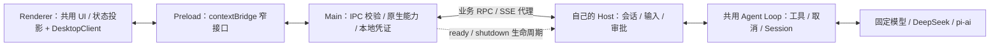

# 从空项目实现 Electron 桌面端

桌面主线：**00～17 → 24～27 → 40～46**。可以做完 Web 闭环就进入桌面分支，编号追加是为了保留旧学习记录，不要求先做 ACP、工作流和全部高级能力。完整清单为 S01～S18，详见学习站点功能地图。

这是任务书，当前没有 `desktop/`、Electron 依赖或任何桌面源码。每一步的文件、脚本和测试都由你创建，先有自己的小闭环再继续。

## 先分清领域与复用位置

这是本课程选择的实现方案。Web 与桌面共用界面组件、UI 投影以及 Host 用例；分别实现 WebClient 与 DesktopClient 传输适配器。模型、工具、存储与审批结算留在同一个内核接口里。Main 代理已有业务协议，不重写一套 Agent Loop。原版桌面源码作为另一种实现对照，不宣称协议与该教学方案相同。

| 领域 | 自己实现什么 | 不放什么 |
| --- | --- | --- |
| Renderer | 输入框、文本流、工具与审批界面、状态投影 | Node、文件系统、模型密钥 |
| Preload | `sendInput`、`cancel`、`answerApproval`、`snapshot`、`subscribe` 等具体方法 | 原始 `ipcRenderer`、任意 channel、任意 Shell |
| Main | sender/参数/所有权校验、业务代理、窗口、系统能力、Host 生命周期 | 模型循环与权限决策副本 |
| Host / Agent | 会话、输入接收、Loop、审批唯一结算、持久化与恢复 | Electron 窗口对象 |
| 模型提供方 | 按统一接口产生流事件 | 桌面 IPC 与窗口状态 |

接口名由你定义，IPC 数据必须可序列化。逐方法限制能力，校验 senderFrame 和来源；开启 contextIsolation 并关闭页面 Node 集成。参考 [Electron context isolation](https://www.electronjs.org/docs/latest/tutorial/context-isolation)、[IPC](https://www.electronjs.org/docs/latest/tutorial/ipc) 与 [安全指南](https://www.electronjs.org/docs/latest/tutorial/security)。

## 开发资源：GUI 在宿主机

- 00～39 的核心逻辑全部在本机 Bun 中运行和调试；Compose 只在需要时启动 OTel Collector。
- 40～46 的 Electron 安装、窗口调试、原生集成与打包，在你的 macOS / Windows / Linux 宿主机完成。这里不增加桌面 GUI 容器。
- 本课程从 Bun Host 起步。Electron 自带的 Node 与 Chromium 不包含 Bun；开发时显式指定本机 Bun 路径，发布时选择携带目标平台 Bun，或把 Host 改为可在独立 Node 运行时运行并通过兼容性验收。不能只把一个 `.ts` 路径塞进安装包。
- 在宿主机自己新建 `desktop/` 后，在里面运行 `npm init`、安装 `electron` 为开发依赖并保存锁文件。下载与锁定版本在真正进入步骤 40 时进行，当前任务书不提前安装。
- `desktop/` 独立管理本机 GUI 的 `node_modules`；与本机 Harness 核心依赖分开管理。主进程/preload 与 UI 分别构建，核心 `bun run build` 不是桌面构建命令。

## 每一步如何练习

所有 `bun test tests/4x-*.test.ts` 都是**自己将要编写的逻辑测试**，不代表真实 Electron、原生权限或安装包已经验收。每步还要记录下面指定的宿主机证据。

### 40：自己打开第一个本地窗口

前置：00、27。自己新增 `desktop/package.json`、`main.cjs` 和 `renderer/index.html`。入口可以先用 CommonJS，避开 preload 与构建格式同时引入的复杂度。

1. 定义桌面包的 `main` 为自己的 `main.cjs`，增加 `start` 脚本执行 `electron .`。这些配置当前不存在。
2. 主进程只等应用 ready、创建窗口、加载自己的本地 HTML；页面显示一个固定标记，暂不连接 Host。
3. 在宿主机的 `desktop/` 内运行 `npm run start`。分别在 main 与 renderer 设断点，记录 PID、窗口数和加载路径。
4. 将 HTML 路径改成不存在的文件，稳定复现加载失败；修正后重试。关闭全部窗口并重新激活，观察是否重复创建窗口。

验收：固定页面可见；启动失败可定位；窗口关闭与退出策略明确。记录实际窗口与断点证据，再运行自己写的 `bun test tests/40-desktop-window.test.ts`。

### 41：自己实现 preload 和 IPC

只先增加一个无副作用的 `getAppInfo` 调用，再扩展业务方法。由 preload 通过 contextBridge 暴露具体函数，main 使用对应 handler 处理；不要暴露任意 channel 的 send/invoke。事件订阅返回撤销函数，包装回调时不把 Electron event 对象交给页面。

故障：非法参数、未知业务方法、不可信来源、非主 frame 请求。分别检查是否在进入有权限操作前拒绝。真实 Electron 下验证页面无法读取 Node API，导航与新窗口策略不能绕过来源检查。

验收：完成 `tests/41-desktop-bridge.test.ts` 的契约校验，并保留真实 IPC 成功/拒绝记录；只跑普通 Bun 测试不能证明 contextIsolation 生效。

### 42：让 main 启动自己的 Host

先写一个发 ready 的固定脚本子进程，验证 `starting → ready / failed → stopping → stopped`。主进程拥有 PID、ready 超时和重启代次；再换成调用步骤 24～27 自己的 Host 启动入口。Host 使用随机本地监听端口并通过私有握手回传地址，业务凭证留在 main。

故障：子进程 ready 前退出、永远不 ready、连续崩溃、旧代次 ready 迟到、启动中退出应用。不能无限重启，也不能让旧 ready 把新实例状态改回就绪。

验收：不用用户先手工启动 Agent Server，桌面可显示启动/失败状态；退出能释放拥有的子进程。逻辑测试：`tests/42-desktop-host.test.ts`，另记录真实 PID 与退出码。

### 43：串起 prompt、流式输出、取消与审批

| 链路 | 正向 | 返回与验收 |
| --- | --- | --- |
| Prompt | UI → DesktopClient → preload → main 代理 → Host 输入接收 → Agent Loop | 接收确认与执行终态分开记录 |
| 流式输出 | 模型 → Loop / Session → Host 事件 → main → preload 订阅 → UI 投影 | 分片、提交消息、seq 与快照边界分别处理 |
| 取消 | UI → 同一桥接 → Host.cancel → 运行时 AbortSignal | 单一轮次终态；迟到结果不继续下一步，取消不等于直接杀 Host |
| 审批 | Host 提出 pending → main / preload → UI；决定沿原路返回 | Host 唯一结算；刷新、重复点击、取消后迟到批准均不重复执行 |

固定模型输出两段后卡在可控制 Promise 上，点击取消再释放 Promise；重复验收工具与审批等待。刷新 renderer 后先拿快照和当前 pending，再接续事件；撤销旧订阅，区分窗口代次，不能再执行已提交工具。主进程转发队列要有上限，缺口或慢消费者触发重新同步。

验收：同一套 UI 投影可在 WebClient 与 DesktopClient 驱动下工作，Host/Loop 不判断自己来自 Web 还是桌面。逻辑测试：`tests/43-desktop-agent.test.ts`；另记录真实窗口的四条链路与重载行为。

### 44：逐项增加原生交互和路径

每项只加一个正常样本和一个拒绝/取消样本，再继续下一项：

1. `dialog` 选择工作区：取消不创建工作区，结果归属请求窗口。
2. 分清应用只读资源、`userData`、日志与用户选择的工作区；不把会话写进安装目录。
3. 剪贴板、菜单、快捷键、托盘、通知逐项接入；第二实例唤醒已有窗口，保存窗口状态。
4. 深链解析并校验允许的动作与参数；打开外链也由受控策略处理。
5. 系统权限与工具审批分别记录；凭证不透传 renderer。
6. 如需要嵌入浏览器/平台页面，单独设置来源、弹窗、下载和摄像头/麦克风权限，不共享应用的高权限桥。

故障：取消选择、不可写用户目录、路径含空格、恶意深链、第二实例、外部页面尝试 IPC、系统权限拒绝。

验收：`tests/44-desktop-native.test.ts` 加目标系统上的原生交互证据。不同系统支持或表现有差异的能力明确标注，不靠其他平台测试替代。

### 45：定义关闭、后台与崩溃恢复

先选择“关窗口完全退出”或“允许后台任务”，把窗口隐藏、renderer 刷新、应用退出和 Host 崩溃列成不同状态转移。完全退出时向 Host 请求 shutdown，等待 ack 与子进程结束，有界超时后清理自己拥有的进程树；撤销 IPC handler、事件订阅、托盘和通知。

复现：工具等待时关闭窗口；Host 不回应；renderer 崩溃但 Host 仍活；Host 异常退出。重开窗口不自动重发 prompt；冷恢复读 Session 权威存储，未知副作用由恢复策略说明。日志关联进程与会话并脱敏，错误界面给重试/退出等明确动作。

验收：`tests/45-desktop-recovery.test.ts` 加关闭前后 PID、监听器数量与冷恢复记录；不能把任务仍在后台继续执行误报成“已经取消”。

### 46：独立构建、安装、签名与更新

本课程先选择 Electron Forge 作为学习打包工具；自己添加配置和对应 scripts，不自动导入一份完成的应用。原版使用的工具与运行时策略另行对照。参考 [官方打包教程](https://www.electronjs.org/docs/latest/tutorial/tutorial-packaging)。

按 S15～S18 分四次验收：

1. **离线打包**：main、preload、renderer 与 Host 分别有清楚的输出，生成运行时清单。目标平台的 Bun/Node、原生依赖、执行权限与资源路径都显式携带。先从源码目录外启动，再在没有全局 Bun 的目标测试机启动。
2. **安装矩阵**：按 OS/架构验证安装、打开、工作区路径含空格、重启恢复和卸载数据策略。原生模块按实际运行时 ABI 打包；一次 macOS 开发运行不代表 Windows/Linux 通过。
3. **签名**：针对选定平台准备证书；macOS 签名、公证与 Windows 签名分别留证。密钥只由本机凭证管理或 CI secret 注入。[签名与公证依据](https://www.electronjs.org/docs/latest/tutorial/code-signing)。
4. **更新**：先用固定更新源实现检查、下载、校验、待安装、收尾退出与新版本启动；再接选定发行渠道。演练下载失败、校验失败与数据迁移失败。二进制可回退不等于数据库可降级，记录 schema 兼容策略。不同 updater 的平台、安装格式和签名要求分别验证。[更新依据](https://www.electronjs.org/docs/latest/tutorial/updates)。

验收：`tests/46-desktop-release.test.ts` 覆盖自己的清单/状态机逻辑；真正完成桌面发布还需要安装包、平台、签名和更新演练的证据。没有证书或平台环境时写“未验证”，不以逻辑测试通过代替。

## 原版源码怎么对照

核心课程原有基线仍为 `99f6f02fecdb7dff40c3fbc9470f5907c29f74ca`。这次桌面参考单列本地原版提交 `687f282e8625c6b8d11ff58211a90524be2e4317`，避免混淆版本。

- [desktop README](https://github.com/deepseek-ai/deepseek-harness/blob/687f282e8625c6b8d11ff58211a90524be2e4317/apps/desktop/README.md)：桌面工程与实际发布方式。
- [main.ts](https://github.com/deepseek-ai/deepseek-harness/blob/687f282e8625c6b8d11ff58211a90524be2e4317/apps/desktop/src/main.ts)：应用、窗口与生命周期入口。
- [preload-app.ts](https://github.com/deepseek-ai/deepseek-harness/blob/687f282e8625c6b8d11ff58211a90524be2e4317/apps/desktop/src/preload-app.ts)、[ipc.ts](https://github.com/deepseek-ai/deepseek-harness/blob/687f282e8625c6b8d11ff58211a90524be2e4317/apps/desktop/src/ipc.ts)：具体能力桥与 sender 校验。
- [host-process.ts](https://github.com/deepseek-ai/deepseek-harness/blob/687f282e8625c6b8d11ff58211a90524be2e4317/apps/desktop/src/host-process.ts)、[desktop-host](https://github.com/deepseek-ai/deepseek-harness/blob/687f282e8625c6b8d11ff58211a90524be2e4317/apps/desktop-host/src/index.ts)：进程协议与实际 Host 入口。
- [runtime-tree.ts](https://github.com/deepseek-ai/deepseek-harness/blob/687f282e8625c6b8d11ff58211a90524be2e4317/apps/desktop/src/runtime-tree.ts)、[update-coordinator.ts](https://github.com/deepseek-ai/deepseek-harness/blob/687f282e8625c6b8d11ff58211a90524be2e4317/apps/desktop/src/update-coordinator.ts)：运行时资源与更新。

先自己实现最小版本，遇到具体问题再对照源码。这里补的是全量学习范围与验收路径，空项目没有被填入任何桌面成品。
