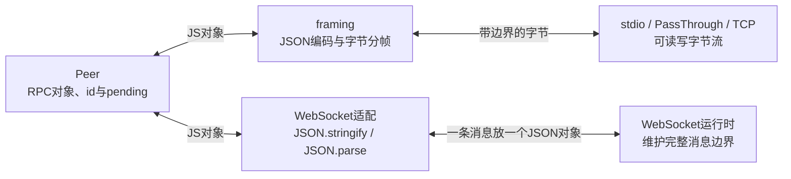

# 032 · Peer/framing 不限于 stdio

原来的 `src/rpc-demo.mjs` 用 stdin/stdout 管道连接子进程。这次用同一份 `src/rpc.mjs`，把 `sum({ a: 2, b: 3 }) → 5` 接到内存流、TCP 和 WebSocket，直接看传输换了以后哪些代码要变。

## 先运行，观察结果

在当前仓库目录打开终端，从 Git 根目录定位练习工程：

```sh
export REPO="$(git rev-parse --show-toplevel)"
export PROJECT="$REPO/harness-own"
cd "$PROJECT"
bun run rpc:memory
bun run rpc:tcp
bun run rpc:ws
```

每条命令独立运行一个示例，输出一行 JSON 后退出。TCP 和 WebSocket 只监听本机 `127.0.0.1`，端口由系统分配。客户端和服务端都在当前这一个 Bun 进程内，不用另外启动 worker，也不需要模型密钥或安装新依赖。

| 命令 | 实际文件 | 完成标准 |
| --- | --- | --- |
| `bun run rpc:memory` | [scripts/rpc-pass-through-demo.mjs](../scripts/rpc-pass-through-demo.mjs) | `sum: 5`、`pending: [0,0]`、`streamsDestroyed: true`。 |
| `bun run rpc:tcp` | [scripts/rpc-tcp-demo.mjs](../scripts/rpc-tcp-demo.mjs) | `sum: 5`、`pendingRejectedOnDisconnect: true`、`socketsDestroyed: true`、`serverListening: false`。 |
| `bun run rpc:ws` | [scripts/rpc-websocket-demo.mjs](../scripts/rpc-websocket-demo.mjs) | `sum: 5`、`echo: "中文🙂"`、`pending: [0,0]`、`clientClosed: true`、`serverSocketClosed: true`。 |

三个示例还会调用不存在的 `missing` 方法，检查错误能按原请求 id 回到调用方；调用故意不回复的 `hold` 方法，检查关闭 Peer 或断开连接后等待会失败。`hold` 只制造等待，不启动真实后台工作。脚本内置 assert，结果不符就非零退出，正常应迅速结束，不应等到默认 5 秒保护期限。

## Peer、framing、传输分别管什么

| 层 | 接到什么 | 做什么 |
| --- | --- | --- |
| `Peer` | JS 对象 | 发请求时生成 id、记录 pending；收请求时按 method 找 handler；收响应时按 id 完成原来的等待。 |
| `framing` | JS 对象、字节 Buffer | 发出前 JSON 编码并加消息边界；接收时缓存半包、拆开粘包，收齐后 JSON.parse，再交给 Peer。 |
| 传输 | 字节流或完整消息 | 在两端之间实际搬运数据。stdio、PassThrough、TCP 是字节流；WebSocket 的 message 回调提供完整消息。 |



上图只展开一端，对端按同一约定还原。`Peer` 不要求使用子进程；`framing` 也没有写死 stdin/stdout。当前 framing 要求读端支持 `.on('data/end/error', ...)`，data 是字节 Buffer，写端支持 `.write(Buffer)` 和相应流状态。这里使用 Bun 支持的 `node:stream`、`node:net` 兼容接口，运行命令仍是 Bun。不能直接把回调接口不同的 Bun.connect 原生 socket 塞进去，也不要先 setEncoding 把 Buffer 改成字符串。

## 先收齐消息，再解析 JSON，不能靠找首尾花括号

可以把 framing 理解成：**攒字节 → 按约定找出一整条消息 → 解析 JSON → 交 Peer 处理 RPC。** 判断边界依据通信双方约定的格式。

| 格式 | 怎样知道一条消息完整了 |
| --- | --- |
| NDJSON | 一行放一个完整 JSON，遇到 LF，也就是字节 `0x0A`，才能取出这一行解析。当前 framing 的默认模式就是它。 |
| Content-Length | 先找到 `\r\n\r\n` 读完头部，再按 Content-Length 收够正文的 UTF-8 字节数。三个例子中的前两个用 `mode = 'lsp'` 选择这套格式。 |
| 本例 WebSocket | 运行时交付一条完整文本消息；我们约定一次 send 放一个 JSON-RPC 对象，直接 JSON.parse。 |

Content-Length 例子：

```text
Content-Length: 7\r\n\r\n{"a":1}
```

这里 `\r\n\r\n` **只表示头部结束**。还要收到后面的 7 字节 `{"a":1}`，才够解析正文。正文后面不用再找结束符。下一帧可以紧接着来。

JSON 的 `{`、`}` 是语法符号，字符串里也能出现：

```json
{"text":"这里有一个 } 符号","nested":{"a":1}}
```

收到第一个 `}` 就截断会把这个 JSON 切坏。分帧器按换行或字节长度确定边界后，才让 JSON.parse 检查 JSON 语法。中文也不能直接用字符串 `.length` 当 Content-Length：`"中文".length` 是 2，`Buffer.byteLength("中文", "utf8")` 是 6；还要把完整 JSON 的引号、字段名等一起计入。本工程已经用 `Buffer.from(JSON.stringify(message)).length` 计算整条消息字节数。

TCP 接收示例，假设发送的是连续的帧 A、B：

```text
data 1：A 的前半段             → 不够，留在 buffer
data 2：A 的后半段 + 整个 B    → 取出 A，解析；继续取出 B，解析
```

一次 write 不保证对应一次 data；真实连接也不保证每次都按这个方式切分。若直接对每个 chunk 做 JSON.parse，就可能遇到半段 JSON，或者两条 JSON 连在一起。

## 三种接线怎么读

### PassThrough：两条内存流交叉连接

```js
// A 写入 aToB，B 从 aToB 读取；另一个方向用 bToA。
framing(a, bToA, aToB, 'lsp') // A：先读端，后写端。
framing(b, aToB, bToA, 'lsp') // B：读写方向与 A 交叉。
```

这里的 `'lsp'` 只选择 Content-Length 编码格式，`sum` 仍是我们自己的 RPC 方法，没有变成真正的语言服务器。先看这份最短脚本，再看网络示例。

### TCP：每一端用自己的 Duplex socket 读写

```js
// 本端 socket 可读也可写，所以传两次；对端拥有它自己的另一个 socket。
framing(peer, socket, socket, 'lsp')
```

TCP 只提供字节流，所以还需要 framing 找消息边界。示例先等 listening/connect 事件再发请求。除 framing 原有的 end/error 处理外，还把 socket 的 close 接到 Peer.close，确保本端 destroy 也能拒绝 pending。

### WebSocket：一条 message 放一个 RPC 对象

```js
// 发送：Peer 交出 JS 对象，适配代码编码成一条 WebSocket 文本消息。
const peer = new Peer(message => socket.send(JSON.stringify(message)))

// 接收：这是接线示意，完整脚本还有类型校验、异常处理和连接关闭。
const message = JSON.parse(text) // text 是 message 回调收到的完整文本。
await peer.receive(message) // Peer 再按 method 或 id 处理 RPC。
```

**省掉的是本教程的 framing 函数。** WebSocket 底层仍有协议帧，一条消息可能分成多帧，由运行时组装后交给 message 回调。WebSocket 不会自动解析 JSON，也不会替 Peer 管方法和 pending。[WebSocket 协议的分片说明](https://www.rfc-editor.org/rfc/rfc6455.html#section-5.4)

本例约定“一条 WebSocket 消息里放一个完整 JSON-RPC 对象”，因此不用再添加 Content-Length 或 NDJSON 换行。如果应用自己把 JSON 拆到多条 WebSocket 消息里，还需要自行约定重组方式。服务端用 `Bun.serve` 的 `message(socket, text)`，客户端用 `message` 事件的 `event.data`，两端接口形状不同。[Bun WebSocket 文档](https://bun.sh/docs/runtime/http/websockets)

## 用 VS Code 调试

1. 用 VS Code 打开仓库根目录的 `harness-course.code-workspace`，在其中的 `harness-own` 文件夹调试；也可以单独打开 `$PROJECT`，确保已安装 Bun 调试扩展。
2. 先打开 `scripts/rpc-pass-through-demo.mjs`，在 `sum = await ...` 前打断点；再到 `src/rpc.mjs` 的 `peer.send`、data 回调和 `receive` 方法打断点。
3. 运行与调试中选择已补好的 **Bun：032当前传输示例**，按 F5。它使用 `${file}`，所以启动前应把对应 demo 切为当前文件。
4. 观察发送前的 `message` 对象、编码后的 `bytes/packet`、接收的 `chunk/buffer/raw`，最后观察 receive 的对象和 pending 表。
5. 按相同方式打开 TCP 或 WebSocket 文件后重新启动。WebSocket 不会进入 framing，应在两端的发送函数和 message 回调停住。

| 示例 | 重点断点 | 观察目标 |
| --- | --- | --- |
| PassThrough | 两次 framing 接线、src/rpc.mjs 的 send/data/receive | 两条流方向相反，pending 属于发请求的那个 Peer。 |
| TCP | 服务端 createServer 回调、客户端 connected 后、src/rpc.mjs 的 data | 两端 socket 是不同对象，各自都能读写，chunk 不等于完整消息。 |
| WebSocket | 两端 Peer 构造器里的 send 函数、两端 message 回调 | JS 对象 → JSON 文本 → 完整 message → JS 对象。 |

这个新增配置使用已有 `scripts/vscode-debug.mjs` 作为 preload，并把 `RPC_DEMO_TIMEOUT_MS` 设为 `3600000`。三个例子没有父子进程，可以在一个调试会话里看到两端，不用再 Attach worker。现有 032/035 调试配置保持原样。

普通运行的总保护期限和每次 Peer 请求预算都是 5 秒；调试配置把两者延长到一小时，方便停断点。`RPC_DEMO_TIMEOUT_MS` 必须是正的有限毫秒数，设成 0 会立即报参数错误。调试完再用普通三条命令复验。这里是普通脚本，不受 bun test 的 `--timeout` 控制。

若想只从终端延长预算，随后配合 VS Code 调试：

```sh
RPC_DEMO_TIMEOUT_MS=3600000 bun --inspect-brk=127.0.0.1:6499/rpc-032 --preload ./scripts/vscode-debug.mjs scripts/rpc-tcp-demo.mjs
```

再用现有 **Bun：032跨进程RPC主进程** 配置 Attach；它附加到这个地址，并不要求被调试脚本必须叫 rpc-demo.mjs。不要与另一个占用 6499 的调试进程同时启动。

## 关闭、超时与示例边界

`Peer.close()` 负责拒绝本地 pending，不会替你关闭流、socket 或监听服务，也不会取消对端 handler 已开始的副作用。三个文件都在 finally 中回收各自拥有的资源。请求超时也只结束本地等待，不能当作远端操作已取消。

本机 Bun 1.3.14 的 WebSocket 示例等待两端 close 事件确认连接关闭；该版本曾出现连接已关闭但 `server.stop(true)` 的 Promise 不结束的情况，所以脚本发起 stop 并挂 catch，不 await 它。`serverStopRequested` 只表示请求已发起，不能单凭这个字段断言监听已释放；还应结合脚本退出和退出后该轮 port 拒连检查。

这三份示例用于理解和调试接线，没有连接池、重连或生产流控。原来的跨进程工具调用和反向审批继续用：

```sh
bun src/rpc-demo.mjs --auto
bun test ./tests/032-rpc.test.mjs ./tests/032-rpc-demo.test.mjs
```

学习时先运行一遍看卡在哪里，只沿这三个文件和 `src/rpc.mjs` 看调用链。然后合上说明，自己画出“对象 → 字节/文本 → 对象”，解释 framing 什么时候需要、什么时候能省。把字段名 `sum` 换成自己写的 `multiply` 再走通一次；第二天不看说明重新接一遍最容易弄反的读写方向。
