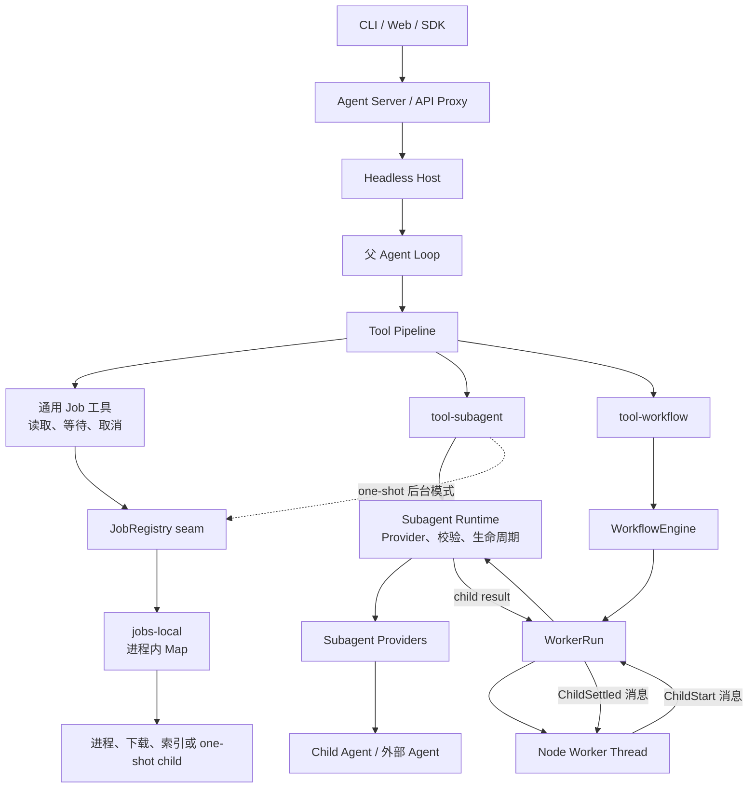
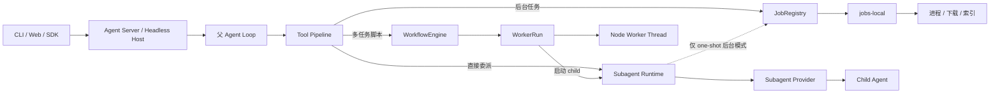
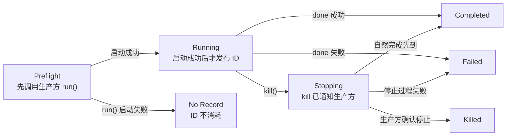
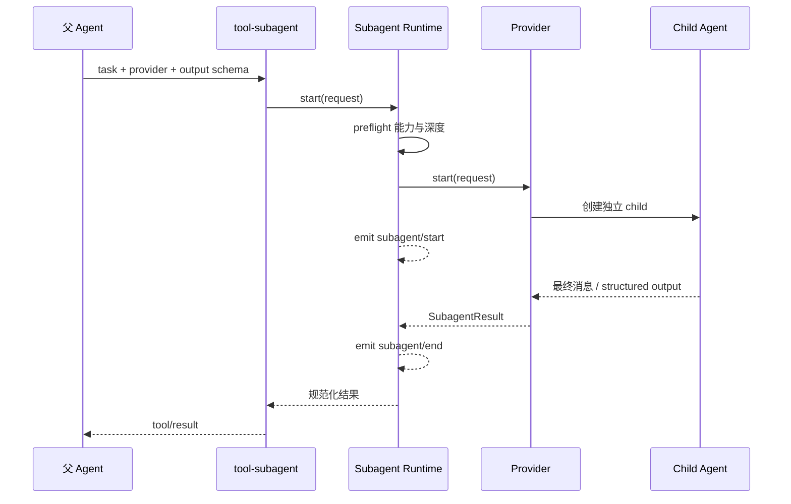
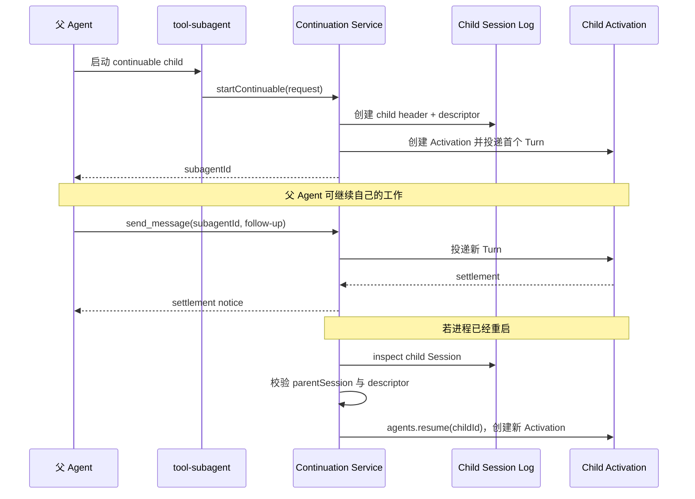
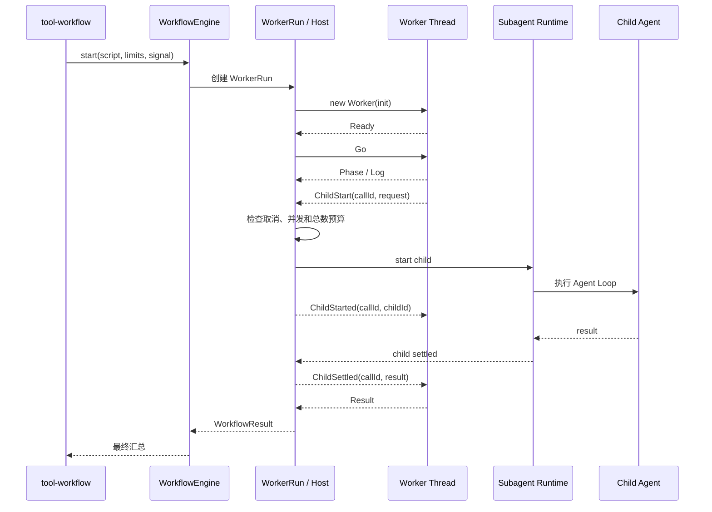
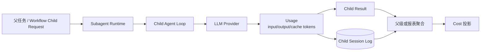
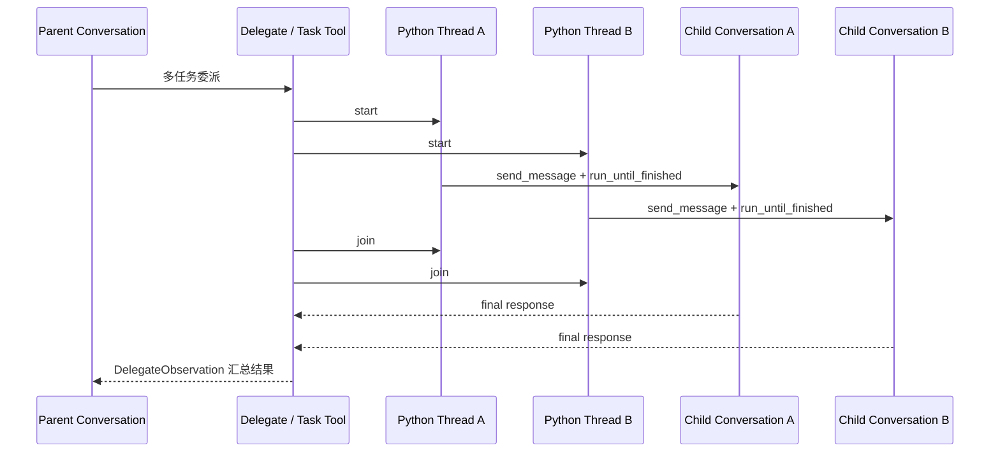
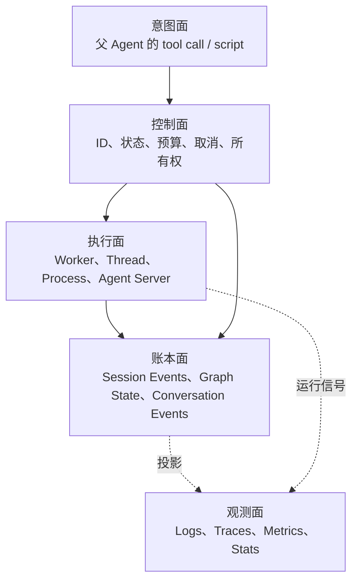

# 拓展阅读：Jobs、Subagent 与 Workflow 深度解读及竞品实现对比

> 本文独立整理 DeepSeek Harness、LangChain Deep Agents 与 OpenHands 在后台任务、子智能体和多任务编排方面的真实实现。文中严格区分“源码或官方文档已经证明的能力”和“为了讲解而提出的统一抽象或未来设计”，避免把建议事件、教学 Demo 或概念类比写成上游项目的现有能力。

## 1. 事实标签

全文使用以下标签：

| 标签 | 含义 |
|---|---|
| **[DSH 已实现]** | 当前工作区 `deepseek-harness/` 源码或包内权威文档可以直接证明 |
| **[Deep Agents 已实现]** | LangChain Deep Agents 官方文档或官方仓库当前实现可以证明 |
| **[OpenHands 已实现]** | OpenHands Software Agent SDK 官方文档或官方仓库当前实现可以证明 |
| **[限制]** | 上游明确写出的限制，或源码结构直接决定的边界 |
| **[推论]** | 根据已有实现作出的工程推导，不是上游对外承诺 |
| **[建议设计]** | 为未来系统提出的协议、事件或持久化方案；当前不能当作已实现能力 |

如果一句话没有对应证据，本文宁可标记为“未知”，也不补齐一个看似合理但没有实现依据的架构。

## 2. 一句话定位

- **Job** 位于“需要后台化的调用方”和“实际执行资源”之间，解决任务身份、状态、输出读取、等待、取消、所有权和清理。
- **Subagent** 位于“父 Agent 的委派意图”和“具体 child Agent 执行方式”之间，解决 Provider 选择、能力校验、父子谱系、生命周期和结果返回。
- **Workflow** 位于“父 Agent 的多任务目标”和“一组动态 child 调用”之间，解决脚本执行、扇出扇入、并发、预算、取消和最终汇总。

三者不是同义词，也不是固定必须串成一条链：

- 普通后台下载可以使用 Job，不需要 Subagent。
- 父 Agent 可以前台直接调用 Subagent，不需要 Job。
- Workflow 可以通过 Subagent 执行 child，但不必把每个 child 再包装成 Job。
- one-shot 后台 Subagent 可以由 Job 托管。
- continuable Subagent 有自己的持久 child Session，不使用普通 Job 作为身份真源。

## 3. DeepSeek Harness 中三者的实际位置

**[DSH 已实现]** 当前源码可以归纳为下面的结构：

<details>
<summary>展开旧版职责关系图</summary>



需要特别纠正一个过度简化的旧图：JobRegistry 并不是所有 Subagent 和 Workflow child 必经的统一存储层。它是一个可供生产方使用的后台任务控制面；Workflow Engine 直接持有 child run，continuable Subagent 则由 continuation service 和 child Session 管理。

</details>

### 3.1 推荐先看：三条主路径

这张图只回答“父 Agent 调用以后分别经过谁、最后由谁执行”，不混入 Job 状态机、Session 恢复、OTel 和 UI 投影。



按这三条路径阅读即可：

1. 后台进程路径：`Tool → JobRegistry → jobs-local → 实际生产方`；
2. 直接委派路径：`Tool → Subagent Runtime → Provider → Child Agent`；
3. 工作流路径：`Tool → WorkflowEngine → WorkerRun ↔ Worker Thread`，需要 child 时再调用 Subagent Runtime。

其中只有 one-shot 后台 Subagent 会包装成普通 Job。Workflow child 和 continuable child 不以普通 JobRegistry 作为身份真源。

### 3.2 六层全景架构图（按需展开）

下面这张图在前一张职责图基础上补充产品入口、Agent Server、Session 持久化、交互和观测面。

图例：

- 普通实线：当前 DeepSeek Harness 源码已经存在的主要调用或数据关系；
- `可选桥接` 虚线：底层事件已经存在，但是否进入 Web、OTel 或其他出口取决于额外消费者和部署组合；
- `建议扩展` 虚线：为了形成完整产品可以增加，但当前不能当作 DeepSeek Harness 已实现能力。

```mermaid
flowchart TB
    subgraph PRODUCT["① 产品入口层"]
        CLI["CLI<br/>命令行任务、交互输入"]
        WEB["Web Client<br/>消息、进度、审批、取消"]
        SDK["SDK / API Client<br/>程序化调用"]
    end

    subgraph HOSTING["② 网络、宿主与会话层"]
        SERVER["Agent Server / API Proxy<br/>协议入口、多会话路由、流式推送"]
        HOST["Headless Host<br/>配置解析、插件装配、Agent 创建与恢复"]
        SESSION["Session Runtime<br/>仅追加事件、投影、生命周期"]
        PERSIST["SessionPersistence<br/>prepare、inspect、load、flush"]
        JSONL[("JSONL / Zstd")]
        SQLITE[("SQLite")]
    end

    CLI -->|"本地组合或 Host 调用"| HOST
    WEB -->|"RPC / HTTP 命令"| SERVER
    SDK -->|"程序化协议调用"| SERVER
    SERVER -->|"定位或创建 Agent"| HOST
    HOST -->|"create / resume"| SESSION
    SESSION -->|"Session Events"| PERSIST
    PERSIST --> JSONL
    PERSIST --> SQLITE
    JSONL -->|"冷加载"| PERSIST
    SQLITE -->|"冷加载"| PERSIST
    PERSIST -->|"重建 Session"| SESSION

    subgraph PARENT["③ 父 Agent 主链路"]
        INBOX["Inbox<br/>待认领用户消息"]
        AGENT["父 Agent Loop<br/>Turn / Step 状态机"]
        LLM["LLM Runtime<br/>请求、流式响应、Usage"]
        TOOL["Tool Pipeline<br/>校验、权限、执行、结果"]

        INBOX -->|"认领消息"| AGENT
        AGENT -->|"模型请求"| LLM
        LLM -->|"chunk、message、tool call、Usage"| AGENT
        AGENT -->|"执行工具"| TOOL
        TOOL -->|"工具结果"| AGENT
    end

    HOST -->|"send_message"| INBOX
    AGENT -->|"追加消息、Turn、Step、Usage"| SESSION
    TOOL -->|"追加 tool/call 与 tool/result"| SESSION

    subgraph CONTROL["④ Jobs、Subagent 与 Workflow 控制面"]
        direction LR

        subgraph JOBS["Jobs：通用后台任务控制面"]
            JOB_TOOLS["Job 工具<br/>output、wait、kill"]
            JOB_REGISTRY["JobRegistry seam<br/>start、list、read、wait、kill"]
            JOB_LOCAL["jobs-local<br/>进程内 Map、owner、output cursor"]

            JOB_TOOLS --> JOB_REGISTRY --> JOB_LOCAL
        end

        subgraph SUBAGENTS["Subagent：子智能体控制面"]
            SUB_TOOL["tool-subagent / control tools<br/>one-shot、continuable、follow-up"]
            SUB_RUNTIME["Subagent Runtime<br/>Provider 选择、能力校验、run 生命周期"]
            SUB_GUARD["委派约束<br/>深度、工具过滤、角色、输出模式"]
            CONTINUATION["Continuation Service<br/>child Session、Activation、settlement"]

            SUB_TOOL --> SUB_RUNTIME
            SUB_RUNTIME --> SUB_GUARD
            SUB_RUNTIME --> CONTINUATION
        end

        subgraph WORKFLOW["Workflow：动态脚本编排控制面"]
            WF_TOOL["tool-workflow"]
            WF_ENGINE["WorkflowEngine<br/>生命周期、并发、数量限制、取消"]
            WF_RUN["WorkerRun<br/>liveAgents、信号量、结果收敛"]
            WF_WORKER["Node Worker Thread<br/>phase()、log()、agent()"]
            WF_RUNTIME_EVENTS["workflow/* Cordis 事件<br/>start、phase、log、agent-start/end、end"]

            WF_TOOL --> WF_ENGINE --> WF_RUN -->|"创建"| WF_WORKER
            WF_WORKER -->|"ChildStart / ChildDispose"| WF_RUN
            WF_RUN -->|"ChildStarted / Settled / Failed"| WF_WORKER
            WF_ENGINE --> WF_RUNTIME_EVENTS
        end
    end

    TOOL -->|"查询或终止 Job"| JOB_TOOLS
    TOOL -->|"直接委派"| SUB_TOOL
    TOOL -->|"执行多任务脚本"| WF_TOOL

    WF_RUN -->|"SubagentStartRequest"| SUB_RUNTIME
    SUB_RUNTIME -->|"SubagentResult"| WF_RUN

    SUB_TOOL -.->|"one-shot 后台模式：注册普通 Job"| JOB_REGISTRY
    CONTINUATION -.->|"continuable 模式不以普通 Job 为身份真源"| SESSION

    subgraph EXECUTION["⑤ 实际执行面"]
        subgraph PROVIDERS["DeepSeek Harness 已有 Subagent Providers"]
            SPAWN["spawn-in-process<br/>创建进程内 child Agent"]
            FORK["fork-in-process<br/>基于父历史创建 child"]
            DSHSDK["dsh-sdk<br/>DeepSeek Harness SDK child"]
            ACP["ACP Provider"]
            CLAUDE["Claude Code Provider"]
            CODEX["Codex Provider"]
        end

        CHILD_SESSION["Child Session<br/>独立 Header 与 Event Log"]
        CHILD_AGENT["Child Agent Loop"]
        CHILD_LLM["Child LLM"]
        CHILD_TOOLS["Child Tools"]

        PROCESS["受管进程 / 构建 / 测试"]
        DOWNLOAD["下载 / 抓取任务"]
        INDEX["索引 / 扫描任务"]
        OTHER["其他 Job 生产方"]

        CHILD_SESSION --> CHILD_AGENT
        CHILD_AGENT --> CHILD_LLM
        CHILD_AGENT --> CHILD_TOOLS
    end

    SUB_RUNTIME --> SPAWN
    SUB_RUNTIME --> FORK
    SUB_RUNTIME --> DSHSDK
    SUB_RUNTIME --> ACP
    SUB_RUNTIME --> CLAUDE
    SUB_RUNTIME --> CODEX

    SPAWN --> CHILD_SESSION
    FORK --> CHILD_SESSION
    DSHSDK --> CHILD_SESSION
    ACP --> CHILD_AGENT
    CLAUDE --> CHILD_AGENT
    CODEX --> CHILD_AGENT

    JOB_LOCAL -->|"生产方提供 cancel / done / output"| PROCESS
    JOB_LOCAL --> DOWNLOAD
    JOB_LOCAL --> INDEX
    JOB_LOCAL --> OTHER

    subgraph SUPPORT["⑥ 交互、投影与观测面"]
        APPROVAL["Interaction / Approval<br/>高风险工具审批"]
        WEB_STREAM["Web / API Push<br/>Session 事件、Job Snapshot"]
        SESSION_TELEMETRY["Session Telemetry<br/>复制、投影、脱敏扩展点"]
        OTEL["OTel Logs Backend<br/>LoggerProvider、Batch Processor、OTLP/HTTP"]
        UI_VIEW["UI Projection<br/>消息、任务、状态"]
        WF_BRIDGE["Workflow Web/Telemetry Bridge<br/>可选桥接，当前不能默认假设"]
        COST["版本化 Cost Ledger<br/>建议扩展，不是当前 Workflow 能力"]
    end

    TOOL -->|"审批请求"| APPROVAL
    APPROVAL -->|"允许、拒绝、取消"| TOOL
    APPROVAL -->|"交互呈现"| WEB

    SESSION -->|"Session Event / Projection"| WEB_STREAM
    JOB_LOCAL -->|"Job Snapshot 变化"| WEB_STREAM
    WEB_STREAM --> UI_VIEW --> WEB
    SERVER -->|"流式推送"| WEB

    SESSION -->|"观测副本"| SESSION_TELEMETRY
    SESSION_TELEMETRY --> OTEL

    WF_RUNTIME_EVENTS -.->|"可选桥接"| WF_BRIDGE
    WF_BRIDGE -.-> WEB_STREAM
    WF_BRIDGE -.-> SESSION_TELEMETRY

    SESSION -.->|"建议扩展：Usage + 价格版本"| COST

    WEB -.->|"取消 Job"| JOB_TOOLS
    WEB -.->|"取消 Workflow"| WF_TOOL
    WEB -.->|"取消父 Turn"| AGENT
    AGENT -.->|"AbortSignal"| TOOL
    WF_ENGINE -.->|"取消 Worker 与全部 child"| WF_RUN
    WF_RUN -.->|"cancel"| SUB_RUNTIME
    SUB_RUNTIME -.->|"cancel / dispose"| PROVIDERS
    HOST -.->|"释放 owner 私有 Job"| JOB_LOCAL
```

<details>
<summary>展开六层全景架构图</summary>



</details>

### 3.3 相对原图的事实校正

| 原图表达 | 校正后的表达 | 原因 |
|---|---|---|
| Session Store 只有 JSONL | `SessionPersistence` 下可以是 JSONL/Zstd 或 SQLite | 当前 DeepSeek Harness 已有可替换持久化后端 |
| Job API 包含通用 model-facing `start` | Registry seam 有 `start`；通用 Job 工具主要暴露 output/wait/kill | 启动通常由具体生产方工具完成，不应假设模型可任意提交 JobHooks |
| `startJob` 是统一 Subagent API | one-shot 后台路由由 `tool-subagent` 注册普通 Job | `startJob` 不是应当推广到所有 Subagent 路径的统一公开事件语义 |
| Workflow 有一个抽象 `Agent Queue` 节点 | WorkerRun 使用消息协议、并发控制和 liveAgents 管理 child | 图中可以表达排队效果，但不能把未证实的类或服务写成源码组件 |
| Workflow Events 自动进入 SSE | `workflow/*` 首先是 Cordis 运行时事件；进入 Web/Telemetry 需要消费者桥接 | 运行时事件不等于 Session Event 或默认网络帧 |
| OpenHands、Deep Agents 是已有 Provider | 改为当前仓库真实 Provider：spawn/fork/dsh-sdk/ACP/Claude Code/Codex | 竞品对比不等于已经存在适配器 |
| Telemetry / OTel 负责检索、追踪、告警 | 当前已证实的是 Session Telemetry → OTel Logs | 不能从 Logs 包推断 Traces、Metrics 或内建检索系统 |
| Cost Projection 是现有主链路 | 标记为建议扩展 | 当前 Workflow 明确没有跨 child token-budget vocabulary，也未证明存在版本化价格账本 |
| 所有后台 child 都经过 Job | 只有 one-shot 后台 Subagent 包装成普通 Job；continuable child 和 Workflow child 走自己的生命周期 | 防止把 JobRegistry 错画成统一执行总线 |

## 4. Job 深度解读

### 4.1 Job 是什么

Job 不是执行代码本身，也不是一个 shell 进程。它是长期运行任务的控制记录和操作入口。

例如，一个后台索引任务真正干活的是索引器 Promise 或进程；JobRegistry 只负责回答：

- 它的 ID 是什么；
- 它属于哪个父 Session；
- 当前是否仍在运行；
- 新输出从哪里读取；
- 调用 `wait` 时等待什么；
- 调用 `kill` 时通知谁取消；
- 结束以后得到什么终态；
- owner 被释放时如何收敛资源。

### 4.2 DeepSeek Harness 的 Job 输入与输出

**[DSH 已实现]** JobRegistry seam 接收生产方提供的任务规格，具体字段以源码类型为准。概念上可以分成：

```text
输入
├─ kind：任务种类，参与生成 <kind>-N ID
├─ owner：可选所有者，用于隔离访问
├─ run：启动实际后台工作的函数
├─ cancel：由生产方拥有的取消钩子
└─ done/output：完成承诺和输出来源

输出
├─ Job ID
├─ snapshot/status
├─ 增量输出
├─ wait 结果
├─ kill 响应
└─ 完成通知
```

JobRegistry 不应该推测底层资源怎么停止。生产方最了解自己的进程、下载器或 child handle，所以 Registry 调用生产方给出的取消接口，再观察 `done` 是否真正结算。

### 4.3 DeepSeek Harness Job 的实际存储

**[DSH 已实现]** `jobs-local` 使用进程内 `Map<JobId, TrackedTask>` 保存记录。

**[限制]** Job 会随 Harness 进程退出而消失。当前没有把 Job 状态写成权威 Session Event，也没有 durable Job backend。

这意味着：

```text
进程存活
  → job_output / job_wait / job_kill 可以通过 Job ID 操作

进程重启
  → 原 Map 消失
  → 原 Job ID 不再指向旧执行资源
  → Session 中可能仍有启动工具的 tool/call 和 tool/result
  → 但不能恢复旧 Job
```

### 4.4 `session/jobs` 与 `job/started` 的区别

**[DSH 已实现]** Web/API 层可以向客户端发送 `session/jobs` 快照，用于显示当前活跃 Job。

**[限制]** 这不是 Session Event Log 中的 `job/started` 事件。当前源码没有把 `job/started`、`job/output`、`job/ended` 作为既有 Session Event 词汇。

**[建议设计]** 如果未来需要跨重启 Job，可设计类似事件，但必须解决底层执行资源能否重连、外部副作用是否幂等、输出保存在哪里等问题。仅新增事件名并不会自动获得可恢复执行能力。

### 4.5 Job 的状态机为什么比 Promise 复杂



`wait` 超时只表示调用者不再等待，不能等价为 Job 被取消。否则一个 UI 轮询超时就可能误杀后台任务。

## 5. Subagent 深度解读

### 5.1 Subagent 是什么

Subagent 是独立运行 Agent Loop 的 child。它拥有单独的上下文窗口，可以有自己的模型、系统提示词、工具和 Session。父 Agent 只把任务描述交给它，再取得最终结果、状态通知或后续消息通道。

Subagent 的首要价值不是“多开一个模型”，而是：

- 隔离中间探索上下文；
- 使用专门的模型或工具集合；
- 并行处理互不依赖的任务；
- 将大量中间工具输出留在 child Session；
- 让父 Agent 只接收压缩后的结论。

### 5.2 DeepSeek Harness 的 Subagent Runtime

**[DSH 已实现]** Subagent Runtime 是一个 capability seam。它负责：

- 注册和选择 Provider；
- 检查 Provider 是否存在和可用；
- 校验输出 Schema、深度、工具过滤和角色能力；
- 启动 one-shot run；
- 准备 continuable child；
- 发布 observe-only 生命周期事件；
- 传播取消并规范化停止原因；
- 在 dispose 时清理仍在运行的 child。

具体 Provider 才负责“怎么跑”：

- 在当前进程中 spawn 一个 child Agent；
- 通过 DeepSeek Harness SDK 启动 child；
- 启动 Claude Code、Codex 等外部进程；
- 或采用其他实现 Subagent Provider 契约的方式。

这是一种深模块设计：调用方依赖统一 Subagent 契约，不直接耦合具体 child 实现。

### 5.3 one-shot 前台 Subagent



**[DSH 已实现]** child 不直接修改父 Session。父 Session 保存委派工具的 `tool/call` 和 `tool/result`；child 的详细 transcript 保存在自己的 Session 或 Provider 拥有的位置。

### 5.4 one-shot 后台 Subagent

**[DSH 已实现]** 在 `backgroundMode: one-shot` 下，显式 `run_in_background: true` 会把调用注册为父级拥有的普通 Job，并立即返回：

```text
started background subagent job <id>
```

后续通过通用 Job 工具查询状态、收集结果或取消。

这一模式的身份真源仍是进程内 JobRegistry，所以它不能跨 Harness 重启继续。

### 5.5 continuable Subagent

**[DSH 已实现]** continuable 模式与普通后台 Job 不同：

- Provider 必须实现 `prepareContinuable`；
- child 拥有持久化 Session ID；
- 后台启动立即返回 `subagentId`；
- 父 Agent 可以通过全局 `send_message` 向 child 发送后续工作；
- child 的详细输出继续留在 child transcript；
- child Activation 结束时，continuation service 向父级投递 settlement notice；
- 冷恢复时读取 child Session 和 descriptor，再调用 `agents.resume(childId)` 创建新的 Activation。



### 5.6 `subagent/start`、`subagent/end` 与 `subagent/requested`

**[DSH 已实现]** `subagent/start` 和 `subagent/end` 是 observe-only Cordis 运行时事件，用于观察 Provider run 生命周期。

**[限制]** 它们不是权威 Session Event Log 事件。

**[未实现]** 当前没有名为 `subagent/requested` 的 Session Event。父级请求由普通 `tool/call` 表达，结果或启动确认由 `tool/result` 表达。

**[建议设计]** 可以在自研系统中定义 `subagent/requested`，但文档必须标注为建议协议，不能说 DeepSeek Harness 已经实现。

## 6. Workflow 深度解读

### 6.1 Workflow 是什么

Workflow 是一段由 Host 控制执行的编排程序。它可以根据前一步结果动态决定下一批 child，表达阶段、循环、过滤、扇出和汇总。

它和父 Agent 直接连续调用多个 Subagent 的差异是：

- 编排逻辑可以集中在一段脚本里；
- fan-out/fan-in 不需要每一步都消耗一次父模型决策；
- Host 可以统一施加并发和总量预算；
- 脚本失控时可以隔离并终止 Worker；
- 中间结果可以留在 Worker 变量中，不全部进入父模型上下文。

### 6.2 DeepSeek Harness 的隔离 Worker

**[DSH 已实现]** 每个 Workflow Run 使用 Node `worker_threads` 执行模型生成或调用方提供的脚本。



Worker 只通过结构化消息请求 Host 能力。关键协议包括：

- Worker → Host：`Ready`、`Phase`、`Log`、`AgentStart`、`AgentEnd`、`ChildStart`、`ChildDispose`、`Result`；
- Host → Worker：`Go`、`Cancel`、`ChildStarted`、`ChildStartError`、`ChildSettled`、`ChildFailed`、`ChildDisposed`。

### 6.3 Worker 隔离了什么，没有隔离什么

**[DSH 已实现]** Worker Thread 将工作流脚本从 Host Event Loop 隔开。同步死循环不会直接卡住 Host 主事件循环，Host 可以在宽限期结束后终止 Worker。

**[限制]** Worker Thread 不是安全沙箱：

- 它仍运行在同一 Node 进程体系；
- 不应执行不可信脚本；
- 资源、模块访问和宿主权限不能仅靠 Worker 边界保证；
- 真正安全隔离需要进程、容器、VM 或受限解释器等额外边界。

### 6.4 Workflow 的预算和取消

**[DSH 已实现]** Workflow Engine 可以限制并发 child、总 child 数、脚本项目数等，并将取消信号传播给所有 pending 和 published child。

取消采用协作式收敛：

1. 记录第一次取消原因；
2. 向 Worker 发送 `Cancel`；
3. Abort 所有 child 共用的信号；
4. 等待脚本和 child 在下一个 await 边界退出；
5. 超过 `disposeGraceMs` 后，规范化遗留生命周期并终止 Worker。

### 6.5 Workflow 当前明确没有什么

**[限制]** 上游 README 明确列出：

- 没有 journaling 或 resume；
- 脚本、child 进度和中间值没有 checkpoint；
- 进程重启不能继续旧 Workflow Run；
- 没有 saved workflow 或 nested workflow；
- 没有跨 child 的 token-budget vocabulary；
- Run 由持有者管理，不是可独立发现的全局持久服务。

因此，下面说法是臆想，不能写成当前能力：

```text
“Workflow 每一步都进入 Session Event Log，所以可以断点续跑。”
“Worker 局部变量在重启后会自动恢复。”
“Workflow Engine 已经能按跨 child Token 总额强制终止。”
“所有 Workflow child 都持久注册为 Job。”
```

## 7. 三者的数据流与 Token/Cost

### 7.1 控制数据与模型计量数据分开



JobRegistry 不应该自己猜 Token。它可以托管运行任务，但模型 Usage 应由 LLM/Agent 层产生。

Subagent Result 可以携带调用结果和停止原因；详细 Usage 的权威位置取决于 child Session 与 Provider 实现。Workflow 若要做跨 child Token 预算，必须从 child 取得统一 Usage 并在每次结算时累计；当前 DeepSeek Workflow 契约没有这套词汇。

### 7.2 Cost 的正确建模

**[建议设计]** 若要求账单级可重现，建议记录：

- provider 和 model；
- input/output/cache Token；
- 价格表版本；
- 单价、币种；
- 当次计算出的 Cost；
- parent Session、child Session、Workflow Run 的归属关系。

只保存 Token 而不保存价格版本，未来重算可能改变历史 Cost。只保存 Cost 而不保存 Usage，又失去审计依据。

## 8. Deep Agents 的真实实现

### 8.1 同步 Subagent

**[Deep Agents 已实现]** `SubAgentMiddleware` 向父 Agent 暴露 `task` 工具。每次调用启动一个隔离上下文的临时 Subagent，接收完整任务描述，执行完整 Agent Loop，并把最终报告作为 ToolMessage 返回父级。

同步 Subagent 的特征：

- 父级等待结果；
- 每次 invocation 无状态；
- child 只看到传入的任务提示；
- 可指定 name、description、system prompt、tools、model、middleware、permissions 和 structured response；
- 独立 child 的中间消息不会全部污染父上下文；
- 同一父模型消息中的多个 task tool call 可以并行执行，但父级仍要等待汇合。

官方实现位于 [`SubAgentMiddleware`](https://github.com/langchain-ai/deepagents/blob/main/libs/deepagents/deepagents/middleware/subagents.py)，官方说明见 [Subagents](https://docs.langchain.com/oss/python/deepagents/subagents)。

### 8.2 Async Subagents

**[Deep Agents 已实现，Preview]** 当前 Deep Agents 已提供 Async Subagents，不应再笼统说它“只有同步 task”。

父 Agent 获得五个工具：

| 工具 | 作用 |
|---|---|
| `start_async_task` | 启动后台任务并立即返回 Task ID |
| `check_async_task` | 查询状态和完成结果 |
| `update_async_task` | 给运行中的任务发送新指令 |
| `cancel_async_task` | 取消任务 |
| `list_async_tasks` | 列出受跟踪任务 |

Task ID 实际使用 child thread ID。每个 Async Subagent 在 Agent Protocol Server 上拥有独立 thread 和 run；既可通过同部署 ASGI transport 调用，也可通过 HTTP 调用远端 Server。

任务元数据放在父 Graph 的专用 `async_tasks` state channel，而不是只写进 ToolMessage。这样即使消息历史被 compaction，父级仍能找回 Task ID、agent name、thread ID、run ID、status 和时间戳。

官方明确将该能力标成 preview，API 仍可能变化。见 [Async subagents](https://docs.langchain.com/oss/python/deepagents/async-subagents) 和 [`async_subagents.py`](https://github.com/langchain-ai/deepagents/blob/main/libs/deepagents/deepagents/middleware/async_subagents.py)。

### 8.3 Dynamic Subagents 与 Workflow 类比

**[Deep Agents 已实现]** 当启用 interpreter middleware 时，解释器可以提供 `task()` bridge。模型在解释器脚本中循环、并发调用 Subagent、筛选结果并汇总。

这与 DeepSeek Harness Workflow 最接近，但实现边界不同：

- Deep Agents 使用解释器变量和 `task()` 能力桥；
- DeepSeek Harness 使用 Node Worker Thread 和显式 Host/Worker 消息协议；
- Deep Agents 的重点是 context engineering、RLM 和 programmatic orchestration；
- DeepSeek Workflow 的重点是 Worker 生命周期、child 并发/数量限制和确定取消收敛。

官方说明见 [Dynamic subagents](https://docs.langchain.com/oss/python/deepagents/dynamic-subagents)。

### 8.4 Deep Agents 有没有独立 JobRegistry

**[事实边界]** Deep Agents Async Subagents 提供了与 Jobs 相似的后台任务工具和 `async_tasks` 状态通道，但不能据此声称它存在与 DeepSeek `JobRegistry` 完全同构、可管理任意后台生产方的通用 Job seam。

它当前公开能力聚焦 Agent Protocol child task。将其称为“异步 Subagent Task 管理”比称为“通用 Jobs 系统”更准确。

## 9. OpenHands 的真实实现

### 9.1 Subagent 注册与发现

**[OpenHands 已实现]** OpenHands Software Agent SDK 支持：

- 程序化注册 Agent；
- Plugin 提供 Agent；
- 项目级文件 Agent；
- 用户级文件 Agent；
- SDK built-in Agent。

文件 Agent 使用 Markdown + YAML frontmatter，可以定义 name、description、tools、model 和 system prompt。注册优先级和 first-registration-wins 规则由官方 subagent loader 明确维护。

官方依据：[Subagent loader](https://github.com/OpenHands/software-agent-sdk/blob/main/openhands-sdk/openhands/sdk/subagent/AGENTS.md) 和 [File-Based Agents](https://docs.openhands.dev/sdk/guides/agent-file-based)。

### 9.2 Delegate/Task 执行

**[OpenHands 已实现]** 当前 SDK 示例通过 `TaskToolSet` 发起委派，多个 child 可以并行处理不同任务。Delegate 实现为每个 child Conversation 创建 Python `threading.Thread`，随后主委派调用对所有线程执行 `join()`，收集最终响应后返回一个 `DelegateObservation`。



所以它是“child 并行、父委派工具阻塞到汇合”，不是 DeepSeek `jobs-local` 那种立即返回 Job ID 的通用后台控制面。

官方实现见 [`delegate/impl.py`](https://github.com/OpenHands/software-agent-sdk/blob/main/openhands-tools/openhands/tools/delegate/impl.py) 和 [Agent Delegation Example](https://github.com/OpenHands/software-agent-sdk/blob/main/examples/01_standalone_sdk/25_agent_delegation.py)。

### 9.3 OpenHands 的 Usage/Cost 聚合

**[OpenHands 已实现]** Delegate 完成后，会把 child Conversation 的 combined metrics 写入父 Conversation Stats 的 `usage_to_metrics["delegate:<agent_id>"]`，并采用 replace 而非重复 merge，避免反复委派时双重计数。

官方示例也通过：

```python
# 汇总父会话和子会话的累计成本。
cost = conversation.conversation_stats.get_combined_metrics().accumulated_cost
```

这说明 OpenHands 在父子 Conversation Stats 层面有显式 Usage/Cost 汇总。它不等于所有费用都已进入独立耐久账单数据库；是否跨进程持久保留仍要看 Conversation/Event 存储配置。

### 9.4 OpenHands 的后台非阻塞任务

**[限制]** 当前官方 Delegate 实现会 `thread.join()`。官方仓库仍有公开 enhancement 请求增加 `background`、Task ID、status、output 和 stop 能力。

因此，在本文核对的版本中，不能把提案里的后台 API 写成 OpenHands 已实现能力。提案见 [Non-blocking background subagent execution](https://github.com/OpenHands/software-agent-sdk/issues/2047)。

### 9.5 OpenHands 有没有 DeepSeek Workflow Engine 等价物

**[事实边界]** OpenHands Delegate 可以并行运行一批 child Conversation 并汇总结果，但当前证据不能证明它存在与 DeepSeek Harness `WorkflowEngine + WorkerRun + Worker Thread Message Protocol` 一一对应的独立动态工作流子系统。

因此可以说“二者都能表达并行委派”，不能说“OpenHands 的 Delegate 就是同构 Workflow Engine”。

## 10. 三套实现总对比

| 维度 | DeepSeek Harness | Deep Agents | OpenHands SDK |
|---|---|---|---|
| 通用 Job seam | **已实现**，但 `jobs-local` 仅进程内 | 未证明有同构通用 seam；Async Tasks 聚焦 Subagent | 未证明有同构通用 seam |
| 同步 Subagent | **已实现** one-shot 前台 | **已实现** `task` | **已实现** Delegate/Task |
| 后台 Subagent | one-shot Job + continuable child | **已实现 Preview** Async Subagents | 当前 Delegate 阻塞汇合；后台化仍见 enhancement |
| 后台查询/取消 | Job 工具；continuable 可 follow-up | start/check/update/cancel/list | 当前同步 Delegate 调用内汇合 |
| Child 独立上下文 | 是 | 是 | 是，Child Conversation |
| Child 可多轮继续 | continuable child 支持 | Async child thread 支持 update/new run | 示例会复用注册 child Conversation；具体委派语义依实现 |
| 通用 Workflow Engine | **已实现** | Dynamic Subagents/Interpreter 提供近似编排 | 未证明有同构独立引擎 |
| 脚本执行隔离 | Node Worker Thread，不是安全沙箱 | Interpreter/QuickJS 等后端 | Delegate 使用 Python Threads |
| 并发预算 | Workflow 限制并发、项目、child | Interpreter bridge/部署 worker pool 等各层限制 | Agent `tool_concurrency_limit` + 委派线程 |
| Workflow 跨重启续跑 | 明确不支持 | 取决于 Graph/checkpointer/interpreter 模式，不能一概而论 | 当前 Delegate 线程不能作为可恢复工作流证明 |
| 跨 child Token budget | Workflow 明确没有该词汇 | 未在本文证据中证明统一硬预算 | 未在本文证据中证明统一硬预算 |
| Parent/child Cost 聚合 | Usage 以 Session/Agent 事件为基础；Workflow 无统一 Token budget | LangGraph/LangSmith 体系可观测，具体账单看配置 | Delegate 明确同步 child combined metrics 到 parent stats |

## 11. 关键取舍

### 11.1 DeepSeek Harness

优势：

- Job、Subagent、Workflow seam 分层明确；
- Provider 可替换；
- continuable child 有独立持久 Session；
- Worker/Host 协议与取消收敛边界清楚；
- Job 可以服务非 Agent 后台生产方。

代价：

- `jobs-local` 不能跨重启；
- Workflow 没有 journal/resume；
- 三套生命周期增加理解和组合成本；
- Workflow Token 总预算尚未统一。

### 11.2 Deep Agents

优势：

- Middleware 与 LangGraph 状态/Checkpoint 深度结合；
- 同步、动态、异步 Subagent 场景覆盖较广；
- Async Task 元数据独立于消息历史，避免 compaction 丢 ID；
- Agent Protocol 支持同部署和远端拓扑。

代价：

- Async Subagents 仍是 Preview；
- 同步、动态、异步三套路径的语义不同；
- 后台任务能力主要围绕 Agent task，不等于任意生产方 JobRegistry；
- 真实恢复能力依赖 Server、Thread、Run 与 Checkpointer 部署。

### 11.3 OpenHands

优势：

- Child Conversation 模型直观；
- Delegate 多线程并行实现简单直接；
- child metrics 明确归集到 parent Conversation Stats；
- 文件 Agent、Plugin Agent 和程序化 Agent 注册体系完整。

代价：

- 当前 Delegate 通过 `join()` 阻塞父调用；
- 后台 Task ID、查询、更新和取消尚不能按提案当作已实现；
- Python Thread 不是安全隔离，也不是持久执行边界；
- 没有证据表明存在 DeepSeek Workflow Engine 的同构层。

## 12. 通用抽象：控制面、执行面、账本面

从三套实现可以抽象出比产品名更稳定的模型：



- Job/Async Task 主要属于控制面。
- Child Agent、Worker、Conversation 属于执行面。
- Session Event Log、LangGraph State、OpenHands Conversation Events 属于账本面。
- OTel、LangSmith 或 Conversation Stats 属于观测/统计面。

架构混乱通常来自让一个对象同时偷偷承担四个面。例如，用 ToolMessage 既当任务 ID 唯一存储，又当运行状态，又当恢复 checkpoint；一旦 compaction 删除历史，整个控制面就失忆。

## 13. 如果要把 DeepSeek Harness 补成可恢复编排系统

以下全部是 **[建议设计]**，不是当前能力：

### 13.1 Durable Jobs

需要新增：

- 耐久 Job Store；
- Job 状态转换日志；
- 输出 Artifact Store；
- worker lease 与 heartbeat；
- 幂等启动键；
- orphan 检测；
- restart 后的 reattach/requeue/unknown 策略；
- owner 与权限的耐久表达。

### 13.2 Resumable Workflow

需要新增：

- Workflow Run ID；
- 脚本或计划版本；
- step journal；
- 每个 child request 的确定幂等键；
- 中间变量 checkpoint；
- fan-out/fan-in 状态；
- 取消和补偿日志；
- 跨版本恢复兼容规则。

不建议直接序列化任意 JavaScript 闭包。更可靠的方式是限制 Workflow DSL，让每一步输入输出都可序列化并可重放。

### 13.3 Token/Cost Budget

需要新增：

- child Usage 标准返回协议；
- parent/child/run 归属 ID；
- 原子预算扣减；
- 并发 child 的 reservation；
- 超预算后的停止语义；
- 价格版本与币种；
- 重试是否重复计费的规则。

## 14. QA

### Q1：Jobs、Subagent、Workflow 是不是一条固定流水线？

不是。

它们可以组合，但没有固定的全包含关系。Job 可以托管普通后台进程；Subagent 可以前台运行；Workflow 可以直接持有 child run；continuable Subagent 以 child Session ID 为身份，不通过普通 Job ID 管理。

### Q2：为什么要有 Job，直接保存 Promise 不行吗？

Promise 只能表达最终结算。它不能天然提供稳定 ID、owner 鉴权、增量输出游标、跨调用查询、取消协议、终态快照和 owner dispose 清理。

### Q3：DeepSeek Harness 的 Job 可以重启恢复吗？

不能。当前 `jobs-local` 的记录在进程内 Map 中，进程退出即丢失。父 Session 的 `tool/call`/`tool/result` 只能证明启动工具被调用过，不能恢复旧 Job 对象。

### Q4：`job/started` 已经进入 Session Event Log 了吗？

没有。它是可以提出的未来事件名，不是当前源码事实。Web 的 `session/jobs` 是运行时快照，也不是 Session Event。

### Q5：为什么搜索不到 `subagent/requested`？

因为当前实现不用这个事件名。父级请求记录为 `tool/call`，结果或确认记录为 `tool/result`；运行时另有 observe-only 的 `subagent/start` 和 `subagent/end`。

### Q6：`subagent/start/end` 能用于重启恢复吗？

不能直接作为恢复真源。它们是运行时观察事件，不是 child 的权威持久日志。Continuable child 从自己的 Session Header、Event Log 和 descriptor 冷恢复。

### Q7：one-shot 后台 Subagent 和 continuable Subagent 有什么根本区别？

one-shot 后台模式返回 Job ID，最终结果由 Job 工具收集，身份存在于进程内 Registry。Continuable 模式返回持久 child Session ID，child 拥有自己的多轮对话，可以接收 follow-up，并可从 child Session 冷恢复为新的 Activation。

### Q8：Workflow Worker 是安全沙箱吗？

不是。Node Worker Thread 主要隔离 Event Loop 和提供可终止执行边界，不等于权限安全边界。执行不可信脚本仍需容器、VM、独立进程或受限解释器。

### Q9：Workflow 为什么不能通过父 Session Event Log 恢复？

因为父日志没有完整保存 Worker 程序计数器、局部变量、Promise 等待关系、fan-out 中间集合和 child call 映射。知道父级调用过 workflow 工具，不等于拥有 workflow checkpoint。

### Q10：Token 从父 Agent 传给 child 吗？

任务提示和上下文会按 Provider/工具协议传给 child；Token Usage 不是预先“传进去”的普通字段，而是 child 模型调用完成后由 Provider 返回的计量结果。需要跨 child Budget 时，Engine 必须显式收集和累计 Usage。

### Q11：DeepSeek Workflow 已经支持跨 child Token 总预算吗？

没有。官方 README 明确写出没有 token-budget vocabulary。它当前限制并发、项目数和 child 数，不能把这些限制等同为 Token 预算。

### Q12：OpenHands 和 Deep Agents 有没有 Subagent？

都有。Deep Agents 有同步 `task`、动态解释器 `task()` 和 Preview Async Subagents。OpenHands SDK 有 Agent Registry、Task/Delegate 和独立 Child Conversation。

### Q13：OpenHands 的 Delegate 是后台 Job 吗？

当前核对版本不是。它会为 child 创建 Python Threads 并行执行，但父委派调用随后 `join()` 等待全部 child 完成。官方后台非阻塞能力仍以 enhancement 形式出现，不能写成现有能力。

### Q14：Deep Agents Async Subagents 和 DeepSeek continuable child 一样吗？

目标相似但实现不同。Deep Agents 使用 Agent Protocol Server 的 thread/run 和父 Graph 的 `async_tasks` state channel；DeepSeek 使用 child Session、continuation descriptor、Provider 能力和 `agents.resume()`。不能把两者的数据模型直接画成同一个类。

### Q15：Deep Agents Dynamic Subagents 就是 DeepSeek Workflow 吗？

不是同构实现。两者都支持脚本化 fan-out/fan-in，但 Deep Agents 依赖 interpreter 的 `task()` capability bridge；DeepSeek 使用 Node Worker Thread 和专门的 Host/Worker 消息协议。

### Q16：三者谁的 Cost 聚合最明确？

在本次核对证据中，OpenHands Delegate 明确把 child combined metrics 写入父 `conversation_stats.usage_to_metrics["delegate:<agent_id>"]`。DeepSeek 的 Usage 以 Session/LLM 事件为基础，但 Workflow 明确没有统一跨 child Token budget。Deep Agents 的运行可进入 LangGraph/LangSmith 体系，但具体 Cost 真源和持久策略取决于部署，不能只凭框架名作统一结论。

### Q17：观测事件应该代替业务 Event Log 吗？

不应该。业务 Event Log 是恢复和审计真源；OTel、LangSmith Trace 或 Stats 是投影和观测。观测链路允许采样、脱敏、批处理和丢失，通常不满足恢复账本的完整性要求。

### Q18：如何快速判断文档是不是在臆想？

对每个能力依次查：

1. 是否有公开类型；
2. 是否有真实生产调用；
3. 是否有消费方；
4. 状态存在哪里；
5. 重启后从哪里重新读取；
6. 是否有冷恢复或跨进程测试；
7. 是官方文档、源码注释、Issue 提案，还是作者建议。

Issue 中的 Proposed Solution 只能证明有人提出过方案，不能证明代码已经实现。

## 15. 源码与官方资料

### DeepSeek Harness 本地源码

- [Jobs 总览](../deepseek-harness/packages/jobs/README.md)
- [Job Registry 契约](../deepseek-harness/packages/jobs/jobs/README.zh.md)
- [jobs-local 限制](../deepseek-harness/packages/jobs/jobs-local/README.zh.md)
- [tool-jobs](../deepseek-harness/packages/jobs/tool-jobs/README.zh.md)
- [Subagent 子系统](../deepseek-harness/docs/subsystems/subagent.md)
- [tool-subagent](../deepseek-harness/packages/subagent/tool-subagent/README.zh.md)
- [Subagent continuation](../deepseek-harness/packages/subagent/subagent/src/continuation.ts)
- [Workflow 契约](../deepseek-harness/packages/workflow/workflow/README.md)
- [Worker Thread Workflow](../deepseek-harness/packages/workflow/workflow-worker-thread/README.md)
- [Worker/Host 协议](../deepseek-harness/packages/workflow/workflow-worker-thread/src/protocol.ts)

### Deep Agents 官方资料

- [Subagents](https://docs.langchain.com/oss/python/deepagents/subagents)
- [SubAgentMiddleware 源码](https://github.com/langchain-ai/deepagents/blob/main/libs/deepagents/deepagents/middleware/subagents.py)
- [Async subagents](https://docs.langchain.com/oss/python/deepagents/async-subagents)
- [AsyncSubAgentMiddleware 源码](https://github.com/langchain-ai/deepagents/blob/main/libs/deepagents/deepagents/middleware/async_subagents.py)
- [Dynamic subagents](https://docs.langchain.com/oss/python/deepagents/dynamic-subagents)

### OpenHands 官方资料

- [Subagent loader 设计与不变量](https://github.com/OpenHands/software-agent-sdk/blob/main/openhands-sdk/openhands/sdk/subagent/AGENTS.md)
- [File-Based Agents](https://docs.openhands.dev/sdk/guides/agent-file-based)
- [Agent Delegation Example](https://github.com/OpenHands/software-agent-sdk/blob/main/examples/01_standalone_sdk/25_agent_delegation.py)
- [Delegate 实现](https://github.com/OpenHands/software-agent-sdk/blob/main/openhands-tools/openhands/tools/delegate/impl.py)
- [后台 Subagent enhancement](https://github.com/OpenHands/software-agent-sdk/issues/2047)


## Workflow 与 Plan 的日志和投影

见 [Workflow：日志、UI、恢复与 LLM 消息](workflow-eventlog-ui-recovery.html) 和 [Plan：日志、UI、恢复与 LLM 消息](plan-eventlog-ui-recovery.html)。专题区分模式、正文、批准、任务清单和执行 checkpoint，并对照三家方案的真实存储和消息投影。
