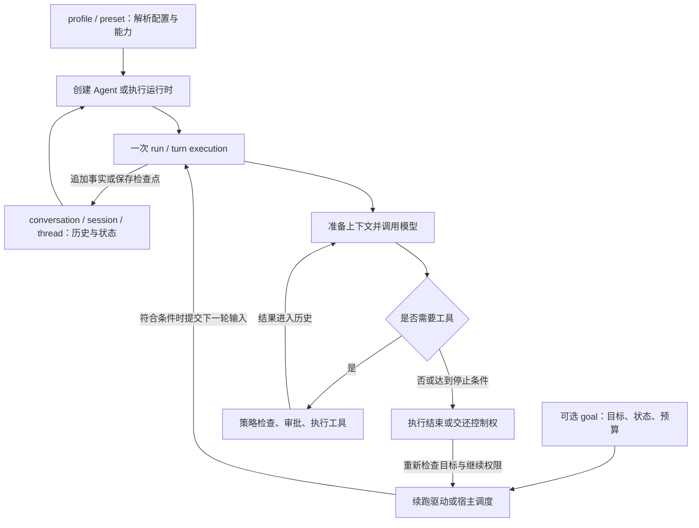

# 四套 Agent 的 profile、conversation、goal 与 run

扫描日期：2026-10-19。本文按源码职责对齐概念，不假设四个项目使用相同术语或相同对象层次。本次是官方源码与文档的静态核查，没有运行模型、启动四套产品或执行故障实验。

## 1. 先把四个问题分开

| 概念 | 回答的问题 | 通常保存什么 | 生命周期 |
| --- | --- | --- | --- |
| profile / preset | 以什么配置和能力工作？ | 模型、工具、提示词、权限、后端或插件组合 | 配置可供多次执行、多段会话复用 |
| conversation / session / thread | 这段交互已经发生什么？ | 消息、工具调用与结果、配置线索、会话状态或检查点 | 跨多轮执行存在，可持久化 |
| goal | 还要完成什么，是否获准继续？ | 目标、状态，有些实现还有预算与续跑策略 | 可跨多个执行轮次；普通聊天可以没有它 |
| run / turn execution | 现在执行哪一段工作？ | 当前输入、取消、等待审批、模型和工具步骤、终止原因 | 一次活动的执行区间；结束不等于目标完成 |

这是本文的分析坐标，不是某个框架的统一 API。尤其是 `run`、`turn`、`step`：必须先看项目如何划分，不能按名字直接互换。

更准确的关系是“配置 + 状态 + 调度”，而不是四层固定嵌套：



图中的目标驱动是可选能力。最小 Agent 只需要“输入 → 模型 → 工具 → 模型”的内循环；目标驱动解决的是内循环结束以后是否还要再启动一次。

## 2. 版本依据

| 项目 | 本次依据 |
| --- | --- |
| DeepSeek Harness 上游 | `687f282e8625c6b8d11ff58211a90524be2e4317`，提交日期 2026-10-17 |
| 本仓库 DeepSeek Harness 子模块 | `99f6f02fecdb7dff40c3fbc9470f5907c29f74ca`，提交日期 2026-08-17；仅用于辨认教学资料与现状的差异 |
| Codex 上游 | `47db41930433487eb1419b3d5887bce7bd53fbe5`，提交日期 2026-10-19，以及实际读取的 OpenAI 官方文档 |
| DeepAgents 上游 | `ca48a2b49fd3a542ca609037f8e22d56a18745d1`，包括 SDK core 与当前 `libs/code` CLI，分别标注 |
| OpenHands SDK 上游 | `3e8e17bee85494eb5ec2eae71ad0bb011e35b33d`；产品仓库另核对 `8fa496c1dad45e77f5f205188f41993e40b65164` |

DeepAgents 与 OpenHands 的固定版本、源码位置另见配套扫描记录：[DeepAgents / OpenHands 源码扫描](deepagents-openhands-loop-source-scan.md)。

## 3. DeepSeek Harness：应用 profile、会话状态、目标域与执行驱动各有主人

### 3.1 profile 是整套应用装配，preset 是其中一个 Agent 的能力组合

`profile` 从有序 bundle 和 patch 组合 Cordis 插件树。当前公开 profile 包括 `web`、`headless`、`sdk`、`sdk-minimal`、`acp`。例如 Web 会挂载服务器、RPC、浏览器连接；headless 运行一项任务并退出，不需要 Web Server。

具体会话使用哪些工具、提示词片段和 skills，则由 `agent-preset` 声明和 `agent-preset-registry` 管理。同一宿主进程可以运行多个 preset。活着的 Agent 保留已绑定的组合修订；改定义主要影响后来创建的 Agent。持久会话记录 preset ID，但进程重启后使用该 ID 当前的定义，不能据此声称旧插件代码也被永久保存。

因此可理解为：`web profile` 决定启动什么应用，`standard preset` 决定某个会话中的 Agent 有什么能力。两者都不负责保存聊天历史。[架构](https://github.com/deepseek-ai/deepseek-harness/blob/687f282e8625c6b8d11ff58211a90524be2e4317/docs/architecture.md)、[Preset Registry](https://github.com/deepseek-ai/deepseek-harness/blob/687f282e8625c6b8d11ff58211a90524be2e4317/packages/preset/agent-preset-registry/README.md)。

### 3.2 conversation 对应 Session；活着的 Agent 是它的执行句柄

Session 的追加事件日志记录会话事实，`deriveMessages()` 从中投影模型历史。Agent 持有 Session、inbox、运行状态和取消控制器。Session 可以在磁盘上存在而没有活着的 Agent；读取历史也不应等同于启动执行。

当前上游把实时 `agent/assistant-stream` 与持久结算区分开：流片段先服务实时展示，结算后通过 `assistant/message` 或 `assistant/attempt` 保存完整紧凑流。进程在结算前硬退出，不能保证这些实时片段已经持久化。这与本地 8 月版逐条记录 `assistant/chunk` 有明显差异。[当前架构与日志说明](https://github.com/deepseek-ai/deepseek-harness/blob/687f282e8625c6b8d11ff58211a90524be2e4317/docs/architecture.md)、[当前循环源码](https://github.com/deepseek-ai/deepseek-harness/blob/687f282e8625c6b8d11ff58211a90524be2e4317/packages/core/agent-loop/src/agent.ts)。

### 3.3 goal 状态和“自动执行下一轮”是两个包

`dsh-goal` 在同一 Session 中保存一个当前目标：`objective`、`id/revision`、`phase`、`maxGoalRounds`，以及从日志推导的已进入轮数。持久阶段是 `active / paused / blocked / complete`；修改使用精确版本，避免旧页面覆盖新状态。

`active` 不足以授权自动继续。还有进程内的 `armed / disarmed`；resume、fork 或重新创建 Agent 后，即使目标仍 active，也会 disarmed，必须显式恢复才可自动推进。状态可恢复与继续权限可恢复是两个不同问题。

`dsh-goal-round-driver` 才负责续跑：等待 Agent 空闲、目标 active 且 armed、没有竞争输入、子 Agent 等条件满足，完成必要的持久化检查，再用 `agent.followup()` 投递下一轮目标提示。只有目标消息真正进入模型历史才消耗轮数。`maxGoalRounds` 是目标轮数上限，不是 token、花费或每轮模型请求数上限。[Goal](https://github.com/deepseek-ai/deepseek-harness/blob/687f282e8625c6b8d11ff58211a90524be2e4317/packages/goal/goal/README.md)、[Goal Round Driver](https://github.com/deepseek-ai/deepseek-harness/blob/687f282e8625c6b8d11ff58211a90524be2e4317/packages/goal/goal-round-driver/README.md)。

### 3.4 run 对应自动唤醒的 driver，一次活动可以消费多个 turn

真实调用链：

```text
followup(message) → next-turn inbox + wake
steer(message)    → next-step inbox + wake
inject(context)  → next-step inbox，不主动 wake
  ↓
wakeDriver() → kick()
  ↓ 循环消费 turn
turn()
  ↓ 循环推进 step
preStep() → step()
  ↓ 允许请求失败后的局部 retry
prepareRequest() → buildRequest() → llm.stream()
  ↓
executeToolCalls() → 工具结果入 Session → 下一个 step
```

本框架一个 `step` 是一次正常模型请求及其工具执行，失败重试可能在同一 step 内发生；一个 `turn` 可以有多个 step。一次 `kick()` 活动还可能连续消费多个 turn，所以 `whenIdle()` 等待的是整体活动静止，不是一次 HTTP 请求结束。[源码：输入接口、kick、turn、step](https://github.com/deepseek-ai/deepseek-harness/blob/687f282e8625c6b8d11ff58211a90524be2e4317/packages/core/agent-loop/src/agent.ts)。

## 4. Codex：配置 profile、Thread、Goal Extension 与 run_turn

### 4.1 profile 是命名配置覆盖层

当前官方文档说明：0.134.0 起，`--profile review` 选择 `~/.codex/review.config.toml`，叠加在基础用户配置上；工程配置及运行时覆盖仍可在更高层生效。旧的 `[profiles.review]` 不再是该新机制的写法。源码 `loader/mod.rs` 同时保留了历史类型和新版加载逻辑，不能因为看到 `ConfigProfile` 类型就认定旧配置仍是推荐方式。

这里的 profile 主要选模型、推理强度、审批和权限等配置，不像 DSH 的应用 profile 那样直接声明整个可替换插件树。另外 `permission profile` 是权限配置概念，需要与 `--profile` 的用户配置层区别开。[OpenAI 官方 profile 文档](https://developers.openai.com/codex/config-advanced#profiles)、[配置加载源码](https://github.com/openai/codex/blob/47db41930433487eb1419b3d5887bce7bd53fbe5/codex-rs/config/src/loader/mod.rs)。

### 4.2 conversation 对应 Thread，向外使用 Turn / Item 协议

App Server 对外分成 `Thread → Turn → Item`：Thread 保存一段会话，Turn 是一次用户请求及后续 Agent 工作，Item 是消息、工具调用、命令和文件变更等内容。`thread/start / resume / fork` 管会话，`turn/start / steer / interrupt` 管执行；二者不是同一套操作。[OpenAI 官方 App Server 文档](https://developers.openai.com/codex/app-server)。

活着的 Session 运行时负责历史、输入队列、活动执行、工具和取消等。一个对外 Turn 可以包含多个内部模型采样请求。仓库旧 `protocol_v1.md` 对 Task / Turn 的描述带有历史术语和自身过时提示，本分析以当前实现和 App Server 协议为准。[Session](https://github.com/openai/codex/blob/47db41930433487eb1419b3d5887bce7bd53fbe5/codex-rs/core/src/session/mod.rs)、[当前 run_turn](https://github.com/openai/codex/blob/47db41930433487eb1419b3d5887bce7bd53fbe5/codex-rs/core/src/session/turn.rs)。

### 4.3 goal 已是原生持久目标，续跑由扩展接入

当前开源树中有独立 `ext/goal`。`ThreadGoal` 以 thread 为归属保存目标、状态、token budget、tokens used 和累计时间；状态包括 active、paused、blocked、usage_limited、budget_limited、complete。App Server 暴露 `thread/goal/set|get|clear`，模型侧有 create/get/update 工具。是否可用取决于该扩展和相应配置是否启用，普通 turn 不必创建 goal。

实际续跑链是：`GoalExtension.on_thread_idle()` → `GoalRuntime.continue_if_idle()` → 读取当前目标和延迟条件 → `thread.start_turn_if_idle()`。它提交的是一个新的目标 turn，不是在 UI 中重复点击发送，也不是把模型自身输出直接当成执行调度。

与 DSH 的显式 disarmed 规则不同，Codex 此版本 `restore_after_resume()` 会为 active 目标恢复进程内活动记账；后续能否续跑仍受启用状态、live thread、持久 deferral、原子空闲提交等检查约束，不能简化成“读到历史就一定运行”。[目标数据](https://github.com/openai/codex/blob/47db41930433487eb1419b3d5887bce7bd53fbe5/codex-rs/state/src/model/thread_goal.rs)、[Goal Extension](https://github.com/openai/codex/blob/47db41930433487eb1419b3d5887bce7bd53fbe5/codex-rs/ext/goal/src/extension.rs)、[Goal Runtime](https://github.com/openai/codex/blob/47db41930433487eb1419b3d5887bce7bd53fbe5/codex-rs/ext/goal/src/runtime.rs)。

### 4.4 run_turn 拥有模型与工具内循环，Goal Extension 决定是否启动下一轮

```text
客户端 turn/start 或目标扩展 start_turn_if_idle
  ↓
会话输入调度 / turn task
  ↓
run_turn()
  ↓ 循环：吸收边界输入、构造历史、压缩等
run_sampling_request()
  ↓ 含请求重试
try_run_sampling_request()
  ↓ 消费模型流、处理输出 Item
ToolCallRuntime / ToolRouter → 工具实现
  ↓
needs_follow_up 或 pending input → 再采样
否则检查停止 hook → 结束 turn
  ↓
thread idle → 可选 GoalExtension 决定是否再开 turn
```

工具审批、沙箱选择和受限失败后的处理由工具运行时管线负责，并不是模型“说了同意”就能通过。普通采样结束时也要检查待处理输入和 stop hook，不能简单认为“出现一段 assistant 文本就结束”。[run_turn / sampling](https://github.com/openai/codex/blob/47db41930433487eb1419b3d5887bce7bd53fbe5/codex-rs/core/src/session/turn.rs)、[Tool Orchestrator](https://github.com/openai/codex/blob/47db41930433487eb1419b3d5887bce7bd53fbe5/codex-rs/core/src/tools/orchestrator.rs)。

## 5. DeepAgents：按模型适配 Harness，由 LangGraph 执行，CLI 再装配目标能力

### 5.1 profile 主要在模型与 Harness 构造层

当前 SDK 已有 ProviderProfile 和 HarnessProfile。ProviderProfile 负责模型构造参数及初始化前处理；HarnessProfile 按 provider/model 选择提示、工具约定、中间件与默认子 Agent 配置。`create_deep_agent()` 在构图时解析这些内容，再把组装结果交给 LangChain `create_agent()`，最终返回 `CompiledStateGraph`。

CLI 还有 `ModelProfileEntry`，表示模型能力字典，例如上下文容量与工具调用能力；`--agent` 则选择 AGENTS.md/skills 等 Agent 目录。不能把这些不同的配置入口都理解为 DSH 的 Web/headless 应用部署 profile，也不能再声称 DeepAgents 没有 profile。[graph.py](https://github.com/langchain-ai/deepagents/blob/ca48a2b49fd3a542ca609037f8e22d56a18745d1/libs/deepagents/deepagents/graph.py)、[HarnessProfile](https://github.com/langchain-ai/deepagents/blob/ca48a2b49fd3a542ca609037f8e22d56a18745d1/libs/deepagents/deepagents/profiles/harness/harness_profiles.py)、[详细配置源码索引](deepagents-openhands-loop-source-scan.md)。

### 5.2 conversation 由 LangGraph thread 与 state 表达

SDK 的中心对象是编译好的图，不是一个必须实例化的 `Conversation` 类。多次执行通过相同的 `thread_id` 和 checkpointer 延续 AgentState；消息、规划和扩展状态可以属于同一个 thread。一个图可以服务多个 thread，一个 thread 可以经历多次图 invocation。有没有真正持久化、存在哪里，取决于接入的 checkpointer 与宿主。模型的一次 API 请求、一次图 invocation、跨 invocation 的 thread 是三个不同层级。[SDK 构造与状态定义](https://github.com/langchain-ai/deepagents/blob/ca48a2b49fd3a542ca609037f8e22d56a18745d1/libs/deepagents/deepagents/graph.py)。

### 5.3 goal 的完整生命周期在当前 CLI 装配，Rubric 是可复用中间件

`create_deep_agent()` 默认不是一个自带持久目标管理器的产品。SDK core 的可选 `RubricMiddleware` 提供评分与修订；CLI 的 `GoalToolsMiddleware`、`ReliableRubricMiddleware` 和应用状态管理再组成完整的 goal 体验。

CLI 把 objective、status、rubric 等写入图状态。模型请求 `update_goal(complete)` 只暂存待完成说明；应用的 `_resolve_pending_goal_completion()` 还要找到与本轮 `grading_run_id` 对应的 satisfied 结果，才确认 complete。创建/修改目标有提案确认流程，暂停与恢复受用户控制。这比只让模型修改一个 `status` 字段多了一道评分约束。[goal_tools.py](https://github.com/langchain-ai/deepagents/blob/ca48a2b49fd3a542ca609037f8e22d56a18745d1/libs/code/deepagents_code/goal_tools.py)、[CLI app.py](https://github.com/langchain-ai/deepagents/blob/ca48a2b49fd3a542ca609037f8e22d56a18745d1/libs/code/deepagents_code/app.py)。

### 5.4 普通工具循环与评分修订可以发生在同一个图 invocation 内

```text
create_deep_agent() → create_agent() → CompiledStateGraph
  ↓ 宿主 invoke / stream / astream 等入口
model → tools → model → ... → 尝试结束
  ↓ 可选 RubricMiddleware.after_agent / aafter_agent
嵌套 grader 评分
  ├─ satisfied / failed / grader_error / 达到评分上限 → 返回
  └─ needs_revision → 写入反馈 HumanMessage + jump_to=model
                        └─ 在同一次图 invocation 内继续
```

评分中间件默认最多评分 3 次；这个次数不是工具调用数，也不是最大递归步数。CLI 还可以通过 `_continue_goal_work()` 提交隐藏的续跑输入，但它是应用触发下一次图执行的逻辑，不能据此推断 SDK 默认有一个常驻后台 goal driver。[RubricMiddleware](https://github.com/langchain-ai/deepagents/blob/ca48a2b49fd3a542ca609037f8e22d56a18745d1/libs/deepagents/deepagents/middleware/rubric.py)、[CLI 续跑实现](https://github.com/langchain-ai/deepagents/blob/ca48a2b49fd3a542ca609037f8e22d56a18745d1/libs/code/deepagents_code/app.py)。

## 6. OpenHands：配置解析成 Agent，Conversation 拥有 run，Goal 再包一层审计循环

### 6.1 profile 包含模型、Agent 与组合解析，不能只看旧 config.toml

当前 SDK 有三类需要区别：LLM Profile 保存模型相关配置；AgentProfile 是带 `llm_profile_ref`、MCP 引用、工具、skills 和验证策略等内容的命名启动规格；MetaProfile 描述模型路由。AgentProfile 还区分 OpenHands Agent 与 ACP 外部 Agent 类型。

`sdk.launch.resolve()` 把引用解析成 `ResolvedLaunch`，携带可供运行时使用的 settings 和启动来源。旧 `resolve_agent_profile()` 已标记弃用。profile 负责选择和组装执行配置，Conversation 才是活动会话。[AgentProfile](https://github.com/OpenHands/software-agent-sdk/blob/3e8e17bee85494eb5ec2eae71ad0bb011e35b33d/openhands-sdk/openhands/sdk/profiles/agent_profile.py)、[launch.resolve](https://github.com/OpenHands/software-agent-sdk/blob/3e8e17bee85494eb5ec2eae71ad0bb011e35b33d/openhands-sdk/openhands/sdk/launch/resolve.py)、[MetaProfile](https://github.com/OpenHands/software-agent-sdk/blob/3e8e17bee85494eb5ec2eae71ad0bb011e35b33d/openhands-sdk/openhands/sdk/llm/meta_profile_store.py)。

旧 OpenHands 的 AgentController / Runtime 资料不能直接当作当前 V1 SDK 的调用链；当前 SDK 的模型、工具与会话逻辑位于独立 `software-agent-sdk` 仓库。完整路径见配套[源码扫描记录](deepagents-openhands-loop-source-scan.md)。

### 6.2 Conversation 是公开入口，也负责根据 workspace 选择本地或远程实现

`Conversation(...)` 根据 LocalWorkspace / RemoteWorkspace 选择 LocalConversation / RemoteConversation，持有 Agent、会话状态和事件。消息先送入会话，再显式 run。远程实现把相关操作发送给 Agent Server；服务端继续管理实际执行，不能把 SDK 客户端中的代理对象当成运行中的整个 Agent。

同步路径是 `LocalConversation.run() → _run()` 的 while → `agent.step()`；异步路径是 `arun() → _arun()` 的 while → `agent.astep()`。默认 `max_iteration_per_run=500` 约束一次 run 内的迭代；模型提出 FINISHED 后仍会经过 stop hook，hook 可以要求继续。一次 run 因此包含多步模型与工具，不能与一次 LLM completion 画等号。单个 step 也可能只处理 pending action 或压缩，不一定发出模型请求。[SDK 源码仓库](https://github.com/OpenHands/software-agent-sdk/tree/3e8e17bee85494eb5ec2eae71ad0bb011e35b33d/openhands-sdk/openhands/sdk/conversation)。

### 6.3 goal 是 run 外面的 controller + judge

`conversation/goal/runner.py` 的 `run_goal()` 反复调用 `conversation.run()`，每次返回后由 `GoalController.on_run_finished()` 调用 `judge_goal()`。判定完成就结束；未完成则追加 followup 再 run；达到审计轮数上限则 capped。默认目标审计上限 10 次，不能和单次 run 的 500 次内部迭代混用。另有可选 critic/迭代修订机制在单次 run 内工作，goal 的外层审计能与它组合，二者不是同一个评分器。

服务端 `event_service._run_goal_loop()` 提供对应的异步目标循环。GoalStatus 通过 `ConversationStateUpdateEvent(key='goal')` 保存；恢复时把尚在 active 的目标转为 interrupted，通过显式 resume 恢复目标循环。普通用户消息会停止当前 goal loop，让新输入接管。[Goal Runner](https://github.com/OpenHands/software-agent-sdk/blob/3e8e17bee85494eb5ec2eae71ad0bb011e35b33d/openhands-sdk/openhands/sdk/conversation/goal/runner.py)、[Goal Controller](https://github.com/OpenHands/software-agent-sdk/blob/3e8e17bee85494eb5ec2eae71ad0bb011e35b33d/openhands-sdk/openhands/sdk/conversation/goal/controller.py)。

```text
run_goal() / AgentServer goal loop
  ↓ 外层审计循环
conversation.run() / arun()
  ↓ 内层工作循环
agent.step() / astep() → LLM → 工具 → 事件 → 下一 step
  ↓ run 返回
GoalController → judge_goal
  ├─ complete → 目标结束
  ├─ capped → 达到目标审计上限
  └─ 未完成 → send_message(审计反馈) → 下一次 run
```

### 6.4 Context 是模型请求组装层，不能省略

OpenHands 的 `context` 包并不是 Conversation 的另一个名字。`AgentContext` 提供仓库/技能、system/user suffix、时间、memory 等提示材料；`AgentBase._build_prompt_context()` 解析为 frozen `PromptContext`，通过 Prompt Registry 渲染 static/dynamic 两块。`dynamic` 在这里指每会话的缓存分层，不表示每次模型调用都重渲染。

`Agent.init_state()` 首次把两块写入 `SystemPromptEvent`；恢复时已有该事件就跳过初始化。`send_message()` 则用 AgentContext 匹配本次输入触发的知识技能，将补充内容记入 `MessageEvent.extended_content`；工具触及路径时也可能触发规则。随后每个常规模型步骤走：

```text
AgentContext + 模型/工具配置
  → PromptContext → Registry → SystemPromptEvent（初始化）

用户输入 / goal objective / goal followup
  → send_message → 技能与 suffix 增补 → MessageEvent

会话事件 → ConversationState.view
  → prepare_llm_messages / aprepare_llm_messages
  → 可选 condenser
  → LLMConvertibleEvent.events_to_messages
  → llm.generate / agenerate
```

goal 并不是 `AgentContext` 或 `PromptContext` 的原生字段；goal driver 通过发送消息接入这条请求管线。服务端保存的 `GoalStatus` 事件不是模型消息，不能因为目标状态存在就认为它每次都被自动投喂。独立 judge 另行把 objective 和 transcript 组装成自己的请求。

还有同名但职责不同的 `LLMCallContext`：它携带 conversation 的 `prompt_cache_key`、`session_id`，应用到请求选项/头部，不能当成提示词正文。[AgentContext](https://github.com/OpenHands/software-agent-sdk/blob/3e8e17bee85494eb5ec2eae71ad0bb011e35b33d/openhands-sdk/openhands/sdk/context/agent_context.py)、[初始化和采样](https://github.com/OpenHands/software-agent-sdk/blob/3e8e17bee85494eb5ec2eae71ad0bb011e35b33d/openhands-sdk/openhands/sdk/agent/agent.py#L543)、[消息投影与压缩](https://github.com/OpenHands/software-agent-sdk/blob/3e8e17bee85494eb5ec2eae71ad0bb011e35b33d/openhands-sdk/openhands/sdk/agent/utils.py#L581)、[LLMCallContext](https://github.com/OpenHands/software-agent-sdk/blob/3e8e17bee85494eb5ec2eae71ad0bb011e35b33d/openhands-sdk/openhands/sdk/llm/call_context.py)。

## 7. 四套实现真正需要对齐的边界

| 维度 | DeepSeek Harness | DeepAgents | OpenHands SDK | Codex |
| --- | --- | --- | --- | --- |
| profile 主要层次 | 应用插件树；Agent preset 另分层 | 模型/Provider 与 Harness 构造 | LLM / Agent / Meta 与 launch 解析 | 命名用户配置覆盖层 |
| 会话承载 | Session 事件日志 + 活 Agent | LangGraph thread + state + checkpointer | Conversation + state/events + workspace | Thread + Session runtime + Turn/Item |
| 目标机制所在 | Goal 状态包 + 独立 round driver | 可选 SDK Rubric；CLI 组合持久 goal | 原生 goal controller / judge / runner | 持久 ThreadGoal + GoalExtension |
| 目标未完成时回哪里 | 空闲后提交下一个 turn | Rubric 可在同一 invocation 回 model；CLI 也有续跑输入 | 外层再次 conversation.run | 空闲后 start_turn_if_idle |
| 主要目标限制 | 已进入目标轮数 | Rubric 评分轮数等；另有图步数限制 | 审计 run 轮数；另有 run 内步数限制 | 可选 token budget，另有账户用量限制 |
| 恢复目标状态后 | active 也 disarmed，须显式 resume | 依赖 checkpoint 与 CLI 恢复控制，不是默认后台调度 | active 转 interrupted，显式恢复 goal loop | active 可恢复活动记账；续跑仍检查启用、deferral 与空闲条件 |

这张表描述的是本次固定版本与指定装配层，不代表每个项目的最小 SDK 默认启用整列能力。

## 8. 用同一个任务检验四个概念

用户要求：“修复登录超时，验收是相关测试通过。”

1. 选配置：用什么模型、能不能写文件、用本地目录还是远程 workspace。profile/preset 在这里起作用。
2. 创建或恢复会话：保存需求、读到的文件、测试日志、修改和解释。conversation/session/thread 在这里起作用。
3. 启动一次执行：模型读文件、编辑、运行测试，再解释结果。一次 run/turn 可以包含许多模型与工具步骤。
4. 这次执行可能认为已经做完而返回；如果还有明确的长期目标，目标驱动可以依据状态、预算、授权和验收反馈再启动一次执行。
5. 最终完成、暂停、阻塞、取消、预算耗尽是不同结果。把它们都记成 `done`，会使恢复和自动续跑产生错误。

“验收通过”需要真实测试或可信评价依据。goal 字段本身不自动验证代码正确；独立 verifier 也不是所有框架的默认必经层。

## 9. 如果给本实验项目设计接口

以下是基于对比的设计建议，不是对四套源码统一 API 的描述。

- `ProfileDefinition` 保存可复用配置；具体执行记录有效配置与能力版本，避免只保留一个后来可能变化的 profile 名字。
- `Conversation` 保存稳定身份、消息事实和恢复入口；活着的 AgentHandle 单独持有取消、队列与工具资源。
- `Goal` 是可选业务状态；目标修改与自动执行权限分别建模。恢复状态时明确是否恢复自动执行。
- `Run` 是执行记录；保留触发来源、开始/结束、停止原因和本次步骤。一个目标允许多次 Run，同一个 Conversation 也允许没有 Goal 的人工 Run。
- `GoalDriver` 决定是否提交下一次 Run；`AgentLoop` 只负责当前执行中的模型/工具推进。审批与工具执行策略落在工具管线。

最值得保留的区别：**Run 结束是执行事实，Goal 完成是任务判断；Conversation 保存两者的历史，Profile 为执行提供配置。**

## 10. 遗漏审计：四个概念与 Context 还不足以解释可用产品

此前的说明聚焦 profile、conversation、goal、run，后来补上 Context，但仍没有完整展开下列职责。这里的“层”按职责划分；它们并非四套共同采用的固定类继承或包含结构。

| 职责 | 前面说明的缺口 | 必须回答的具体问题 |
| --- | --- | --- |
| 装配与 Agent 定义/实例 | 讲了 profile，没充分展开如何创建可运行对象 | 谁解析配置、创建模型与工具、绑定会话资源？谁销毁它们？ |
| 会话宿主与输入调度 | 讲了 run，没充分展开谁准许启动 | 用户插话是排队、steer 还是取消？等待审批时由谁恢复？谁防止竞争启动？ |
| 模型运行时/Provider | 把调用模型画成一条箭头 | 谁转换协议、选路由、绑定模型能力、维护连接与缓存、重试网络请求？ |
| 工具注册与执行管线 | 提过工具，但执行不是简单函数调用 | schema 怎么公开？参数/结果怎么验证？调用如何并行、超时、取消、归一化？ |
| 权限/审批/Hook | 提过审批，但容易和提示词规则混同 | 真正执行前谁能拒绝？审批如何往返？Hook 能否阻止输入、工具或结束？ |
| Workspace/Backend/执行环境 | 提过 sandbox，但没有展开物理执行归属 | 文件、shell、进程、浏览器实际在哪跑？路径、权限和资源生命周期由谁管理？ |
| 事件、模型投影与 UI 投影 | 曾把会话历史过度接近模型历史 | 哪些事件进入模型？哪些只供 UI？实时流、已结算消息和日志有什么区别？ |
| 持久化、恢复与资源生命周期 | 讲过可恢复，未完整区分状态与执行资源 | checkpoint/log 能恢复什么？谁重建运行对象？进程和 task 是否还活着？ |
| 子 Agent/后台任务/编排 | 尚未放进四套主调用链 | child 的输入、历史、工具、预算、审批、取消和结果由谁拥有？ |
| 服务协议与客户端 | 提过 Server/UI，未展开它们的职责边界 | 谁接收命令、承载双向审批、推送事件、重连、读历史和渲染结果？ |

Context 内还要分别辨认指令/技能/记忆来源、请求组装、历史压缩；它们不应和模型 Provider、执行环境都合称为“runtime”。

### 10.1 四套的实际实现坐标

| 职责 | DeepSeek Harness | DeepAgents | OpenHands SDK/Server | Codex |
| --- | --- | --- | --- | --- |
| 装配与 Agent | Cordis profile/bundle/preset + Agent factory | `create_deep_agent → create_agent → CompiledStateGraph` | `launch.resolve → finalize → Agent` | 配置解析 + Thread/Session 创建 |
| 输入与执行宿主 | Agent inbox、wake、`followup/steer/inject` | 宿主调用图；LangGraph interrupt/resume | LocalConversation；服务端 EventService 持有 run/goal task | 输入队列、submission handler、turn task |
| 模型请求 | `ctx.llm.prepareCall/stream` + provider adapter | LangChain chat model + provider/harness profile | `LLM/RouterLLM`，`generate/agenerate` | Session 级 ModelClient + Turn 级 ModelClientSession |
| 工具执行 | scoped Tools registry + ToolRuntime + 调度器 | tools 节点与 tool middleware | ToolDefinition、Action/Observation、executor | ToolRouter/registry + ToolCallRuntime；相关工具使用 ToolOrchestrator |
| 实际执行环境 | fs/subprocess/shell/terminal provider 与 sandbox 能力 | Filesystem/Sandbox Backend 的具体实现 | Workspace 与工具执行器；远端 Agent Server | 工具 runtime + 当前 environment/executor/sandbox |
| 状态与投影 | SessionEvent → 模型/客户端 projection | graph state、checkpoint、stream modes | EventLog → cached View → messages；服务端事件推送 | ThreadStore/持久记录、模型历史与对外 Turn/Item 事件 |
| 子任务 | Subagent provider、Job、Workflow 分属不同能力 | SubAgentMiddleware 等图/工具装配 | DelegateExecutor 管 child Conversation | child thread/Agent 控制与工具入口 |

这张表是职责映射，不表示一行中的对象完全等价，也不表示最小 SDK 默认安装该项目所有产品能力。

### 10.2 必须分开的三种循环

```text
目标循环：未完成且允许继续 → 再开一段执行
    执行循环：模型要求工具 → 执行工具 → 再问模型
        请求重试：一次模型请求因可重试错误再次尝试
```

三者的停止条件、预算和重试语义不同。审批等待、压缩模型调用、内部评分调用也不应随意算成同一种 step。网络请求重试尤其不能直接扩展为重做已经产生外部副作用的工具。

### 10.3 以 OpenHands 展开完整主路径

```text
Profile → launch.resolve/finalize → Agent
    Agent 使用 LLM、AgentContext、工具，以及可选 condenser/critic

Conversation
    State：Agent、Workspace、执行状态、确认策略、事件和统计等
    send_message：输入 Hook/技能扩展 → 消息事件
    run/arun：活动执行与取消
      → state.view → condenser → messages
      → LLM generate/agenerate
      → 模型响应解析 → Action
      → 相关 Hook/安全分析/确认策略
      → 工具执行器 → 真实执行环境 → Observation
      → 事件更新 → 下一步

Agent Server 的 EventService（远程装配）
    _conversation + _run_task + _goal_loop_task
    接收远程操作、推送事件、处理恢复
```

这是代表性路径，不保证每个 step 都调用模型或执行工具；具体分支由 Action 类型和配置决定。Goal runner 与可选 critic/Stop Hook 另决定何时结束或继续。

### 10.4 横切机制不能误画成外层容器

- **权限与隔离**：工具 schema 可见性、执行审批、操作系统/容器隔离是不同约束。实现 Sandbox 接口不自动代表安全隔离。
- **Hooks/中间件/插件生命周期**：可能出现在输入、请求、工具和停止等多个节点，不是只在 loop 外面包装一次。
- **观测与预算**：日志、trace、usage、token/cost、子任务汇总以及目标预算各有归属；统计到数值不代表某一执行点已经强制限制。
- **持久化与资源清理**：恢复目标和消息不代表恢复了活动 task、终端进程或远端沙箱；取消也需要等待已启动资源收敛。

### 10.5 代表源码依据

- DSH：[整体装配与能力边界](https://github.com/deepseek-ai/deepseek-harness/blob/687f282e8625c6b8d11ff58211a90524be2e4317/docs/architecture.md)、[ToolRuntime](https://github.com/deepseek-ai/deepseek-harness/blob/687f282e8625c6b8d11ff58211a90524be2e4317/packages/core/tools/src/index.ts)、[工具并发调度](https://github.com/deepseek-ai/deepseek-harness/blob/687f282e8625c6b8d11ff58211a90524be2e4317/packages/core/agent-loop/src/tool-calls.ts)。
- DeepAgents：[组图与 middleware](https://github.com/langchain-ai/deepagents/blob/ca48a2b49fd3a542ca609037f8e22d56a18745d1/libs/deepagents/deepagents/graph.py)、[Filesystem/Subagent middleware 与 Backend 的进一步源码索引](deepagents-openhands-loop-source-scan.md)。
- OpenHands：[AgentBase](https://github.com/OpenHands/software-agent-sdk/blob/3e8e17bee85494eb5ec2eae71ad0bb011e35b33d/openhands-sdk/openhands/sdk/agent/base.py)、[Agent 执行](https://github.com/OpenHands/software-agent-sdk/blob/3e8e17bee85494eb5ec2eae71ad0bb011e35b33d/openhands-sdk/openhands/sdk/agent/agent.py)、[ConversationState](https://github.com/OpenHands/software-agent-sdk/blob/3e8e17bee85494eb5ec2eae71ad0bb011e35b33d/openhands-sdk/openhands/sdk/conversation/state.py)、[EventService](https://github.com/OpenHands/software-agent-sdk/blob/3e8e17bee85494eb5ec2eae71ad0bb011e35b33d/openhands-agent-server/openhands/agent_server/event_service.py)。
- Codex：[输入调度](https://github.com/openai/codex/blob/47db41930433487eb1419b3d5887bce7bd53fbe5/codex-rs/core/src/session/input_queue.rs)、[模型客户端生命周期](https://github.com/openai/codex/blob/47db41930433487eb1419b3d5887bce7bd53fbe5/codex-rs/core/src/client.rs)、[工具路由](https://github.com/openai/codex/blob/47db41930433487eb1419b3d5887bce7bd53fbe5/codex-rs/core/src/tools/router.rs)、[审批与沙箱选择](https://github.com/openai/codex/blob/47db41930433487eb1419b3d5887bce7bd53fbe5/codex-rs/core/src/tools/orchestrator.rs)。

进一步核对得到的具体例子：

- DeepAgents Code 的[请求模型选择](https://github.com/langchain-ai/deepagents/blob/ca48a2b49fd3a542ca609037f8e22d56a18745d1/libs/code/deepagents_code/configurable_model.py#L942)和[模型节点重试](https://github.com/langchain-ai/deepagents/blob/ca48a2b49fd3a542ca609037f8e22d56a18745d1/libs/code/deepagents_code/model_retry.py#L1091)是额外职责，不能用 `create_deep_agent` 的静态构造解释全部运行行为。
- DeepAgents 的 [LocalShellBackend](https://github.com/langchain-ai/deepagents/blob/ca48a2b49fd3a542ca609037f8e22d56a18745d1/libs/deepagents/deepagents/backends/local_shell.py#L1)明确不提供 sandboxing/isolation；接口类型与实际隔离必须分别检查。
- OpenHands [ParallelToolExecutor](https://github.com/OpenHands/software-agent-sdk/blob/3e8e17bee85494eb5ec2eae71ad0bb011e35b33d/openhands-sdk/openhands/sdk/agent/parallel_executor.py#L67)与 [DelegateExecutor](https://github.com/OpenHands/software-agent-sdk/blob/3e8e17bee85494eb5ec2eae71ad0bb011e35b33d/openhands-tools/openhands/tools/delegate/impl.py#L112)分别负责工具并发与子会话委派，不能都归纳成“循环里 await 一个工具”。
- OpenHands 的[预算检查](https://github.com/OpenHands/software-agent-sdk/blob/3e8e17bee85494eb5ec2eae71ad0bb011e35b33d/openhands-sdk/openhands/sdk/conversation/impl/local_conversation.py#L737)比较会话累计指标与配置限额；不能仅从 `max_budget_per_run` 的名字推断每次 run 从零开始计算。

该附录确认的是此前解释的缺口，不把这些职责面的清单当作四套代码已经逐文件穷尽的证明。
