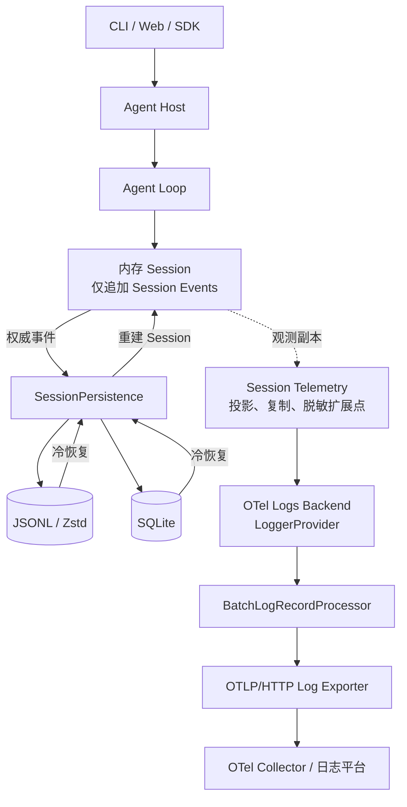
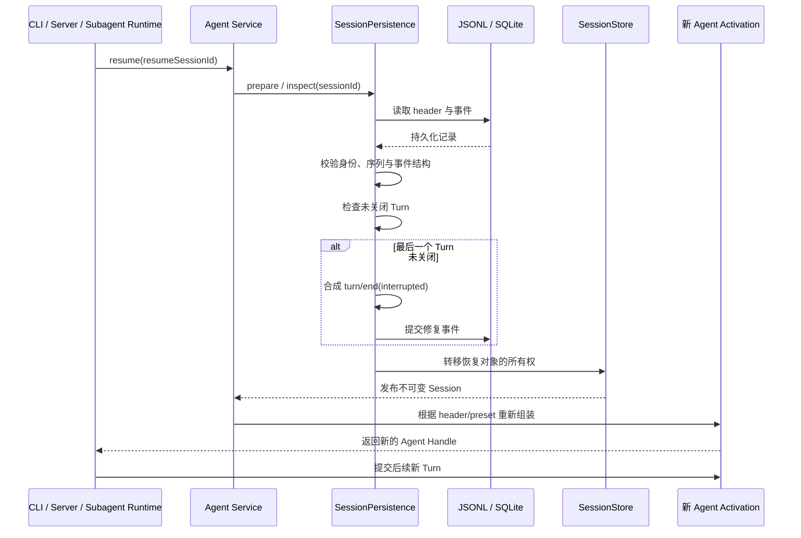
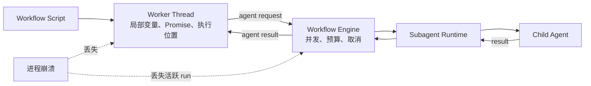
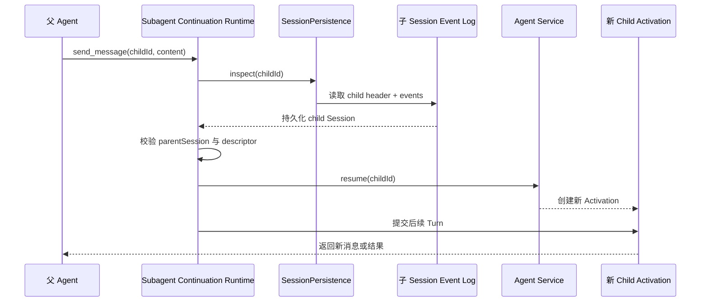
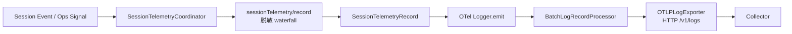
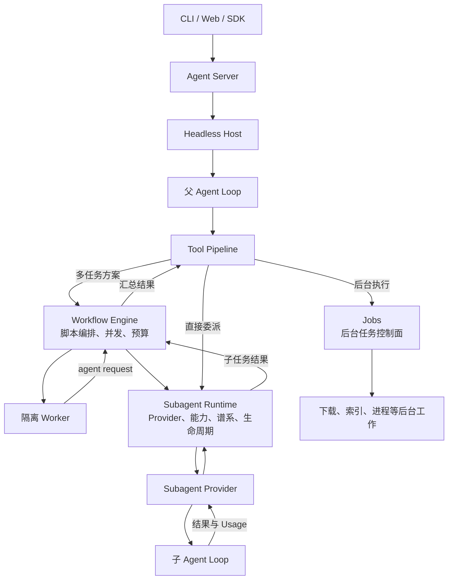

# 拓展阅读：DeepSeek Harness 的 Session Event Log 恢复与 OTel Logs

> 本文来自一次围绕 DeepSeek Harness 恢复能力和 OpenTelemetry 能力边界的完整问答。目标不是只给出“能”或“不能”的结论，而是说明：恢复的对象是什么、恢复发生在哪一层、输入和输出分别是什么、哪些状态会丢失，以及 OTel Logs 为什么不能代替 Session Event Log。

## 1. 先给出完整结论

现有 DeepSeek Harness 可以通过持久化的 Session Event Log 恢复 Session，并重新组装一个可继续接收新 Turn 的 Agent。

但是，这种能力属于“根据已持久化事实重建会话”，不属于“恢复崩溃前的进程执行现场”。它不会恢复 JavaScript 调用栈、Promise、Worker Thread、正在传输的模型响应、仍在运行的工具进程，也不会从崩溃前某条代码指令后面原地继续。

另外，OpenTelemetry Logs 确实是 DeepSeek Harness 已经实现的能力，而不是设想出来的架构。对应实现是 `@deepseek-ai/dsh-session-telemetry-otel`。不过它是 Session Telemetry 的可选 OTel Logs 导出后端，不是 Session 持久化后端，不是恢复真源，也不是完整的 OTel Traces 与 Metrics 实现。

可以把两者的职责压缩成下面两句话：

- Session Event Log 回答：“这个会话已经发生了什么，重启以后可以重建成什么状态？”
- OTel Logs 回答：“这些会话事件和运维信号需要如何投影、脱敏并发送给外部观测系统？”

## 2. Session Event Log、Session Telemetry 和 OTel Logs 所处的位置



这里最重要的是箭头语义：

- `Session → SessionPersistence` 是持久化路径。Session Event Log 是会话事实的真源。
- `Session → Session Telemetry` 是旁路观测路径。Telemetry 获得的是投影和复制后的记录。
- `OTel Collector` 不参与 `agents.resume()`，也不负责重建 Session。
- OTel 导出失败不能反向改变 Session 中已经发生的事实。
- Session 成功恢复不代表之前未成功导出的 OTel 记录一定会被补发。

## 3. “恢复”需要拆成三个不同问题

讨论恢复时，最容易出错的地方是把三种不同能力都叫作“恢复”。

| 恢复层次 | 含义 | DeepSeek Harness 当前能力 |
|---|---|---|
| 会话重建 | 从 header 与事件重新得到消息、Turn、工具结果、Usage、策略和谱系等逻辑状态 | 支持 |
| 冷恢复后继续 | 重建 Session 和 Agent，然后提交一个新的 Turn | 支持 |
| 原地断点续跑 | 恢复崩溃时的调用栈、Promise、网络流、Worker 和工具进程，并从原指令继续 | 不支持 |

因此，“DeepSeek Harness 可以通过 Session Event Log 恢复”是正确的，但需要补全宾语：

> 它可以恢复 Session 的持久化语义状态，并让 Agent 在新的运行时 Activation 中继续；它不能恢复原进程的瞬时执行状态。

## 4. 恢复的输入和输出分别是什么

### 4.1 输入

恢复的核心输入由两部分组成：

1. `SessionHeader`
2. 连续、合法的 `SessionEvent[]`

Header 可以携带以下组装和谱系信息：

- Session ID
- 创建时间
- 工作目录 `cwd`
- 父 Session `parentSession`
- 继承事件边界 `seedLength`
- 来源 `origin`
- 委派深度 `delegationDepth`
- Agent 预设 `agentPreset`

Event Log 则记录已经发生的会话事实，例如 Turn 边界、消息、工具调用、工具结果、模型 Usage、反馈以及其他插件扩展事件。

恢复不能从日志里读取没有被记录的进程状态。例如，日志中可能存在一次 `tool/call`，但无法从这条事件本身反推出对应 shell 子进程的 PID、管道缓冲区、内核状态或 JavaScript Promise continuation。

### 4.2 输出

恢复流程输出的不是旧进程的内存镜像，而是：

- 一份校验和冻结后的逻辑 Session；
- 根据事件重新建立的消息、Usage、权限等投影视图；
- 一个重新组装的 Agent Handle 或 Activation；
- 接收后续新 Turn 的能力。

公开恢复入口是：

```ts
// 根据持久化的 Session ID 重新组装 Agent。
const handle = await ctx.agents.resume({
  resumeSessionId,
})
```

## 5. 冷恢复的完整流程



这个过程的关键词是“重新组装”。恢复后的 Activation 是一个新运行时对象，旧 Activation 已随进程退出而消失。

## 6. 崩溃发生在 Turn 中间时怎么处理

假设已经持久化的事件是：

```text
turn/start
message/user
step/start
tool/call
# 进程在这里崩溃，没有 turn/end
```

加载时，持久化层会发现 `turn/start` 没有对应的 `turn/end`。DeepSeek Harness 不会为了得到一个“干净的 Turn”而删除前面已经提交的事件，因为这些事件可能包含大量有价值的模型输出和工具上下文。

冷恢复会在逻辑上补成：

```text
turn/start
message/user
step/start
tool/call
turn/end { reason: { kind: "interrupted" } }
```

这意味着：

- 已提交的历史被保留；
- 不完整 Turn 获得明确终态；
- 投影器不必面对永久悬空的 Turn；
- 后续可以开启新的 Turn；
- 旧 Turn 不会从 `tool/call` 后面的程序位置继续。

`interrupted` 表示“旧执行被中断并已被恢复器封口”，而不是“旧执行已成功完成”。

## 7. 为什么不能自动重试所有悬空工具调用

考虑一个具有外部副作用的工具：

```text
tool/call: create_order({ amount: 100 })
外部订单系统：订单创建成功
进程：尚未来得及 append tool/result 就崩溃
```

恢复后，Session Event Log 只能证明调用请求已经记录，不能证明外部系统是否执行成功。如果直接自动重试，可能创建两份订单。

这种状态应该理解为“结果未知”，而不是“调用失败”。安全处理方式包括：

- 工具请求携带稳定幂等键；
- 恢复后先查询外部系统状态；
- 读操作可以在风险评估后重试；
- 非幂等写操作要求人工确认；
- 将外部操作设计成可查询、可补偿的事务。

Session Event Log 能忠实表达 Harness 已知的事实，但无法凭空恢复外部世界中尚未回写的事实。

## 8. 哪些状态可以通过 Session Event Log 恢复

| 状态 | 恢复情况 | 原因 |
|---|---|---|
| Session Header | 可以 | 属于持久化元数据 |
| 用户消息 | 可以 | 已记录为 Session Event |
| Assistant 最终消息 | 可以 | 已记录为 Session Event |
| 已完成的工具调用与结果 | 可以 | call/result 都存在于日志中 |
| 已记录的模型 Usage | 可以 | 可以从对应事件重新投影和累计 |
| 基于 Usage 推导的 Cost | 有条件可以 | 取决于定价信息和计算规则是否仍然明确、稳定 |
| 权限和策略状态 | 对已事件化的部分可以 | 通过相应事件折叠重建 |
| 父子 Session 谱系 | 可以 | Header 含 parentSession、seedLength 等信息 |
| 未关闭 Turn | 可以封口 | 合成 `turn/end(interrupted)`，不是继续旧执行 |
| 下一轮编号 | 可以 | 从历史 Turn 推导 |

这里需要特别区分 Usage 与 Cost：Token Usage 是模型响应产生的事实，适合事件化；Cost 通常是 `usage × price` 的派生值。如果价格表发生变化，只保存 Token 而在恢复后按新价格重算，可能得到与历史账单不同的结果。需要账单级可重现性时，应额外记录价格版本、币种和当时计算出的费用明细。

## 9. 哪些状态无法通过 Session Event Log 恢复

| 状态 | 为什么不能恢复 |
|---|---|
| JavaScript 调用栈 | Event Log 不是堆栈快照 |
| Promise continuation | 没有序列化闭包和等待点 |
| 正在进行的 LLM HTTP 请求 | 网络连接和流式状态属于旧进程 |
| 尚未完成的流式 chunk | 未提交内容不是持久化事实 |
| shell/工具子进程 | PID、文件描述符和内核状态不在 Session Log 中 |
| Worker Thread | Worker 内存、消息队列和脚本指令位置没有 checkpoint |
| AbortController | 属于进程内控制对象 |
| 内存缓存与计时器 | 默认不属于事件协议 |
| 未 flush 的事件 | 仍可能只在内存写后队列中 |
| 未回写的外部副作用结果 | Harness 无法知道外部系统已经发生了什么 |

## 10. Jobs 能不能恢复

当前 `jobs-local` 不能通过 Session Event Log 恢复。

它的权威状态是进程内 `Map`，Job 记录会随 Harness 进程退出而消失。现有代码没有把 Job 生命周期作为 `job/started`、`job/output`、`job/ended` 等权威 Session Event 持久化。

需要注意两件容易混淆的事：

1. 父 Session 可能存在启动后台任务的 `tool/call` 和对应 `tool/result`。
2. 这并不等于 Job Registry 自身的状态、输出游标、取消状态和底层进程已经持久化。

因此恢复后可能知道“之前调用过一个启动任务的工具”，但不能据此恢复旧 `Job` 对象，更不能继续读取旧进程内的输出缓冲区。

`session/jobs` 之类发送给 Web 的内容属于运行时快照或界面同步消息，不等于 Session Event Log 中存在同名权威事件。

## 11. Workflow 能不能恢复

当前 Workflow 不能在进程重启后从中间继续。

Workflow Engine 可以在活跃进程中负责：

- 启动隔离 Worker；
- 执行工作流脚本；
- 接收 Worker 的 `agent()` 请求；
- 控制并发和子任务总数；
- 将子 Agent 结果送回 Worker；
- 传播取消；
- 汇合最终结果。

但是脚本的程序计数器、局部变量、尚未完成的 Promise、子任务进度和中间结果没有 journal/checkpoint。进程退出以后，不能从原脚本行继续。



要实现可恢复 Workflow，需要额外设计持久化 Run ID、步骤 journal、输入输出 checkpoint、幂等 child request、重放规则和版本化脚本，而不是仅依赖父 Session Event Log。

## 12. Subagent 能不能恢复

需要区分一次性 Subagent 与 continuable Subagent。

### 12.1 一次性 Subagent

父 Session 通常记录委派工具的 `tool/call` 和 `tool/result`，子 Agent 的完整对话则可以位于自己的 child Session 中。父日志知道委派边界，不等于父日志包含子 Agent 的全部运行现场。

如果进程在一次性 Subagent 尚未完成时崩溃，旧的 Provider Handle、网络请求和 Activation 不会恢复成同一个运行对象。

### 12.2 Continuable Subagent

Continuable Subagent 可以执行冷恢复，但恢复依据是子 Agent 自己持久化的 Session，而不是父 Session 中一条假想的 `subagent/requested` 事件。

冷恢复过程会：

1. 根据 child Session ID 读取持久化 Session；
2. 校验它确实属于当前父 Session；
3. 折叠 child 自己日志中的 continuation descriptor；
4. 校验模式为 `continuable`；
5. 调用 `ctx.agents.resume({ resumeSessionId: childId })`；
6. 创建一个新的 Activation；
7. 向新的 Activation 提交等待中的后续 Turn。



所以它恢复的是“可继续的子会话”，不是旧子进程的内存镜像。

## 13. `job/started` 和 `subagent/requested` 是现有事件吗

不是。至少在当前 DeepSeek Harness 实现中，不能把这两个名称当成已经存在的 Session Event。

### 13.1 `job/started`

当前 `jobs-local` 的 Job 状态在进程内维护，没有通过 `session.append()` 写入权威日志。因此搜索不到 `job/started` 是符合现状的。

如果未来要实现持久 Job Registry，可以设计类似事件，但那是未来协议设计，不是当前源码事实。

### 13.2 `subagent/requested`

当前源码存在 observe-only 的 Cordis 运行时事件：

- `subagent/start`
- `subagent/end`

它们用于观察运行生命周期，不是 Session Event Log 的权威持久化事件。

父 Agent 的委派请求通过普通工具协议表现为 `tool/call`，工具返回或后台确认通过 `tool/result` 表现。子 Agent 的完整历史位于 child Session。因而搜索不到 `subagent/requested` 并不意味着 Subagent 没实现，而是因为当前实现没有采用这个事件名称和建模方式。

如果文档需要提出建议事件词汇，必须明确标注为“建议协议”，不能写成“DeepSeek Harness 已实现事件”。

## 14. OTel Logs 是不是 DeepSeek Harness 的真实能力

是。当前仓库包含完整的 OTel Logs 后端包：

```text
@deepseek-ai/dsh-session-telemetry-otel
```

代码实际使用：

- `@opentelemetry/sdk-logs` 的 `LoggerProvider`；
- `BatchLogRecordProcessor`；
- `@opentelemetry/exporter-logs-otlp-http` 的 `OTLPLogExporter`；
- `@opentelemetry/api-logs` 的 Logger 和 Severity；
- `@opentelemetry/resources` 的 Resource 属性。

真实导出链路是：



这里的结论必须说得精确：

> DeepSeek Harness 已实现 OTel Logs 导出后端；不能据此宣称它在该包中实现了完整的 OTel Traces、Metrics 或基于 Span 的 Agent 调用链。

## 15. OTel Logs 的三种模式

| 模式 | 行为 | 是否上传 |
|---|---|---|
| `FULL` | Session Event 发生时投影、复制、脱敏并立即交给 OTel SDK | 是 |
| `FEEDBACK_ONLY` | 平时不保留遥测副本；记录反馈时，从权威 Session Log 回放截至反馈事件的未释放后缀 | 反馈触发后上传 |
| `DISABLED` | 不构造 Coordinator、Provider、Processor 或 Exporter | 否 |

默认模式是 `DISABLED`，因此“代码支持 OTel”不等于“每次运行默认都会上传遥测”。CLI 部署可以通过 `DSH_TELEMETRY_MODE` 显式选择模式，并通过 `DSH_TELEMETRY_OTLP_URL` 指定 Collector。

## 16. OTel LogRecord 中有什么

Session Telemetry 会把内部记录映射为 OTel LogRecord：

- `time` → `timestamp` 与 `observedTimestamp`
- `severity` → `severityNumber` 与 `severityText`
- 完整、深拷贝、经过部署方规则处理的 `event.data` → `body`
- Session 和事件身份 → `attributes`

典型 identity attributes 包括：

- `session.id`
- `event.type`
- `event.seq`
- `session.cwd`
- `session.parent_id`
- `session.seed_length`

资源属性包括 `service.name`、`service.version` 和匿名 `user.id`。

OTel 后端使用两个 instrumentation scope：

- ledger scope：承载 Session 账本投影记录；
- ops scope：承载 `agent-error`、`shutdown` 等运维记录。

接收端应使用 `(session.id, event.seq)` 对账本记录去重。`ops` 记录没有 `event.seq`，它们是告警信号，不应与账本事件混在一起求和。

## 17. 哪些内容可能通过 OTel 离开本机

在上传模式下，记录可能包含完整的事件数据，例如：

- 用户消息和 Assistant 消息；
- 工具参数和工具结果；
- 命令输出和文件内容；
- 系统提示词与工具 Schema；
- Todo 文本；
- Compaction 摘要；
- Hook 的错误摘要；
- 反馈内容；
- Session 工作目录路径。

Telemetry seam 提供 `sessionTelemetry/record` waterfall 作为部署方的脱敏扩展点，但当前基础 seam 不自带通用脱敏规则。未挂载规则时，导出的副本可能接近原始事件内容。

因此，启用 `FULL` 或 `FEEDBACK_ONLY` 前需要明确：

- Collector 是否位于可信边界；
- 哪些字段必须删除、替换或哈希；
- 工具输出中是否可能包含 Token、密码或私钥；
- 文件内容和本地路径是否允许出站；
- 遥测保留期和访问权限如何设置。

Provider API Key 通常不是 Session Event 的一部分，因此不会因为 Session Telemetry 投影而自动进入 OTel body；但工具结果或文件内容中意外打印出的凭据仍可能被导出。

## 18. OTel Logs 为什么不能用来恢复 Session

OTel Logs 与 Session Event Log 的目标不同：

| 对比项 | Session Event Log | OTel Logs |
|---|---|---|
| 定位 | 会话权威账本 | 外部观测投影 |
| 写入目标 | SessionPersistence 后端 | OTel SDK 和 Collector |
| 是否参与 `agents.resume()` | 是 | 否 |
| 是否要求完整事件词汇 | 是 | 可以投影、脱敏或丢弃部分记录 |
| 流式 chunk | 由 Session 协议决定 | Telemetry 固定投影只发送每个 step 的首个 chunk |
| 交付语义 | 持久化后端负责耐久性 | 当前为 best-effort，SDK 队列中的记录可能随崩溃丢失 |
| 是否允许接收端去重 | Session 内序列连续 | 需要按 `(session.id, event.seq)` 去重 |
| 是否可包含 ops 信号 | Session 词汇不必包含 | 可以包含 `agent-error`、`shutdown` |
| 是否能替代恢复存储 | 否 | 否 |

一个关键反例是 `assistant/chunk`：Telemetry 为控制数据量，只发送每个 `(turn, step)` 的第一个 chunk，其余 chunk 在采集时丢弃。既然 OTel 流本身就可能不是 Session Event Log 的完整逐条副本，它自然不适合作为 Session 恢复输入。

另一个关键差异是交付游标表示“已经交给 SDK”，而不是“Collector 已经耐久保存”。进程崩溃时，仍在 BatchLogRecordProcessor 队列中的记录可能丢失。当前没有 durable telemetry outbox 来保证至少一次投递。

## 19. Session 恢复与 OTel 导出的组合场景

### 19.1 正常关闭

```text
Session Event
  → SessionPersistence 持久化
  → SessionTelemetry 投影
  → OTel SDK 批量导出
  → Session dispose 产生 shutdown 运维记录
```

此时持久化和观测都可能完整结束，但它们仍是两条独立路径。

### 19.2 Session 已持久化，OTel 尚未发送时崩溃

```text
Session Event 已写入 JSONL/SQLite
OTel 记录仍在 SDK 内存队列
进程崩溃
```

结果：

- Session 可以恢复；
- SDK 队列中的 OTel 记录可能丢失；
- 恢复流程默认不会把上一进程未交付成功的记录全部补发；
- Collector 中的观测历史可能存在缺口，但不能据此判断 Session Event Log 损坏。

### 19.3 OTel 已收到，Session 事件尚未达到耐久边界时崩溃

在异步系统中，两条路径的时序可能不同。Collector 看到了某条观测记录，并不自动证明对应 SessionPersistence 后端已经完成 flush。真正恢复时仍应以持久化后端能读到的权威记录为准。

### 19.4 `FEEDBACK_ONLY` 模式

反馈发生前，遥测系统不维护独立副本。反馈事件被记录后，Coordinator 从权威 Session Log 读取未释放后缀，按当时的脱敏规则处理并交给 OTel SDK。

这说明 `FEEDBACK_ONLY` 会读取 Session Event Log，但读取目的是“生成观测投影”，不是“恢复 Agent”。

## 20. 当前能力矩阵

| 能力 | 当前状态 | 权威位置或实现 |
|---|---|---|
| Session Event Log 持久化 | 已实现 | `dsh-session-persistence` 及 JSONL/SQLite 后端 |
| 中断 Turn 修复 | 已实现 | 冷加载时补 `turn/end(interrupted)` |
| `agents.resume()` | 已实现 | 从持久 Session 重新组装 Agent |
| Session 级继续对话 | 已实现 | 恢复后开启新 Turn |
| 精确恢复模型流 | 未实现 | 旧 HTTP/stream 已丢失 |
| 精确恢复工具进程 | 未实现 | 旧进程和句柄已丢失 |
| Jobs 跨进程恢复 | 未实现 | `jobs-local` 仅进程内 |
| Workflow journal/resume | 未实现 | Worker 进度和中间值无 checkpoint |
| Continuable Subagent 冷恢复 | 已实现 | 子 Session + descriptor + `agents.resume()` |
| OTel Logs | 已实现 | `dsh-session-telemetry-otel` |
| OTLP/HTTP Logs 导出 | 已实现 | `OTLPLogExporter` |
| OTel Traces | 不能由当前 Logs 包推断为已实现 | 需要单独的 tracing 实现与证据 |
| OTel Metrics | 不能由当前 Logs 包推断为已实现 | 需要单独的 metrics 实现与证据 |
| Telemetry durable outbox | 未实现 | 当前为 best-effort 交付 |
| OTel 驱动 Session 恢复 | 未实现，也不应作为当前职责 | 恢复读取 SessionPersistence |

## 21. 阅读源码时如何避免把设计建议当成现有能力

判断一个事件或能力是否真实存在，建议按下面顺序核对：

1. 查找公开类型和事件映射，例如 `SessionEventMap`。
2. 查找实际生产位置，例如 `session.append(...)` 或 Cordis `emit(...)`。
3. 查找消费位置，确认它用于持久化、UI、遥测还是运行时观察。
4. 查找后端状态所有权，是磁盘、数据库，还是进程内 `Map`。
5. 查找冷启动入口，确认重启后是否真的读取这些数据。
6. 查找测试，确认是否覆盖跨进程或冷恢复场景。

仅仅在架构图里出现一个名称，不能证明源码已经实现。尤其需要区分：

- Session Event；
- Cordis 运行时事件；
- API/Web 推送帧；
- OTel LogRecord；
- 教学 Demo 自定义事件；
- 建议中的未来事件协议。

## 22. 对本轮问答的最终校正

下面四句话可以作为后续文档中的统一口径：

1. **现有 DeepSeek Harness 可以从 Session Event Log 恢复 Session，并通过 `agents.resume()` 重新组装 Agent。**
2. **恢复会封闭被中断的 Turn，但不会恢复旧进程的执行栈、Worker、模型流或工具进程。**
3. **OTel Logs 是 DeepSeek Harness 已实现的可选 Session Telemetry 后端，但它不是 Session 恢复机制。**
4. **Jobs 和 Workflow 当前不具备跨进程续跑能力；Continuable Subagent 则可以依靠自己的持久化 child Session 冷恢复为新的 Activation。**

## 23. 完整 QA

这一节按照实际阅读和排查时最容易提出的问题组织。每个回答都区分当前 DeepSeek Harness 已实现的源码事实、运行时边界，以及尚未实现或只能作为未来设计的部分。

### Q1：现有 DeepSeek Harness 可以通过 Session Event Log 恢复吗？

可以，但恢复对象是 Session 的持久化语义状态，不是旧进程的完整执行现场。

恢复时，DeepSeek Harness 会读取持久化的 `SessionHeader` 和 `SessionEvent[]`，校验并准备一个不可变 Session，然后通过下面的入口重新组装 Agent：

```ts
// 恢复一个已经持久化的 Session，并创建新的 Agent 运行时对象。
const handle = await ctx.agents.resume({
  resumeSessionId,
})
```

恢复完成后，可以看到此前已经持久化的消息、Turn、工具调用与结果、Usage 和其他事件化状态，并可以提交新的 Turn。

它不能恢复：

- 崩溃时的 JavaScript 调用栈；
- 尚未结算的 Promise；
- 正在传输的模型 HTTP 响应；
- 原来的 Worker Thread；
- 正在执行的 shell 或其他工具进程；
- AbortController、计时器和进程内队列；
- 尚未达到持久化边界的内存事件。

所以，更严谨的表述是：

> DeepSeek Harness 支持 Session 级冷恢复和恢复后的继续对话，不支持进程级精确断点续跑。

### Q2：如果崩溃时最后一个 Turn 没有结束，恢复会失败吗？

不会简单删除整个 Turn，也不会把这个 Turn 当作正常完成。

如果持久日志中存在 `turn/start`，却没有对应的 `turn/end`，冷恢复会保留已提交事件，并用合成的下面这条事件关闭遗留 Turn：

```text
turn/end { reason: { kind: "interrupted" } }
```

这一步叫作“修复生命周期边界”，不是“继续旧 Turn”。修复以后，旧 Turn 明确处于被中断状态，新 Agent 才能开启新的 Turn。

如果恢复器删除旧 Turn，可能丢失已经持久化的大量模型输出和工具上下文；如果恢复器把它标成成功，又会伪造事实。因此 `interrupted` 是更可靠的语义。

### Q3：恢复以后，会不会从崩溃前的工具调用后面接着运行？

不会。

Session Event Log 记录的是协议事实，而不是解释器或虚拟机快照。日志中出现 `tool/call` 只能证明 Harness 已经记录了调用意图，不能恢复调用函数内部的程序计数器、局部变量和底层进程。

如果 `tool/result` 已经持久化，恢复后可以读取该结果。如果只有 `tool/call` 而没有 `tool/result`，就存在三种可能：

1. 工具根本没有开始执行；
2. 工具开始了，但尚未完成；
3. 外部副作用已经成功，只是结果尚未来得及写回。

仅凭 Session Event Log 无法在三者之间做出可靠判断。因此，尤其对非幂等写操作，不能自动当作失败并重试。

### Q4：OTel 是不是之前分析时臆想出来的？DeepSeek Harness 真的实现了吗？

不是臆想。DeepSeek Harness 当前仓库确实实现了 OTel Logs 后端，对应包为：

```text
@deepseek-ai/dsh-session-telemetry-otel
```

源码真实使用了：

```text
LoggerProvider
  → BatchLogRecordProcessor
  → OTLPLogExporter
  → OTLP/HTTP Logs Endpoint
```

因此，“DeepSeek Harness 具备 OTel Logs 导出能力”是源码事实。

但不能把这个事实扩大成以下说法：

- 不能据此断言当前包实现了 OTel Traces；
- 不能据此断言当前包实现了 OTel Metrics；
- 不能说 Agent 恢复依赖 OTel；
- 不能把 Collector 当作 Session Event Store；
- 不能说所有部署默认都会上传遥测。

当前 OTel Session Telemetry 默认模式是 `DISABLED`。只有部署方显式选择 `FULL` 或 `FEEDBACK_ONLY` 并配置 OTLP Endpoint 后，才会构造上传流水线。

### Q5：OTel Logs 在 DeepSeek Harness 中到底扮演什么角色？

它位于 Session 事件的旁路观测链路中，负责把内部 Session Telemetry Record 转换为 OTel LogRecord，再交给 OTel SDK 批处理并通过 OTLP/HTTP 发往 Collector。

```text
Session Event
  ├─→ SessionPersistence：保存权威会话事实，供恢复使用
  └─→ SessionTelemetry：投影、复制、部署方脱敏
          └─→ OTel Logs：批处理并导出到观测系统
```

OTel Logs 的用途包括：

- 远端查看 Session 生命周期；
- 分析模型与工具事件；
- 根据严重级别生成告警；
- 观察 `agent-error` 和 `shutdown` 等运维信号；
- 通过 `(session.id, event.seq)` 在接收端去重；
- 计算外部报表或质量分析指标。

它不参与模型请求组装，不改变 KV Cache，也不负责重新创建 Agent。

### Q6：Session Event Log 和 OTel Logs 都包含事件，两者为什么不能合并？

因为它们对完整性、语义和交付的要求不同。

Session Event Log 是权威账本。恢复器依赖它判断已发生的会话事实，因此不能随意省略影响状态重建的事件。

OTel Logs 是观测投影，可以为了隐私、容量和查询目的进行：

- 字段脱敏；
- 整条记录替换或阻止导出；
- 流式 chunk 采样；
- 严重级别映射；
- ledger 与 ops 分流；
- SDK 批处理和有限队列；
- best-effort 交付。

例如，Session Telemetry 的固定 chunk 投影只发送每个 `(turn, step)` 的第一个 `assistant/chunk`。其余 chunk 即使存在于 Session 中，也不会逐条出现在 OTel 流里。这样的观测流不能用于无损恢复 Session。

### Q7：复杂类型应该进入 Event Log，还是进入 OTel？

判断标准不是类型“复杂不复杂”，而是它是不是需要跨重启保持的业务事实。

应该进入 Session Event Log 的内容：

- 恢复后必须知道的会话事实；
- 会影响消息、Turn、Usage、权限、策略和谱系投影的状态变化；
- 必须有明确顺序和 Session 内序列号的事实；
- 用户以后查看历史时必须存在的事实。

更适合只进入 OTel ops 或普通运行日志的内容：

- 内部重试次数；
- 队列等待时间；
- SDK 导出失败；
- 临时连接状态；
- `agent-error` 这类需要告警但不应成为会话业务事实的运维信号；
- 进程 CPU、内存和延迟指标。

两边都可能出现的内容：

- Session Event 先进入权威日志；
- Telemetry 再从该 Event 生成只读投影副本；
- 副本经过脱敏后进入 OTel。

不应把同一状态分别由 Event Log 和 OTel 两套系统独立写成两个真源，否则两条链路不一致时无法判断谁正确。

### Q8：现有 DeepSeek Harness 实现了 `job/started` 写入 Event Log 吗？

没有。

当前 `jobs-local` 使用进程内存中的 Registry 保存 Job 记录。Job ID、状态、输出游标、取消过程和底层任务引用不会作为权威 Session Event 在进程重启后重新建立。

父 Agent 可能会记录：

```text
tool/call   → 请求启动后台任务
tool/result → 返回 Job ID 或启动确认
```

这只能恢复“父 Agent 曾经调用过启动工具”的会话历史，不能恢复旧 Job Registry 中的 Job 对象。

Web 端接收到的 `session/jobs` 快照同样不是 `job/started` Session Event。它是活跃运行时状态的界面同步通道。

如果未来实现可恢复 Job，需要新增耐久 Job 后端或事件协议，并明确：

- Job 的稳定 ID；
- 状态转换；
- 输出存储；
- 所有者和访问控制；
- 底层执行资源的重连或重建策略；
- 取消幂等性；
- 进程重启时 running Job 如何归类。

这些目前不能从 `jobs-local` 自动得到。

### Q9：为什么搜索不到 `subagent/requested`？

因为它不是当前 DeepSeek Harness 已实现的 Session Event 名称。

当前实现中需要区分三层信息：

1. 父 Session 使用普通 `tool/call` 表达委派请求；
2. 工具通过 `tool/result` 返回委派结果或后台确认；
3. Subagent Runtime 使用 observe-only 的 `subagent/start` 和 `subagent/end` 观察运行生命周期。

`subagent/start` 和 `subagent/end` 是 Cordis 运行时观察事件，不等于持久化 Session Event。子 Agent 的详细对话历史由 child 自己的 Session 保存。

`subagent/requested` 可以作为未来协议设计建议，但如果文档使用它，必须明确标成“建议事件”，不能描述成当前源码已经 append 的事件。

### Q10：父 Agent 和子 Agent 分别从哪里恢复？

父 Agent 从父 Session 自己的持久化 Header 和 Event Log 恢复。

Continuable Subagent 从 child Session 自己的持久化 Header、Event Log 和 continuation descriptor 恢复。

```text
父 Session Event Log
  → 恢复父 Agent

子 Session Event Log
  → 校验 parentSession
  → 折叠 continuable descriptor
  → agents.resume(childId)
  → 创建新的 Child Activation
```

父 Session 中的委派 `tool/call` 不是 child 完整历史的替代品。父日志与子日志通过 `parentSession`、`seedLength` 和 child ID 建立谱系关系。

一次性 Subagent 即使拥有持久化 transcript，也不代表当前运行时一定允许用同一个语义继续；continuable 模式还需要通过 descriptor 和父子权限校验。

### Q11：Workflow 的隔离 Worker 怎么工作，为什么它不能恢复？

工作流脚本运行在 Worker Thread 中，Host 通过消息协议接收 Worker 发出的 `agent()` 请求，然后由 Workflow Engine 执行并发限制、总量限制和取消控制，再调用 Subagent Runtime。

```text
Workflow Script
  → Worker Thread
  → agent-request 消息
  → Workflow Engine
  → 并发和总量校验
  → Subagent Runtime
  → Child Agent
  → agent-result 消息
  → Worker 中原 Promise 继续
```

Worker 隔离的主要价值是避免工作流脚本的同步死循环阻塞 Host Event Loop，并建立明确的消息边界。它不是安全沙箱，脚本仍应被视为可信代码。

它不能恢复的原因是：

- Worker 当前执行到哪条指令没有持久化；
- 脚本局部变量没有序列化；
- Worker 内 Promise 等待关系没有 checkpoint；
- 已创建 child 与脚本中变量的映射没有 journal；
- 重启后没有工作流步骤重放协议。

因此 Session Event Log 即使保存了父工具调用，也不足以重新建立整个 Worker 程序状态。

### Q12：Jobs、Workflow 和 Subagent 的上下游分别是什么？

三者不是同一层的三个同义词。



- Jobs 的上游是需要后台化的工具或生产方；下游是进程、下载、索引任务，也可以包装某些 child 执行。输入是启动器、owner 和取消函数，输出是 Job ID、状态、增量输出和终态。
- Workflow 的上游是父 Agent 的工作流工具调用；下游是 Worker 和 Subagent Runtime。输入是脚本、预算、并发参数和信号，输出是汇总结果或失败状态。
- Subagent Runtime 的上游是直接委派工具或 Workflow Engine；下游是 Provider 与 Child Agent。输入是任务、provider、能力限制、父子谱系和取消信号，输出是 child ID、消息、结构化结果、停止原因与 Usage。

### Q13：Token 和 Cost 在这些上下游之间怎么传？

Token 不应该作为 Jobs、Workflow 或 Subagent Runtime 内部隐式共享的全局变量传递，而应来自每次模型调用的 Usage 结果，再沿 child result 或 Session Event 明确归集。

典型链路是：

```text
LLM Provider Response
  → Usage（input/output/cache tokens）
  → Child Session Event Log
  → Child Result / Workflow 聚合
  → Parent 工具结果或独立统计投影
  → Cost 计算
```

当前 Workflow 文档明确说明它没有跨 child 的 token-budget vocabulary。这意味着 Workflow Engine 具备并发、项目数和 child 数量等预算，并不自动等于它已经实现了跨子 Agent Token 总预算和硬截断。

Cost 最好区分两层：

- 事实层保存模型、Usage、时间和价格版本；
- 投影层计算单次、Session、Parent/Child 谱系或 Workflow Run 的费用。

如果只保存最终 Cost 而不保存 Usage 和价格依据，就难以审计；如果只保存 Usage 而不固定价格版本，历史费用可能随价格表变化。

### Q14：OTel 中的 Usage 和 Cost 可以作为账单真源吗？

不建议。

OTel 可以承载 Usage 和 Cost 投影，方便制作仪表盘、告警和聚合查询，但当前 OTel 链路是 best-effort：

- SDK 内存队列可能在崩溃时丢失；
- 接收端可能收到重复记录；
- Telemetry 策略可能过滤记录；
- `FEEDBACK_ONLY` 不会实时上传；
- `DISABLED` 完全不上传；
- 没有 durable telemetry outbox 保证账单级投递。

因此，账单和配额真源应放在耐久、可审计的业务存储中。OTel 更适合作为观测副本和分析入口。

### Q15：恢复后会自动补发上一进程遗漏的 OTel 记录吗？

不能假设会。

Session Telemetry 的 handoff cursor 表示记录已经交给后端 SDK，而不是 Collector 已经成功耐久保存。当前交付语义允许：

- SDK 重试导致接收端重复；
- 进程退出导致内存队列记录丢失；
- 恢复后的 Session 从新进程边界继续，而不为上一进程执行完整可靠补发。

如果部署要求至少一次交付、精确补发或账单级可靠性，需要额外实现 durable outbox、每个 sink 的持久游标、重放和接收端幂等处理。这是独立于 Session 恢复的遥测可靠性工程。

### Q16：最容易写错的结论有哪些？

以下说法不准确：

```text
“有 Session Event Log，所以整个 Workflow 可以断点续跑。”
“父 Session 记录了 tool/call，所以后台 Job 可以恢复。”
“有 subagent/start，所以它一定写入了 Session Event Log。”
“实现了 OTel Logs，所以也实现了 OTel Traces 和 Metrics。”
“Collector 收到了事件，所以 Session 已经达到持久化耐久边界。”
“Session 恢复成功，所以崩溃前所有遥测都会自动补发。”
“Usage 可以恢复，所以历史 Cost 一定能按原账单精确重算。”
```

对应的正确说法是：

```text
“Session Event Log 可以重建事件化会话状态。”
“Jobs-local 当前是进程内状态。”
“subagent/start/end 是 observe-only 运行时生命周期事件。”
“当前已证实的能力是 OTel Logs 后端。”
“SessionPersistence 和 OTel Export 是两条独立链路。”
“遥测当前为 best-effort，不是恢复真源。”
“账单级 Cost 重现还需要稳定的价格版本与计算依据。”
```

## 24. 对应源码与权威文档

### Session 持久化与恢复

- [会话持久化说明](../deepseek-harness/docs/subsystems/persistence.zh.md)
- [Session Persistence 包](../deepseek-harness/packages/session/session-persistence/)
- [Session 核心包](../deepseek-harness/packages/core/session/)

### OTel Logs

- [OTel Session Telemetry 中文说明](../deepseek-harness/packages/session/session-telemetry-otel/README.zh.md)
- [OTel Session Telemetry 实现](../deepseek-harness/packages/session/session-telemetry-otel/src/index.ts)
- [Session Telemetry seam](../deepseek-harness/packages/session/session-telemetry/README.md)
- [CLI 遥测配置说明](../deepseek-harness/apps/cli/reference/README.zh.md)

### Jobs、Workflow 与 Subagent

- [本地 Jobs 说明](../deepseek-harness/packages/jobs/jobs-local/README.zh.md)
- [Workflow 说明](../deepseek-harness/packages/workflow/workflow/README.md)
- [Subagent Continuation 实现](../deepseek-harness/packages/subagent/subagent/src/continuation.ts)
