# 系统总览：领域、组件与课程拼图

先看领域位置，再沿箭头理解依赖，最后用课程编号回到实现。组件和领域标题在阅读站中均可点击；颜色标识领域，编号标识课程。

## 怎么读这张图

- 箭头A→B表示A使用B，不代表B主动调用A，也不代表消息按图从上往下执行。
- 组件用较实的浅色背景；领域模块用同色系5%不透明度底色和40%不透明度边框。模块标签与边界也表达归属，不仅靠颜色。
- 有箭头的部分表示这里明确展示的依赖或Host装配关系，不是完整导入图。没有连线的组件仍属于该领域，不能推断它已经接入所有任务。
- 图里的组件编号可跳主讲课程；Model等涉及多实现的节点跳转领域说明，再选择具体课程。领域标题跳转本页对应说明。
- Mermaid保持strict模式；阅读站只给已打包的站内文档添加链接，不执行任意回调。GitHub或其他Markdown阅读器未必支持此交互，下面的课程表始终可点击。

## 按领域查看整体拼图

```mermaid
flowchart TD
    subgraph Entry["接入与界面"]
        SDK["SDK · 044 Bun / 045 Python"]
        Web["Web · 048读模型 / 049接线"]
        ACP["ACP适配 · 046"]
        Remote["Remote · 043"]
        Peer["Peer / Framing · 032"]
    end
    subgraph Session["会话管理"]
        Host["Host · 041"]
        Agent["Agent · 013"]
        Inbox["Inbox · 009"]
    end
    subgraph Execution["任务执行"]
        Loop["Loop · 012 / 014并发工具"]
        Tools["Tools · 011"]
        Read["文件工具 · 022"]
    end
    subgraph Models["模型与上下文"]
        Model["Model · 010 / 016 / 018 / 020"]
        SSE["SSE · 015"]
        Context["上下文压缩 · 019"]
        Projection["消息投影 · 008"]
    end
    subgraph Access["权限与系统资源"]
        Guard["权限守卫 · 024"]
        Approvals["Approvals · 023"]
        LocalFS["LocalFS · 021"]
        Process["进程管理 · 025"]
    end
    subgraph Facts["事件与持久化"]
        Events["Events · 005"]
        Journal["Journal · 006"]
        Generation["Generation · 007"]
    end
    subgraph Foundation["资源与配置"]
        Scope["Scope · 001"]
        Services["Services · 002"]
        Plugins["Plugins · 003"]
        Settings["Settings · 004"]
    end
    SDK -->|"stdio RPC"| Remote
    Web -->|"047 WebSocket"| Remote
    ACP --> Host
    Remote --> Host
    Host --> Agent
    Host --> Scope
    Host --> Settings
    Host --> Tools
    Host --> Journal
    Agent --> Inbox
    Agent --> Settings
    Agent --> Loop
    Inbox --> Events
    Loop --> Model
    Loop --> Tools
    Loop --> Events
    Loop --> Projection
    Tools --> Guard
    Guard --> Settings
    Guard --> Approvals
    Tools -->|"调用已注册处理函数"| Read
    Read --> LocalFS
    Events -->|"041注入持久化回调"| Journal
    Plugins --> Services
    Plugins --> Scope
    classDef cEntry fill:#e0f2fe,stroke:#0369a1,color:#0c4a6e
    class SDK,Web,ACP,Remote,Peer cEntry
    style Entry fill:#0369a1,fill-opacity:0.05,stroke:#0369a1,stroke-opacity:0.4
    %% course-link SDK lessons/044.md
    %% course-link Web lessons/049.md
    %% course-link ACP lessons/046.md
    %% course-link Remote lessons/043.md
    %% course-link Peer lessons/032.md
    %% course-link Entry ARCHITECTURE.md#接入与界面
    classDef cSession fill:#ede9fe,stroke:#7c3aed,color:#4c1d95
    class Host,Agent,Inbox cSession
    style Session fill:#7c3aed,fill-opacity:0.05,stroke:#7c3aed,stroke-opacity:0.4
    %% course-link Host lessons/041.md
    %% course-link Agent lessons/013.md
    %% course-link Inbox lessons/009.md
    %% course-link Session ARCHITECTURE.md#会话管理
    classDef cExecution fill:#ffedd5,stroke:#ea580c,color:#7c2d12
    class Loop,Tools,Read cExecution
    style Execution fill:#ea580c,fill-opacity:0.05,stroke:#ea580c,stroke-opacity:0.4
    %% course-link Loop lessons/012.md
    %% course-link Tools lessons/011.md
    %% course-link Read lessons/022.md
    %% course-link Execution ARCHITECTURE.md#任务执行
    classDef cModels fill:#fce7f3,stroke:#db2777,color:#831843
    class Model,SSE,Context,Projection cModels
    style Models fill:#db2777,fill-opacity:0.05,stroke:#db2777,stroke-opacity:0.4
    %% course-link Model ARCHITECTURE.md#模型与上下文
    %% course-link SSE lessons/015.md
    %% course-link Context lessons/019.md
    %% course-link Projection lessons/008.md
    %% course-link Models ARCHITECTURE.md#模型与上下文
    classDef cAccess fill:#fee2e2,stroke:#dc2626,color:#7f1d1d
    class Guard,Approvals,LocalFS,Process cAccess
    style Access fill:#dc2626,fill-opacity:0.05,stroke:#dc2626,stroke-opacity:0.4
    %% course-link Guard lessons/024.md
    %% course-link Approvals lessons/023.md
    %% course-link LocalFS lessons/021.md
    %% course-link Process lessons/025.md
    %% course-link Access ARCHITECTURE.md#权限与系统资源
    classDef cFacts fill:#dcfce7,stroke:#16a34a,color:#14532d
    class Events,Journal,Generation cFacts
    style Facts fill:#16a34a,fill-opacity:0.05,stroke:#16a34a,stroke-opacity:0.4
    %% course-link Events lessons/005.md
    %% course-link Journal lessons/006.md
    %% course-link Generation lessons/007.md
    %% course-link Facts ARCHITECTURE.md#事件与持久化
    classDef cFoundation fill:#f1f5f9,stroke:#64748b,color:#334155
    class Scope,Services,Plugins,Settings cFoundation
    style Foundation fill:#64748b,fill-opacity:0.05,stroke:#64748b,stroke-opacity:0.4
    %% course-link Scope lessons/001.md
    %% course-link Services lessons/002.md
    %% course-link Plugins lessons/003.md
    %% course-link Settings lessons/004.md
    %% course-link Foundation ARCHITECTURE.md#资源与配置
    linkStyle default stroke:#64748b
```

Events不直接依赖Journal模块：041的Host把Journal.append注入Events的persist回调。Process、Generation、SSE、Context等节点未画统一调用线，因为它们并非每种任务都经过的固定步骤。

## 领域与课程入口

### 接入与界面

| 组件 | 课程入口 |
| --- | --- |
| SDK | [044](lessons/044.md)、[045](lessons/045.md) |
| Web | [048](lessons/048.md)、[049](lessons/049.md) |
| ACP适配 | [046](lessons/046.md) |
| Remote | [043](lessons/043.md) |
| Peer / Framing | [032](lessons/032.md) |

### 会话管理

| 组件 | 课程入口 |
| --- | --- |
| Host | [041](lessons/041.md) |
| Agent | [013](lessons/013.md) |
| Inbox | [009](lessons/009.md) |

### 任务执行

| 组件 | 课程入口 |
| --- | --- |
| Loop | [012](lessons/012.md)、[014](lessons/014.md) |
| Tools | [011](lessons/011.md) |
| 文件工具 | [022](lessons/022.md) |

### 模型与上下文

| 组件 | 课程入口 |
| --- | --- |
| Model | [010](lessons/010.md)、[015](lessons/015.md)、[016](lessons/016.md)、[018](lessons/018.md)、[019](lessons/019.md)、[020](lessons/020.md) |
| SSE | [015](lessons/015.md) |
| 上下文压缩 | [019](lessons/019.md) |
| 消息投影 | [008](lessons/008.md) |

### 权限与系统资源

| 组件 | 课程入口 |
| --- | --- |
| 权限守卫 | [024](lessons/024.md) |
| Approvals | [023](lessons/023.md) |
| LocalFS | [021](lessons/021.md) |
| 进程管理 | [025](lessons/025.md) |

### 事件与持久化

| 组件 | 课程入口 |
| --- | --- |
| Events | [005](lessons/005.md) |
| Journal | [006](lessons/006.md) |
| Generation | [007](lessons/007.md) |

### 资源与配置

| 组件 | 课程入口 |
| --- | --- |
| Scope | [001](lessons/001.md) |
| Services | [002](lessons/002.md) |
| Plugins | [003](lessons/003.md) |
| Settings | [004](lessons/004.md) |

## 其他能力放在哪里

| 分组 | 课程 | 当前边界 |
| --- | --- | --- |
| 协议扩展 | [033 MCP](lessons/033.md)、[035 LSP](lessons/035.md) | 各自管理外部服务进程，不与Host共用调用栈 |
| 系统执行 | [026 Shell](lessons/026.md)、[027 PTY](lessons/027.md)、[028 Sandbox](lessons/028.md)、[029 SSH](lessons/029.md)、[030 Jobs](lessons/030.md) | 各有平台、进程与取消边界 |
| 任务组织 | [031 Skills](lessons/031.md)、[036 子Agent](lessons/036.md)、[037 Workflow](lessons/037.md)、[038 PTC](lessons/038.md)、[039 协作](lessons/039.md) | 并非全部默认装入每个Host |
| 数据与产品 | [040 附件](lessons/040.md)、[042 Store与凭据](lessons/042.md)、[050 产品设置](lessons/050.md)、[051 能力接线](lessons/051.md)、[066 搜索与导入导出](lessons/066.md) | 066有底层函数与测试，当前页面无搜索导出接线 |
| 桌面与交付 | [052 Electron](lessons/052.md)、[053 PKCE与快捷键](lessons/053.md)、[054 下载验证](lessons/054.md)、[055 更新](lessons/055.md)、[056 打包](lessons/056.md) | 053不等于已接真实浏览器登录；安装交付不属于每次模型循环 |
| 实验能力 | [057 Teams](lessons/057.md)、[058 Hooks](lessons/058.md)、[059 浏览器与系统动作](lessons/059.md)、[060 音频](lessons/060.md)、[061 Webhook](lessons/061.md)、[062 Worktree](lessons/062.md)、[063 Workers](lessons/063.md)、[064 遥测](lessons/064.md)、[065 市场](lessons/065.md) | 逐章看接线与测试边界；061已有HTTP到真实Agent的离线示例 |
| 验收与最终入口 | [067 ACP对照](lessons/067.md)、[068 页面贯通](lessons/068.md)、[069 最终CLI](lessons/069.md) | 对照样本通过不等于全产品等价 |

## 一次任务的实际调用顺序

以SDK请求为例：客户端经stdio与032的协议处理通信，043 Remote找到041 Host中的会话，013 Agent将任务写入009 Inbox，012 Loop使用008投影形成模型历史，再调用模型。工具请求经过011 Tools、024权限守卫，必要时等待023审批；读文件由022处理函数调用021 LocalFS。005 Events通过注入回调写入006 Journal，再向订阅者通知。

这是调用过程，不是上图所有箭头的一条直线。Web与ACP使用各自传输适配，不强行套用SDK的字节解帧。完整实现与缺口继续看[COVERAGE.md](COVERAGE.md)，具体启动顺序看各节的调试路线。
