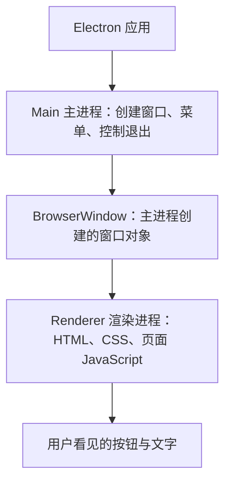
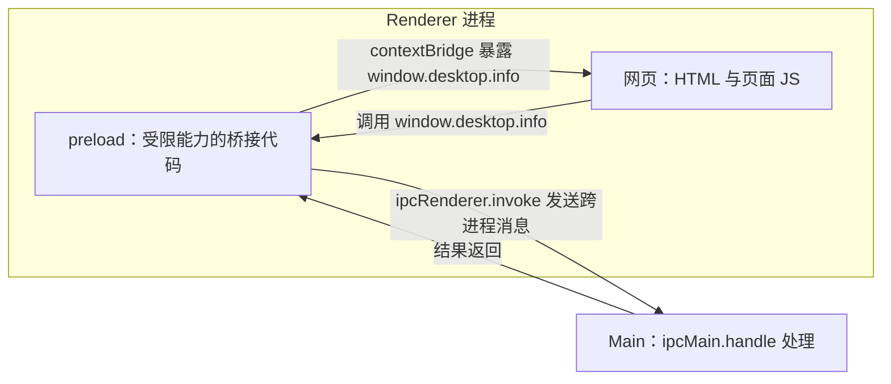
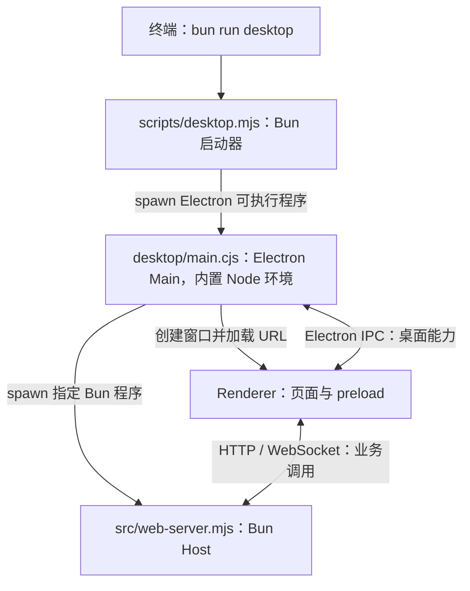
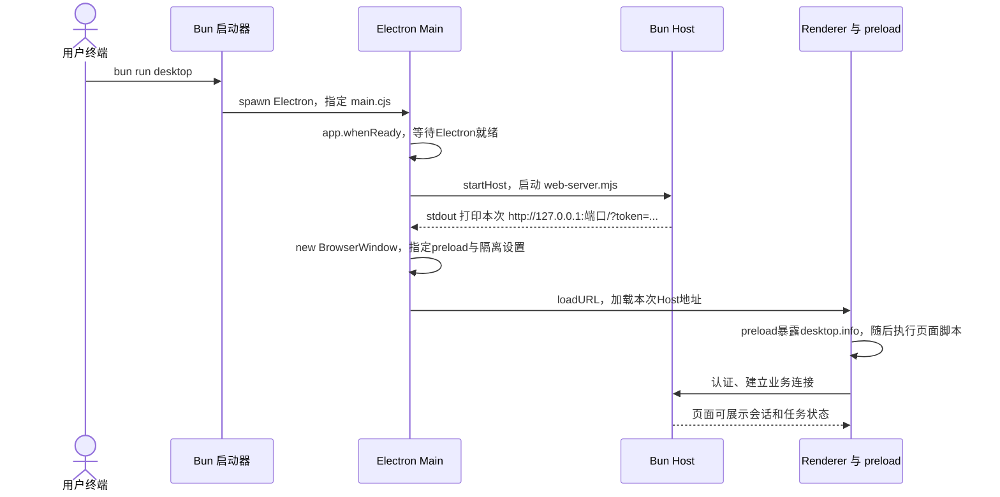
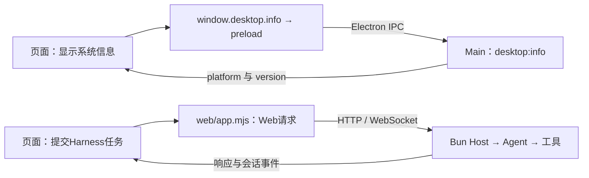
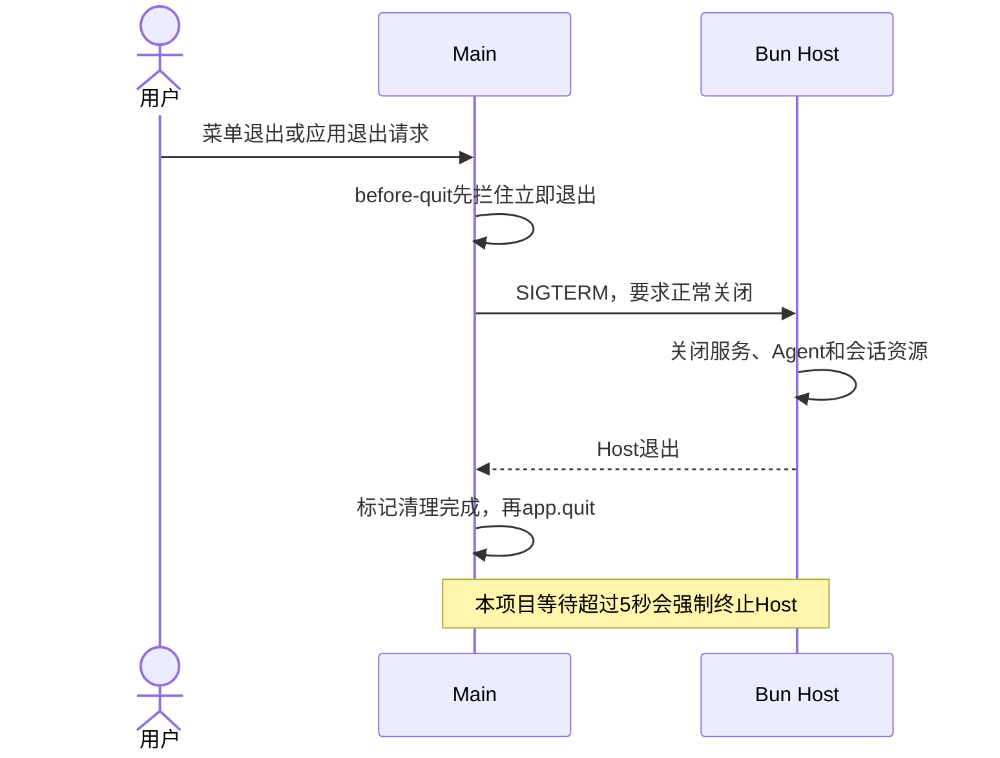

# Electron 入门：先看懂窗口、进程和这份项目

你不需要先理解第 052 节的全部代码。先回答三个问题：窗口是谁创建的、页面代码在哪里跑、页面怎样请求真正的业务程序。

本篇先讲 Electron 本身，再映射到本仓库。它是第 052 节的前置阅读，不增加一条新的 Harness 实现路线。源码对照当前仓库的 `harness-own`；参考 [Electron 进程模型](https://www.electronjs.org/docs/latest/tutorial/process-model) 与 [IPC 教程](https://www.electronjs.org/docs/latest/tutorial/ipc)。

## 1. 先想象一个只有按钮的桌面应用

假设要做一个窗口：里面有“显示系统信息”和“提交任务”两个按钮。



Main 像窗口管理者，Renderer 像窗口里的网页。Electron 带有 Chromium 和用于主进程的 Node.js 环境，你不用要求用户另外打开 Chrome 才能看见窗口。实际运行还可能有 GPU 等辅助进程，上图只画本篇关心的角色。

| 你想做什么 | 放在哪里 | 原因 |
| --- | --- | --- |
| 创建、关闭一个窗口 | Main | Main 管理桌面应用与窗口生命周期 |
| 写按钮、表单、聊天列表 | Renderer | 它负责网页显示和交互，可以使用 DOM |
| 让页面调用一项明确的桌面能力 | preload 暴露方法，再由 IPC 调 Main | 页面不直接拿到全部系统权限 |
| 执行本项目的 Agent、工具与会话管理 | Bun Host | 本项目已有这些实现，桌面入口继续复用 |

**Bun Host 是本项目选的业务架构，不是 Electron 应用的必需组件。** 一个简单的 Electron 计算器可以只有 Main、页面和少量 preload。

## 2. preload 是什么？是不是又一个进程？

preload 是在页面自己的脚本执行前加载的脚本。它在 Renderer 侧的隔离上下文运行，不是第三个独立业务进程。



`contextBridge` 负责跨越页面与 preload 的上下文边界；`ipcRenderer` / `ipcMain` 负责 Renderer 与 Main 之间的进程通信。它们不是同一个东西。

本项目的 [preload.cjs](../../harness-own/desktop/preload.cjs) 很短：

```javascript
const { contextBridge, ipcRenderer } = require('electron')

// 页面只得到info方法；具体IPC通道由这层固定，不交给页面随意填写。
contextBridge.exposeInMainWorld('desktop', Object.freeze({
  info: () => ipcRenderer.invoke('desktop:info'),
}))
```

页面随后可以调用：

```javascript
// 这段在桌面页面中执行，得到Main返回的对象。
const information = await window.desktop.info()
console.log(information.platform, information.version)
```

Main 中对应的是：

```javascript
// 这段在Electron Main执行，登记同名通道的处理函数。
ipcMain.handle('desktop:info', () => ({
  platform: process.platform,
  version: app.getVersion(),
}))
```

`desktop:info` 是本项目自定的通道名，类似消息地址。`invoke` 返回 Promise，`handle` 的返回值经 IPC 送回，页面的 await 才拿到结果。函数并没有被“传进 Main 执行”，传过去的是请求消息。

## 3. 先分清这几个名字

| 名字 | 白话含义 | 本项目位置 |
| --- | --- | --- |
| `app` | 整个 Electron 应用的生命周期管理对象 | Main 中等待 ready、退出、单实例控制 |
| `BrowserWindow` | 用来创建和管理窗口的类 | Main 中 new BrowserWindow |
| `webContents` | 窗口中网页内容的管理接口 | 限制导航、打开 DevTools 等 |
| `loadURL` | 在窗口里加载一个网页地址 | 加载本机 Bun Host 输出的地址 |
| `loadFile` | 在窗口里加载本地 HTML 文件 | 简单练习常用，本项目主入口使用 loadURL |
| `preload` | 页面脚本前加载的桥接脚本 | `desktop/preload.cjs` |
| `ipcMain` / `ipcRenderer` | Main 与 Renderer 两侧的 IPC 接口 | `desktop:info` 这条请求链 |

Main 中没有页面的 `document`。要修改一个按钮的文字，应在 Renderer 里操作 DOM；要创建窗口，应在 Main 里调用 BrowserWindow。

## 4. 为什么本项目又有 Electron、Node、Bun？

不要根据文件名里的 `.mjs`、`.cjs` 猜执行进程。看谁启动了它。



- Bun 启动器负责找到 Electron 程序，并把自己的 Bun 绝对路径传给 Main。
- Main 使用 Electron 自带的 Node 环境管理窗口；不因此把领域 Host 改成 Node。
- Host 继续用 Bun 执行 Agent、会话、工具与 Web 服务。
- Renderer 的普通页面脚本按浏览器方式运行。

本项目 Main 和 preload 用 `.cjs` 是为了明确采用 CommonJS 的 require 写法；Bun 侧 `.mjs` 用 import。扩展名描述模块格式，不能代替进程关系。

## 5. 再看本项目目录

```text
harness-own/
├── package.json                   # desktop命令指向Bun启动器
├── scripts/
│   ├── install-electron.mjs       # 准备Electron运行程序
│   ├── desktop.mjs                # 启动Electron，不创建窗口
│   └── smoke-desktop.mjs          # 隔离桌面检查入口
├── desktop/
│   ├── main.cjs                   # 创建Host、窗口和菜单，处理退出
│   ├── preload.cjs                # 页面可用的桌面能力白名单
│   └── policy.mjs                 # 运行路径、Bun选择和深链接校验
├── src/
│   ├── web-server.mjs             # Bun Host入口，输出本次网页地址
│   ├── host.mjs                   # 会话与Agent管理
│   └── remote.mjs                 # Web等接入对应的业务操作
├── web/
│   ├── index.html                 # 窗口加载的页面
│   └── app.mjs                    # 按钮、状态和Web请求
└── tests/
    └── 052-desktop-policy.test.mjs # 策略测试，不会创建桌面窗口
```

先按 `scripts/desktop.mjs → desktop/main.cjs → desktop/preload.cjs` 阅读。`policy.mjs` 和安装脚本先知道职责即可，不必先读完下载、签名、发布流程。

## 6. 一次启动到底按什么顺序发生？



为什么先启动 Host 再开页面？因为 `loadURL(address)` 要用本次 Host 真正生成的端口和 token。不能在配置里随便写一个旧地址，也不能把 Host 创建前的空 address 传进去。

这里 Main 读取 Host 的 stdout，是为了取得网页启动地址；后续聊天业务走 HTTP / WebSocket。它与第 044～046 节通过 stdio 长期传 SDK/ACP JSON 的方式不同。

## 7. 两个按钮，其实走两条不同的路



**不是页面每次做事都要经过 Main 和 preload。** 在本项目里，任务请求沿已有 Web 链路进入 Host；桌面专有能力才通过有限的 IPC 方法进入 Main。

## 8. 那三个 webPreferences 设置在防什么？

本项目创建窗口时写了：

```javascript
// Main里创建窗口；这是选项片段，不是另一个可直接启动的完整应用。
const window = new BrowserWindow({
  webPreferences: {
    contextIsolation: true, // preload与页面使用不同JavaScript上下文。
    sandbox: true,         // Renderer受沙箱限制，preload也不能随意使用全部Node模块。
    nodeIntegration: false, // 不让普通网页脚本直接使用Node的require与文件系统。
    preload: path.join(applicationRoot, 'desktop/preload.cjs'),
  },
})
```

所以页面不能直接 `require('node:fs')`。如果确实要增加一项桌面能力，在 preload 暴露一个用途明确的方法，再由 Main 实现和校验；不要为了“能调用”就把任意 IPC 通道或整个文件系统暴露给页面。

`contextIsolation` 是上下文隔离，`sandbox` 是更外层的运行限制，`nodeIntegration` 决定普通页面能否获得 Node 集成。这三个开关不等价，也不取代 Host 自己的工具权限检查。

## 9. 怎么运行，分别证明了什么？

在课程仓库根目录进入自己的工程：

```sh
cd harness-own
bun install --frozen-lockfile --ignore-scripts
bun scripts/install-electron.mjs
bun run desktop
```

若已在 `harness-own` 中，不要再重复 cd。前三个命令可能准备或下载依赖，读本文不需要立即执行。不要把教材的 `steps/052` 当作完整工程，它只有当步增量。

| 操作 | 预期 | 不能据此推断 |
| --- | --- | --- |
| 安装依赖 | Electron包等文件就位 | 窗口已经能启动 |
| install-electron.mjs | Electron运行程序就位 | 已打包你的桌面成品 |
| bun run desktop | 出现能加载本机Host页面的窗口 | 跨平台安装包、签名、自动更新已完成 |
| 052策略测试 | 路径与运行时选择断言通过 | Main、preload和真实窗口已验证 |

安装脚本为什么还需要单独运行，见 [第052节安装问答](lessons/052.md)。Electron包的具体安装钩子以安装版本为准；本教程用 `--ignore-scripts`，不依赖自动执行安装生命周期脚本。

## 10. 点哪里看日志、在哪里打断点？

| 要看什么 | 先用什么观察 | 第052节调试配置 |
| --- | --- | --- |
| 谁创建窗口、Host为什么没启动 | 启动终端；Main调用栈 | Electron：Main |
| 按钮、DOM、页面Web请求 | 窗口的DevTools | Electron：Renderer |
| Agent、权限、工具、会话 | Host的Bun调用栈 | Electron：Bun Host |
| preload暴露的函数 | Renderer侧的preload源码；页面检查window.desktop | Renderer相关调试目标 |

先正常运行成功，再开启调试：

```sh
HARNESS_VSCODE_DEBUG=1 env -u DEEPSEEK_API_KEY bun run desktop
```

按 [052本节启动图](lessons/052.md) 先附加 Main（9229）并继续，之后才能出现 Host（6499）和页面（9222）。只启动“052：本节测试”不会开窗口，Bun 的 F11 也不会直接进入 Electron Renderer。

## 11. 窗口关了，应用为什么还在？

窗口关闭和应用退出是两件事。macOS 常见行为是关掉最后一个窗口后应用仍留在 Dock；本项目在 activate 时可以重新打开窗口，菜单“退出”才进入完整清理。



如果退出时只销毁窗口，却不收回自己启动的 Host，就可能留下后台进程。因此“桌面壳”除了创建窗口，还要拥有子进程的完整生命周期。

## 12. 看不懂时，先做三个小观察

1. 打开 `desktop/preload.cjs`，找出网页最终得到的方法名。答案是 `window.desktop.info`，不是整个 ipcRenderer。
2. 打开 Main，找到 `ipcMain.handle('desktop:info', ...)`，再在桌面窗口 DevTools 中执行 `await window.desktop.info()`，观察返回字段。普通浏览器打开同一页面时没有这份 Electron preload，不能期待该方法存在。
3. 在启动器的 spawn、Main 的 startHost 和 new BrowserWindow 处依次看断点，解释是谁创建了谁。先不追下载、打包和自动更新。

| 稳定复现的现象 | 先检查什么 |
| --- | --- |
| 直接用 bun desktop/main.cjs，Electron API不可用 | Main需要由Electron程序执行；使用 bun run desktop 的启动器 |
| 打开的是普通Chrome页面，window.desktop不存在 | 页面没有加载Electron preload；回到桌面窗口观察 |
| 只运行052测试却没有窗口 | 那是策略测试，实际窗口用 desktop 命令启动 |
| Main已暂停，Host附加连接失败 | 先继续Main，让startHost真正执行 |
| 窗口空白或报Host超时 | 检查Host stderr和本次URL；不能只看Main是否创建成功 |

读完后能画出 `启动器 → Main → Host / Renderer`，并分清 `页面 → IPC → Main` 与 `页面 → Web → Host` 两条路，就可以回到 [第052节](lessons/052.md) 继续逐文件阅读。
