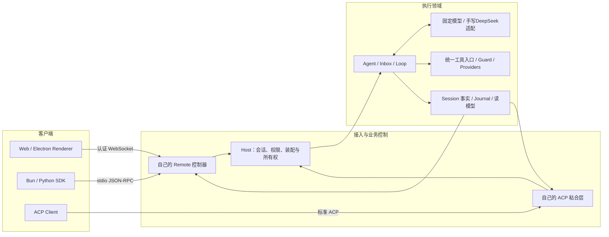

# 从空工程逐步实现 Harness

这次的主材料是**自己写出的累计工程**：第 000 步只有命令行入口，第 012 步跑通模型—工具循环，第 041 步形成持久 Host，随后逐步接入 SDK、ACP、Web 和 Electron。共70个连续步骤；每一步只依赖前面文件，保留完整代码增量和运行命令。每页开头现在先写具体使用场景、真实接线位置，末尾列出原版差距；测试范围与调试预期也单独说明。

**完整复刻目标仍未完成。** 这份重写已经摆脱“拆原版源码照抄”，但不能把 70 步、自家测试或几个差分样本当作原版全部功能等价。V4 历史数据、Typert 公共协议、完整 PTC、全量产品 UI、平台沙箱和发布运行时等仍有实质缺口，逐项记录在 [COVERAGE.md](COVERAGE.md)。未实现的功能没有被移出范围。

## 就从这里开始

固定主线先在 macOS ARM64 编码，使用 Bun 1.3.14、Python 3、Git、Xcode Command Line Tools。第 059 步需要本机 Chrome；第 052 步首次启动会下载固定 Electron 二进制。平台交付是最终资格，不是让你选择另一条学习路线。

打开终端，逐行执行：

```sh
bun --version
python3 --version
git --version
export COURSE="/Users/yhding/ws/github.com/deepseek-harness-demo/tutorial/linear"
export PROJECT="$HOME/ws/harness-own"
mkdir -p "$PROJECT"
cd "$PROJECT"
```

第一次从000开始时，确认Bun输出`1.3.14`，PROJECT是空目录。已经做到032等后续步骤时，继续使用已有工程和当前页，不清空、不重建，也不重新复制前面步骤覆盖自己的修改。编辑器打开这个目录，接着打开 [第 000 步](lessons/000.md)，按文件位置创建代码。后续命令全部在 PROJECT 执行；本目录只用来阅读教材，不是运行目标。已有 `harness-from-zero` 不覆盖。

命令、测试与包管理统一使用 Bun。源码里的 `node:fs`、`node:path`、`node:child_process` 等是 Bun 支持的兼容 API，不需要启动 Node。测试使用 `bun:test`，SQLite 使用 `bun:sqlite`，PTY 使用 `Bun.Terminal`。Electron 自带的主进程运行时属于 Electron；领域 Host 仍运行在独立 Bun 进程，开发模式显式传 Bun 路径，本机打包时携带同架构 Bun。

每个新终端先重新执行两条 export 和 `cd "$PROJECT"`。COURSE 只提供教材和第三方依赖锁；业务代码写在 PROJECT。原版只在第 067 步进入独立对照进程。

引入第三方包的步骤使用课程自有 Bun 安装结果生成的锁文件：只复制该步 `locks/步骤号.bun.lock` 为工程中的 `bun.lock`，再执行 bun install --frozen-lockfile --ignore-scripts。锁文件不是原版业务实现，不会替你填 src；它让后续复习使用同一依赖树。统一加 `--ignore-scripts`，Electron 二进制到第 052 步再显式运行安装器。

第005步已补上前四步的真实装配场景：[读文件、记录事实、展示端退出与补读](lessons/005.md)。它使用自己的Plugins/Services/Scope/Settings，而不是单独展示Events方法；最小JSONL写入器的恢复能力尚未接入。

第020步通过新的`pi-demo.mjs`把PiModel注册进Routes并交给Agent：[仍用DeepSeek跑通模型→工具→模型](lessons/020.md)。先运行固定HTTP场景，再显式加`--live`调用真实DeepSeek；两者都实际执行sum，并核对第二次请求中的工具结果和推理回放。

## 每一步怎么做

只读当前页，按这四个动作往下做：

1. **先看懂要解决的问题。** 读开头的具体场景和文本调用链，再看紧接着的时序图：横向是调用者和模块，纵向从上往下是发生顺序，箭头说明调用和返回；`opt`是可选操作，`alt`是不同结果，`loop`是重复，`par`及其`and`分支表示并行。例如026是“前一次export，后一次还能读到变量”，不是“搭完整终端”。看“当前接线位置”，知道它是独立模块、demo还是已进入Host；再对照本页具体输入和预期结果。
2. **按位置写文件并运行。** 在自己的PROJECT里创建或替换列出的文件，不在教材steps目录运行。需要本章新接口的操作，写完代码再执行；以本页“运行命令与通过标准”为准，不能在上一步还没实现的API上试。测试中替代HTTP、进程或模型的部分会明确说明。
3. **在VS Code验证一个状态变化。** 本页会给文件、断点表达式、监视变量和预期值。先确认断点属于主进程、子进程、浏览器还是Electron；按F10/F11跟踪本次输入怎样变成结果。只有代码跑到、变量确实符合预期才算完成这一观察。
4. **离开提示再做一次。** 按每页结尾那个具体回忆动作讲出或重写关键部分，再改一个条件验证。失败就回到对应断点修正，不换教程。LEARNING.md只记实际结果和一个卡点；明天、第3天、第7天重做这个卡点，不用重读全书。

这把“摸清起点→固定主材料→把一起使用的步骤组成块→主动回忆→运行反馈并纠错→间隔复习→换条件验证”放进每一步。完整代码用于核对，不把复制成功算作已经内化。

每页末尾的原版对照以本地固定提交`687f282e8625c6b8d11ff58211a90524be2e4317`为准，链接直接指向原版文件。它不是上游最新版本承诺，也不是让你切换到照抄原版的第二条学习路线。某项写着“未接入”，表示当前000～069实际没有补齐，不能靠后面出现同名模块推断已完成。

## 唯一顺序

| 阶段 | 连续步骤 | 完成后能实际做什么 |
| --- | --- | --- |
| R00 | [000](lessons/000.md) | 运行空工程入口，空任务有明确退出码 |
| R01 | [001](lessons/001.md)～[005](lessons/005.md) | 把插件、服务、设置、会话装成真实读文件任务，展示端可卸载并按序号补读 |
| R02 | [006](lessons/006.md)～[009](lessons/009.md) | 日志恢复、数据升级后另存并切换读取入口、fork/查询、持久输入队列 |
| R03 | [010](lessons/010.md)～[020](lessons/020.md) | 模型流、工具循环、取消、并发、OpenAI兼容接口、Files示例、pi-ai、压缩 |
| R04 | [021](lessons/021.md)～[030](lessons/030.md) | 文件版本、审批、进程、Shell、PTY、沙箱边界、SSH、Jobs |
| R05 | [031](lessons/031.md)～[041](lessons/041.md) | Skills、双向 RPC、MCP、Web/LSP、子 Agent、协作、附件、持久 Host |
| R06 | [042](lessons/042.md)～[047](lessons/047.md) | 数据域、领域控制器、Bun/Python SDK、ACP、认证 WebSocket |
| R07 | [048](lessons/048.md)～[051](lessons/051.md) | 重连读模型、真实页面、队列/文件/模型设置与工具装配 |
| R08 | [052](lessons/052.md)～[056](lessons/056.md) | Electron 进程边界、PKCE、运行时校验、更新签名、本机打包 |
| R09 | [057](lessons/057.md)～[069](lessons/069.md) | 实验机制、索引/导出、原版 ACP 差分、真实浏览器纵向验收 |

逐步标题见 [INDEX.md](INDEX.md)。以上“能做”按本步测试和实际操作限定，范围更窄的实现已在章节末尾标明，不能据此把整组原版功能勾完。

## 最后会串成什么



统一抽象落在Host/Agent/工具/Session；外层协议适配各自实现。020的PiModel/Routes已有独立demo，但050及最终产品的模型工厂仍只接固定模型和手写DeepSeek适配，不把图中的共用节点理解为所有早期模块都已装进最终产品。本工程 Remote 目前是自有协议，尚未兼容原版 Typert。这一点是明确缺口，不用图里的共同节点遮住。

## 怎样核对教材本身

`steps/000…069` 是逐步新增或替换的文件，不是 70 份预先完整工程。`syllabus.py`登记顺序、标题、命令；`guides/000.json…069.json`逐页维护场景、文本调用链、`sequence`时序图、操作、断点与原版差距；`scenarios/`保留此前补充的长例子，`labs/`保留跨进程和浏览器等操作补充。`teaching.py`把说明合入`lessons.json`，`build.py`再生成`lessons/`。修改生成后的Markdown会在重建时丢失，应该改对应guide或scenario。本次说明依据原版只读审查，生成器不复制原版业务源码。`verify.py` 从另一个空目录逐步叠加并真实测试，第三方依赖在首次出现的步骤独立安装；不使用后面的实现偷跑。

实际证据见 [VERIFICATION.md](VERIFICATION.md)。第 067 步的原版对照只证明指定 ACP 样本；完整目标由 [COVERAGE.md](COVERAGE.md) 约束。旧源码拆册已退出主线，没有自动提交，也没有新建学习站点。

维护者先运行`python3 tutorial/linear/syllabus.py`、`python3 tutorial/linear/build.py`和`python3 tutorial/linear/check_docs.py`，检查70页说明齐全、原版引用存在以及完整代码块与steps一致。这是文档检查，不执行运行时测试，也不证明原版功能等价。

维护者重验命令：`python3 tutorial/linear/verify.py --install`（在本仓库根目录运行），从新的临时空目录叠加 70 步；历史 Node 记录保存在 `evidence/node24-history/`，不能作为 Bun 的通过证据。

调试统一使用 **VS Code Debug**：第 000 步安装 `oven.bun-vscode` 并创建 `.vscode/launch.json`，随后设断点、选配置、按 F5。每章标出当前测试、观察点和调试验收；Web 与 Electron 配置到对应章节才加入。详细操作见 [VS Code 调试说明](DEBUGGING.md)。
