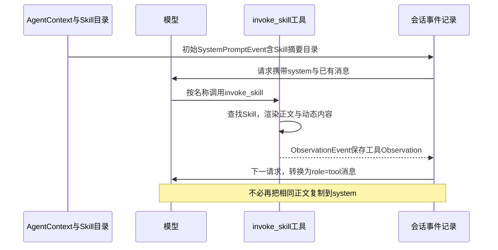
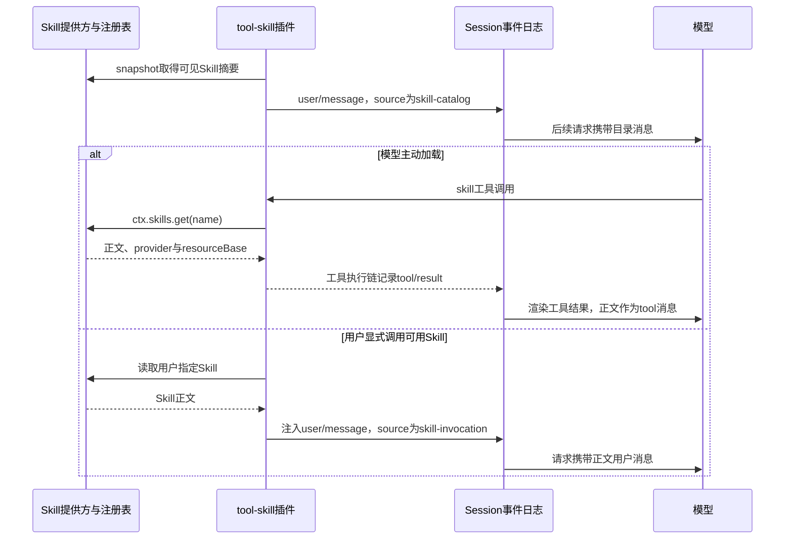
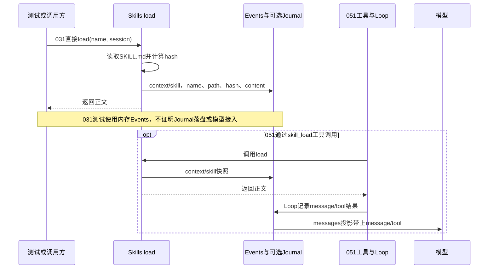

## 补充知识：Skill加载、事件记录与模型上下文

<details>
<summary>展开：OpenHands、DeepSeek Harness和本教程分别怎么加载Skill？正文需要再拼进系统提示词吗？</summary>

### 先分清三件事

发现Skill只是建立名称和描述目录；加载Skill才取得完整正文；把正文转换成下一次模型请求中的消息，模型才看得到。写入eventlog可以保存事实，但不是所有事件都会自动成为模型消息。正文无需仅因属于“指令”就再次复制到system消息。

本文OpenHands依据2026-11-05核对的[官方SDK文档](https://docs.openhands.dev/sdk/guides/skill)与源码main，后续可能变化；DeepSeek Harness依据本仓库固定基线687f282e8625c6b8d11ff58211a90524be2e4317。本节只补充机制对照，没有运行OpenHands或原版模型实验。

### 三种实现放在一起看

| 环节 | OpenHands SDK | 固定原版DeepSeek Harness | 本教程 |
| --- | --- | --- | --- |
| 发现与目录 | AgentSkills摘要进入系统上下文的available_skills | skill-catalog来源的user/message保存摘要目录 | 031 discover只建立名称到路径的Map，不自动给模型目录 |
| 模型主动加载 | invoke_skill返回正文Observation | skill工具调用ctx.skills.get，返回正文和来源 | 031直接load；051才注册skill_load工具 |
| 工具加载后的事件 | ObservationEvent持有工具结果 | tool/result通过工具执行链记录结果 | load自己写context/skill；051工具返回值另经Loop写message/tool |
| 正文如何给模型 | ObservationEvent.to_llm_message转换为role=tool | 工具结果渲染正文后形成tool角色消息 | 031的context/skill不在messages投影白名单；051的message/tool才进入后续模型历史 |
| 是否要再修改system | 按需工具加载不需要；常驻旧格式Skill可能一开始就在system | skill工具结果无需重复拼入system | 需要明确接入消息投影或工具结果，不能只依赖context/skill存在 |

OpenHands的ObservationEvent和原版tool/result是各自的事件类型，不能认为文件格式相同。本教程的message/tool也不是原版事件名。

### OpenHands：根据Skill类型选择注入位置



[invoke_skill实现](https://github.com/OpenHands/software-agent-sdk/blob/main/openhands-sdk/openhands/sdk/tool/builtins/invoke_skill.py)返回InvokeSkillObservation，正文可能已经过动态命令渲染，因此不能一概当作原始SKILL.md字节。[ObservationEvent源码](https://github.com/OpenHands/software-agent-sdk/blob/main/openhands-sdk/openhands/sdk/event/llm_convertible/observation.py)把观察结果和扩展内容转换成tool消息；[EventLog源码](https://github.com/OpenHands/software-agent-sdk/blob/main/openhands-sdk/openhands/sdk/conversation/event_store.py)提供持久事件存储。这里的eventlog指会话事件记录，不是每次模型请求都去重新读Skill文件。

OpenHands还有其他路径：旧格式且无触发器的常驻Skill全文进入初始system的REPO_CONTEXT；关键词触发可把正文加入用户消息的EXTRA_INFO；PathTrigger规则在匹配文件被访问后追加到对应工具结果，当前文档说明该规则注入适用于本地会话，不能泛化到ACP服务端执行。不能把这些路径全部概括成“Skill都在系统提示词”或“Skill都产生invoke_skill结果”。

### DeepSeek Harness：目录消息、工具结果与用户显式调用



对照[tool-skill源码](../../../deepseek-harness/packages/skill/tool-skill/src/index.ts)：工具execute返回name、provider、resourceBase和content；result.render使用renderSkillContent生成模型可读文字。目录摘要由skill-catalog用户消息发布；显式用户调用通过pre-step注入skill-invocation用户消息，不必产生skill工具调用。[Session源码](../../../deepseek-harness/packages/core/session/src/index.ts)将user/message与tool/result映射到相应模型角色。

因此“正文写进tool/result”和“正文被模型看到”是相邻但不同的步骤：前者保留执行事实，后者由消息投影与工具渲染完成。系统或目录中的说明告诉模型何时加载、如何使用Skill，正文可以保留在工具结果中。

### 本教程031与051：别把记录成功当成模型已经看见



031的src/skills.mjs明确执行：

```javascript
// 保留实际加载时的来源、摘要和正文快照。
session.append('context/skill', { name, path, hash, content })

// 返回值交给调用者，记录事件本身不会自动注入system。
return content
```

本章测试的Events未绑定Journal，因此只证明内存事件快照。实际由041 Host把Journal.append接到Events.persist时，追加事件才走磁盘日志。008/后续projection的messages只选择message/user、message/assistant、message/tool，忽略context/skill。051注册skill_load后，Loop会把工具返回的正文写成message/tool，并通过下一轮历史传给模型；同一次加载可能有context/skill快照与message/tool两条事实，但模型不会因快照存在自动获得两份正文。

### 调试时看哪三处

1. 031在Skills.load的readFile和session.append处观察content、path、hash，只用临时测试文件。
2. 查看session.read()中的context/skill，再调用messages(session.read())观察它未进入模型历史；不把事件存在误当成已注入。
3. 到051的skill_load和Loop追加message/tool处，观察正文作为工具返回进入历史；这条路线属于051，不要在031配置里期待自动命中。

Skill引用的scripts、references或附件不会因正文包含路径就全部读入eventlog。模型还需要通过实际读取、执行或资源工具使用它们。历史事件保留加载当时的内容，也不代表无限保留在每次请求中：压缩、裁剪和具体上下文策略仍可能改变后续送给模型的消息。

</details>
