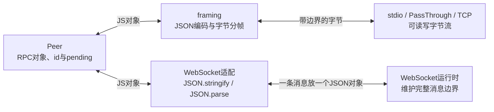

## Peer和framing支持stdio，但不限于stdio

032的跨进程demo使用stdin/stdout管道，035也用它连接语言服务器。**stdio是传输选择；Peer管RPC对象，framing管字节流中的消息边界。** 本节按PassThrough、TCP、WebSocket的顺序，把同一个sum调用接到三种通道上。

先按 [教程README](../README.md) 初始化REPO、COURSE和PROJECT。操作地点仍是 `$PROJECT`，默认指向本仓库的 `harness-own/`；独立重做时沿用你明确选定的同仓练习目录。下面提供三个可复制文件，不自动修改该工程，也不改本章已有 `src/rpc.mjs`。先完成032原有代码，再创建这些脚本。所有命令用Bun；`node:stream`、`node:net`是Bun支持的兼容模块名，不需要另启动Node.js。

三个脚本都注册一个独立的sum方法，参数为 `{ a: 2, b: 3 }`，返回5，便于只观察传输接线。它们没有经过原worker的tools/call和审批链，也不需要启动那个worker。

### 先区分三个层次

| 层 | 输入输出 | 负责什么 |
| --- | --- | --- |
| Peer | JS消息对象 | 生成请求id、保存pending、按method找handler、按id完成等待。 |
| framing | 对象与字节流之间转换 | JSON编码/解码、NDJSON或Content-Length边界、半包缓存和粘包拆分。 |
| 传输 | 字节流或带边界的消息 | stdio管道、内存流、TCP或WebSocket，实际搬运数据。 |

当前framing要求读取端具备 `.on('data/end/error', ...)`，data交付字节Buffer，写入端具备 `.write(Buffer)` 和相应流状态；不能把任意名为socket的对象直接传进去。保持字节模式，不要先调用socket.setEncoding把data变成字符串。本节TCP特意使用 `node:net.Socket`，它是可读又可写的Duplex字节流；Bun原生TCP API的回调式socket需要另外适配。Node接口性质可对照[官方net.Socket文档](https://nodejs.org/api/net.html#class-netsocket)，实际运行兼容性以下面的Bun实测为准。

每个例子都为两端各创建一个Peer，并选择一套对应接线：



上图只展开一端，另一端按相同约定接收并还原。Peer不要求先创建子进程，下面三个脚本都在单个Bun进程内建立两端；TCP和WebSocket例子仍会建立真实的本机网络连接，没有启动远程外部服务。

### 文件1：scripts/rpc-pass-through-demo.mjs

在练习工程创建 `scripts/rpc-pass-through-demo.mjs`，复制完整内容：

```js
import assert from 'node:assert/strict'
import { PassThrough } from 'node:stream'
import { Peer, framing } from '../src/rpc.mjs'

const budget = Number(process.env.RPC_DEMO_TIMEOUT_MS ?? 5_000) // 普通5秒，断点调试可显式给一小时。
assert.ok(Number.isFinite(budget) && budget > 0, 'RPC_DEMO_TIMEOUT_MS必须是正有限毫秒数；0不表示关闭超时')

const bToA = new PassThrough() // B向A发送的字节管道，A从这里读取。
const aToB = new PassThrough() // A向B发送的字节管道，B从这里读取。
const a = new Peer() // A拥有自己的请求ID和pending等待表。
const b = new Peer() // B拥有另一份方法表与等待表，不与A共享。
framing(a, bToA, aToB, 'lsp') // 读取端在前，写入端在后。
framing(b, aToB, bToA, 'lsp') // 两条管道交叉接线，仍按Content-Length拆帧。
b.handle('sum', ({ a, b }) => a + b) // 固定演示请求参数和返回值。
b.handle('hold', () => new Promise(() => {})) // 故意不回复，只用于观察关闭时清理pending。

const deadline = setTimeout(() => {
  a.close() // 请求等待不能因为示例故障无限挂住。
  b.close()
  bToA.destroy()
  aToB.destroy()
}, budget) // 有界保护，不用sleep协调消息到达。
let sum // 保存本次RPC真正返回的结果。
try {
  sum = await a.request('sum', { a: 2, b: 3 }, budget)
  assert.equal(sum, 5)
  await assert.rejects(a.request('missing', {}, budget), /未知方法/) // Peer负责把远端错误对应回原请求。
  const pending = a.request('hold', {}, budget) // 此时A等待表里有一项。
  a.close() // 只关闭本地Peer，原等待会以RPC连接断开失败。
  await assert.rejects(pending, /RPC连接断开/)
} finally {
  a.close()
  b.close()
  bToA.destroy() // Peer.close不等于关闭字节流，流也必须由拥有者回收。
  aToB.destroy()
  clearTimeout(deadline) // 成功后不留下保护定时器。
}
assert.equal(a.pending.size, 0)
assert.equal(b.pending.size, 0)
assert.ok(bToA.destroyed && aToB.destroyed)
console.log(JSON.stringify({ transport: 'PassThrough', sum, unknownMethodRejected: true, pendingRejectedOnClose: true, pending: [a.pending.size, b.pending.size], streamsDestroyed: true }))
```

PassThrough是内存字节流，没有子进程。两条流分别负责一个方向，关键接线是：

```text
aToB：A写入 → B读取
bToA：B写入 → A读取

A：framing(a, bToA, aToB, 'lsp')
B：framing(b, aToB, bToA, 'lsp')
```

framing参数仍然是先读、后写，所以两端要交叉接。`mode: 'lsp'` 在这里只选择Content-Length帧格式，sum仍是自定义RPC方法，不会自动成为具有initialize、文档同步、语义导航的LSP服务。

在练习工程根目录执行：

```sh
cd "$PROJECT"
mkdir -p scripts
bun scripts/rpc-pass-through-demo.mjs
```

### 文件2：scripts/rpc-tcp-demo.mjs

接着创建 `scripts/rpc-tcp-demo.mjs`：

```js
import assert from 'node:assert/strict'
import { createServer, createConnection } from 'node:net'
import { Peer, framing } from '../src/rpc.mjs'

const budget = Number(process.env.RPC_DEMO_TIMEOUT_MS ?? 5_000) // 普通5秒，断点调试可显式给一小时。
assert.ok(Number.isFinite(budget) && budget > 0, 'RPC_DEMO_TIMEOUT_MS必须是正有限毫秒数；0不表示关闭超时')

let rejectFailure // 所有启动、连接和传输错误共用一个失败出口。
const failure = new Promise((resolve, reject) => { rejectFailure = reject }) // 在每个等待点与它竞速。
failure.catch(() => {}) // 即使错误发生在两个await之间，也不会成为未处理的拒绝。
const wait = promise => Promise.race([promise, failure]) // 出错或总期限到达，就结束当前等待。
const deadline = setTimeout(() => rejectFailure(Error('TCP示例超过总预算')), budget) // 不用sleep等待服务端启动。
let serverSocket // 服务端accept得到的node:net.Socket。
let serverPeer // 服务端这条连接专属的Peer。
let clientSocket // 客户端创建的node:net.Socket，同样是Duplex。
let clientPeer // 客户端这一侧的Peer。
let sum // 保存真正收到的RPC结果。
let port // 系统分配的临时端口，避免固定端口冲突。

const server = createServer(socket => {
  serverSocket = socket // 这个最小示例只创建一个客户端连接。
  serverPeer = new Peer()
  framing(serverPeer, socket, socket, 'lsp') // 同一个Duplex同时作为读取端和写入端。
  socket.once('close', () => serverPeer.close()) // 原framing只订阅end/error，本地destroy还要兜底close。
  socket.on('error', rejectFailure) // 连接错误同样终止外层等待。
  serverPeer.handle('sum', ({ a, b }) => a + b)
  serverPeer.handle('hold', () => new Promise(() => {})) // 用于验证断连会唤醒等待方。
})
server.on('error', rejectFailure) // listen失败也进入finally清理。

try {
  const listening = new Promise(resolve => server.once('listening', resolve)) // 先订阅，再开始监听。
  server.listen(0, '127.0.0.1') // 真实TCP回环连接，只绑定本机，端口由系统分配。
  await wait(listening)
  port = server.address().port
  clientSocket = createConnection({ host: '127.0.0.1', port })
  clientPeer = new Peer()
  framing(clientPeer, clientSocket, clientSocket, 'lsp') // 必须传node流，不能直接塞Bun.connect的原生socket。
  clientSocket.once('close', () => clientPeer.close()) // 本地destroy也立即清理pending。
  clientSocket.on('error', rejectFailure)
  const connected = new Promise(resolve => clientSocket.once('connect', resolve)) // 连接成功后再发业务请求。
  await wait(connected)
  sum = await wait(clientPeer.request('sum', { a: 2, b: 3 }, budget))
  assert.equal(sum, 5)
  await assert.rejects(wait(clientPeer.request('missing', {}, budget)), /未知方法/)
  const pending = clientPeer.request('hold', {}, budget) // 模拟已经发出但还没有回复的请求。
  clientSocket.destroy() // 主动断开底层TCP，close监听会关闭本地Peer。
  await assert.rejects(wait(pending), /RPC连接断开/)
} finally {
  clientPeer?.close()
  serverPeer?.close()
  clientSocket?.destroy() // 只清pending还不够，TCP socket也要关闭。
  serverSocket?.destroy()
  try {
    const closed = new Promise(resolve => {
      try { server.close(() => resolve()) } // 关闭监听；尚未成功监听时callback也会结束。
      catch { resolve() } // 同步启动失败时仍允许执行余下清理。
    })
    await Promise.race([closed, failure.catch(() => {})]) // 出错路径不再无限等待close回调。
  } finally {
    clearTimeout(deadline)
  }
}
await Promise.race([failure, Promise.resolve()]) // 清理阶段若耗尽总预算，也不能把失败当成成功。
assert.equal(clientPeer.pending.size, 0)
assert.equal(serverPeer.pending.size, 0)
assert.ok(clientSocket.destroyed && serverSocket.destroyed)
assert.equal(server.listening, false)
console.log(JSON.stringify({ transport: 'TCP', port, sum, unknownMethodRejected: true, pendingRejectedOnDisconnect: true, pending: [clientPeer.pending.size, serverPeer.pending.size], socketsDestroyed: true, serverListening: server.listening }))
```

客户端socket和服务端接收到的socket各是一个连接端点，每个端点都能读也能写，因此两侧各自这样接：

```js
// 同一个端点的socket既是readable，也是writable；对端使用自己的另一个socket。
framing(peer, socket, socket, 'lsp')
```

TCP传的是连续字节流，一次write不保证对应一次data。下面这些到达方式都可能发生，例子没有要求实际运行必须按其中一种分包：

```text
发送：完整帧A + 完整帧B
接收方式一：chunk1是A的半段，chunk2是A剩余部分加B
接收方式二：chunk1同时包含A和B
```

framing根据Content-Length缓存未完成部分、循环提取完整帧，再交给Peer。换成TCP后这层责任仍然存在；直接对每个data的chunk做JSON.parse，可能因为半包或多条JSON粘在一起而失败。

运行：

```sh
bun scripts/rpc-tcp-demo.mjs
```

脚本让操作系统分配本机空闲端口，等待listen/connect事件后再发请求，结束时关闭Peer、socket和监听服务；不需要手动抢固定端口，也不靠sleep等待连接。

### 文件3：scripts/rpc-websocket-demo.mjs

最后创建 `scripts/rpc-websocket-demo.mjs`：

```js
import assert from 'node:assert/strict'
import { Peer } from '../src/rpc.mjs'

const budget = Number(process.env.RPC_DEMO_TIMEOUT_MS ?? 5_000) // 普通5秒，断点调试可显式给一小时。
assert.ok(Number.isFinite(budget) && budget > 0, 'RPC_DEMO_TIMEOUT_MS必须是正有限毫秒数；0不表示关闭超时')

let rejectFailure // 启动、连接、消息处理错误共用的失败出口。
const failure = new Promise((resolve, reject) => { rejectFailure = reject }) // 与所有等待操作竞速。
failure.catch(() => {}) // 错误发生在等待点之间也不会成为未处理的拒绝。
const wait = promise => Promise.race([promise, failure]) // 失败后立即转入finally回收资源。
const deadline = setTimeout(() => rejectFailure(Error('WebSocket示例超过总预算')), budget) // 不靠sleep等连接。
let server // Bun的本机HTTP/WebSocket服务器。
let serverSocket // Bun服务端收到的WebSocket连接。
let serverPeer // 这条服务端连接自己的RPC Peer。
let clientSocket // Bun提供的原生WebSocket客户端。
let clientPeer // 客户端自己的RPC Peer。
let clientClosed // 等客户端close事件，不把调用close误认为已经关闭。
let resolveServerClosed // 服务端close事件的完成通知。
const serverClosed = new Promise(resolve => { resolveServerClosed = resolve }) // 明确等待服务器连接关闭，不靠sleep。
let sum // 本次真正返回的计算结果。
let echo // 本次真正往返的中文内容。
let port // Bun实际监听的临时端口。

try {
  server = Bun.serve({
    hostname: '127.0.0.1',
    port: 0, // 系统分配端口，不与其他示例抢固定地址。
    /** 只接收本示例的WebSocket升级，不在HTTP正文里传RPC。 */
    fetch(request, server) {
      if (server.upgrade(request)) return
      return new Response('需要WebSocket升级', { status: 426 })
    },
    websocket: {
      /** 一条WebSocket连接对应一个Peer；发送一次就是一条完整JSON文本消息。 */
      open(socket) {
        serverSocket = socket
        serverPeer = new Peer(message => socket.send(JSON.stringify(message)))
        serverPeer.handle('sum', ({ a, b }) => a + b)
        serverPeer.handle('echo', text => text)
        serverPeer.handle('hold', () => new Promise(() => {})) // 仅用于观察断连pending清理。
      },
      /** WebSocket已提供完整消息边界，直接解JSON交Peer，不再经过framing。 */
      message(socket, text) {
        if (typeof text !== 'string') {
          serverPeer?.close()
          rejectFailure(Error('服务端只接受JSON文本消息'))
          socket.close(1003, '只接受文本') // 二进制消息明确拒绝，不把Buffer或Blob强转字符串。
          return
        }
        try {
          const message = JSON.parse(text) // 本示例约定每条文本消息只装一个RPC对象。
          void serverPeer.receive(message).catch(error => {
            serverPeer.close()
            rejectFailure(error)
            socket.close(1002, 'RPC处理失败')
          })
        } catch (error) {
          serverPeer.close()
          rejectFailure(error)
          socket.close(1002, 'JSON无效')
        }
      },
      /** 对端断开后，关闭对应Peer，拒绝它尚未完成的请求。 */
      close() {
        serverPeer?.close()
        resolveServerClosed()
      },
      /** 其他服务端handler抛错时回调；本机Bun1.3.14实测只给第一个Error参数。 */
      error(error, socket) {
        serverPeer?.close()
        ;(socket ?? serverSocket)?.terminate() // 新版若给socket就使用它，当前版本用本示例捕获的连接。
        rejectFailure(error instanceof Error ? error : Error(String(error))) // 失败出口始终收到真实Error。
      },
    },
  }) // Bun.serve启动失败会直接跳到finally。
  port = server.port
  clientSocket = new WebSocket(`ws://127.0.0.1:${port}`)
  clientPeer = new Peer(message => clientSocket.send(JSON.stringify(message))) // 不添加Content-Length或换行分隔。
  clientClosed = new Promise(resolve => clientSocket.addEventListener('close', () => {
    clientPeer.close()
    resolve()
  }, { once: true })) // 断连会立即清掉客户端pending。
  clientSocket.addEventListener('error', () => {
    clientPeer.close()
    rejectFailure(Error('WebSocket客户端连接错误'))
  })
  clientSocket.addEventListener('message', event => {
    if (typeof event.data !== 'string') {
      clientPeer.close()
      rejectFailure(Error('客户端只接受JSON文本消息'))
      clientSocket.close(1003, '只接受文本')
      return
    }
    try {
      const message = JSON.parse(event.data) // 收到的是完整文本message，不是任意字节chunk。
      void clientPeer.receive(message).catch(error => {
        clientPeer.close()
        rejectFailure(error)
        clientSocket.close(1002, 'RPC处理失败')
      })
    } catch (error) {
      clientPeer.close()
      rejectFailure(error)
      clientSocket.close(1002, 'JSON无效')
    }
  })
  const opened = new Promise(resolve => clientSocket.addEventListener('open', resolve, { once: true })) // 发请求前必须等open。
  await wait(opened)
  sum = await wait(clientPeer.request('sum', { a: 2, b: 3 }, budget))
  assert.equal(sum, 5)
  echo = await wait(clientPeer.request('echo', '中文🙂', budget))
  assert.equal(echo, '中文🙂')
  await assert.rejects(wait(clientPeer.request('missing', {}, budget)), /未知方法/)
  const pending = clientPeer.request('hold', {}, budget) // 此时客户端等待一个故意不回复的请求。
  clientSocket.close(1000, '演示断开')
  await assert.rejects(wait(pending), /RPC连接断开/)
} finally {
  clientPeer?.close()
  serverPeer?.close()
  clientSocket?.close() // Peer.close不会替你关闭WebSocket。
  serverSocket?.terminate() // finally明确回收服务端这一条连接，触发close事件。
  try {
    server?.stop(true).catch(rejectFailure) // 请求停止监听；本机1.3.14有WS关闭后stop Promise不结束的情况，不拿它当关闭凭证。
    const connectionsClosed = Promise.all([clientClosed, serverSocket ? serverClosed : undefined]) // 真正等两侧close，而不是等到总期限。
    await Promise.race([connectionsClosed, failure.catch(() => {})]) // 已失败时也能有界回收。
  } finally {
    clearTimeout(deadline) // 成功后不留下保护定时器。
  }
}
await Promise.race([failure, Promise.resolve()]) // 清理时若总预算已失败，不输出伪成功。
assert.equal(clientPeer.pending.size, 0)
assert.equal(serverPeer.pending.size, 0)
assert.equal(clientSocket.readyState, WebSocket.CLOSED)
assert.equal(serverSocket.readyState, WebSocket.CLOSED)
console.log(JSON.stringify({ transport: 'WebSocket', port, sum, echo, unknownMethodRejected: true, pendingRejectedOnDisconnect: true, pending: [clientPeer.pending.size, serverPeer.pending.size], clientClosed: true, serverSocketClosed: true, serverStopRequested: true }))
```

这个文件只导入Peer，没有调用framing。发送方向把RPC对象交给JSON.stringify，再用ws.send发送；接收方向从完整message里JSON.parse，再交给Peer.receive。服务端使用Bun.serve的 `message(ws, message)` 回调，客户端使用WebSocket事件的 `event.data`，两者API形状不同。[Bun官方WebSocket文档](https://bun.sh/docs/runtime/http/websockets)

只看核心接线，就是下面两个动作；完整示例另外处理类型校验、异常和关闭：

| 方向 | 接线 |
| --- | --- |
| Peer向外发送 | 构造Peer时传入 `message => socket.send(JSON.stringify(message))`，作为peer.send。 |
| WebSocket向Peer交付 | message回调取到完整文本后，调用 `peer.receive(JSON.parse(text))`；客户端文本取自event.data。 |

当前framing会给peer安装自己的send函数；这里已经通过构造器装好WebSocket发送函数，接收也直接进入Peer，所以不再调用framing覆盖这套接线。

运行：

```sh
bun scripts/rpc-websocket-demo.mjs
```

示例只接受文本消息，显式处理二进制、解析错误和连接关闭；先等open，再发RPC。断开时调用peer.close拒绝仍在等待的请求，传输本身也要关闭；Peer不会替你关闭WebSocket或监听服务。

### 为什么WebSocket可以不经过当前framing

TCP的data事件交付的是字节片段；WebSocket运行时交付给message回调的是一条完整消息。WebSocket的一条消息在底层仍可能拆成多个协议帧，运行时会按协议组装；**省去的是本教程的framing函数，WebSocket协议自身的分帧和组装仍由运行时完成。** [RFC 6455 第5.4节](https://www.rfc-editor.org/rfc/rfc6455.html#section-5.4)

本例进一步约定：**一次ws.send发送一个完整JSON-RPC对象的JSON字符串，一次message事件解析一个对象。** 所以无需再添加Content-Length或NDJSON换行：

```text
TCP / stdio / PassThrough：
Peer对象 → JSON → UTF-8字节 + 应用消息边界 → 字节流
字节流chunk → framing收齐一帧 → JSON.parse → Peer对象

本例WebSocket：
Peer对象 → JSON.stringify → ws.send一条文本消息
message收到一条完整文本 → JSON.parse → Peer对象
```

WebSocket只提供消息边界，不会自动识别JSON或RPC。JSON.parse、按method分发、按id完成pending仍需我们的适配和Peer完成；如果应用自己把一段JSON拆成多条WebSocket消息，接收端还得按应用约定重组，不能直接沿用本例的一条消息解析一次的做法。

### 在VS Code里看三种接线的差别

先按上面三条Bun命令验收，再单独调试一个脚本。在练习工程已有 `.vscode/launch.json` 的configurations数组里追加下面这个对象，保留原有配置；先把要调试的demo文件切到当前编辑器，再选择“Bun：032当前传输示例”启动：

```json
{
  "name": "Bun：032当前传输示例",
  "type": "bun",
  "request": "launch",
  "program": "${file}",
  "cwd": "${workspaceFolder}",
  "runtime": "bun",
  "runtimeArgs": ["--preload", "${workspaceFolder}/scripts/vscode-debug.mjs"],
  "env": { "RPC_DEMO_TIMEOUT_MS": "3600000" },
  "stopOnEntry": false
}
```

三个例子的服务端和客户端都在同一个Bun进程，不需要另外附加子进程。未设置RPC_DEMO_TIMEOUT_MS时，示例总期限与Peer请求预算默认5秒；上面这个调试配置把两者都延长为一小时，便于停在断点看变量，时间到了仍会失败。参数必须为正的有限数，0不会关闭等待。这里运行的是普通脚本，控制的是示例自己的保护计时器和Peer请求预算。

调试时先识别当前Peer属于哪一端，结束后再用上面的普通Bun命令复验；请求超时只结束本地等待，不能当作对端操作已取消。

| 例子 | 断点 | 看什么 |
| --- | --- | --- |
| PassThrough | 两次framing接线、rpc.mjs的peer.send与receive | 两条流的方向；message先是对象，再变成bytes/packet。 |
| TCP | 服务端connection回调、客户端连接完成处、rpc.mjs的data回调 | 两个socket是不同端点；每个同时可读可写；chunk不保证是一条完整消息。 |
| WebSocket | Peer构造器里的发送回调、两端message处理处 | JSON字符串从send进入，完整消息从message出来，再解析成对象；不会进入framing。 |

### 运行验收与边界

三条运行命令各自输出一条JSON并退出，不能靠等到5秒保护期限才结束。共同验收是 `sum: 5`、`unknownMethodRejected: true`、`pending: [0, 0]`，再按下表看对应资源：

| 例子 | 额外输出 | 怎样算完成 |
| --- | --- | --- |
| PassThrough | pendingRejectedOnClose=true、streamsDestroyed=true | 本地关闭Peer会拒绝等待，两条内存流显式销毁。 |
| TCP | pendingRejectedOnDisconnect=true、socketsDestroyed=true、serverListening=false | 断连清pending，客户端和服务端socket销毁，监听已关闭。port是本轮动态端口。 |
| WebSocket | echo为中文🙂、pendingRejectedOnDisconnect=true、clientClosed=true、serverSocketClosed=true | 完整文本消息往返，断连后pending被拒绝，两端都进入CLOSED。serverStopRequested表示已请求停止监听。 |

hold方法故意不回复，只为制造一个可观察的pending，不执行真实后台工作；未知方法错误仍通过RPC原id回到调用方。脚本中的assert会检查结果，失败就非零退出，不要只看打印了sum就认为清理也通过。

本机Bun 1.3.14的WebSocket示例采用两侧close事件作为连接关闭凭证；实测该版本server.stop(true)返回的Promise在连接已关闭后仍可能不结束，所以给它挂catch但不await。serverStopRequested字段只表示发起停止，另以脚本退出后本轮端口拒连核对监听已释放。默认5秒和一小时预算都已实跑且立即结束，排除了靠总期限结束清理的假成功，见[本节验证记录](../evidence/032-transports-2026-10-26.json)。这是一对Peer的本地接线示例，未实现连接池、断线重连或生产流控。

如果Peer的request挂住，按“已连接 → 已安装send/receive → 对端注册handler → 对端已继续执行”检查。TCP断开还要处理socket的close事件：原framing只监听end/error，示例额外把close接到Peer.close；本地destroy不会自动等于RPC取消。所有例子都显式释放传输资源，Peer.close只清本地pending，不会取消对端handler已经开始的副作用。

本节演示同一份032 Peer在不同传输上的接线，不会替换MCP/ACP各自的SDK，也没有把047的Remote协议改成这套示例。已有跨进程工具与反向审批示例仍按原文运行。

合上文档，分别画出两条PassThrough流、TCP两端socket、WebSocket两个Peer，解释每一层收到的是对象、字节还是完整消息。隔天只看这三个文件名再运行一次，重点回忆为什么“有完整消息边界”仍需要JSON.parse和请求id。
