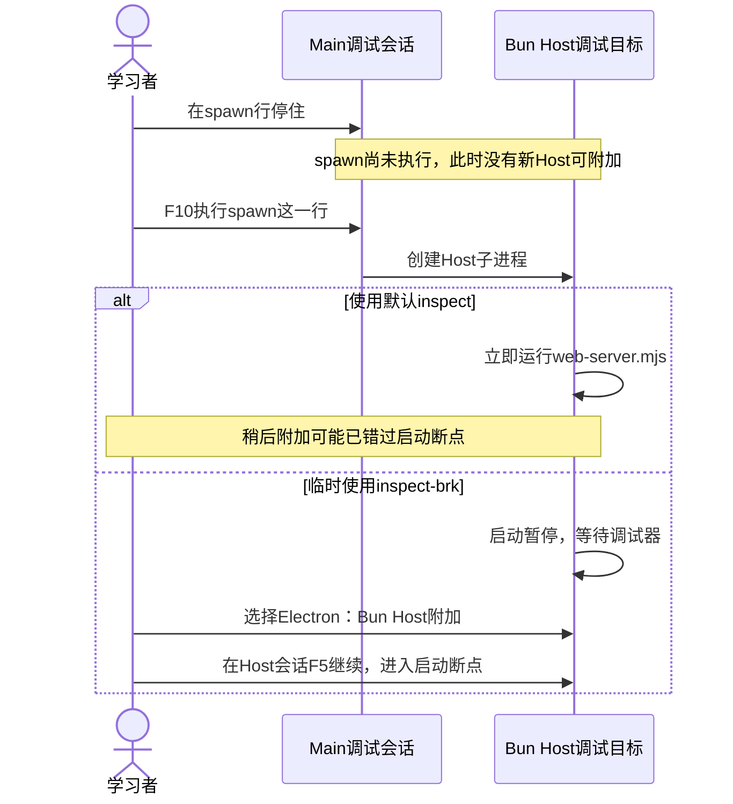

## 在 VS Code 调试 Electron Main、Bun Host 和页面

先完成本章的 Electron 安装及普通窗口烟测。下面全部在自己的 PROJECT 内操作：

1. VS Code 打开 `desktop/main.cjs`，在 `startHost` 内设断点；打开 `src/host.mjs` 与 `web/app.mjs`，分别在提交处理与 rpc 内设断点。
2. 在集成终端执行：

```sh
HARNESS_VSCODE_DEBUG=1 bun run desktop
```

3. 进程在 Main 入口等待，这是预期。选择 **Electron：Main**，按 F5 连接；命中 startHost 后继续运行，让 Host 和窗口就绪。
4. 再选择 **Electron：Bun Host**，按 F5。它连接本机6499端口上的 Bun，不是 Main 的9229端口。
5. 窗口就绪后选择 **Electron：Renderer**，按 F5，连接本机9222端口的页面。点击发送，观察页面和 Host 的断点分别命中。
6. 从“调用堆栈”切换会话。若调 preload，在 `desktop/preload.cjs` 设置断点，附加 Renderer 后重新加载测试窗口；preload 与页面隔离，变量不能当成同一个上下文。
7. 调试完成后停止三个附加会话，并退出桌面窗口；确认启动终端回到提示符。重新正常启动、跑测试和烟测，不携带调试开关。

三个端口只绑定本机。若端口占用，先退出上一次自己启动的调试进程；不要随意杀掉其他程序。


### Main停在spawn，为什么还附加不到Host？

断点通常停在语句执行之前。Main停在 `host = spawn(runtime, hostArgs, ...)` 这一行，不等于子进程已经创建。Main的F11也不能跨进程进入web-server.mjs。



本项目默认Host参数是 `--inspect=127.0.0.1:6499/harness-host`：开放调试端口，但不等你附加。要观察Host启动代码，请临时把Main的hostArgs中这一项改成 `--inspect-brk=127.0.0.1:6499/harness-host`，保留后面的paths.host参数。

1. 退出旧桌面应用，重新用调试模式启动，并先附加 **Electron：Main**。
2. 在Main的spawn行停住，按F10执行这一行；停到下一行后，Host才已经创建。此时可以暂时保持Main暂停。
3. 在PROJECT的 `src/web-server.mjs` 首条可执行语句设断点，再启动 **Electron：Bun Host** 附加会话。配置地址应与6499/harness-host一致，不选9222的Renderer。
4. 从“调用堆栈”选中Host调试会话，按F5继续Host；启动代码这时才开始执行。按需要继续Main，让它读取Host输出的URL并创建窗口。
5. Main中的Host启动保护计时为20秒。尚停在spawn之后、计时器创建之前时可以先完成附加；如果已经让Main进入等待URL的代码，就要及时连接并继续Host。仅让Host一直暂停会使Main报启动超时。
6. 调完恢复默认inspect。普通运行无需暂停等待第二个调试器；要观察运行中的任务，附加Host后在remote、Host或Agent的处理函数下断点，再从页面发送任务即可。

`--inspect-brk`让Host成为可连接、尚未执行完启动逻辑的目标；它不会把Host并入Main调用栈。若6499已被旧实例占用，先退出旧实例，不要误连旧Host并等待新进程断点命中。
