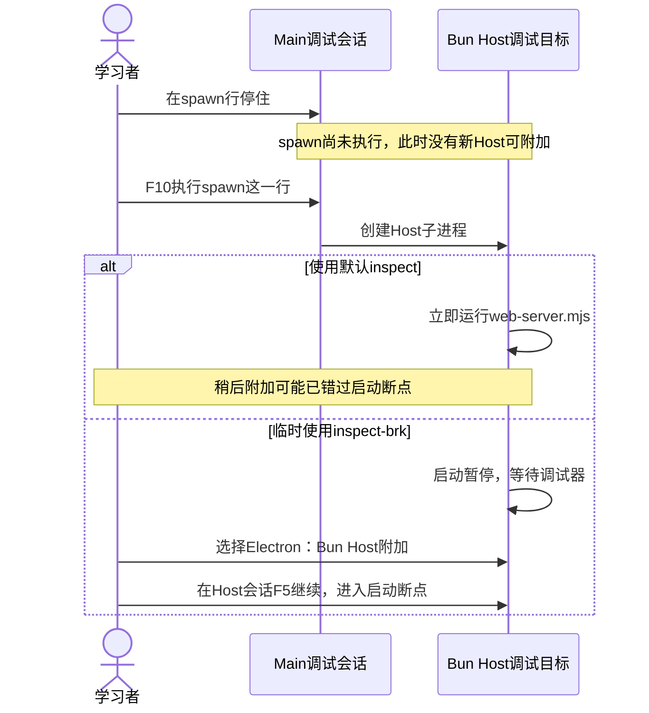
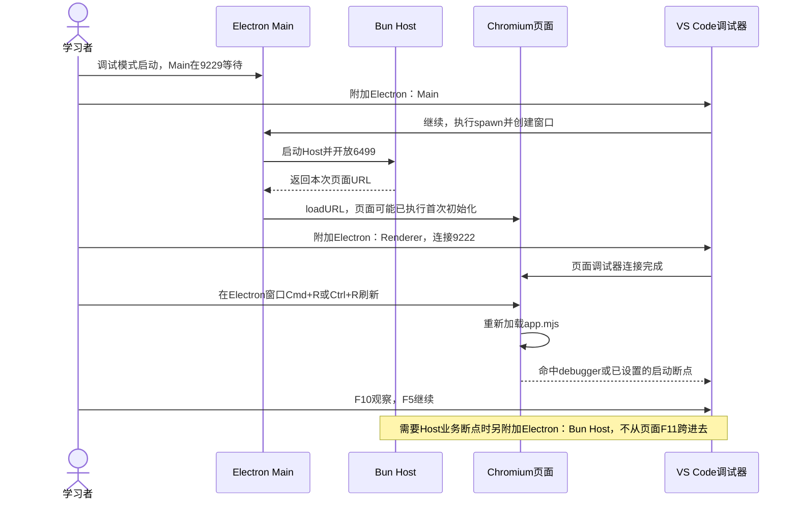
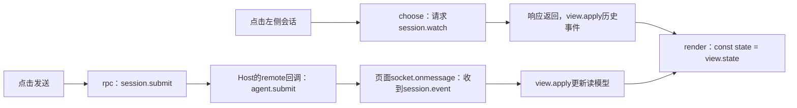

## 在 VS Code 调试 Electron Main、Bun Host 和页面

先完成本章的 Electron 安装及普通窗口烟测。下面全部在自己的 PROJECT 内操作：

1. VS Code 打开 `desktop/main.cjs`，在 `startHost` 内设断点；打开 `src/host.mjs` 与 `web/app.mjs`，分别在提交处理与 rpc 内设断点。
2. 在集成终端执行：

```sh
HARNESS_VSCODE_DEBUG=1 bun run desktop
```

3. 进程在 Main 入口等待，这是预期。选择 **Electron：Main**，按 F5 连接；命中 startHost 后继续运行，让 Host 和窗口就绪。
4. 再选择 **Electron：Bun Host**，按 F5。它连接本机6499端口上的 Bun，不是 Main 的9229端口。
5. 窗口就绪后选择 **Electron：Renderer**，按 F5，连接本机9222端口的页面。点击发送，观察页面和 Host 的断点分别命中。
6. 从“调用堆栈”切换会话。若调 preload，在 `desktop/preload.cjs` 设置断点，附加 Renderer 后重新加载测试窗口；preload 与页面隔离，变量不能当成同一个上下文。
7. 调试完成后停止三个附加会话，并退出桌面窗口；确认启动终端回到提示符。重新正常启动、跑测试和烟测，不携带调试开关。

三个端口只绑定本机。若端口占用，先退出上一次自己启动的调试进程；不要随意杀掉其他程序。


### Main停在spawn，为什么还附加不到Host？

断点通常停在语句执行之前。Main停在 `host = spawn(runtime, hostArgs, ...)` 这一行，不等于子进程已经创建。Main的F11也不能跨进程进入web-server.mjs。



本项目默认Host参数是 `--inspect=127.0.0.1:6499/harness-host`：开放调试端口，但不等你附加。要观察Host启动代码，请临时把Main的hostArgs中这一项改成 `--inspect-brk=127.0.0.1:6499/harness-host`，保留后面的paths.host参数。

1. 退出旧桌面应用，重新用调试模式启动，并先附加 **Electron：Main**。
2. 在Main的spawn行停住，按F10执行这一行；停到下一行后，Host才已经创建。此时可以暂时保持Main暂停。
3. 在PROJECT的 `src/web-server.mjs` 首条可执行语句设断点，再启动 **Electron：Bun Host** 附加会话。配置地址应与6499/harness-host一致，不选9222的Renderer。
4. 从“调用堆栈”选中Host调试会话，按F5继续Host；启动代码这时才开始执行。按需要继续Main，让它读取Host输出的URL并创建窗口。
5. Main中的Host启动保护计时为20秒。尚停在spawn之后、计时器创建之前时可以先完成附加；如果已经让Main进入等待URL的代码，就要及时连接并继续Host。仅让Host一直暂停会使Main报启动超时。
6. 调完恢复默认inspect。普通运行无需暂停等待第二个调试器；要观察运行中的任务，附加Host后在remote、Host或Agent的处理函数下断点，再从页面发送任务即可。

`--inspect-brk`让Host成为可连接、尚未执行完启动逻辑的目标；它不会把Host并入Main调用栈。若6499已被旧实例占用，先退出旧实例，不要误连旧Host并等待新进程断点命中。


### Main、Host、Renderer：启动参数与断点对照

先确定代码由谁执行，再选择调试配置。`inspect-brk`不能控制所有文件：它用于这里的Main或Bun Host，不是页面JavaScript的启动参数。

| 目标 | 哪段代码启动它、使用什么参数 | VS Code配置 | 建议断点 |
| --- | --- | --- | --- |
| Main | scripts/desktop.mjs给Electron传 `--inspect-brk=127.0.0.1:9229` | Electron：Main | desktop/main.cjs的spawn行、new BrowserWindow、loadURL |
| Bun Host | Main的hostArgs默认传 `--inspect=127.0.0.1:6499/harness-host`；调启动时临时换成inspect-brk | Electron：Bun Host | src/web-server.mjs的new Host与startHTTP；运行中看src/remote.mjs的session.submit回调 |
| Renderer | 启动器给Electron传 `--remote-debugging-address=127.0.0.1` 与 `--remote-debugging-port=9222` | Electron：Renderer | web/app.mjs的rpc、socket.onmessage、render |

这些端口在 `HARNESS_VSCODE_DEBUG=1` 时才开启。9229是Main，6499是Bun Host，9222用于连接Chromium页面目标；不能用一个端口附加全部进程。remote-debugging-port只开放连接，不像inspect-brk那样暂停页面启动。

### 稳定停在页面启动位置：先附加，再刷新

如果要看页面模块的首次执行，可在PROJECT的 `web/app.mjs` 中临时添加：

```javascript
import { View } from '/view.mjs'

// 临时观察页面模块启动：先连接页面调试器，再刷新，执行到这里暂停。
debugger

// 后面保留原文件内容；本片段只展示插入位置，不是完整替换文件。
```

这个位置在import声明之后，能观察app.mjs本身的初始化；它不能让已经执行过的依赖模块倒退，也不是Bun Host的断点。



1. 在PROJECT修改app.mjs并保存，或在模块首条可执行语句上设置普通断点。
2. 用 `HARNESS_VSCODE_DEBUG=1 env -u DEEPSEEK_API_KEY bun run desktop` 启动，先附加Main并继续。
3. 窗口出现后，选择 **Electron：Renderer** 附加；确保当前调试会话是页面而非Main。
4. 让焦点回到Electron窗口，macOS按Cmd+R，Windows/Linux按Ctrl+R。不要只重启Main的调试连接，也不要在VS Code编辑器里误按刷新快捷键。
5. 停在debugger后，F10观察connect与事件注册，F5继续页面运行。要追用户操作，再设置下表中的断点。
6. 调试完成删除临时debugger并保存。已加载的页面需刷新才会取得修改后的脚本；不要把debugger永久留在正式源码里。

若Main中已临时改为Host的inspect-brk，必须先按上一小节附加并继续Host，让页面URL产生，窗口才能出现；不能卡着Host去等Renderer目标出现。

### 用户点击后，具体断在哪里？

以下行号是本次核对的源码位置，后续文件改动时以语句内容为准。

| 想观察什么 | 本项目文件与语句 | 怎么触发、看什么 |
| --- | --- | --- |
| 会话如何变成页面 | web/app.mjs约18行：`const state = view.state()` | 已连接后点击左侧会话；F10后看state |
| 任务内容怎么取出 | web/app.mjs约54行：`await rpc('session.submit', ...)` | 选择会话，输入hello，点发送/排队；看content |
| 请求发到哪里 | web/app.mjs约10～11行：`const id = ++serial`与socket.send | 看method、params和请求id |
| 返回消息怎么处理 | web/app.mjs约44行：`const message = JSON.parse(event.data)` | 发送任务后接收消息；F10后看message.method与sessionId |
| 服务端怎样收到任务 | src/remote.mjs约10行：session.submit回调里的agent.submit | 另附加Host；看params.content，不只在注册bind时停 |



Renderer附加得晚、错过首次render时，不需要猜启动过程：等待页面显示“已连接”，点击一个已有会话；没有会话则填写工作区路径并新建，choose返回后会调用render。断点若为空心，核对webRoot是否为当前PROJECT的web目录，而非教材steps目录。

普通Web调试使用 **Web：Bun Host** 启动服务，再用 **Web：页面** 加载本次完整URL。页面也可用同样的debugger加刷新方法；它不需要Electron的Main和Renderer附加配置。Electron窗口则使用 **Electron：Renderer**，不要另开Web：页面来期待它控制桌面窗口。
