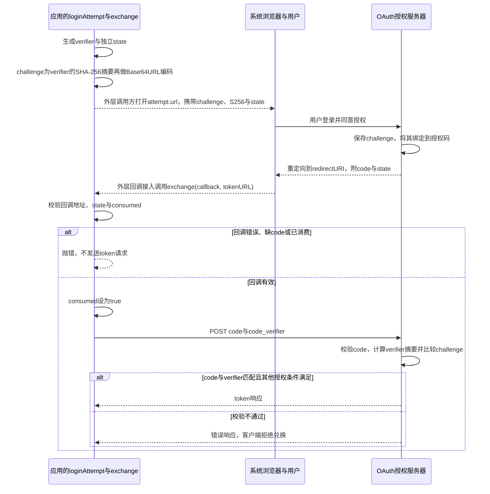
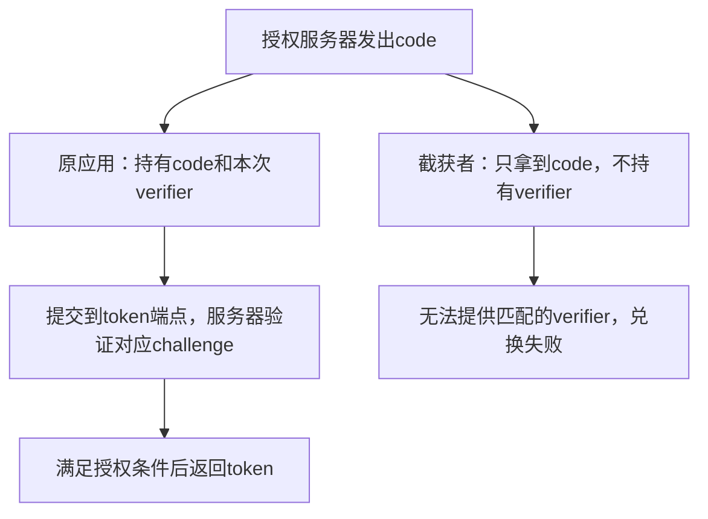

## 补充知识：OAuth 登录中的 PKCE

<details>
<summary>展开：verifier、challenge、code、state 分别是什么，如何对应本节代码？</summary>

### 先区分本章已经实现什么

本章的 `loginAttempt` 是登录流程中的客户端辅助模块，还没有接到Electron登录按钮、系统浏览器和回调监听器。下面的浏览器与授权服务器是完整流程需要的参与方，不代表运行本章测试就会启动它们。标准依据见 [RFC 7636](https://www.rfc-editor.org/rfc/rfc7636)。

PKCE全称Proof Key for Code Exchange，通常读作“pixy”。它把发起授权与兑换授权码绑定：即使授权码code被截获，没有本次尝试的秘密verifier，也不能通过正确实现的服务器校验取得token。它不是对用户密码加密，也不代替用户在授权服务器登录。

### 四个值不要混在一起

| 值 | 谁生成、何时生成 | 去哪里、在哪里保留 | 本节代码位置与用途 |
| --- | --- | --- | --- |
| verifier | 应用在loginAttempt开始时，用32个随机字节生成 | 闭包暂存；只在token兑换时提交 | randomBytes(32)加base64url；不是放在授权URL里的长期client secret |
| challenge | 应用根据本次verifier计算 | 放进授权URL；服务器与签发的code关联保存 | createHash('sha256').update(verifier).digest('base64url') |
| code | 授权服务器在用户授权后签发 | 通过回调交给应用，随后提交token端点 | result.searchParams.get('code')；客户端不自己生成它 |
| state | 应用在本次尝试开始时，独立用24个随机字节生成 | 授权URL发送，回调原样带回，应用与闭包中的值比较 | state与actualState比较，防止把不属于本次尝试的回调接进来 |

最终的access_token又是另一种值：由token端点在校验成功后返回，用来访问获准资源。不要把code、state或verifier直接当作access_token使用。

### 完整流程与本节函数的边界



浏览器打开、回调监听属于本章尚未实现的外层接入。`exchange` 只是接收callback字符串；向服务器请求token时，不会把用户密码交给本函数。

### 沿着本节源码看一次

```text
loginAttempt(...)
  ├─ verifier随机秘密 → 计算challenge → attempt.url
  ├─ 独立state → attempt.url，同时在闭包保留
  └─ 返回exchange函数，闭包继续保存本次verifier、state、consumed

exchange(callback, tokenURL)
  → 检查callback的origin/path与state
  → 取服务器返回的code
  → consumed = true
  → POST code + code_verifier + client_id + redirect_uri
  → 授权服务器验证PKCE
  → 返回token响应或抛错
```

原始verifier不出现在授权URL里，但兑换时必须通过受保护的连接提交给token端点。标准中的S256方式使用 `BASE64URL(SHA256(ASCII(code_verifier)))`；本节verifier由base64url字符组成，使用UTF-8输入hash时与ASCII字节一致，digest('base64url')给出URL安全且无填充的编码。

state与PKCE分工不同：state帮助客户端关联本次回调，PKCE让服务器检查兑换者持有本次verifier。consumed是本地状态，不是第三种token；本实现发起兑换后即消费，网络失败也不会重用同一attempt。

### 用“授权码被拿走”理解为什么需要PKCE



这说明的是授权码拦截场景，不承诺能应对运行时秘密也一并被窃取的情况。verifier每次登录重新生成；不要打印真实code、verifier或token来观察流程。

### 本章测试怎么验证，哪些尚未证明？

在PROJECT运行 `bun test ./tests/053-login.test.mjs`。本章测试使用accounts.example占位地址和固定fetcher，实际不会连接账号服务器。

| 测试动作 | 实际观察 |
| --- | --- |
| wrong state回调 | 在兑换前被拒绝 |
| 正确state加测试code=a | 固定fetcher收到code_verifier，并返回test-token |
| 重复同一个回调 | 被consumed拒绝 |

现有测试检查verifier存在与长度，没有让真实服务器验证challenge，也未断言challenge恰好等于verifier摘要。不能把测试通过说成已完成真实登录、凭据保存或浏览器回调接线。

调试时在loginAttempt生成随机值之后、exchange的回调校验、consumed赋值和fetcher调用前后观察。只用测试值；主要看URL参数是否包含challenge而不含verifier、错误state能否阻止网络请求，以及consumed何时从false变true。

</details>
