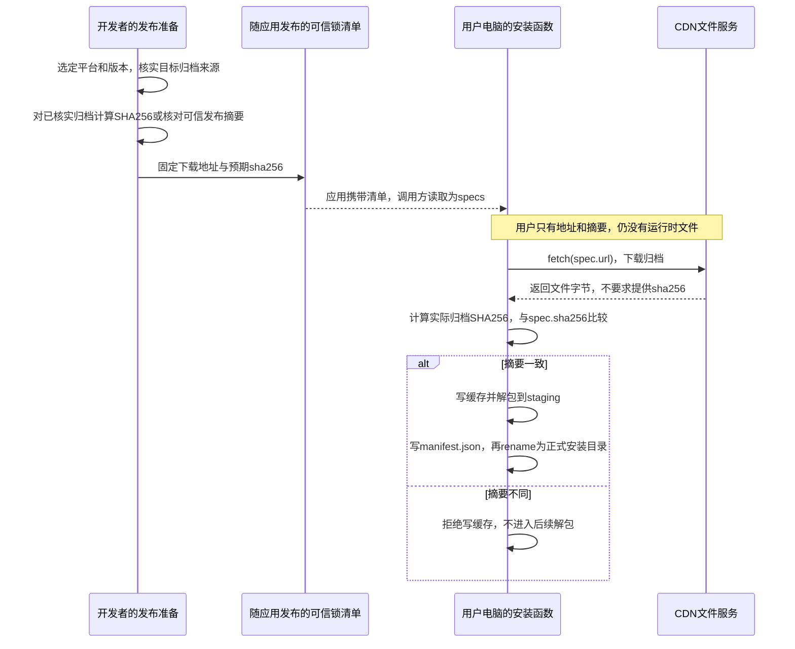
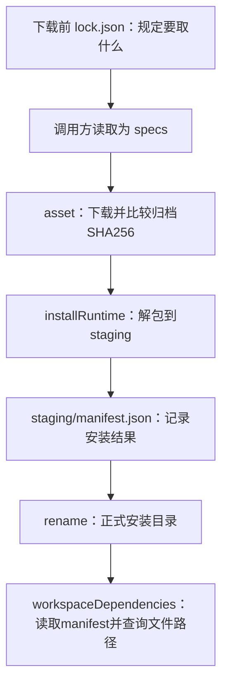

## 补充知识：下载前的 lock.json 与安装后的 manifest.json

<details>
<summary>展开：正确的 SHA256 从哪里来？已经有摘要，为什么还要下载？</summary>

### 先看两份清单分别管什么

| 对比 | 下载前的 lock.json | 安装后的 manifest.json |
| --- | --- | --- |
| 谁准备 | 开发者在发布应用前核实并固定 | installRuntime在解包完成后生成 |
| 用途 | 规定准备下载什么、预期归档摘要是什么 | 记录本次安装了什么、去哪里找可执行文件 |
| 本节涉及的字段 | name、url、sha256、executable | name、sha256、executable |
| 何时使用 | 下载前读取，作为specs传入installRuntime | 安装目录发布后，由workspaceDependencies读取 |
| 能否成为首次下载的校验依据 | 可以，前提是清单本身来自可信发布过程 | 不可以，本次安装结束前它还没生成 |

文件名不是协议规定；这里用lock.json说明“下载前固定的可信清单”。本节尚未提供真实运行时的锁文件，也没有自动读取锁文件的代码：asset接收单个spec，installRuntime接收specs数组。下文清单和读取代码是补充接入示意，不代表已经接到桌面启动。

### SHA256的来路：发布方先确定，用户下载后比较



摘要是文件的“指纹”，不能还原文件，所以有了摘要仍需要下载。开发者曾拿到归档，不代表每个用户的电脑上都有归档。正确摘要不能在用户下载后才根据同一份下载内容生成，再拿来与自己比较；错误内容也会通过那种比较。清单也不能仅因和文件来自同一个CDN就被当作可信，预期值应由应用的可信发布过程固定。

### 清单形状与调用位置

以下是下载前lock.json的**格式示意**，地址和摘要均为占位值，不可直接用于安装。根节点是数组，与本章installRuntime(specs, destination, signal)的入参一致；name、url、sha256、executable是本节代码实际使用的字段。

```json
[
  {
    "name": "bun",
    "url": "https://runtime.example/bun-target.tar.gz",
    "sha256": "替换为已核实归档的64位小写十六进制摘要",
    "executable": "bin/bun"
  }
]
```

调用方需要补上的读取位置如下。这里假定放在项目根目录的脚本中，并且锁清单已填入真实、核实过的值；本章尚未提供这个脚本和清单文件。

```javascript
import { readFile } from 'node:fs/promises'
import { installRuntime } from './src/runtime-assets.mjs'

// 下载前读取随应用发布的锁清单，不从下载响应里寻找预期sha256。
const specs = JSON.parse(await readFile(new URL('./lock.json', import.meta.url), 'utf8'))

// 把清单数组传给安装函数；每个spec的url用于下载，sha256用于校验。
// 正式目录必须尚不存在，且归档中的目录结构必须与executable配置一致。
await installRuntime(specs, './installed-runtime')
```

归档校验并解包后，installRuntime根据spec生成另一份清单。下面依旧是字段示意，不是现成安装结果：

```json
[
  {
    "name": "bun",
    "sha256": "沿用下载前清单中已经验证的归档摘要",
    "executable": "bin/bun"
  }
]
```

这份manifest.json没有url，保存于安装根目录。workspaceDependencies读取它，组合出安装根目录/bun/bin/bun并检查文件可读。这里的sha256对应下载的**归档整体**，不等于解包后bin/bun单个文件的摘要；当前路径查询也不会重新验证已安装内容，更没有证明运行时可执行。



“验证后发布”的发布指本地暂存目录变成正式安装目录，不是上传GitHub。当前实现的校验与解包也不等于完整可运行性验收；本章没有执行运行时冒烟测试。

### 为什么测试里已经有内容，还要“下载”？

本章测试同时模拟了发布方和用户：先把trusted-archive当作可信内容算出sha256，再让假fetcher返回同样的内存字节。它没有连接CDN、没有真实lock.json，也没有调用installRuntime生成manifest.json。第二次保留同一个预期sha256，却把响应改为tampered，用来证明内容变化会在写缓存前被拒绝。

```text
测试准备：trusted-archive → 预先算出sha256变量 → 作为spec.sha256传入
模拟下载：假fetcher返回字节 → asset重新算摘要 → 与spec.sha256比较
```

换CDN时，只修改url且归档每个字节不变，sha256就不变。若重新压缩导致归档字节变化，即使解压后的文件一样，归档摘要也可能变化，需要先核实新归档，再更新锁清单。本章缓存写入也不是自动复用缓存：当前asset每次调用仍会发起下载。

</details>
