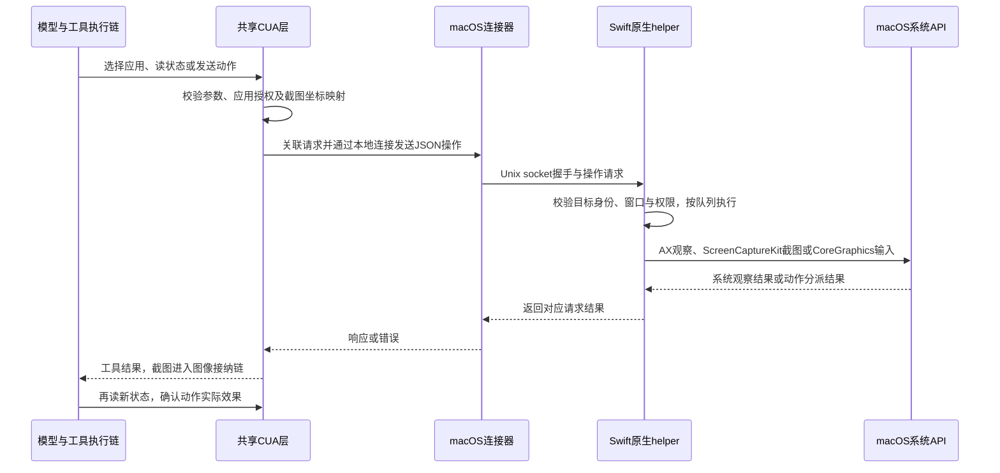
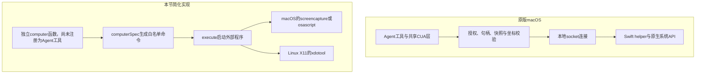

## 系统动作怎么验收

| 系统 | 截图 | 点击 | 按键 |
| --- | --- | --- | --- |
| macOS | screencapture | 未实现 | osascript：Return、Escape、Tab |
| Linux | 未实现 | xdotool，依赖X11环境 | 未实现 |
| Windows | 未实现 | 未实现 | 未实现 |

osascript是macOS自带的AppleScript执行程序，`-e`后面是脚本；本章只把允许的按键映射成固定键码，不接受任意脚本。按键发送给当前焦点窗口，通常需要辅助功能权限。xdotool也不是通用Wayland提供方；没有对应实现的动作明确报错。

### 1. 默认自动测试：不控制你的桌面

执行 `bun test ./tests/059-browser.test.mjs`。其中1项启动隔离Chrome，另外7项验证系统命令参数与执行契约。测试传入platform，因此即使在macOS上，也能检查Linux的命令生成；这不等于实际运行了Linux命令。

computer的第三个参数允许注入runner与platform。普通调用默认使用真实execute；测试的runner只记录参数或返回错误，不截屏、不点击、不向窗口输入。

### 2. macOS真实截屏：单独执行

先创建本章的scripts/computer-smoke.mjs，然后在自己的PROJECT执行：

```sh
bun scripts/computer-smoke.mjs --screenshot
```

需要本机macOS图形会话，以及终端或宿主应用相应的屏幕录制权限。脚本实际调用computer、运行screencapture，检查生成文件的完整PNG签名，最后删除临时图片。桌面可能含私人内容，请先整理屏幕；脚本不上传图片。命令失败或文件无效会报错，不会skip后算通过。本轮没有执行真实截屏验收。

### 3. 真实点击与按键：仍未验收

当前没有为真实输入准备专用测试窗口，也没有验证Linux图形环境与系统权限。自动测试通过只证明固定命令与错误处理，不能证明目标窗口收到按键或点击。此处保留缺口，不提供会盲目操作日常窗口的自动测试。

## 补充知识：原版的跨平台边界与 macOS 原生链路

<details>
<summary>展开：原版怎么控制桌面，与本节的osascript、xdotool有什么区别？</summary>

### 平台支持要以本仓库固定版本为准

以下结论对应本教材固定原版基线687f282e8625c6b8d11ff58211a90524be2e4317，不代表上游未来版本。依据是[共享CUA文档的已知限制](../../../deepseek-harness/packages/experimental/cua/README.zh.md#known-limitations-and-deferred-work)、[macOS提供方](../../../deepseek-harness/packages/experimental/cua-macos/README.zh.md)及本仓库实现。

| 平台或入口 | 原版固定版本的支持情况 | 能得出的结论 |
| --- | --- | --- |
| macOS内置原生提供方 | 已有cua-macos包及Swift helper源码 | 有真实原生执行路径；本次没有重新进行桌面验收 |
| Windows内置原生提供方 | 文档计划独立提供方包与C# helper | 规划不能当作已实现或已验证 |
| Linux内置原生提供方 | 当前基线未发现相应提供方实现 | 不能由共享CUA接口推断Linux桌面已支持 |
| 外部Cua Driver MCP | 已有连接已安装驱动的适配包 | 具体系统能力由外部驱动及权限决定，不能据此承诺跨平台可用 |

浏览器自动化和桌面控制分别判断：浏览器提供方能工作，不等于能够控制该系统的其他应用窗口。教程里的Linux xdotool分支，也不是从原版Linux原生提供方移植来的。

### 原版macOS：共享工具层加原生辅助程序



[macOS入口](../../../deepseek-harness/packages/experimental/cua-macos/src/index.ts)准备helper并调用installCua；[连接器](../../../deepseek-harness/packages/experimental/cua-macos/src/shared-native.ts)负责共享原生程序与本地socket连接；[NativeClient](../../../deepseek-harness/packages/experimental/cua/src/native-client.ts)负责请求关联、取消等通信约束。共享helper可被多个Agent或Host连接使用，每条连接分别保存句柄与快照，桌面操作通过全局队列执行。

| 原生职责 | 对应源码 | 做什么 |
| --- | --- | --- |
| 读取辅助功能状态 | [AXAccess.swift](../../../deepseek-harness/packages/experimental/cua-macos/native/Sources/CuaNative/AXAccess.swift) | 通过AX接口读取应用、窗口和元素 |
| 获取窗口截图 | [WindowCapture.swift](../../../deepseek-harness/packages/experimental/cua-macos/native/Sources/CuaNative/WindowCapture.swift) | 使用ScreenCaptureKit捕获窗口 |
| 发送键盘事件 | [KeyboardInput.swift](../../../deepseek-harness/packages/experimental/cua-macos/native/Sources/CuaNative/KeyboardInput.swift) | 构造CoreGraphics键盘事件，处理按下与释放 |
| 发送窗口指针事件 | [WindowPointerInput.swift](../../../deepseek-harness/packages/experimental/cua-macos/native/Sources/CuaNative/WindowPointerInput.swift) | 处理窗口内的鼠标输入 |

动作返回dispatched:true、verified:false，表示已分派而不是业务目标已成功。比如“点击提交”仍需要重新读取窗口状态，确认出现了提交结果。

### 与教程简化实现的区别



| 方面 | 原版macOS | 本节简化实现 |
| --- | --- | --- |
| 调用入口 | 已挂载共享CUA工具链 | 独立辅助函数，未接Agent工具表 |
| 执行方式 | Swift程序调用原生API | 启动系统命令行程序 |
| 目标定位 | 应用句柄、窗口、AX快照和截图坐标 | 截图路径、屏幕坐标或有限按键 |
| 授权与状态 | 应用授权、系统权限、快照有效性等分层检查 | 命令白名单和参数检查，依赖系统权限，失败抛错 |
| 测试证据 | 原版有自身测试，本节没有重新执行原版桌面验证 | 1项真实浏览器测试、7项系统侧自动测试；真实系统截屏另行验收 |

本节的价值是先理解“页面动作”和“系统动作”具有不同执行边界；它不等于复刻了原版CUA提供方。外部[MCP适配包](../../../deepseek-harness/packages/experimental/computer-use-cua-driver-mcp/README.zh.md)是另一种接入路径：驱动自行承担桌面能力，Harness通过MCP发现和调用其工具。

</details>
