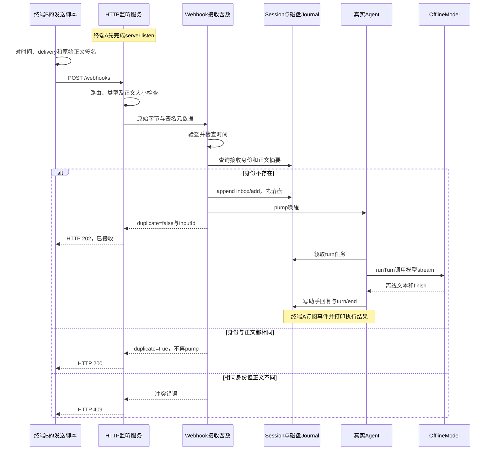

## 实操：两个终端跑通 HTTP → Agent

### 先看文件分工

```text
PROJECT/
├── src/webhook-server.mjs    # 创建Host与会话，启动服务，打印回复，处理退出
├── src/webhook-http.mjs      # 真正listen，读取原始字节，映射请求头与HTTP响应
├── src/webhook.mjs           # 验签、去重、写Inbox、pump
├── src/host.mjs              # 沿用前置：真实Agent、Journal与OfflineModel
├── scripts/send-webhook.mjs  # 发起带签名的HTTP请求
└── tests/061-webhook.test.mjs # 真实本机HTTP与持久日志集成测试
```

### 步骤1：先在终端A启动监听

先按本节创建所有文件。在自己的PROJECT执行：

```sh
HARNESS_WEBHOOK_SECRET=local-demo-only bun src/webhook-server.mjs
```

终端会打印Webhook地址、独立数据目录、会话ID和模型说明。地址示例为http://127.0.0.1:随机端口/webhooks，必须复制本次真实输出，不能原样输入“随机端口”。真正监听的位置是webhook-http.mjs的server.listen(port, '127.0.0.1', ...)；端口0表示让系统分配空闲端口。设置HARNESS_WEBHOOK_PORT可选择固定端口。

服务默认持续等待请求，终端不会自动结束；观察完成后在终端A按Ctrl+C退出。程序关闭HTTP连接、Agent、Journal和锁，保留数据目录供检查。启动失败也会清理已创建的Host。它只监听本机，不直接接收互联网平台的投递，本章不配置公网入口。

### 步骤2：终端B发送真实HTTP请求

在同一个PROJECT另开终端，将示例端口12345替换成终端A打印的端口：

```sh
HARNESS_WEBHOOK_SECRET=local-demo-only bun scripts/send-webhook.mjs \
  http://127.0.0.1:12345/webhooks '帮我处理这条通知' delivery-1
```

预期终端B收到HTTP 202和duplicate:false、inputId:webhook_delivery-1。这表示已持久入队，不表示模型已处理完成。终端A稍后打印“Agent回复：[离线演示] 帮我处理这条通知”以及“Agent回合结束：completed”。响应与日志在两个终端的显示先后可能不同。

这里不是计数替身：HTTP、Host、Journal、Inbox、Agent和runTurn都是真实实现，只有外部模型被明确替换为OfflineModel，所以无需DeepSeek API Key。换成真实模型需要通过Host的modelFactory接入；不要把离线回复误当成远程模型输出。

### 步骤3：验证重复投递与冲突

再次运行完全相同的发送命令：预期HTTP 200、duplicate:true，不再追加任务或启动新回合。保持delivery-1不变，把任务正文改成另一句话：预期HTTP 409，提示相同投递身份的正文不同。换成delivery-2则是一个新任务。

### 完整时序：哪里监听，哪里调用模型？



### 自定义HTTP协议与错误响应

| 项目 | 本章约定 |
| --- | --- |
| 路由与方法 | POST /webhooks |
| 内容类型与正文 | application/json，非空字符串prompt，默认最多64 KiB |
| x-webhook-timestamp | 当前毫秒时间戳，默认前后5分钟内 |
| x-webhook-delivery | 1～100个ASCII字母、数字、下划线或短横线 |
| x-webhook-signature | sha256=后接小写十六进制HMAC |
| 签名输入 | timestamp + 换行 + delivery + 换行 + 原始body字节 |
| 首次接收 / 重复接收 | 202 / 200 |
| 校验与接入错误 | 400正文无效、401验签或时间失败、404路由、405方法、409身份冲突、413正文过大、415类型不符、503 Agent关闭 |
| 内部错误 | 500；例如Journal写入失败，不回传内部路径 |

这个格式不是GitHub官方Webhook协议，外部发送方必须按本章格式签名。时间、delivery和原始正文都在HMAC范围内，不能签名后改JSON空白、换投递ID或更新时间；重试时由持有secret的发送方重新签名。

### 从磁盘恢复与测试证据

6项测试覆盖：处理函数验签与元数据防篡改；真实HTTP触发真实Agent及离线回复；关闭并重开Host后读取Journal去重；同进程并发重复投递；同ID不同正文冲突；错误正文、请求类型、大小及内部失败不误报成功。它们没有连接外部模型或公网账号系统。

要手工重开同一会话，在终端A正常退出后，使用原输出的数据目录和会话ID：

```sh
HARNESS_WEBHOOK_SECRET=local-demo-only \
HARNESS_WEBHOOK_HOME='/替换为原数据目录' \
HARNESS_WEBHOOK_SESSION='替换为原session_ID' \
bun src/webhook-server.mjs
```

服务会打印新的端口；终端B使用新地址重发原任务与原delivery，仍应返回duplicate:true。集成测试验证的是关闭Host后创建新Host并重新读盘，未做进程崩溃故障注入。已入队后崩溃、模型执行失败和外部工具副作用，不由HTTP接收去重保证“恰好执行一次”；本章也没有自动重放未完成任务、死信或多进程共享同一会话的机制。

### 调试顺序

1. 用“061：本节测试”看自动断言；用“061：Webhook监听服务”看手工链路，配置内使用local-demo-only演示secret。
2. 在webhook-http.mjs的server.listen设断点，确认先启动监听，再去另一个终端发请求。
3. 在receive(record, ...)前观察原始body和请求头；在webhook.mjs的previous查询、append与pump停下，确认只有首次投递入队。
4. 在agent.mjs的inbox.claim和runTurn停下，进入loop.mjs的model.stream，确认是Agent消费任务，而不是模型调用Webhook。
5. 在终端A观察message/assistant与turn/end；HTTP 202不代替这一步。默认请求读取超时10秒、签名时间窗5分钟，长时间停断点后需重新发送签名请求。
6. Ctrl+C或停止调试，确认端口释放。日志仍留在打印的数据目录，可供下次重开检查。
