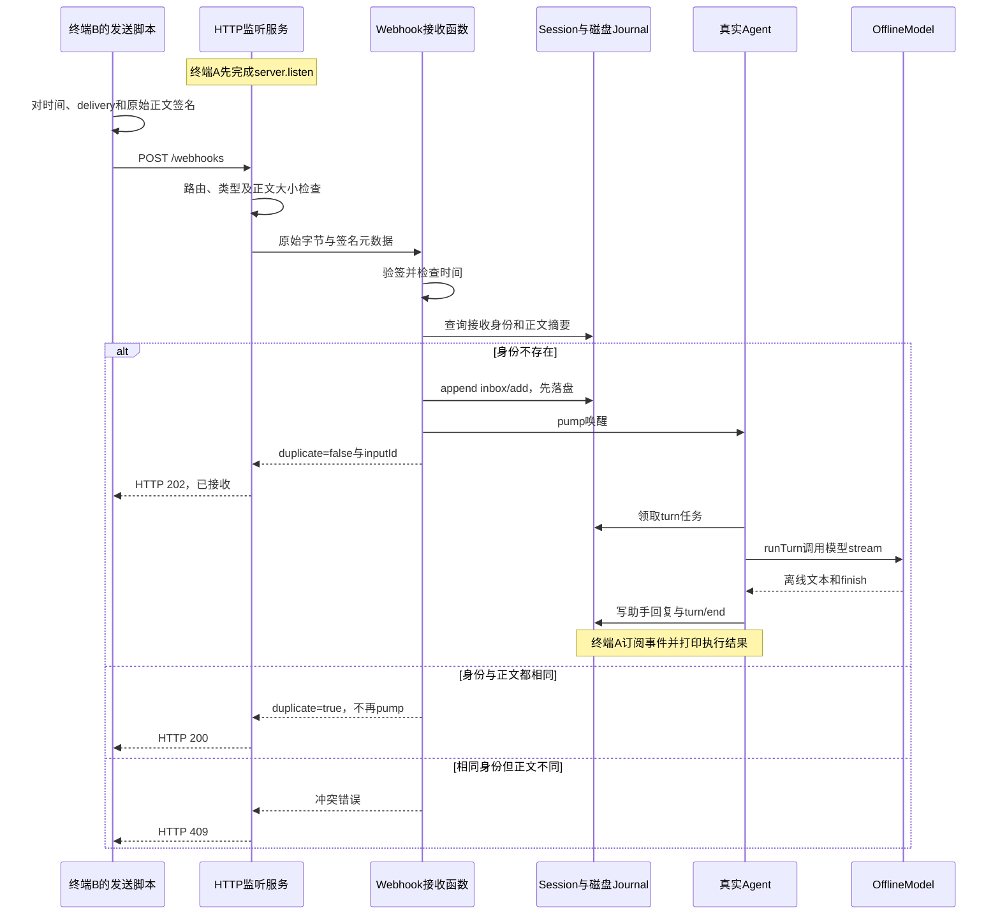
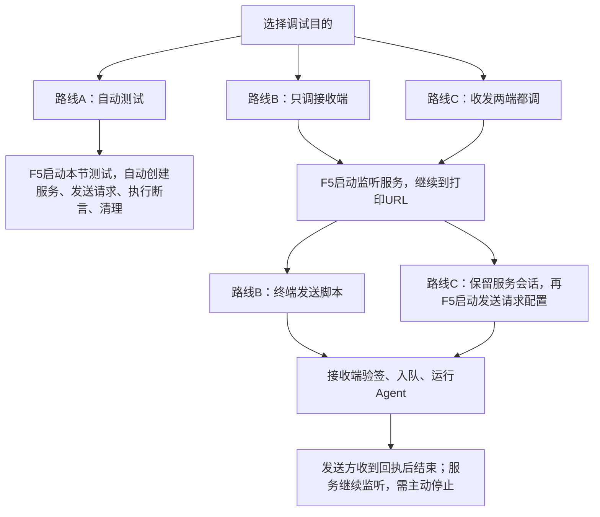
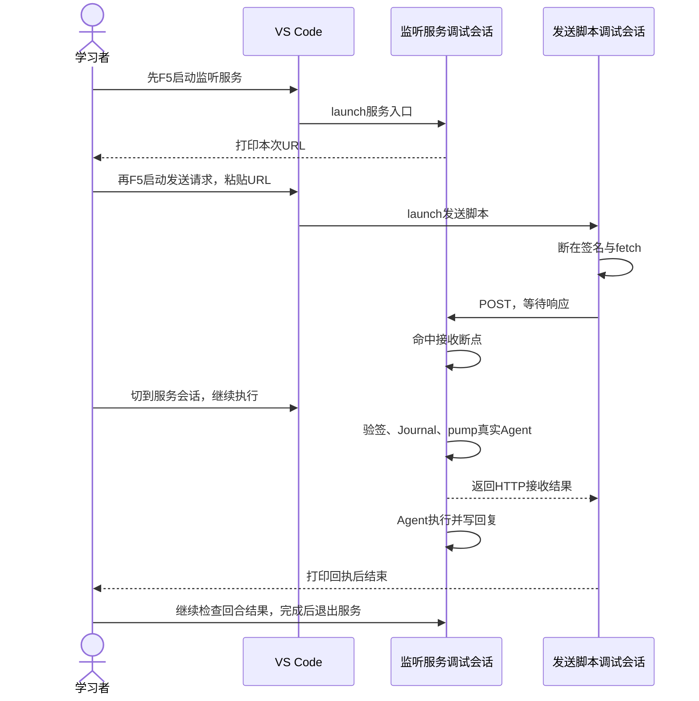

## 实操：两个终端跑通 HTTP → Agent

### 先看文件分工

```text
PROJECT/
├── src/webhook-server.mjs    # 创建Host与会话，启动服务，打印回复，处理退出
├── src/webhook-http.mjs      # 真正listen，读取原始字节，映射请求头与HTTP响应
├── src/webhook.mjs           # 验签、去重、写Inbox、pump
├── src/host.mjs              # 沿用前置：真实Agent、Journal与OfflineModel
├── scripts/send-webhook.mjs  # 发起带签名的HTTP请求
└── tests/061-webhook.test.mjs # 真实本机HTTP与持久日志集成测试
```

### 步骤1：先在终端A启动监听

先按本节创建所有文件。在自己的PROJECT执行：

```sh
HARNESS_WEBHOOK_SECRET=local-demo-only bun src/webhook-server.mjs
```

终端会打印Webhook地址、独立数据目录、会话ID和模型说明。地址示例为http://127.0.0.1:随机端口/webhooks，必须复制本次真实输出，不能原样输入“随机端口”。真正监听的位置是webhook-http.mjs的server.listen(port, '127.0.0.1', ...)；端口0表示让系统分配空闲端口。设置HARNESS_WEBHOOK_PORT可选择固定端口。

服务默认持续等待请求，终端不会自动结束；观察完成后在终端A按Ctrl+C退出。程序关闭HTTP连接、Agent、Journal和锁，保留数据目录供检查。启动失败也会清理已创建的Host。它只监听本机，不直接接收互联网平台的投递，本章不配置公网入口。

### 步骤2：终端B发送真实HTTP请求

在同一个PROJECT另开终端，将示例端口12345替换成终端A打印的端口：

```sh
HARNESS_WEBHOOK_SECRET=local-demo-only bun scripts/send-webhook.mjs \
  http://127.0.0.1:12345/webhooks '帮我处理这条通知' delivery-1
```

预期终端B收到HTTP 202和duplicate:false、inputId:webhook_delivery-1。这表示已持久入队，不表示模型已处理完成。终端A稍后打印“Agent回复：[离线演示] 帮我处理这条通知”以及“Agent回合结束：completed”。响应与日志在两个终端的显示先后可能不同。

这里不是计数替身：HTTP、Host、Journal、Inbox、Agent和runTurn都是真实实现，只有外部模型被明确替换为OfflineModel，所以无需DeepSeek API Key。换成真实模型需要通过Host的modelFactory接入；不要把离线回复误当成远程模型输出。

### 步骤3：验证重复投递与冲突

再次运行完全相同的发送命令：预期HTTP 200、duplicate:true，不再追加任务或启动新回合。保持delivery-1不变，把任务正文改成另一句话：预期HTTP 409，提示相同投递身份的正文不同。换成delivery-2则是一个新任务。

### 完整时序：哪里监听，哪里调用模型？



### 自定义HTTP协议与错误响应

| 项目 | 本章约定 |
| --- | --- |
| 路由与方法 | POST /webhooks |
| 内容类型与正文 | application/json，非空字符串prompt，默认最多64 KiB |
| x-webhook-timestamp | 当前毫秒时间戳，默认前后5分钟内 |
| x-webhook-delivery | 1～100个ASCII字母、数字、下划线或短横线 |
| x-webhook-signature | sha256=后接小写十六进制HMAC |
| 签名输入 | timestamp + 换行 + delivery + 换行 + 原始body字节 |
| 首次接收 / 重复接收 | 202 / 200 |
| 校验与接入错误 | 400正文无效、401验签或时间失败、404路由、405方法、409身份冲突、413正文过大、415类型不符、503 Agent关闭 |
| 内部错误 | 500；例如Journal写入失败，不回传内部路径 |

这个格式不是GitHub官方Webhook协议，外部发送方必须按本章格式签名。时间、delivery和原始正文都在HMAC范围内，不能签名后改JSON空白、换投递ID或更新时间；重试时由持有secret的发送方重新签名。

### 从磁盘恢复与测试证据

6项测试覆盖：处理函数验签与元数据防篡改；真实HTTP触发真实Agent及离线回复；关闭并重开Host后读取Journal去重；同进程并发重复投递；同ID不同正文冲突；错误正文、请求类型、大小及内部失败不误报成功。它们没有连接外部模型或公网账号系统。

要手工重开同一会话，在终端A正常退出后，使用原输出的数据目录和会话ID：

```sh
HARNESS_WEBHOOK_SECRET=local-demo-only \
HARNESS_WEBHOOK_HOME='/替换为原数据目录' \
HARNESS_WEBHOOK_SESSION='替换为原session_ID' \
bun src/webhook-server.mjs
```

服务会打印新的端口；终端B使用新地址重发原任务与原delivery，仍应返回duplicate:true。集成测试验证的是关闭Host后创建新Host并重新读盘，未做进程崩溃故障注入。已入队后崩溃、模型执行失败和外部工具副作用，不由HTTP接收去重保证“恰好执行一次”；本章也没有自动重放未完成任务、死信或多进程共享同一会话的机制。

## 调试路线：先启动谁，再启动谁

### 先认清3个入口与进程边界

| 配置 | 启动文件 | 谁负责启动服务 | 是否需要另发HTTP请求 |
| --- | --- | --- | --- |
| 061：本节测试 | tests/061-webhook.test.mjs | 测试fixture内部启动，结束自动关闭 | 不需要，测试自己发送 |
| 061：Webhook监听服务 | src/webhook-server.mjs | 入口创建Host后调用startWebhook | 需要，等打印地址再发 |
| 061：Webhook发送请求 | scripts/send-webhook.mjs | 不启动服务，只发一次请求 | 它就是发送方，服务必须已在运行 |



HTTP接收、Host、Journal、Agent和OfflineModel位于监听服务的同一个Bun进程。发送脚本是另一个Bun进程。不需要启动main.mjs、web-server.mjs、Electron或单独的模型服务。

### 路线A：只调自动测试

1. VS Code打开PROJECT，安装或合并本节专用launch.json。
2. 在webhook.mjs的previous查询、session.append和pump处打断点。
3. 选择“061：本节测试”按F5。测试fixture会在同一进程启动真实HTTP服务，不需要先启动“Webhook监听服务”。
4. 单步观察首次入队、重复拒绝、Agent回复和断言。某些测试只直接调用接收函数，HTTP断点只会在HTTP集成用例命中。
5. 测试执行结束自动关闭端口、Host并删除临时目录。预期6项通过，不会留下等待外部请求的服务。

### 路线B：先启动接收端，再用终端投递

1. 先在webhook-http.mjs的server.listen处设断点；在webhook.mjs的receive逻辑和agent.mjs的runTurn处设后续断点。
2. 选择“061：Webhook监听服务”按F5。此配置是launch，会创建服务进程，不需要额外attach。
3. 命中server.listen所在行时，监听操作可能还没执行。继续运行，直到终端打印“Webhook地址”，这才表示可以发送。
4. 保留该调试会话，在PROJECT另开终端，使用打印的真实端口替换12345：

```sh
HARNESS_WEBHOOK_SECRET=local-demo-only HARNESS_WEBHOOK_TIMEOUT_MS=600000 \
bun scripts/send-webhook.mjs \
  http://127.0.0.1:12345/webhooks '帮我处理这条通知' debug-delivery-1
```

5. 服务端收到请求后，依次停在读取完成后的receive、验签去重、append和pump。此时发送终端等待回执是正常的；继续服务端运行后才能收到响应。
6. F11可从服务端进入Agent和Loop，因为它们在同一进程。HTTP 202只代表接收，在服务端继续到model.stream和message/assistant，再看turn/end.reason=completed。
7. 发送脚本打印回执后自动退出；监听服务会一直等待下一条请求，不会因一次任务完成就退出。观察完后在服务运行时按Ctrl+C，停止服务并释放Host。

### 路线C：先启动接收端，再启动发送端调试会话

1. 按路线B先启动“061：Webhook监听服务”，继续到打印真实URL。不要再从终端重复启动第二份服务。
2. 保留服务调试会话，在scripts/send-webhook.mjs的webhookSignature调用和fetch处打断点。
3. 打开运行配置下拉菜单，选择“061：Webhook发送请求”，点击绿色启动按钮或按F5，建立第二个调试会话。
4. 配置会依次询问服务URL、任务和delivery。粘贴刚才的完整URL；首次使用debug-delivery-1，重复同任务同ID验证去重，新任务换ID。
5. 发送端检查body、timestamp、delivery和signature。F10执行fetch后，它需要服务端回复；若没有前进，切到服务调试会话并继续，不要反复在发送端按F11。
6. 服务端依次观察receive、webhook、Journal和Agent；需要查看发送端response时再切回来。服务端与发送端各有自己的调用栈，F11不能跨HTTP。
7. 发送端打印HTTP回执后结束。服务端仍保持运行，可再次启动发送端配置测试重复或冲突；最后主动退出服务。



### 具体断点和预期，不需要猜文件

| 调试会话 | 文件与语句 | 看什么 | 预期 |
| --- | --- | --- | --- |
| 服务 | webhook-http.mjs的server.listen | port和监听地址 | 绑定127.0.0.1，打印URL后再发请求 |
| 发送 | send-webhook.mjs的webhookSignature、fetch | body、delivery、timestamp、url | 对即将发送的原始字节签名，URL来自当前服务 |
| 服务 | webhook-http.mjs的receive(record, ...) | Buffer.concat(chunks)、request.headers | 收到签名头和原始JSON字节 |
| 服务 | webhook.mjs的previous查询 | identity、digest、previous | 首次没有记录；相同身份同正文走duplicate |
| 服务 | webhook.mjs的session.append、pump | record.session.read() | 首次新增inbox/add，随后唤醒Agent |
| 服务 | agent.mjs的inbox.claim、runTurn | input.content、this.active | 领取刚才的任务并进入模型循环 |
| 服务 | loop.mjs的model.stream | content、history和模型请求 | 使用OfflineModel，不请求外部API |
| 发送 | send-webhook.mjs的response.status | 状态码与回执 | 首次202，重复200，身份冲突409 |
| 服务 | webhook-server.mjs的事件订阅回调 | event.type、event.data | message/assistant与turn/end.reason=completed |

### 等待、超时与退出怎么判断

普通发送脚本默认等待5秒；上面的调试命令和发送端调试配置明确放宽为10分钟。长停服务断点导致发送端超时，不代表任务未接收，也不能盲目换ID重发。先继续服务并检查日志；重试原任务用原delivery，避免重复入队。

签名时间窗仍是5分钟，HTTP读取请求正文超时仍是10秒，发送端等待预算不会改变它们。签名生成后停太久，重新发请求生成新签名。停止调试若被强制结束，不能保证执行finally；需要验证清理时，先让服务继续运行，再在其终端按Ctrl+C，观察进程退出后再重开原会话。
