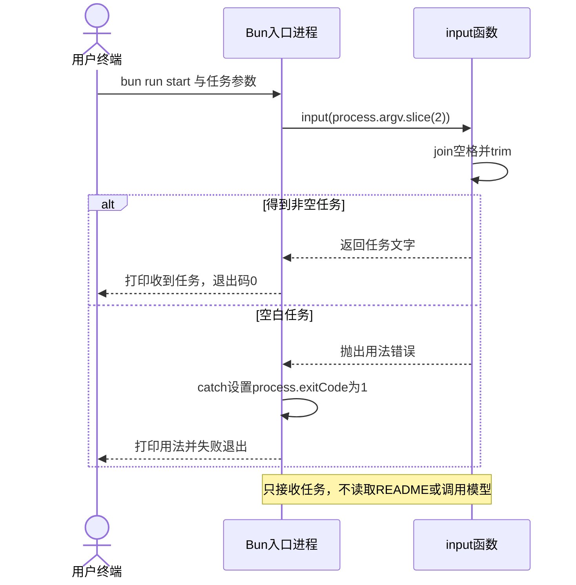
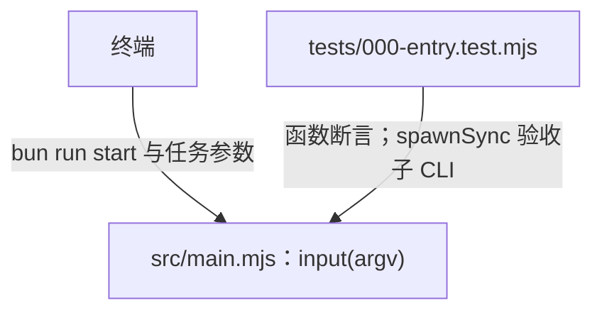
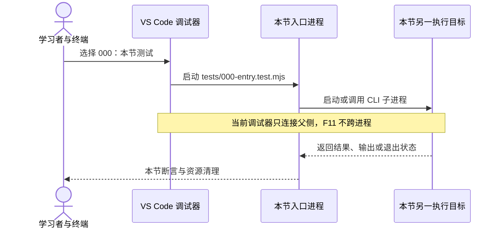

# 000 · 在真正的空目录接收任务

阶段：R00。唯一前置：空目录。

<!-- harness-own-links:start -->
## 当前练习工程文件

以下链接指向 `harness-own` 的当前累计版本；本课下方的完整代码仍保留当步版本，二者可能不同。

[打开练习工程说明](../../../harness-own/README.md)

| 本课文件 | 当前练习工程文件 |
| --- | --- |
| `.gitignore` | [`harness-own/.gitignore`](../../../harness-own/.gitignore) |
| `.vscode/extensions.json` | [`harness-own/.vscode/extensions.json`](../../../harness-own/.vscode/extensions.json) |
| `.vscode/launch.json` | 使用本页下方的本节专用配置，不复制累计版本 |
| `LEARNING.md` | [`harness-own/LEARNING.md`](../../../harness-own/LEARNING.md) |
| `package.json` | [`harness-own/package.json`](../../../harness-own/package.json) |
| `scripts/vscode-debug.mjs` | [`harness-own/scripts/vscode-debug.mjs`](../../../harness-own/scripts/vscode-debug.mjs) |
| `src/main.mjs` | [`harness-own/src/main.mjs`](../../../harness-own/src/main.mjs) |
| `tests/000-entry.test.mjs` | [`harness-own/tests/000-entry.test.mjs`](../../../harness-own/tests/000-entry.test.mjs) |

<!-- harness-own-links:end -->

## 什么时候会用到这一页

你在空工程输入“读取 README 并解释”，程序先把任务接住并打印；直接运行、不提供任务时打印用法并以退出码1结束。本步验证的是命令行输入，不会真的读README，也不会请求模型。

### 这次数据怎么走

```text
终端 bun run start "读取 README 并解释" → Bun加载src/main.mjs → input(process.argv.slice(2)) → 合并参数并trim → 打印任务；空白输入 → 抛错 → process.exitCode=1。
```

### 对应时序图

从上往下读；实线箭头表示调用或发送，虚线箭头表示返回或事件通知。`opt`表示可选操作，`alt`表示不同结果，`loop`表示重复，`par`及其`and`分支表示并行；“未接入”及fixture说明按图中标注理解。



**当前接线位置：** 本步可独立运行；005的session-demo会复用input校验文件路径，013才出现Agent演示。当前start仍只是000的接收入口，不会因为复制了后续文件就自动成为完整Harness CLI。

## 先看目录与调用关系

目录只列本节文件及图中直接用到的前置实现；不是累计工程的完整文件清单。

```text
PROJECT/
├── .gitignore  # 本节创建或替换
├── .vscode/
│   ├── extensions.json  # 本节创建或替换
│   └── launch.json  # 本节创建或替换
├── LEARNING.md  # 本节创建或替换
├── package.json  # 本节创建或替换
├── scripts/
│   └── vscode-debug.mjs  # 本节创建或替换
├── src/
│   └── main.mjs  # 本节创建或替换
└── tests/
    └── 000-entry.test.mjs  # 本节创建或替换
```

### 本节入口怎样调用这些文件

箭头写明实际调用或进程启动；标为“未接入”的文件不是本节测试能命中的目标。




## 这一步具体做什么

在自己的空练习工程按本章代码创建package.json、src/main.mjs和tests/000-entry.test.mjs，写完再运行 bun run start "读取 README 并解释"；然后运行 bun run start "   " 并立即运行 echo $?，预期分别收到完整中文任务、退出码1。最后运行 bun test ./tests/000-entry.test.mjs。不运行原版、不填写模型Key。

需要本章新文件的操作，先按下面代码创建文件，再执行；不要在上一步尚不存在的接口上试错。

## 代码为什么放在这一层

input只负责把操作系统传来的字符串数组变成一条非空任务。把检查放到独立函数，后面终端入口与测试可共用；import.meta.url判断使测试导入函数时不自动启动命令行程序。

## 本节调试：选什么、为什么、怎么启动

**建议先选：Bun：CLI 入口。** 每节的测试入口都固定到本节文件，不依赖编辑器当前打开的 `${file}`。

| 配置名称 | 什么时候选 | 实际入口或目标 | 能观察什么 |
| --- | --- | --- | --- |
| 000：本节测试 | 本节验收 | tests/000-entry.test.mjs | 本节 Bun 测试进程；入口固定，不依赖当前编辑器文件。 |
| Bun：CLI 入口 | 本节直接入口 | src/main.mjs | 直接命中 CLI；固定测试中的 spawnSync 不自动附加子 CLI。 |

**为什么这样启动：** 000 只检查命令行输入；它尚不会读文件或调用模型。 测试的 spawnSync 检查命令行退出码；直接调 main 请选本节 CLI 入口。

使用下方的[本节专用调试配置](#lesson-debug-config)。它只列本节可用目标；要保留个人配置，请先备份并按名称合并。页面上 `harness-own` 的累计文件链接供看当前工程，不是本节调试配置的答案。

1. VS Code 打开自己的 PROJECT；按本节创建源码与配置，断点设在 PROJECT 文件中。
2. 先用终端运行 `bun test ./tests/000-entry.test.mjs` 确认普通验收，再选表中的配置按 F5。
3. 在下方具体观察点停住；F10 跨过当前语句，F11 只进入当前调试目标。异步等待涉及另一进程时，切换调试会话并继续对端。
4. 变量要在所属调用帧查看；看测试局部变量时选测试帧，看 this 和参数时选实现方法帧。

<details class="debug-details">
<summary>展开本节具体断点和预期</summary>

1. 在VS Code打开练习工程。

2. 在src/main.mjs的 const prompt = argv.join 行和 process.exitCode = 1 打断点，选择“Bun：CLI 入口”按F5启动。

3. 这是launch配置，不需要手动attach。

4. 监视argv、process.argv、prompt，F10越过join后任务不应含Bun与脚本路径。

5. 要验证失败，在launch.json该配置的args暂改为["   "]后重启，F11进入input并继续到catch，预期process.exitCode为1。

6. 恢复args。

7. 再打开tests/000-entry.test.mjs，选择“000：本节测试”按F5运行函数断言。

8. 其中spawnSync创建的子进程不自动进入当前调试会话。

</details>

先安装 Bun 扩展 `oven.bun-vscode`。若找不到 Bun，在 PROJECT 终端执行 `which bun`，将 runtime 换成实际绝对路径。

### 本节调试启动时序

这张图解释如何创建并连接调试目标；上面的业务时序图解释任务本身怎样执行。



暂停断点会影响应用自身的 RPC、取消、进程和网络计时。Bun 测试超时放宽不等于这些计时也被关闭；按本节说明分别设置，普通验收恢复原有时限。

观察完成后退出本节启动的调试会话和进程，再运行 `bun test ./tests/000-entry.test.mjs`。测试通过只证明本节断言，不代表所有 GUI、外部服务或发布过程均已验证。

## 在哪里写、写什么

操作地点：终端中的 `$PROJECT`，编辑器打开同一个目录。只创建或替换下列文件，其他文件保留上一步版本。文件目录不存在先创建。

本仓库的 `harness-own/` 是保留当前进度的现有练习工程，不能清空，也不能把下面第000步的文件覆盖进去。先在仓库目录按 [README](../README.md) 初始化环境：

```sh
bun --version
export REPO="$(git rev-parse --show-toplevel)"
export COURSE="$REPO/tutorial/linear"
export PROJECT="$REPO/harness-own"
```

继续已有进度时使用上面的PROJECT和当前课次。若要从第000步独立重做，请先显式选择一个新的同仓目录，例如下面的 `harness-practice-000`；确认该目录名尚未使用后，自行创建空目录，再执行进入目录的命令。这里不会自动创建、清空或覆盖目录：

```sh
export PROJECT="$REPO/harness-practice-000"
cd "$PROJECT"
```

固定使用 Bun 1.3.14。第000步的目标目录必须为空；不要使用已有进度的harness-own、原版仓库或已有harness-from-zero。以下package.json和源码由你在新空目录创建，不克隆、不展开原版。后续新终端继续使用你选定的PROJECT。

### 创建 [`.gitignore`](../../../harness-own/.gitignore)

````text
node_modules/
.env
.data*/
.harness*/
.evidence/
release/
.release-config/
__pycache__/
.runtime/
````

```sh
mkdir -p .vscode
```

### 创建 [`.vscode/extensions.json`](../../../harness-own/.vscode/extensions.json)

````json
{
  "recommendations": [
    "oven.bun-vscode"
  ]
}
````

```sh
mkdir -p .vscode
```

<a id="lesson-debug-config"></a>

下面是本节专用调试配置，只包含本节入口。program 已固定到本节文件；不是 harness-own 的累计配置。

### 创建 `.vscode/launch.json`

````json
{
  "version": "0.2.0",
  "configurations": [
    {
      "name": "000：本节测试",
      "type": "bun",
      "request": "launch",
      "program": "${workspaceFolder}/tests/000-entry.test.mjs",
      "cwd": "${workspaceFolder}",
      "runtime": "bun",
      "runtimeArgs": [
        "test",
        "--preload",
        "${workspaceFolder}/scripts/vscode-debug.mjs",
        "--timeout",
        "3600000"
      ],
      "stopOnEntry": false
    },
    {
      "name": "Bun：CLI 入口",
      "type": "bun",
      "request": "launch",
      "program": "${workspaceFolder}/src/main.mjs",
      "cwd": "${workspaceFolder}",
      "runtime": "bun",
      "runtimeArgs": [
        "--preload",
        "${workspaceFolder}/scripts/vscode-debug.mjs"
      ],
      "stopOnEntry": false,
      "args": [
        "读取 README"
      ]
    }
  ]
}
````

### 创建 [`LEARNING.md`](../../../harness-own/LEARNING.md)

````text
# 我的实现记录

每步只填一行，不为填写表格耽误编码。

| 步骤 | 先试卡点 | 我对调用链的解释 | 最小故障与修正 | 实际验收输出 | 有提示/独立 | 次日/第3天/第7天重做 |
| --- | --- | --- | --- | --- | --- | --- |
````

### 创建 [`package.json`](../../../harness-own/package.json)

````json
{
  "name": "harness-own",
  "version": "0.1.0",
  "type": "module",
  "private": true,
  "engines": {
    "bun": "1.3.14"
  },
  "scripts": {
    "start": "bun src/main.mjs",
    "test": "bun test ./tests"
  },
  "packageManager": "bun@1.3.14"
}
````

```sh
mkdir -p scripts
```

### 创建 [`scripts/vscode-debug.mjs`](../../../harness-own/scripts/vscode-debug.mjs)

````javascript
/** 当前调试器已在启动时连接；这些地址只属于本进程，不能让子进程抢占。 */
export function clearInspectorEnvironment() {
  delete process.env.BUN_INSPECT
  delete process.env.BUN_INSPECT_NOTIFY
}

// 仅由 VS Code 的 --preload 加载，普通运行不加载此文件。
clearInspectorEnvironment()
````

```sh
mkdir -p src
```

### 创建 [`src/main.mjs`](../../../harness-own/src/main.mjs)

````javascript
import { pathToFileURL } from 'node:url'

/** 先把命令行边界做好；以后换 UI，任务文字仍然从这里进入领域。 */
export function input(argv) {
  const prompt = argv.join(' ').trim() // 参数里可能有中文和空格。
  if (!prompt) throw new Error('用法：bun run start "你的任务"')
  return prompt
}

// 只在直接执行时启动，测试 import 不会偷偷运行程序。
if (process.argv[1] && import.meta.url === pathToFileURL(process.argv[1]).href) {
  try { console.log('收到任务：' + input(process.argv.slice(2))) }
  catch (error) { console.error(error.message); process.exitCode = 1 }
}
````

```sh
mkdir -p tests
```

### 创建 [`tests/000-entry.test.mjs`](../../../harness-own/tests/000-entry.test.mjs)

````javascript
import { test } from 'bun:test'
import assert from 'node:assert/strict'
import { spawnSync } from 'node:child_process'
import { input } from '../src/main.mjs'

test('入口既接收中文，也通过退出码报告空任务', () => {
  assert.equal(input(['读取 README', '并解释']), '读取 README 并解释')
  assert.throws(() => input([]), /用法/)
  // 显式传当前环境，避免 Bun 默认缓存的启动环境把父调试地址带进子进程。
  const failed = spawnSync(process.execPath, ['src/main.mjs'], { env: { ...process.env }, encoding: 'utf8' })
  assert.equal(failed.status, 1)
  assert.match(failed.stderr, /用法/)
})
````

## 运行命令与通过标准

```sh
cd "$PROJECT"
bun run start "读取 README"
bun test ./tests/000-entry.test.mjs
bun test
```

带任务输出“收到任务：读取 README 并解释”；空任务输出用法并退出1。测试直接检查input及一个真实失败子进程；没有证明文件读取、Agent执行或任何原版profile已经实现。

**本步证据的范围：** tests/000-entry.test.mjs有1项测试：中文参数合并、input空任务抛错、真实Bun子进程失败退出。运行命令只启动本地程序，无收费模型调用。

## 不看答案，确认自己能解释

合上教程，在纸上写出process.argv前两个元素是什么，再不看示例重写input；分别口述空数组、两个中文参数、纯空格的返回或错误。

完成后在 LEARNING.md 写一句实际结果和一个卡点。明天只重做这个卡点；第 3 天、第 7 天再做一次，能独立完成就继续下一页，不另开学习路线。

**再改一个条件验证：** 仅把启动参数改成 "读取 README" "并解释取消逻辑"，预期合并为一条任务；再传空白验证仍拒绝。此变体只使用已有入口，不需要新API。

## 与当前原版还差哪些

对照本仓库固定原版 `687f282e8625c6b8d11ff58211a90524be2e4317`；这里的“当前”指该本地基线，不是未经检查的上游最新版。

**这一页已经实现：**

- 中文与空格参数接收，空白任务失败退出。
- 测试导入与直接启动分离，Bun子进程验收退出码。

**原版仍有、或本步尚未对齐的部分：**

- 原版apps/cli/src/args.ts负责profile选择、--patch、配置导出和内层参数转交；000没有这些启动分支。
- 原版profile-boot负责加载插件树，000没有Loader、持久会话恢复或工具执行。原版以Node与pnpm组织应用，教程有意使用Bun，不构成运行时完全兼容。

**原版对照位置：**

- [apps/cli/src/args.ts](../../../deepseek-harness/apps/cli/src/args.ts)
- [apps/cli/src/profile-boot.ts](../../../deepseek-harness/apps/cli/src/profile-boot.ts)

本步测试通过只证明上面的具体行为；完整差距仍看 [COVERAGE.md](../COVERAGE.md)，不以文件数量、同名类或后面出现另一个模块代替接线证据。

下一步：[第 001 步](001.md)
