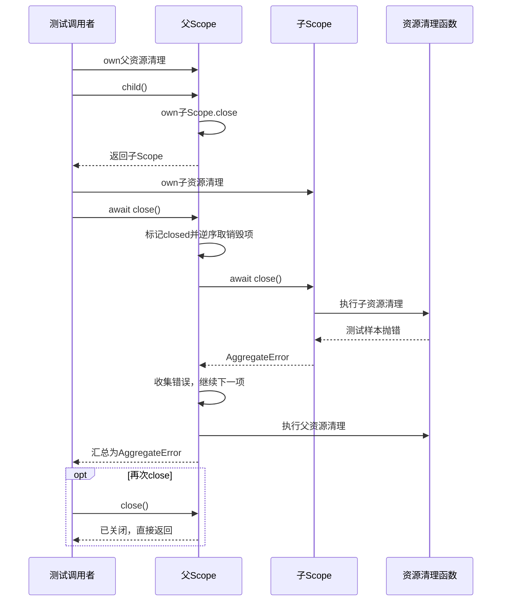

# 001 · 先学会收回自己创建的资源

阶段：R01。唯一前置：完成第 000 步，继续同一个工程。

## 什么时候会用到这一页

一个读文件插件打开日志文件、订阅会话事件，还创建了子任务。卸载时必须先停子任务与订阅，再关日志；其中一个清理失败，也要继续清掉其他资源。Scope保存的是这些销毁函数。

### 这次数据怎么走

```text
创建Scope → own登记清理函数／child登记子close → close取走销毁数组并反向执行 → 每项单次撤销 → 汇总清理错误；单独关闭子Scope会撤掉父数组里的对应登记。
```

### 对应时序图

从上往下读；实线箭头表示调用或发送，虚线箭头表示返回或事件通知。`opt`表示可选操作，`alt`表示不同结果，`loop`表示重复，`par`及其`and`分支表示并行；“未接入”及fixture说明按图中标注理解。



**当前接线位置：**002的服务撤销、003的插件卸载使用这个Scope；005第一次在真实日志文件与订阅上装配。没有注册own的资源不会自动被发现。

## 这一步具体做什么

先在纸上写出测试的两个登记：父资源parent、子资源child，并预测关闭顺序。按本章创建scope.mjs与测试后运行 bun test ./tests/001-scope.test.mjs；预期order为["child","parent"]，第一次close拒绝为AggregateError，第二次close不重复清理。

需要本章新文件的操作，先按下面代码创建文件，再执行；不要在上一步尚不存在的接口上试错。

## 代码为什么放在这一层

own表示“这个Scope负责调用这份销毁函数”；child表示“这个子Scope的关闭也属于父资源”。Scope不申请资源、不查找服务；创建文件或连接的代码要把真正的关闭函数交给own。逆序针对登记顺序，不是按资源类别自动排优先级。

## 在哪里写、写什么

操作地点：终端中的 `$PROJECT`，编辑器打开同一个目录。只创建或替换下列文件，其他文件保留上一步版本。文件目录不存在先创建。

```sh
mkdir -p src
```

### 创建 `src/scope.mjs`

````javascript
/** 作用域拥有资源；关掉它时逆序清理，重复关闭不会重复执行。 */
export class Scope {
  disposers = []
  closed = false
  /** 记录资源归属，返回单次撤销函数。 */
  own(dispose) {
    if (this.closed) throw new Error('作用域已关闭')
    let active = true
    const once = async () => {
      if (!active) return
      active = false
      const index = this.disposers.indexOf(once)
      if (index >= 0) this.disposers.splice(index, 1)
      await dispose()
    }
    this.disposers.push(once)
    return once
  }
  /** 子作用域的退出属于父作用域，子资源先清。 */
  child() {
    const child = new Scope()
    const release = this.own(() => child.close())
    child.own(() => release())
    return child
  }
  /** 一个清理失败也继续清其他资源，最后汇总错误。 */
  async close() {
    if (this.closed) return
    this.closed = true
    const errors = []
    for (const dispose of this.disposers.splice(0).reverse()) {
      try { await dispose() } catch (error) { errors.push(error) }
    }
    this.disposers = []
    if (errors.length) throw new AggregateError(errors, '资源清理失败')
  }
}
````

```sh
mkdir -p tests
```

### 创建 `tests/001-scope.test.mjs`

````javascript
import { test } from 'bun:test'
import assert from 'node:assert/strict'
import { Scope } from '../src/scope.mjs'

test('撤销逆序、幂等，异常不阻断剩余清理', async () => {
  const scope = new Scope(), order = []
  scope.own(() => order.push('parent'))
  scope.child().own(() => { order.push('child'); throw Error('broken') })
  await assert.rejects(scope.close(), AggregateError)
  await scope.close()
  assert.deepEqual(order, ['child', 'parent'])
  assert.throws(() => scope.own(() => {}), /已关闭/)
})
````

## 运行命令与通过标准

```sh
cd "$PROJECT"
bun test ./tests/001-scope.test.mjs
bun test
```

一个抛错子清理不阻止父清理，重复close不重复调用，已关闭Scope不接收新own。只验证本地所有权和逆序；不是进程沙箱，也不是原版按Agent继承可见性的完整Scope。

**本步证据的范围：**tests/001-scope.test.mjs的1项测试覆盖逆序、重复关闭、抛错仍清理、关闭后拒绝注册；没有并发close等待或真实网络连接验收。

## VS Code：断在哪里、看什么

在VS Code打开练习工程并选中tests/001-scope.test.mjs，选择“Bun：当前测试”按F5启动。在src/scope.mjs的 active = false、this.closed = true 和 await dispose() 打断点。F11进入测试触发的close，监视disposers长度、order、errors；F10经过child抛错后errors增加，继续应仍进入parent。再次close应在if(this.closed)返回。

操作位置：VS Code 打开的是自己的 `$PROJECT`，断点也设在这里的源码，不在教材的 `steps` 目录。

上面的说明若指定CLI、子进程、页面或Electron附加调试，就先按该流程操作；下面这组步骤只用于本章测试入口。“当前测试”不会自动附加子进程，也不会命中浏览器或Electron中的断点。

变量只在所属作用域可见：停在方法内部时看this和参数；要看测试里的局部变量，先在“调用堆栈”选择对应测试帧。正在等待的异步调用者不一定保留可求值的帧，此时在测试调用前后加断点再看，不把未定义误判成业务状态丢失。

沿用第 000 步安装的 Bun 扩展与 `.vscode/launch.json`；本章列出替换配置时，使用本章完整版本。

1. 打开本步测试文件 `tests/001-scope.test.mjs`，保持它为当前编辑器文件。
2. 在上面指定的函数内单击行号左侧设置断点。
3. “运行和调试”选择 **Bun：当前测试**，按 F5；它执行当前测试，工作目录固定为 PROJECT。
4. 在“变量 / 监视 / 调用堆栈 / 调试控制台”检查状态；F10 逐行执行，F11 进入函数，Shift+F11 返回，F5 继续，Shift+F5 停止。

验收：断点实际命中，能说出当前输入、状态和下一步；只看到进程启动不算完成。长时间暂停会影响真实取消、审批和网络超时，先检查时序，不删超时断言。修正后在集成终端运行 `bun test ./tests/001-scope.test.mjs`，再运行 `bun test`，保留全部断言。

## 不看答案，确认自己能解释

不看资料画出父数组[父清理1,子1.close,父清理2,子2.close]反向执行的顺序，并说明为什么active要在await dispose之前改成false。

完成后在 LEARNING.md 写一句实际结果和一个卡点。明天只重做这个卡点；第 3 天、第 7 天再做一次，能独立完成就继续下一页，不另开学习路线。

**再改一个条件验证：**在测试副本中再登记一个不抛错的子资源，写断言确认其仍清理；这属于需要自己补代码的练习，写完再运行本章测试。不要拿真实数据库或长驻进程做故障实验。

## 与当前原版还差哪些

对照本仓库固定原版 `687f282e8625c6b8d11ff58211a90524be2e4317`；这里的“当前”指该本地基线，不是未经检查的上游最新版。

**这一页已经实现：**

- 资源撤销单次执行、父子关闭关联、反向清理和AggregateError汇总。
- 子项主动关闭后移除父登记，避免仅因父数组继续持有已释放子项。

**原版仍有、或本步尚未对齐的部分：**

- 原版vendor/cordis/src/fiber.ts拥有插件PENDING/LOADING/ACTIVE/UNLOADING等状态与正在清理工作的等待；教程closed布尔值不能让并发第二次close等待第一次清理收敛。
- 原版packages/core/scope通过scopeOf、scopeTarget、父链和ScopedLayers控制注册可见性与事件路由；本章只实现销毁所有权，尚无这些隔离行为。

**原版对照位置：**

- [vendor/cordis/src/fiber.ts](../../../deepseek-harness/vendor/cordis/src/fiber.ts)
- [packages/core/scope/src/index.ts](../../../deepseek-harness/packages/core/scope/src/index.ts)
- [packages/core/scope/src/store.ts](../../../deepseek-harness/packages/core/scope/src/store.ts)

本步测试通过只证明上面的具体行为；完整差距仍看 [COVERAGE.md](../COVERAGE.md)，不以文件数量、同名类或后面出现另一个模块代替接线证据。

下一步：[第 002 步](002.md)
