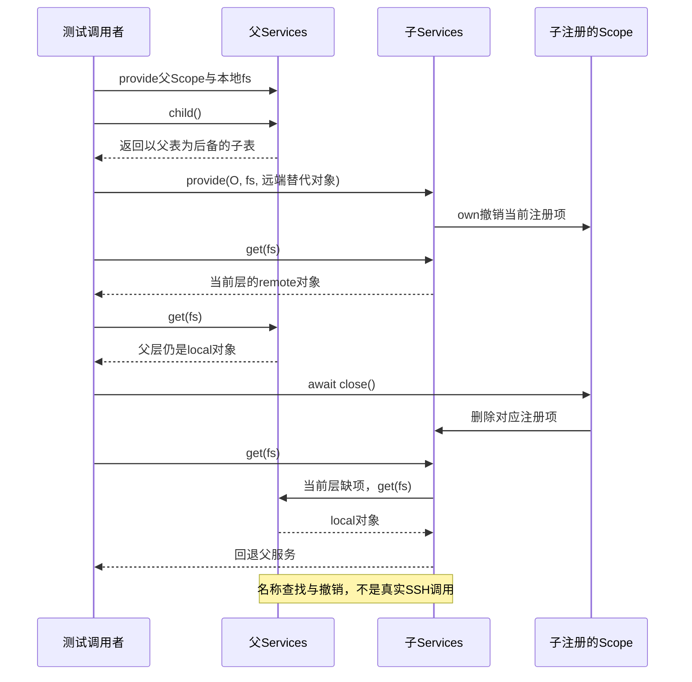

# 002 · 把服务接口和执行实现分开

阶段：R01。唯一前置：完成第 001 步，继续同一个工程。

<!-- harness-own-links:start -->
## 当前练习工程文件

以下链接指向 `harness-own` 的当前累计版本；本课下方的完整代码仍保留当步版本，二者可能不同。

[打开练习工程说明](../../../harness-own/README.md)

| 本课文件 | 当前练习工程文件 |
| --- | --- |
| `src/services.mjs` | [`harness-own/src/services.mjs`](../../../harness-own/src/services.mjs) |
| `tests/002-services.test.mjs` | [`harness-own/tests/002-services.test.mjs`](../../../harness-own/tests/002-services.test.mjs) |

<!-- harness-own-links:end -->

## 什么时候会用到这一页

应用默认使用本地文件服务；一个子会话改用远端文件服务。子会话查fs应得到remote，父应用仍得到local；关闭子会话的Scope后，子会话再次查fs会退回父层local。

### 这次数据怎么走

```text
root.provide(owner,"fs",本地实现) → child=root.child() → child.provide(local,"fs",远端实现) → child.get先查当前Map再查parent → local.close撤销子项 → child.get回退父项。
```

### 对应时序图

从上往下读；实线箭头表示调用或发送，虚线箭头表示返回或事件通知。`opt`表示可选操作，`alt`表示不同结果，`loop`表示重复，`par`及其`and`分支表示并行；“未接入”及fixture说明按图中标注理解。



**当前接线位置：**003的Plugins只创建一个共享Services供兄弟插件协作，不会自动为每个插件生成Services.child；005的reader从共享注册表取settings与session。子覆盖机制本章只在单测直接使用。

## 这一步具体做什么

按本章写完services.mjs和测试，运行 bun test ./tests/002-services.test.mjs。逐个对应四个结果：子读remote、父读local、关闭local后子读local、关闭owner后get抛“缺少服务”。这里remote是测试对象返回值，不是真正SSH访问。

需要本章新文件的操作，先按下面代码创建文件，再执行；不要在上一步尚不存在的接口上试错。

## 代码为什么放在这一层

Services是按名字查能力实现的注册表，Scope是撤销这些注册项的所有者。provide(scope,...)把移除Map项的函数交给scope；没有另一个destroy接口，是因为生命周期从登记时就交给Scope了。调用方仍持有value变量时，关闭Scope也不会神奇删除那个外部引用。

## 在哪里写、写什么

操作地点：终端中的 `$PROJECT`，编辑器打开同一个目录。只创建或替换下列文件，其他文件保留上一步版本。文件目录不存在先创建。

```sh
mkdir -p src
```

### 创建 [`src/services.mjs`](../../../harness-own/src/services.mjs)

````javascript
/** 服务接口与实现解耦，注册项带身份，旧撤销不能误删后注册项。 */
export class Services {
  entries = new Map()
  constructor(parent = undefined) { this.parent = parent }
  /** 在当前作用域注册，允许子作用域覆盖父服务。 */
  provide(scope, name, value) {
    if (this.entries.has(name)) throw Error('重复服务：' + name)
    const entry = { value }
    this.entries.set(name, entry)
    scope.own(() => { if (this.entries.get(name) === entry) this.entries.delete(name) })
    return value
  }
  /** 消费方只拿契约，缺依赖立即失败，不能默默使用全局对象。 */
  get(name) {
    if (this.entries.has(name)) return this.entries.get(name).value
    if (this.parent) return this.parent.get(name)
    throw Error('缺少服务：' + name)
  }
  /** 创建会话私有的覆盖层。 */
  child() { return new Services(this) }
}
````

```sh
mkdir -p tests
```

### 创建 [`tests/002-services.test.mjs`](../../../harness-own/tests/002-services.test.mjs)

````javascript
import { test } from 'bun:test'
import assert from 'node:assert/strict'
import { Services } from '../src/services.mjs'
import { Scope } from '../src/scope.mjs'

test('提供方可替换，子会话覆盖不污染父服务', async () => {
  const root = new Services(), owner = new Scope(), child = root.child(), local = new Scope()
  root.provide(owner, 'fs', { read: () => 'local' })
  child.provide(local, 'fs', { read: () => 'remote' })
  assert.equal(child.get('fs').read(), 'remote')
  assert.equal(root.get('fs').read(), 'local')
  await local.close()
  assert.equal(child.get('fs').read(), 'local')
  await owner.close()
  assert.throws(() => child.get('fs'), /缺少/)
})
````

## 运行命令与通过标准

```sh
cd "$PROJECT"
bun test ./tests/002-services.test.mjs
bun test
```

父子覆盖与回退成立，关闭后不再留注册项。测试没有打开文件或连接，只验证查找和撤销；服务对象自己的文件句柄或连接若需要关闭，还必须另行scope.own。

**本步证据的范围：**tests/002-services.test.mjs有1项内存测试，覆盖local/remote替代对象、父层不污染和两次Scope关闭后的查找。

## VS Code：断在哪里、看什么

在VS Code打开练习工程并选中tests/002-services.test.mjs，选择“Bun：当前测试”按F5启动。在src/services.mjs的if(this.entries.has(name))、this.parent.get(name)以及this.entries.delete(name)打断点。F11进入child.get，监视this.entries、this.parent.entries和entry.value；关闭local后再查，F10应走父层。注意看Map大小而不是把“变量仍可见”误认为没有撤销。

操作位置：VS Code 打开的是自己的 `$PROJECT`，断点也设在这里的源码，不在教材的 `steps` 目录。

上面的说明若指定CLI、子进程、页面或Electron附加调试，就先按该流程操作；下面这组步骤只用于本章测试入口。“当前测试”不会自动附加子进程，也不会命中浏览器或Electron中的断点。

变量只在所属作用域可见：停在方法内部时看this和参数；要看测试里的局部变量，先在“调用堆栈”选择对应测试帧。正在等待的异步调用者不一定保留可求值的帧，此时在测试调用前后加断点再看，不把未定义误判成业务状态丢失。

沿用第 000 步安装的 Bun 扩展与 `.vscode/launch.json`；本章列出替换配置时，使用本章完整版本。

1. 打开本步测试文件 `tests/002-services.test.mjs`，保持它为当前编辑器文件。
2. 在上面指定的函数内单击行号左侧设置断点。
3. “运行和调试”选择 **Bun：当前测试**，按 F5；它执行当前测试，工作目录固定为 PROJECT。
4. 在“变量 / 监视 / 调用堆栈 / 调试控制台”检查状态；F10 逐行执行，F11 进入函数，Shift+F11 返回，F5 继续，Shift+F5 停止。

验收：断点实际命中，能说出当前输入、状态和下一步；只看到进程启动不算完成。长时间暂停会影响真实取消、审批和网络超时，先检查时序，不删超时断言。修正后在集成终端运行 `bun test ./tests/002-services.test.mjs`，再运行 `bun test`，保留全部断言。

## 不看答案，确认自己能解释

合上资料写出Services和Scope各负责的一句话；再画出子Map缺项时get沿父链查找的顺序。

完成后在 LEARNING.md 写一句实际结果和一个卡点。明天只重做这个卡点；第 3 天、第 7 天再做一次，能独立完成就继续下一页，不另开学习路线。

**再改一个条件验证：**把测试服务名改为model，父返回模型A、子返回模型B，重复覆盖与回退断言；这是替换测试数据，不代表已经实现模型网络请求。

## 与当前原版还差哪些

对照本仓库固定原版 `687f282e8625c6b8d11ff58211a90524be2e4317`；这里的“当前”指该本地基线，不是未经检查的上游最新版。

**这一页已经实现：**

- 按名字提供与读取能力，缺依赖立即抛错。
- 子注册覆盖父项，Scope关闭撤销，撤销时核对注册项身份。

**原版仍有、或本步尚未对齐的部分：**

- 原版Cordis Service/Context结合注入声明、服务可达范围与isolate标记；教程只有显式Map父链，没有依赖等待和拓扑感知解析。
- 原版dsh-scope的作用域注册表将贡献可见性与所有权绑定，不能把本章任意child服务覆盖等同于原版所有服务自动按Agent隔离。

**原版对照位置：**

- [vendor/cordis/src/service.ts](../../../deepseek-harness/vendor/cordis/src/service.ts)
- [vendor/cordis/src/context.ts](../../../deepseek-harness/vendor/cordis/src/context.ts)
- [vendor/loader/src/config/isolate.ts](../../../deepseek-harness/vendor/loader/src/config/isolate.ts)
- [packages/core/scope/src/store.ts](../../../deepseek-harness/packages/core/scope/src/store.ts)

本步测试通过只证明上面的具体行为；完整差距仍看 [COVERAGE.md](../COVERAGE.md)，不以文件数量、同名类或后面出现另一个模块代替接线证据。

下一步：[第 003 步](003.md)
