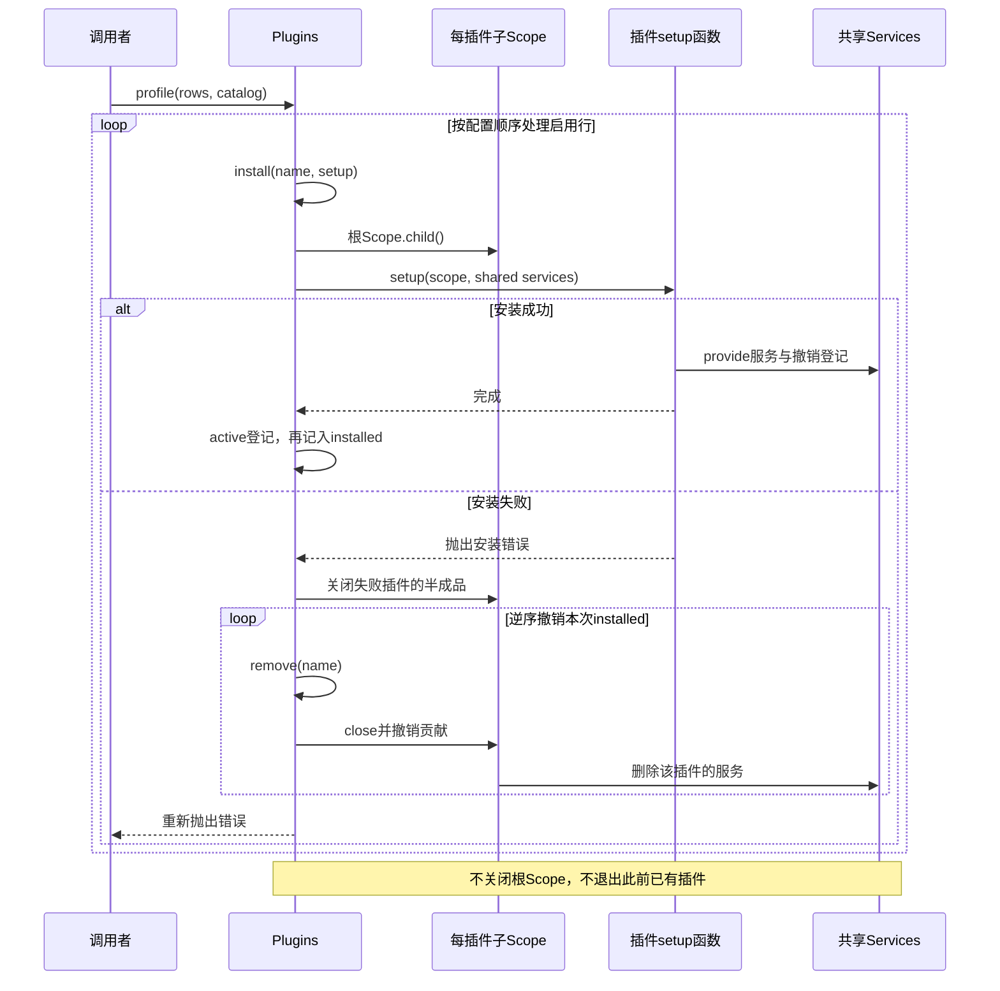

# 003 · 安装插件，失败时撤销半成品

阶段：R01。唯一前置：完成第 002 步，继续同一个工程。

<!-- harness-own-links:start -->
## 当前练习工程文件

以下链接指向 `harness-own` 的当前累计版本；本课下方的完整代码仍保留当步版本，二者可能不同。

[打开练习工程说明](../../../harness-own/README.md)

| 本课文件 | 当前练习工程文件 |
| --- | --- |
| `src/plugins.mjs` | [`harness-own/src/plugins.mjs`](../../../harness-own/src/plugins.mjs) |
| `tests/003-plugins.test.mjs` | [`harness-own/tests/003-plugins.test.mjs`](../../../harness-own/tests/003-plugins.test.mjs) |

<!-- harness-own-links:end -->

## 什么时候会用到这一页

启动一个配置、日志、读文件插件组合：配置先安装，读插件随后取配置；如果读插件安装失败，应撤掉本次组合已经装上的服务，但保留运行前就存在的其他插件。

### 这次数据怎么走

```text
profile(rows,catalog) → 按rows顺序install → 每个插件用独立子Scope、共享Services → 成功名字记入installed → 失败时逆序remove本次成功项 → 子Scope关闭撤销贡献。
```

### 对应时序图

从上往下读；实线箭头表示调用或发送，虚线箭头表示返回或事件通知。`opt`表示可选操作，`alt`表示不同结果，`loop`表示重复，`par`及其`and`分支表示并行；“未接入”及fixture说明按图中标注理解。



**当前接线位置：**005的createReaderApp首次真正调用profile(compose(...),catalog)；其他很多后续入口手动new对象，并非全部经过此Plugins。003的单测只是最小回滚验证。

## 这一步具体做什么

按本章写完plugins.mjs及测试，运行 bun test ./tests/003-plugins.test.mjs。在测试的broken插件处观察“安装失败”后，plugins.services.get("x")必须再报缺少，不能留下a的服务。此处不启动模型和网络。005再运行真实读文件组合。

需要本章新文件的操作，先按下面代码创建文件，再执行；不要在上一步尚不存在的接口上试错。

## 代码为什么放在这一层

Plugins负责“安装谁、用哪份配置、卸载谁”；兄弟插件借同一个services交流，各自scope只管理自己的贡献。installed只记录本次profile装配成功的插件，因此失败时不直接close根Scope；根关闭会连本来就运行的插件也退出。

## 在哪里写、写什么

操作地点：终端中的 `$PROJECT`，编辑器打开同一个目录。只创建或替换下列文件，其他文件保留上一步版本。文件目录不存在先创建。

```sh
mkdir -p src
```

### 创建 [`src/plugins.mjs`](../../../harness-own/src/plugins.mjs)

````javascript
import { Scope } from './scope.mjs'
import { Services } from './services.mjs'

/** Loader 将数据配置装配为可撤销的插件树。 */
export class Plugins {
  constructor() { this.scope = new Scope(); this.services = new Services(); this.active = new Map() }
  /** 先检查依赖，再安装；失败要撤销半成品。 */
  async install(name, setup) {
    if (this.active.has(name)) throw Error('重复插件：' + name)
    const scope = this.scope.child()
    try {
      await setup({ scope, services: this.services })
      this.active.set(name, scope)
    } catch (error) {
      try { await scope.close() } catch (cleanup) { throw new AggregateError([error, cleanup]) }
      throw error
    }
  }
  /** 只撤销目标贡献，其他插件不受影响。 */
  async remove(name) { const scope = this.active.get(name); this.active.delete(name); await scope?.close() }
  /** Profile 顺序固定；任一配置失败，撤销本次装配。 */
  async profile(rows, catalog) {
    const installed = []
    try {
      for (const row of rows) {
        if (row.enabled === false) continue
        if (!catalog[row.name]) throw Error('未知插件：' + row.name)
        await this.install(row.name, context => catalog[row.name](context, row.config ?? {}))
        installed.push(row.name)
      }
    } catch (error) { for (const name of installed.reverse()) await this.remove(name); throw error }
  }
  /** 应用退出等待所有资源。 */
  async close() { await this.scope.close(); this.active.clear() }
}
````

```sh
mkdir -p tests
```

### 创建 [`tests/003-plugins.test.mjs`](../../../harness-own/tests/003-plugins.test.mjs)

````javascript
import { test } from 'bun:test'
import assert from 'node:assert/strict'
import { Plugins } from '../src/plugins.mjs'

test('Profile 中途失败，已经装上的服务也回滚', async () => {
  const plugins = new Plugins()
  await assert.rejects(plugins.profile([{ name: 'a' }, { name: 'broken' }], {
    a: ({ scope, services }) => services.provide(scope, 'x', 1),
    broken: () => { throw Error('安装失败') },
  }), /安装失败/)
  assert.throws(() => plugins.services.get('x'), /缺少/)
  await plugins.close()
})
````

## 运行命令与通过标准

```sh
cd "$PROJECT"
bun test ./tests/003-plugins.test.mjs
bun test
```

本次Profile中途失败后，前面安装的服务消失。当前测试只覆盖一个正常清理项和一个安装失败项；不证明依赖自动排序、热重载及清理失败时整个回滚链都可靠。

**本步证据的范围：**tests/003-plugins.test.mjs有1项测试：a提供x，broken安装抛错后x撤销；无热重载、复杂依赖和多项清理异常测试。

## VS Code：断在哪里、看什么

在VS Code打开练习工程并选中tests/003-plugins.test.mjs，选择“Bun：当前测试”按F5启动。在src/plugins.mjs的 const scope = this.scope.child()、this.active.set(name,scope)、installed.push和installed.reverse打断点。F11进入install(a)，监视active和services.entries；再F10到broken抛错，回到catch应移除a。观察共享services相同而两个插件scope不同。

操作位置：VS Code 打开的是自己的 `$PROJECT`，断点也设在这里的源码，不在教材的 `steps` 目录。

上面的说明若指定CLI、子进程、页面或Electron附加调试，就先按该流程操作；下面这组步骤只用于本章测试入口。“当前测试”不会自动附加子进程，也不会命中浏览器或Electron中的断点。

变量只在所属作用域可见：停在方法内部时看this和参数；要看测试里的局部变量，先在“调用堆栈”选择对应测试帧。正在等待的异步调用者不一定保留可求值的帧，此时在测试调用前后加断点再看，不把未定义误判成业务状态丢失。

沿用第 000 步安装的 Bun 扩展与 `.vscode/launch.json`；本章列出替换配置时，使用本章完整版本。

1. 打开本步测试文件 `tests/003-plugins.test.mjs`，保持它为当前编辑器文件。
2. 在上面指定的函数内单击行号左侧设置断点。
3. “运行和调试”选择 **Bun：当前测试**，按 F5；它执行当前测试，工作目录固定为 PROJECT。
4. 在“变量 / 监视 / 调用堆栈 / 调试控制台”检查状态；F10 逐行执行，F11 进入函数，Shift+F11 返回，F5 继续，Shift+F5 停止。

验收：断点实际命中，能说出当前输入、状态和下一步；只看到进程启动不算完成。长时间暂停会影响真实取消、审批和网络超时，先检查时序，不删超时断言。修正后在集成终端运行 `bun test ./tests/003-plugins.test.mjs`，再运行 `bun test`，保留全部断言。

## 不看答案，确认自己能解释

不看代码写出install、profile、close的区别，并解释为什么profile的installed列表不能用根scope.close替换。

完成后在 LEARNING.md 写一句实际结果和一个卡点。明天只重做这个卡点；第 3 天、第 7 天再做一次，能独立完成就继续下一页，不另开学习路线。

**再改一个条件验证：**在测试副本中先install一个existing服务，再运行失败profile，增加断言existing仍可get、a已消失；这是需要自己新增的测试练习，写完再运行，勿直接假定原测试已经覆盖。

## 与当前原版还差哪些

对照本仓库固定原版 `687f282e8625c6b8d11ff58211a90524be2e4317`；这里的“当前”指该本地基线，不是未经检查的上游最新版。

**这一页已经实现：**

- 按显式列表顺序装配、重复插件拒绝、安装半成品清理。
- 共享服务协作、每插件独立Scope、当前Profile成功项逆序回滚。

**原版仍有、或本步尚未对齐的部分：**

- 原版Loader有Entry树、Group/Include、inject依赖等待、配置schema校验与volatile更新；教程catalog是手工对象，不导入npm插件或解析cordis.yml。
- 本章回滚for中若某个remove抛错会中断后续回滚，未达到原版Fiber按生命周期协调卸载与异常收敛的覆盖范围。

**原版对照位置：**

- [vendor/loader/src/index.ts](../../../deepseek-harness/vendor/loader/src/index.ts)
- [vendor/loader/src/config/entry.ts](../../../deepseek-harness/vendor/loader/src/config/entry.ts)
- [vendor/loader/src/config/group.ts](../../../deepseek-harness/vendor/loader/src/config/group.ts)
- [vendor/cordis/src/fiber.ts](../../../deepseek-harness/vendor/cordis/src/fiber.ts)

本步测试通过只证明上面的具体行为；完整差距仍看 [COVERAGE.md](../COVERAGE.md)，不以文件数量、同名类或后面出现另一个模块代替接线证据。

下一步：[第 004 步](004.md)
