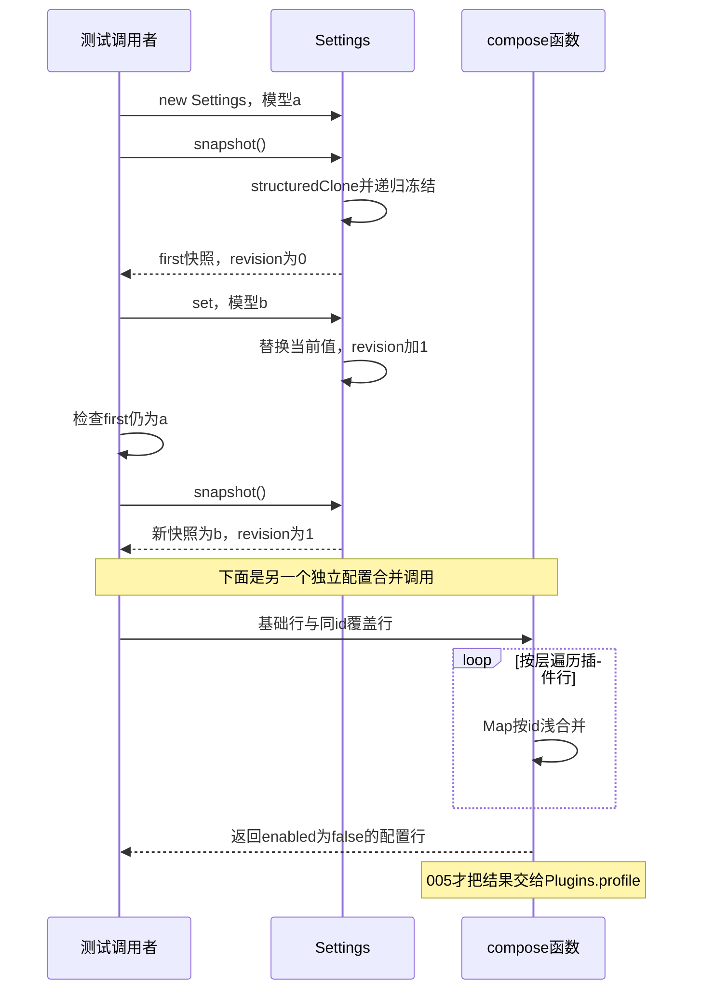

# 004 · 正在运行的请求不跟着设置漂移

阶段：R01。唯一前置：完成第 003 步，继续同一个工程。

<!-- harness-own-links:start -->
## 当前练习工程文件

以下链接指向 `harness-own` 的当前累计版本；本课下方的完整代码仍保留当步版本，二者可能不同。

[打开练习工程说明](../../../harness-own/README.md)

| 本课文件 | 当前练习工程文件 |
| --- | --- |
| `.vscode/launch.json` | 使用本页下方的本节专用配置，不复制累计版本 |
| `src/config.mjs` | [`harness-own/src/config.mjs`](../../../harness-own/src/config.mjs) |
| `tests/004-config.test.mjs` | [`harness-own/tests/004-config.test.mjs`](../../../harness-own/tests/004-config.test.mjs) |

<!-- harness-own-links:end -->

## 什么时候会用到这一页

任务已经用模型A开始执行，此时用户把设置改成模型B。正在进行的任务继续使用快照A，下一次任务才拿到B；同时机器配置可把某个插件enabled覆盖成false。

### 这次数据怎么走

```text
Settings(initial)复制初值 → snapshot深复制并冻结 → set浅合并patch并revision++ → 新snapshot读取新值；compose按层遍历 → 相同id的插件行覆盖 → 交给Plugins.profile。
```

### 对应时序图

从上往下读；实线箭头表示调用或发送，虚线箭头表示返回或事件通知。`opt`表示可选操作，`alt`表示不同结果，`loop`表示重复，`par`及其`and`分支表示并行；“未接入”及fixture说明按图中标注理解。



**当前接线位置：**005把compose结果真的交给Plugins.profile；013的Agent在每个新turn调用settings.snapshot，018/020按这份快照路由。当前每turn固定快照与原版每次操作捕获配置并非相同接口。

## 这一步具体做什么

写完config.mjs和测试后运行 bun test ./tests/004-config.test.mjs。对照断言确认first.route.model仍为a、直接改first抛TypeError、新snapshot为b；compose同id的enabled:false应保留。005的真实读取示例会在任务开始后更新prefix，再验证旧任务快照不变。

需要本章新文件的操作，先按下面代码创建文件，再执行；不要在上一步尚不存在的接口上试错。

## 代码为什么放在这一层

Settings保存当前设置，snapshot保存“一次任务选定的设置”。compose只合并插件行，不负责安装插件，也不是任意嵌套JSON深合并：同一行的config对象会被后层整个替换，需要明确写全该对象的值。

## 本节调试：选什么、为什么、怎么启动

**建议先选：004：本节测试。** 每节的测试入口都固定到本节文件，不依赖编辑器当前打开的 `${file}`。

| 配置名称 | 什么时候选 | 实际入口或目标 | 能观察什么 |
| --- | --- | --- | --- |
| 004：本节测试 | 本节验收 | tests/004-config.test.mjs | 本节 Bun 测试进程；入口固定，不依赖当前编辑器文件。 |

**为什么这样启动：**本节测试直接调用被测模块，选择这一项即可沿测试进入实现；前序 CLI 或其他语言入口不参与这次调试。

使用下方的[本节专用调试配置](#lesson-debug-config)。它只列本节可用目标；要保留个人配置，请先备份并按名称合并。页面上 `harness-own` 的累计文件链接供看当前工程，不是本节调试配置的答案。

1. VS Code 打开自己的 PROJECT；按本节创建源码与配置，断点设在 PROJECT 文件中。
2. 先用终端运行 `bun test ./tests/004-config.test.mjs` 确认普通验收，再选表中的配置按 F5。
3. 在下方具体观察点停住；F10 跨过当前语句，F11 只进入当前调试目标。异步等待涉及另一进程时，切换调试会话并继续对端。
4. 变量要在所属调用帧查看；看测试局部变量时选测试帧，看 this 和参数时选实现方法帧。

**本节具体断点和预期：**在VS Code打开练习工程并选中tests/004-config.test.mjs，选择“004：本节测试”按F5启动。在src/config.mjs的this.revision++、freeze返回处和rows.set打断点。F10经过set后，在config.mjs的方法帧监视this.value.route.model与this.revision，应为b、1；切换到测试调用者帧再看first.route.model，应仍为a。F11进入compose，查看相同row.id覆盖前后config是否整对象替换。

暂停断点会影响应用自身的 RPC、取消、进程和网络计时。Bun 测试超时放宽不等于这些计时也被关闭；按本节说明分别设置，普通验收恢复原有时限。

观察完成后退出本节启动的调试会话和进程，再运行 `bun test ./tests/004-config.test.mjs`。测试通过只证明本节断言，不代表所有 GUI、外部服务或发布过程均已验证。

## 在哪里写、写什么

操作地点：终端中的 `$PROJECT`，编辑器打开同一个目录。只创建或替换下列文件，其他文件保留上一步版本。文件目录不存在先创建。

```sh
mkdir -p .vscode
```

<a id="lesson-debug-config"></a>

下面是本节专用调试配置，只包含本节入口。program 已固定到本节文件；不是 harness-own 的累计配置。

### 替换 `.vscode/launch.json`

````json
{
  "version": "0.2.0",
  "configurations": [
    {
      "name": "004：本节测试",
      "type": "bun",
      "request": "launch",
      "program": "${workspaceFolder}/tests/004-config.test.mjs",
      "cwd": "${workspaceFolder}",
      "runtime": "bun",
      "runtimeArgs": [
        "test",
        "--preload",
        "${workspaceFolder}/scripts/vscode-debug.mjs",
        "--timeout",
        "3600000"
      ],
      "stopOnEntry": false
    }
  ]
}
````

```sh
mkdir -p src
```

### 创建 [`src/config.mjs`](../../../harness-own/src/config.mjs)

````javascript
/** 配置改变影响下一请求；快照不得被调用方或后续热更新修改。 */
export class Settings {
  constructor(initial = {}) { this.value = structuredClone(initial); this.revision = 0 }
  /** 提交新版本，数组/对象均复制，不共享可变引用。 */
  set(patch) { this.value = { ...this.value, ...structuredClone(patch) }; this.revision++ }
  /** 用序列化边界获得深副本，冻结所有嵌套属性。 */
  snapshot() {
    const freeze = value => {
      if (value && typeof value === 'object') { Object.values(value).forEach(freeze); Object.freeze(value) }
      return value
    }
    return freeze({ revision: this.revision, ...structuredClone(this.value) })
  }
}

/** Bundle 基础层、机器层、Profile 层顺序合并，不执行配置里的代码。 */
export function compose(...layers) {
  const rows = new Map()
  for (const layer of layers) for (const row of layer) {
    if (!row.id || !row.name) throw Error('配置缺少 id/name')
    rows.set(row.id, { ...rows.get(row.id), ...structuredClone(row) })
  }
  return [...rows.values()]
}
````

```sh
mkdir -p tests
```

### 创建 [`tests/004-config.test.mjs`](../../../harness-own/tests/004-config.test.mjs)

````javascript
import { test } from 'bun:test'
import assert from 'node:assert/strict'
import { Settings, compose } from '../src/config.mjs'

test('请求快照稳定，后续设置只影响下一请求', () => {
  const settings = new Settings({ route: { model: 'a' } }), first = settings.snapshot()
  settings.set({ route: { model: 'b' } })
  assert.equal(first.route.model, 'a')
  assert.throws(() => { first.route.model = 'bad' }, TypeError)
  assert.equal(settings.snapshot().route.model, 'b')
  assert.equal(compose([{ id: 'a', name: 'fs' }], [{ id: 'a', name: 'fs', enabled: false }])[0].enabled, false)
})
````

## 运行命令与通过标准

```sh
cd "$PROJECT"
bun test ./tests/004-config.test.mjs
bun test
```

本章测试证明冻结副本与后续更新分离，以及同id行覆盖；不包含设置表单、写磁盘或配置schema校验。禁止把revision当成已实现跨客户端并发保护，它只是本实例计数。

**本步证据的范围：**tests/004-config.test.mjs有1项测试，覆盖旧快照、新快照、冻结写失败和enabled覆盖；005另有实际装配与进行中设置变化的测试。

## 不看答案，确认自己能解释

合上资料，写出“当前设置”和“已启动任务快照”两份对象；说明set后哪些变化、哪些不变，再说明compose不是安装动作。

完成后在 LEARNING.md 写一句实际结果和一个卡点。明天只重做这个卡点；第 3 天、第 7 天再做一次，能独立完成就继续下一页，不另开学习路线。

**再改一个条件验证：**在测试副本给初始route添加temperature，再用set({route:{model:"b"}})更新，观察temperature被替换掉；这是理解浅合并的练习。不要把预期写成自动保留嵌套字段。

## 与当前原版还差哪些

对照本仓库固定原版 `687f282e8625c6b8d11ff58211a90524be2e4317`；这里的“当前”指该本地基线，不是未经检查的上游最新版。

**这一页已经实现：**

- 更新版本计数、结构复制与递归冻结。
- 插件行按id、按层顺序合并，顺序稳定。

**原版仍有、或本步尚未对齐的部分：**

- 原版SettingsForms从Loader volatile Config投影表单，支持秘密脱敏、期望revision冲突拒绝与profile patch持久化；本章没有UI或持久化更新。
- 原版Loader有schema默认值、合法性校验与entry更新；教程compose只做对象合并，没有配置文件解析、Group/Include和动态重载。

**原版对照位置：**

- [packages/settings/settings/src/index.ts](../../../deepseek-harness/packages/settings/settings/src/index.ts)
- [packages/settings/settings/src/schema.ts](../../../deepseek-harness/packages/settings/settings/src/schema.ts)
- [vendor/loader/src/config/entry.ts](../../../deepseek-harness/vendor/loader/src/config/entry.ts)
- [vendor/loader/src/index.ts](../../../deepseek-harness/vendor/loader/src/index.ts)

本步测试通过只证明上面的具体行为；完整差距仍看 [COVERAGE.md](../COVERAGE.md)，不以文件数量、同名类或后面出现另一个模块代替接线证据。

下一步：[第 005 步](005.md)
