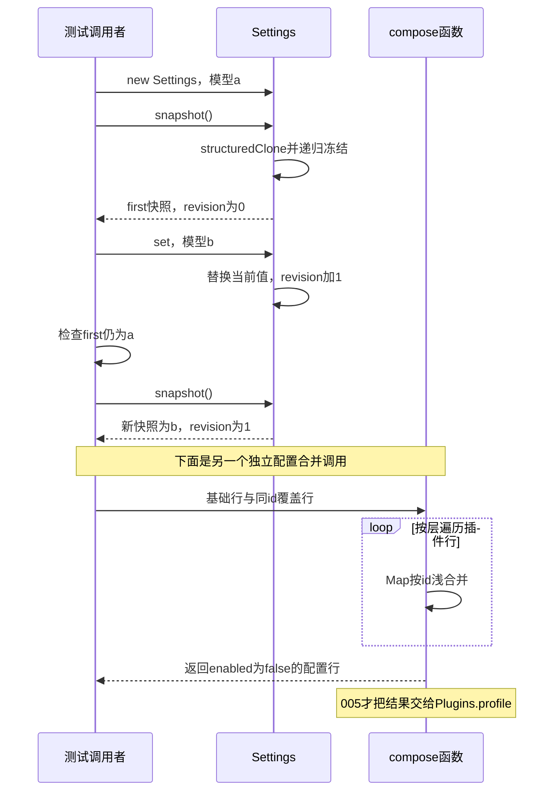

# 004 · 正在运行的请求不跟着设置漂移

阶段：R01。唯一前置：完成第 003 步，继续同一个工程。

## 什么时候会用到这一页

任务已经用模型A开始执行，此时用户把设置改成模型B。正在进行的任务继续使用快照A，下一次任务才拿到B；同时机器配置可把某个插件enabled覆盖成false。

### 这次数据怎么走

```text
Settings(initial)复制初值 → snapshot深复制并冻结 → set浅合并patch并revision++ → 新snapshot读取新值；compose按层遍历 → 相同id的插件行覆盖 → 交给Plugins.profile。
```

### 对应时序图

从上往下读；实线箭头表示调用或发送，虚线箭头表示返回或事件通知。`opt`表示可选操作，`alt`表示不同结果，`loop`表示重复，`par`及其`and`分支表示并行；“未接入”及fixture说明按图中标注理解。



**当前接线位置：**005把compose结果真的交给Plugins.profile；013的Agent在每个新turn调用settings.snapshot，018/020按这份快照路由。当前每turn固定快照与原版每次操作捕获配置并非相同接口。

## 这一步具体做什么

写完config.mjs和测试后运行 bun test ./tests/004-config.test.mjs。对照断言确认first.route.model仍为a、直接改first抛TypeError、新snapshot为b；compose同id的enabled:false应保留。005的真实读取示例会在任务开始后更新prefix，再验证旧任务快照不变。

需要本章新文件的操作，先按下面代码创建文件，再执行；不要在上一步尚不存在的接口上试错。

## 代码为什么放在这一层

Settings保存当前设置，snapshot保存“一次任务选定的设置”。compose只合并插件行，不负责安装插件，也不是任意嵌套JSON深合并：同一行的config对象会被后层整个替换，需要明确写全该对象的值。

## 在哪里写、写什么

操作地点：终端中的 `$PROJECT`，编辑器打开同一个目录。只创建或替换下列文件，其他文件保留上一步版本。文件目录不存在先创建。

```sh
mkdir -p src
```

### 创建 `src/config.mjs`

````javascript
/** 配置改变影响下一请求；快照不得被调用方或后续热更新修改。 */
export class Settings {
  constructor(initial = {}) { this.value = structuredClone(initial); this.revision = 0 }
  /** 提交新版本，数组/对象均复制，不共享可变引用。 */
  set(patch) { this.value = { ...this.value, ...structuredClone(patch) }; this.revision++ }
  /** 用序列化边界获得深副本，冻结所有嵌套属性。 */
  snapshot() {
    const freeze = value => {
      if (value && typeof value === 'object') { Object.values(value).forEach(freeze); Object.freeze(value) }
      return value
    }
    return freeze({ revision: this.revision, ...structuredClone(this.value) })
  }
}

/** Bundle 基础层、机器层、Profile 层顺序合并，不执行配置里的代码。 */
export function compose(...layers) {
  const rows = new Map()
  for (const layer of layers) for (const row of layer) {
    if (!row.id || !row.name) throw Error('配置缺少 id/name')
    rows.set(row.id, { ...rows.get(row.id), ...structuredClone(row) })
  }
  return [...rows.values()]
}
````

```sh
mkdir -p tests
```

### 创建 `tests/004-config.test.mjs`

````javascript
import { test } from 'bun:test'
import assert from 'node:assert/strict'
import { Settings, compose } from '../src/config.mjs'

test('请求快照稳定，后续设置只影响下一请求', () => {
  const settings = new Settings({ route: { model: 'a' } }), first = settings.snapshot()
  settings.set({ route: { model: 'b' } })
  assert.equal(first.route.model, 'a')
  assert.throws(() => { first.route.model = 'bad' }, TypeError)
  assert.equal(settings.snapshot().route.model, 'b')
  assert.equal(compose([{ id: 'a', name: 'fs' }], [{ id: 'a', name: 'fs', enabled: false }])[0].enabled, false)
})
````

## 运行命令与通过标准

```sh
cd "$PROJECT"
bun test ./tests/004-config.test.mjs
bun test
```

本章测试证明冻结副本与后续更新分离，以及同id行覆盖；不包含设置表单、写磁盘或配置schema校验。禁止把revision当成已实现跨客户端并发保护，它只是本实例计数。

**本步证据的范围：**tests/004-config.test.mjs有1项测试，覆盖旧快照、新快照、冻结写失败和enabled覆盖；005另有实际装配与进行中设置变化的测试。

## VS Code：断在哪里、看什么

在VS Code打开练习工程并选中tests/004-config.test.mjs，选择“Bun：当前测试”按F5启动。在src/config.mjs的this.revision++、freeze返回处和rows.set打断点。F10经过set后，在config.mjs的方法帧监视this.value.route.model与this.revision，应为b、1；切换到测试调用者帧再看first.route.model，应仍为a。F11进入compose，查看相同row.id覆盖前后config是否整对象替换。

操作位置：VS Code 打开的是自己的 `$PROJECT`，断点也设在这里的源码，不在教材的 `steps` 目录。

上面的说明若指定CLI、子进程、页面或Electron附加调试，就先按该流程操作；下面这组步骤只用于本章测试入口。“当前测试”不会自动附加子进程，也不会命中浏览器或Electron中的断点。

变量只在所属作用域可见：停在方法内部时看this和参数；要看测试里的局部变量，先在“调用堆栈”选择对应测试帧。正在等待的异步调用者不一定保留可求值的帧，此时在测试调用前后加断点再看，不把未定义误判成业务状态丢失。

沿用第 000 步安装的 Bun 扩展与 `.vscode/launch.json`；本章列出替换配置时，使用本章完整版本。

1. 打开本步测试文件 `tests/004-config.test.mjs`，保持它为当前编辑器文件。
2. 在上面指定的函数内单击行号左侧设置断点。
3. “运行和调试”选择 **Bun：当前测试**，按 F5；它执行当前测试，工作目录固定为 PROJECT。
4. 在“变量 / 监视 / 调用堆栈 / 调试控制台”检查状态；F10 逐行执行，F11 进入函数，Shift+F11 返回，F5 继续，Shift+F5 停止。

验收：断点实际命中，能说出当前输入、状态和下一步；只看到进程启动不算完成。长时间暂停会影响真实取消、审批和网络超时，先检查时序，不删超时断言。修正后在集成终端运行 `bun test ./tests/004-config.test.mjs`，再运行 `bun test`，保留全部断言。

## 不看答案，确认自己能解释

合上资料，写出“当前设置”和“已启动任务快照”两份对象；说明set后哪些变化、哪些不变，再说明compose不是安装动作。

完成后在 LEARNING.md 写一句实际结果和一个卡点。明天只重做这个卡点；第 3 天、第 7 天再做一次，能独立完成就继续下一页，不另开学习路线。

**再改一个条件验证：**在测试副本给初始route添加temperature，再用set({route:{model:"b"}})更新，观察temperature被替换掉；这是理解浅合并的练习。不要把预期写成自动保留嵌套字段。

## 与当前原版还差哪些

对照本仓库固定原版 `687f282e8625c6b8d11ff58211a90524be2e4317`；这里的“当前”指该本地基线，不是未经检查的上游最新版。

**这一页已经实现：**

- 更新版本计数、结构复制与递归冻结。
- 插件行按id、按层顺序合并，顺序稳定。

**原版仍有、或本步尚未对齐的部分：**

- 原版SettingsForms从Loader volatile Config投影表单，支持秘密脱敏、期望revision冲突拒绝与profile patch持久化；本章没有UI或持久化更新。
- 原版Loader有schema默认值、合法性校验与entry更新；教程compose只做对象合并，没有配置文件解析、Group/Include和动态重载。

**原版对照位置：**

- [packages/settings/settings/src/index.ts](../../../deepseek-harness/packages/settings/settings/src/index.ts)
- [packages/settings/settings/src/schema.ts](../../../deepseek-harness/packages/settings/settings/src/schema.ts)
- [vendor/loader/src/config/entry.ts](../../../deepseek-harness/vendor/loader/src/config/entry.ts)
- [vendor/loader/src/index.ts](../../../deepseek-harness/vendor/loader/src/index.ts)

本步测试通过只证明上面的具体行为；完整差距仍看 [COVERAGE.md](../COVERAGE.md)，不以文件数量、同名类或后面出现另一个模块代替接线证据。

下一步：[第 005 步](005.md)
