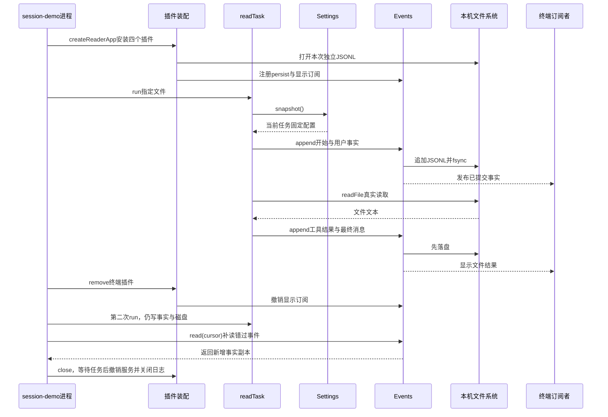
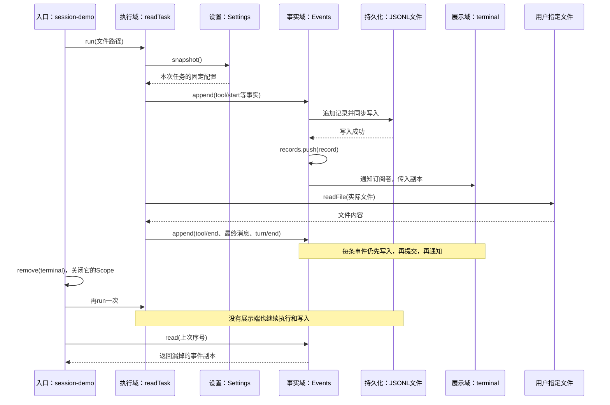

# 005 · 把插件装成真实读文件任务：写事实、显示进度、按序号补读

阶段：R01。唯一前置：完成第 004 步，继续同一个工程。

<!-- harness-own-links:start -->
## 当前练习工程文件

以下链接指向 `harness-own` 的当前累计版本；本课下方的完整代码仍保留当步版本，二者可能不同。

[打开练习工程说明](../../../harness-own/README.md)

| 本课文件 | 当前练习工程文件 |
| --- | --- |
| `src/events.mjs` | [`harness-own/src/events.mjs`](../../../harness-own/src/events.mjs) |
| `src/session-app.mjs` | 尚未合入 harness-own |
| `src/session-demo.mjs` | 尚未合入 harness-own |
| `tests/005-events.test.mjs` | [`harness-own/tests/005-events.test.mjs`](../../../harness-own/tests/005-events.test.mjs) |
| `tests/005-session.test.mjs` | 尚未合入 harness-own |

<!-- harness-own-links:end -->

## 什么时候会用到这一页

读取你指定的README：读文件任务把开始、工具结果和最终文字记入JSONL，终端订阅这些事件显示。然后卸载显示插件再读一次，业务与磁盘仍成功，显示端可按seq补读自己错过的事件。

### 这次数据怎么走

```text
session-demo读取CLI路径 → createReaderApp合并并安装settings/session/terminal/reader → readTask.run取配置快照 → Events.append先同步落盘再入内存 → 真实readFile → 订阅者显示 → remove("terminal") → 第二次读取 → session.read(cursor)补读 → app.close。
```

### 对应时序图

从上往下读；实线箭头表示调用或发送，虚线箭头表示返回或事件通知。`opt`表示可选操作，`alt`表示不同结果，`loop`表示重复，`par`及其`and`分支表示并行；“未接入”及fixture说明按图中标注理解。



**当前接线位置：**这是000～004第一次真实装配的独立读文件应用，未接模型循环。006的Journal还没有替换此处最小JSONL写入器；041 Host另行装配Journal和Agent，不是自动升级这个demo。

## 这一步具体做什么

完成本章所有文件后，在练习工程运行 bun src/session-demo.mjs package.json，再运行 bun test ./tests/005-events.test.mjs ./tests/005-session.test.mjs。终端先出现[终端]事件，卸载后第二次任务不再出现这种前缀，却会显示补读序号；按输出路径打开.data-005中的本次JSONL核对记录。不要用不存在的README作为第一次成功验收。

需要本章新文件的操作，先按下面代码创建文件，再执行；不要在上一步尚不存在的接口上试错。

## 代码为什么放在这一层

Events保存业务事实，订阅者只观察；终端退出不等于取消任务。createReaderApp把000～004真实装起来，避免只学到孤立类。持久化回调在发布前执行，让写入失败时不产生假成功事件。

## 先看这一步到底做成什么

操作场景：你在终端输入一个文件名，程序真实读取文件，显示“开始读取、读取完成、最终内容”，并把这些过程记录到会话日志。随后终端展示端退出，同一个读任务继续执行；展示端回来时，根据上次序号补读漏掉的记录。

这就是 Harness 中“执行”和“展示”分开的最小完整使用场景：以后把终端换成 Web、Electron 或 ACP，业务仍向会话提交事实，不去调用某个界面的显示函数。本步的展示端只有终端，尚未实现网页或ACP。

### 把000～004真的接起来

```text
session-demo.mjs：应用入口，沿用000的input校验
└── createReaderApp：compose配置 → Plugins.profile装配
    ├── 共享Services
    │   ├── settings：最新设置，来自004
    │   ├── session：Events，会话事实与订阅入口
    │   └── readTask：真实读文件任务
    └── 根Scope
        ├── settings插件Scope：撤销settings注册
        ├── session插件Scope：撤销session、关闭日志文件
        ├── terminal插件Scope：取消自己的事件订阅
        └── reader插件Scope：停止接收任务、取消并等待当前读取、撤销readTask
```

插件如何关联就在代码里：reader通过`services.get('session')`、`services.get('settings')`获取前面插件提供的对象；terminal获取同一个session。每个插件有自己的Scope，复用同一个Services。

### 一次调用怎样走



### 现在在哪操作、怎样算完成

先按下面“在哪里写、写什么”在自己的PROJECT创建本步文件，再回到集成终端执行：

```sh
bun src/session-demo.mjs package.json
```

你应该看到：

1. 打印本次独立的日志文件路径，位于PROJECT的`.data-005/`。
2. 第一轮显示`[终端] 0 turn/start`到`[终端] 5 turn/end`，并显示自己工程的真实package.json内容。
3. 卸载terminal后，第二轮仍完成，但不再出现`[终端]`事件；它没有调用display来制造“展示成功”。
4. 补读结果为`6:turn/start → 7:message/user → 8:tool/start → 9:tool/end → 10:message/assistant → 11:turn/end`。
5. 退出时显示`应用已退出：插件=0，注册服务=0`。打开打印的JSONL文件，应有12条记录，与`session.read()`一致。

显示回调更新设置时，当前任务仍使用旧快照，下一次任务才使用新版本；集成测试会稳定重现这个时机，不用靠sleep碰运气。

**本步边界：**读任务真的访问文件，日志真的写盘；最终文本直接使用读取结果，没有模型生成。`read(after)`只补读当前进程的会话事实，不自动重新订阅，也没有实现进程重启恢复。最小JSONL写入器没有坏尾修复、恢复或原版V4兼容，这些不能提前记为完成。

## 在哪里写、写什么

操作地点：终端中的 `$PROJECT`，编辑器打开同一个目录。只创建或替换下列文件，其他文件保留上一步版本。文件目录不存在先创建。

```sh
mkdir -p src
```

### 创建 [`src/events.mjs`](../../../harness-own/src/events.mjs)

````javascript
import { randomUUID } from 'node:crypto'

/** 每类身份带可见前缀，调试时能立刻看出串错了什么。 */
export function id(kind) { return kind + '_' + randomUUID() }

/** Session 只保存事实；界面和模型通过投影读取，不直接改历史。 */
export class Events {
  records = []
  listeners = new Set()
  constructor(sessionId = id('session'), persist = () => {}) { this.id = sessionId; this.persist = persist }
  /** 先持久化，再发布；持久化失败时内存与订阅者都不能看到成功。 */
  append(type, data) {
    const record = { format: 1, sessionId: this.id, seq: this.records.length, time: Date.now(), type, data: structuredClone(data) }
    this.persist(record)
    this.records.push(record)
    for (const listener of [...this.listeners]) {
      // 展示订阅者失败不能回滚已经提交的事实。
      try { listener(structuredClone(record)) } catch {}
    }
    return structuredClone(record)
  }
  /** 读取副本，防止 UI 改写已经提交的消息。 */
  read(after = -1) { return structuredClone(this.records.filter(record => record.seq > after)) }
  /** 每个订阅者独立撤销。 */
  on(listener) { this.listeners.add(listener); return () => this.listeners.delete(listener) }
}
````

```sh
mkdir -p src
```

### 创建 `src/session-app.mjs`

````javascript
import { appendFileSync, closeSync, fsyncSync, mkdirSync, openSync } from 'node:fs'
import { readFile } from 'node:fs/promises'
import { dirname, resolve } from 'node:path'
import { Plugins } from './plugins.mjs'
import { Settings, compose } from './config.mjs'
import { Events, id } from './events.mjs'

/** 把000～004的基础件装成一次真实读文件任务；模型循环在后续章节接入。 */
export async function createReaderApp({ logPath, display = () => {}, layers = [] }) {
  if (!logPath) throw Error('需要明确指定会话日志路径')
  const plugins = new Plugins() // 当前应用只有一个插件管理根。
  const rows = [ // 顺序体现真实依赖：读任务依赖设置和会话，终端依赖会话。
    { id: 'settings', name: 'settings', config: { prefix: '读取完成' } },
    { id: 'session', name: 'session' },
    { id: 'terminal', name: 'terminal' },
    { id: 'reader', name: 'reader' }
  ]
  const catalog = {
    /** 设置插件：提供所有任务共享的最新设置入口。 */
    settings({ scope, services }, config) {
      services.provide(scope, 'settings', new Settings(config))
    },
    /** 会话插件：本步使用最小JSONL写入器，第006步的Journal提供恢复与损坏处理，本例尚未接入。 */
    session({ scope, services }) {
      const path = resolve(logPath) // 一个新文件只属于这一个会话。
      mkdirSync(dirname(path), { recursive: true })
      const descriptor = openSync(path, 'ax', 0o600) // 已存在就失败，禁止混入旧会话。
      scope.own(() => closeSync(descriptor)) // 先登记文件关闭，后登记服务撤销。
      const session = new Events(id('session'), record => {
        appendFileSync(descriptor, JSON.stringify(record) + '\n')
        fsyncSync(descriptor) // 写入返回后才允许提交内存与通知观察者。
      })
      services.provide(scope, 'session', session)
    },
    /** 终端插件：只订阅事实，自己的卸载不应停止业务或删除历史。 */
    terminal({ scope, services }) {
      const session = services.get('session') // 从共享注册表获取会话。
      scope.own(session.on(display)) // on返回取消订阅函数，归本插件Scope管理。
    },
    /** 任务插件：写事实并执行文件读取，不直接调用终端显示函数。 */
    reader({ scope, services }) {
      const session = services.get('session'), settings = services.get('settings')
      let active, controller // 本步只运行一个任务，队列与并发在后面实现。
      services.provide(scope, 'readTask', {
        /** 每次任务只取一次配置快照；所有事件带同一个turnId关联。 */
        run(path) {
          if (scope.closed) return Promise.reject(Error('读任务插件已退出'))
          if (active) return Promise.reject(Error('已有读任务正在执行'))
          const config = settings.snapshot(), turnId = id('turn'), callId = id('call')
          const request = new AbortController() // 退出插件时取消当前文件读取。
          controller = request
          active = Promise.resolve().then(async () => {
            request.signal.throwIfAborted()
            session.append('turn/start', { turnId, config })
            session.append('message/user', { role: 'user', content: '读取 ' + path })
            session.append('tool/start', { turnId, callId, name: 'read', path })
            let text // 只有真实文件读取成功才产生tool/end和最终消息。
            try { text = await readFile(path, { encoding: 'utf8', signal: request.signal }) }
            catch (error) {
              session.append('tool/error', { turnId, callId, message: error.message })
              session.append('turn/end', { turnId, reason: request.signal.aborted ? 'cancelled' : 'error' })
              throw error
            }
            session.append('tool/end', { turnId, callId, text })
            const content = config.prefix + '：\n' + text // 本步直接展示文件结果，不伪装成模型生成。
            session.append('message/assistant', { role: 'assistant', content })
            session.append('turn/end', { turnId, reason: 'completed' })
            return { turnId, config, content }
          })
          return active.finally(() => { active = undefined; controller = undefined })
        }
      })
      // 后登记的任务退出先执行：先取消并等待读取收敛，再让会话插件关闭日志。
      scope.own(async () => { controller?.abort(Error('读任务插件退出')); if (active) await active.catch(() => {}) })
    }
  }
  try {
    await plugins.profile(compose(rows, ...layers), catalog) // 合并配置后才安装，而不是只测试compose函数。
    return plugins
  } catch (error) {
    try { await plugins.close() } catch (cleanup) { throw new AggregateError([error, cleanup], '应用装配失败') }
    throw error
  }
}
````

```sh
mkdir -p src
```

### 创建 `src/session-demo.mjs`

````javascript
import { resolve } from 'node:path'
import { input } from './main.mjs'
import { id } from './events.mjs'
import { createReaderApp } from './session-app.mjs'

// 沿用第000步的输入校验；这里只读取用户明确指定的文件。
const path = input(process.argv.slice(2))
const logPath = resolve('.data-005', id('session') + '.jsonl') // 每次运行生成独立日志，不覆盖旧记录。
const app = await createReaderApp({
  logPath,
  display(event) {
    console.log('[终端]', event.seq, event.type)
    if (event.type === 'message/assistant') console.log(event.data.content)
  },
  layers: [[{ id: 'settings', name: 'settings', config: { prefix: '本次任务的文件内容' } }]]
})

try {
  const session = app.services.get('session'), task = app.services.get('readTask')
  console.log('日志文件：' + logPath)
  await task.run(path) // 第一次任务同时写日志并通知终端。
  const cursor = session.read().at(-1).seq // 记住终端最后收到的序号。
  await app.remove('terminal') // 等价于一个展示端退出，撤销它的订阅。
  console.log('终端订阅已卸载，开始第二次任务；下面不应再出现[终端]事件。')
  app.services.get('settings').set({ prefix: '第二次读取' }) // 只影响下一次任务的快照。
  const result = await task.run(path) // 没有终端订阅者，业务与持久化仍正常进行。
  console.log('第二次任务完成，配置版本：' + result.config.revision)
  console.log('按游标补读：' + session.read(cursor).map(event => event.seq + ':' + event.type).join(' → '))
} finally {
  await app.close() // 先等任务结束，再撤销订阅与服务，最后关闭日志文件。
  console.log('应用已退出：插件=' + app.active.size + '，注册服务=' + app.services.entries.size)
}
````

```sh
mkdir -p tests
```

### 创建 [`tests/005-events.test.mjs`](../../../harness-own/tests/005-events.test.mjs)

````javascript
import { test } from 'bun:test'
import assert from 'node:assert/strict'
import { Events } from '../src/events.mjs'

test('日志失败时不发布；读取者不能篡改已经发布的事实', () => {
  const failed = new Events('s', () => { throw Error('disk full') }), observed = []
  failed.on(event => observed.push(event))
  assert.throws(() => failed.append('user', { text: 'hi' }), /disk full/)
  assert.equal(observed.length, 0)
  assert.equal(failed.read().length, 0)
  const session = new Events('s')
  session.append('user', { text: 'hi' })
  session.read()[0].data.text = 'changed'
  assert.equal(session.read()[0].data.text, 'hi')
})
````

```sh
mkdir -p tests
```

### 创建 `tests/005-session.test.mjs`

````javascript
import { test } from 'bun:test'
import assert from 'node:assert/strict'
import { mkdtempSync, readFileSync, rmSync, writeFileSync } from 'node:fs'
import { join } from 'node:path'
import { tmpdir } from 'node:os'
import { createReaderApp } from '../src/session-app.mjs'

/** 读取实际落盘的JSONL，验证磁盘记录和会话事实一致。 */
function records(path) { return readFileSync(path, 'utf8').trim().split('\n').filter(Boolean).map(line => JSON.parse(line)) }

test('完整装配：真实读文件、配置固定、终端退出、游标补读和应用清理', async () => {
  const root = mkdtempSync(join(tmpdir(), 'reader-app-')) // 隔离工作区与日志。
  const file = join(root, 'README.md'), log = join(root, 'events.jsonl'), observed = []
  writeFileSync(file, '真实 README 内容')
  let settings // 观察者在任务开始后更新设置，检验当前任务是否仍用旧快照。
  const app = await createReaderApp({ logPath: log, display: event => {
    observed.push(event)
    if (event.type === 'tool/start') settings.set({ prefix: '新设置' })
  }, layers: [[{ id: 'settings', name: 'settings', config: { prefix: '个人配置' } }]] })
  const session = app.services.get('session'), task = app.services.get('readTask')
  settings = app.services.get('settings')
  try {
    const first = await task.run(file)
    assert.equal(first.config.revision, 0)
    assert.equal(first.content, '个人配置：\n真实 README 内容')
    assert.equal(settings.snapshot().prefix, '新设置')
    assert.deepEqual(records(log), session.read())
    assert.deepEqual(observed.map(event => event.seq), [0, 1, 2, 3, 4, 5])
    await app.remove('terminal')
    assert.equal(session.listeners.size, 0)
    const second = await task.run(file)
    assert.equal(second.config.revision, 1)
    assert.equal(second.content, '新设置：\n真实 README 内容')
    assert.equal(observed.length, 6)
    assert.deepEqual(session.read(5).map(event => event.seq), [6, 7, 8, 9, 10, 11])
    assert.deepEqual(records(log), session.read())
  } finally { await app.close(); rmSync(root, { recursive: true, force: true }) }
  assert.equal(app.active.size, 0)
  assert.equal(app.services.entries.size, 0)
  await assert.rejects(task.run(file), /已退出/)
})

test('真实读取失败不会产生成功消息，坏展示端不阻断其他观察者', async () => {
  const root = mkdtempSync(join(tmpdir(), 'reader-failure-')), log = join(root, 'events.jsonl'), observed = []
  const app = await createReaderApp({ logPath: log, display: () => { throw Error('展示端异常') } })
  const session = app.services.get('session')
  app.scope.own(session.on(event => observed.push(event))) // 第二个观察者有自己的清理归属。
  try {
    await assert.rejects(app.services.get('readTask').run(join(root, 'missing.md')), /ENOENT/)
    assert.deepEqual(session.read().map(event => event.type), ['turn/start', 'message/user', 'tool/start', 'tool/error', 'turn/end'])
    assert.equal(session.read().at(-1).data.reason, 'error')
    assert.equal(observed.length, 5)
    assert.deepEqual(records(log), session.read())
  } finally { await app.close(); rmSync(root, { recursive: true, force: true }) }
  assert.equal(session.listeners.size, 0)
})
````

## 运行命令与通过标准

```sh
cd "$PROJECT"
bun src/session-demo.mjs package.json
bun test ./tests/005-session.test.mjs
bun test
```

三个测试覆盖日志失败不发布、读副本不改事实、真实文件读取、配置固定、卸载显示、补读、关闭，以及读取失败不写成功消息。当前日志是本工程format:1；不是原版Session V4，也没有模型参与。

**本步证据的范围：**005-events.test.mjs有1项测试，005-session.test.mjs有2项真实磁盘测试；session-demo可手动运行并留下本次独立日志。所有内容来自本地文件，没有模型收费请求。

## VS Code：断在哪里、看什么

在VS Code打开练习工程并选中tests/005-session.test.mjs，选择“Bun：当前测试”按F5启动。在src/session-app.mjs的const config = settings.snapshot()、session.append("tool/start",...)和readFile处打断点；在src/events.mjs的this.persist(record)、this.records.push(record)再打点。F10观察persist先执行、records后增加；F11进入display触发set后，当前config.prefix仍旧而settings.snapshot().prefix已新。

操作位置：VS Code 打开的是自己的 `$PROJECT`，断点也设在这里的源码，不在教材的 `steps` 目录。

上面的说明若指定CLI、子进程、页面或Electron附加调试，就先按该流程操作；下面这组步骤只用于本章测试入口。“当前测试”不会自动附加子进程，也不会命中浏览器或Electron中的断点。

变量只在所属作用域可见：停在方法内部时看this和参数；要看测试里的局部变量，先在“调用堆栈”选择对应测试帧。正在等待的异步调用者不一定保留可求值的帧，此时在测试调用前后加断点再看，不把未定义误判成业务状态丢失。

沿用第 000 步安装的 Bun 扩展与 `.vscode/launch.json`；本章列出替换配置时，使用本章完整版本。

1. 打开本步测试文件 `tests/005-session.test.mjs`，保持它为当前编辑器文件。
2. 在上面指定的函数内单击行号左侧设置断点。
3. “运行和调试”选择 **Bun：当前测试**，按 F5；它执行当前测试，工作目录固定为 PROJECT。
4. 在“变量 / 监视 / 调用堆栈 / 调试控制台”检查状态；F10 逐行执行，F11 进入函数，Shift+F11 返回，F5 继续，Shift+F5 停止。

验收：断点实际命中，能说出当前输入、状态和下一步；只看到进程启动不算完成。长时间暂停会影响真实取消、审批和网络超时，先检查时序，不删超时断言。修正后在集成终端运行 `bun test ./tests/005-session.test.mjs`，再运行 `bun test`，保留全部断言。

## 不看答案，确认自己能解释

合上教程画出“任务写事实→磁盘→内存→展示”的顺序；再说明卸载terminal为什么不停止reader，关闭reader为什么应早于关闭日志文件。

完成后在 LEARNING.md 写一句实际结果和一个卡点。明天只重做这个卡点；第 3 天、第 7 天再做一次，能独立完成就继续下一页，不另开学习路线。

**再改一个条件验证：**用自己新建的短文本文件替代package.json运行同一入口，再传不存在的临时文件观察错误；这是已有入口的安全变体。不要删除原项目文件或故意占满真实磁盘。

## 与当前原版还差哪些

对照本仓库固定原版 `687f282e8625c6b8d11ff58211a90524be2e4317`；这里的“当前”指该本地基线，不是未经检查的上游最新版。

**这一页已经实现：**

- 事实提交、独立订阅撤销、游标补读、读副本防修改。
- 真实文件任务、配置快照、插件组合、日志fd与运行任务的有序清理。

**原版仍有、或本步尚未对齐的部分：**

- 原版Session有类型化事件、header、surface派生、请求重建和会话注册/释放事件；本章接受任意type/data且只用数组保存记录。
- 原版持久化通过SessionPersistence句柄和session/flush耐久点协调；本章把同步fsync回调嵌在每次append，不复刻原版的缓冲、后端切换与恢复协议。

**原版对照位置：**

- [packages/core/session/src/index.ts](../../../deepseek-harness/packages/core/session/src/index.ts)
- [packages/core/session/src/surface.ts](../../../deepseek-harness/packages/core/session/src/surface.ts)
- [packages/session/session-persistence/src/index.ts](../../../deepseek-harness/packages/session/session-persistence/src/index.ts)
- [packages/session/session-persistence-jsonl/src/index.ts](../../../deepseek-harness/packages/session/session-persistence-jsonl/src/index.ts)

本步测试通过只证明上面的具体行为；完整差距仍看 [COVERAGE.md](../COVERAGE.md)，不以文件数量、同名类或后面出现另一个模块代替接线证据。

下一步：[第 006 步](006.md)

## 用VS Code逐段验收这个场景

不要先通读所有类。按下面顺序各停一次，并在“监视”里看对应对象：

| 断点位置 | 你要观察的内容 |
| --- | --- |
| session-app.mjs的profile调用 | compose合并后的配置真正交给003的插件安装器 |
| reader插件中的services.get | settings和session来自共享表，不是任务自己new出来的副本 |
| run中的settings.snapshot | 第一轮revision=0；展示回调更新设置后，这份config仍是旧值 |
| Events.append的persist | 此时当前记录还没加入records，也没通知展示端 |
| Events.append的records.push | 持久化已返回，随后才把事实提交到内存 |
| terminal插件的scope.own(session.on(display)) | 登记的清理动作是取消订阅，不是关闭整个会话 |
| 测试里的app.remove('terminal')之后 | session.listeners.size=0，但readTask和session仍能get到 |
| 第二轮run | revision=1；磁盘继续增加6～11号记录，旧观察者不再收到通知 |

在VS Code打开`tests/005-session.test.mjs`，选 **Bun：当前测试**，按F5。第一项集成测试对应正常流程、执行中更新配置、展示端退出和补读；第二项故意让展示端抛错并读取不存在的文件。

任务结束后再运行：

```sh
bun test ./tests/005-events.test.mjs ./tests/005-session.test.mjs
bun test
```

主动回忆只做一件事：关掉材料，重新写出terminal插件的三行核心逻辑——取session、订阅、把取消订阅交给scope。再把终端插件禁用，证明真实读取和日志写入仍然有效。
