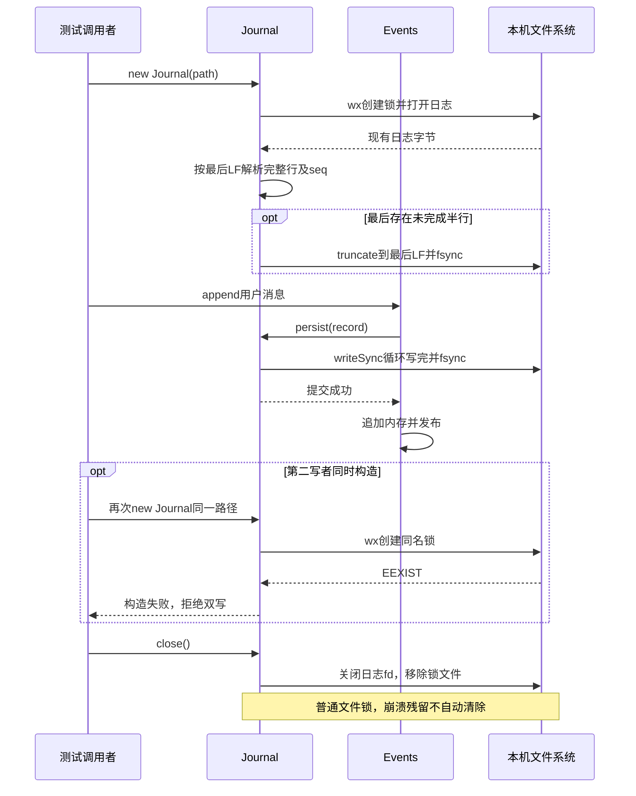

# 006 · 真正落盘、重启与损坏恢复

阶段：R02。唯一前置：完成第 005 步，继续同一个工程。

<!-- harness-own-links:start -->
## 当前练习工程文件

以下链接指向 `harness-own` 的当前累计版本；本课下方的完整代码仍保留当步版本，二者可能不同。

[打开练习工程说明](../../../harness-own/README.md)

| 本课文件 | 当前练习工程文件 |
| --- | --- |
| `.vscode/launch.json` | 使用本页下方的本节专用配置，不复制累计版本 |
| `src/journal.mjs` | [`harness-own/src/journal.mjs`](../../../harness-own/src/journal.mjs) |
| `tests/006-journal.test.mjs` | [`harness-own/tests/006-journal.test.mjs`](../../../harness-own/tests/006-journal.test.mjs) |

<!-- harness-own-links:end -->

## 什么时候会用到这一页

Harness写了一条用户消息后退出；下次启动要读回已提交行。若磁盘尾部只有半条JSON，应丢掉未完成尾行；若中间有完整换行却不是JSON，要拒绝恢复，不能跳过后继续伪装历史完整。

### 这次数据怎么走

```text
new Journal(path)独占创建.lock → 打开日志 → 定位最后LF → 解析完整行并校验seq/format → 截去尾半行 → Events.persist调用Journal.append → writeSync循环写完并fsync → close释放fd与锁文件。
```

### 对应时序图

从上往下读；实线箭头表示调用或发送，虚线箭头表示返回或事件通知。`opt`表示可选操作，`alt`表示不同结果，`loop`表示重复，`par`及其`and`分支表示并行；“未接入”及fixture说明按图中标注理解。



**当前接线位置：**本章单测把Events.persist接到Journal.append；005原demo仍用自己的同步写入器。041的Host.create/open路径才真正装配本章Journal并恢复会话记录，后续Web/ACP共享Host。

## 这一步具体做什么

按本章创建journal.mjs及测试，运行 bun test ./tests/006-journal.test.mjs。测试自己创建临时目录：正常写一条中文换行消息、拒绝第二写者、追加半行后恢复、追加broken完整行后拒绝。先读测试的四段操作，再运行，不需要手动破坏自己的会话文件。

需要本章新文件的操作，先按下面代码创建文件，再执行；不要在上一步尚不存在的接口上试错。

## 代码为什么放在这一层

Journal是磁盘存储执行器，Events仍是事实接口。只有完整换行才视为提交记录；锁文件阻止第二个写者。两者组合需要把恢复出的records重新放入会话，本章不是仅new一个Journal就自动恢复Agent。

## 本节调试：选什么、为什么、怎么启动

**建议先选：006：本节测试。** 每节的测试入口都固定到本节文件，不依赖编辑器当前打开的 `${file}`。

| 配置名称 | 什么时候选 | 实际入口或目标 | 能观察什么 |
| --- | --- | --- | --- |
| 006：本节测试 | 本节验收 | tests/006-journal.test.mjs | 本节 Bun 测试进程；入口固定，不依赖当前编辑器文件。 |

**为什么这样启动：**本节测试直接调用被测模块，选择这一项即可沿测试进入实现；前序 CLI 或其他语言入口不参与这次调试。

使用下方的[本节专用调试配置](#lesson-debug-config)。它只列本节可用目标；要保留个人配置，请先备份并按名称合并。页面上 `harness-own` 的累计文件链接供看当前工程，不是本节调试配置的答案。

1. VS Code 打开自己的 PROJECT；按本节创建源码与配置，断点设在 PROJECT 文件中。
2. 先用终端运行 `bun test ./tests/006-journal.test.mjs` 确认普通验收，再选表中的配置按 F5。
3. 在下方具体观察点停住；F10 跨过当前语句，F11 只进入当前调试目标。异步等待涉及另一进程时，切换调试会话并继续对端。
4. 变量要在所属调用帧查看；看测试局部变量时选测试帧，看 this 和参数时选实现方法帧。

**本节具体断点和预期：**在VS Code打开练习工程并选中tests/006-journal.test.mjs，选择“006：本节测试”按F5启动。在src/journal.mjs的openSync(this.lock,"wx")、const committed、ftruncateSync和fsyncSync打断点。F11进入new Journal，监视last、buffer.length、records；尾半行场景应last+1小于长度，F10后文件截到最后LF。第二次构造应在独占建锁处失败。

暂停断点会影响应用自身的 RPC、取消、进程和网络计时。Bun 测试超时放宽不等于这些计时也被关闭；按本节说明分别设置，普通验收恢复原有时限。

观察完成后退出本节启动的调试会话和进程，再运行 `bun test ./tests/006-journal.test.mjs`。测试通过只证明本节断言，不代表所有 GUI、外部服务或发布过程均已验证。

## 在哪里写、写什么

操作地点：终端中的 `$PROJECT`，编辑器打开同一个目录。只创建或替换下列文件，其他文件保留上一步版本。文件目录不存在先创建。

```sh
mkdir -p .vscode
```

<a id="lesson-debug-config"></a>

下面是本节专用调试配置，只包含本节入口。program 已固定到本节文件；不是 harness-own 的累计配置。

### 替换 `.vscode/launch.json`

````json
{
  "version": "0.2.0",
  "configurations": [
    {
      "name": "006：本节测试",
      "type": "bun",
      "request": "launch",
      "program": "${workspaceFolder}/tests/006-journal.test.mjs",
      "cwd": "${workspaceFolder}",
      "runtime": "bun",
      "runtimeArgs": [
        "test",
        "--preload",
        "${workspaceFolder}/scripts/vscode-debug.mjs",
        "--timeout",
        "3600000"
      ],
      "stopOnEntry": false
    }
  ]
}
````

```sh
mkdir -p src
```

### 创建 [`src/journal.mjs`](../../../harness-own/src/journal.mjs)

````javascript
import { openSync, writeSync, fsyncSync, closeSync, readFileSync, ftruncateSync, unlinkSync, mkdirSync } from 'node:fs'
import { dirname } from 'node:path'
import { randomUUID } from 'node:crypto'

/** 这是本工程的格式 v1；不能把它谎称为原版 Session V4。 */
export class Journal {
  closed = false
  /** 用独占锁阻止双写，崩溃锁需要明确核验 owner 后处理。 */
  constructor(path) {
    mkdirSync(dirname(path), { recursive: true })
    this.path = path
    this.lock = path + '.lock'
    const lock = openSync(this.lock, 'wx')
    try { writeSync(lock, JSON.stringify({ pid: process.pid, nonce: randomUUID() })); fsyncSync(lock) }
    finally { closeSync(lock) }
    try {
      this.fd = openSync(path, 'a+')
      const buffer = readFileSync(path), last = buffer.lastIndexOf(10)
      // 只有未完成的最后一行可以修复，中间坏行必须报错。
      const committed = buffer.subarray(0, last + 1).toString('utf8')
      this.records = committed.split('\n').filter(Boolean).map(line => JSON.parse(line))
      this.records.forEach((record, index) => {
        if (record.seq !== index || record.format !== 1) throw Error('日志序号或格式不合法')
      })
      if (last + 1 < buffer.length) { ftruncateSync(this.fd, last + 1); fsyncSync(this.fd) }
    } catch (error) { if (this.fd !== undefined) closeSync(this.fd); unlinkSync(this.lock); throw error }
  }
  /** 同步追加边界让后续副作用知道持久化是否成功。 */
  append(record) {
    if (this.closed) throw Error('日志已关闭')
    if (record.seq !== this.records.length) throw Error('日志序号冲突')
    const bytes = Buffer.from(JSON.stringify(record) + '\n')
    let offset = 0
    while (offset < bytes.length) offset += writeSync(this.fd, bytes, offset)
    fsyncSync(this.fd)
    this.records.push(structuredClone(record))
  }
  /** 正常退出释放文件与独占锁。 */
  close() { if (this.closed) return; this.closed = true; closeSync(this.fd); unlinkSync(this.lock) }
}
````

```sh
mkdir -p tests
```

### 创建 [`tests/006-journal.test.mjs`](../../../harness-own/tests/006-journal.test.mjs)

````javascript
import { test } from 'bun:test'
import assert from 'node:assert/strict'
import { mkdtempSync, appendFileSync, rmSync } from 'node:fs'
import { tmpdir } from 'node:os'
import { join } from 'node:path'
import { Journal } from '../src/journal.mjs'
import { Events } from '../src/events.mjs'

test('重启恢复、双写拒绝、尾半行修复、中间损坏拒绝', () => {
  const root = mkdtempSync(join(tmpdir(), 'own-log-')), path = join(root, 'events.jsonl')
  try {
    const log = new Journal(path), session = new Events('s', event => log.append(event))
    session.append('user', { text: '中文\n换行' })
    assert.throws(() => new Journal(path), /EEXIST/)
    log.close()
    appendFileSync(path, '{"seq":')
    const restored = new Journal(path)
    assert.equal(restored.records[0].data.text, '中文\n换行')
    restored.close()
    appendFileSync(path, 'broken\n')
    assert.throws(() => new Journal(path), SyntaxError)
  } finally { rmSync(root, { recursive: true, force: true }) }
})
````

## 运行命令与通过标准

```sh
cd "$PROJECT"
bun test ./tests/006-journal.test.mjs
bun test
```

本工程format:1日志能恢复，尾半行修剪，中间坏行拒绝，活着的第二写者失败。未验证进程掉电、磁盘写到一半或遗留.lock自动识别；不能宣称等同原版内核锁。

**本步证据的范围：**tests/006-journal.test.mjs有1项临时磁盘测试，覆盖恢复、第二写者、尾部修复和中间坏JSON。无真实杀进程、掉电或跨平台原版格式兼容验收。

## 不看答案，确认自己能解释

闭卷写出“无换行尾巴”和“broken
完整行”的不同处理，再说明append失败为什么不能先把record放进records。

完成后在 LEARNING.md 写一句实际结果和一个卡点。明天只重做这个卡点；第 3 天、第 7 天再做一次，能独立完成就继续下一页，不另开学习路线。

**再改一个条件验证：**在测试副本追加一个带正确format但跳号seq的完整JSON行，断言构造拒绝；这是需新增代码的练习。不要手动删除真实活跃进程的锁文件。

## 与当前原版还差哪些

对照本仓库固定原版 `687f282e8625c6b8d11ff58211a90524be2e4317`；这里的“当前”指该本地基线，不是未经检查的上游最新版。

**这一页已经实现：**

- 独占文件锁、完整行恢复、序号和format检查、尾半行修剪。
- 同步完整写入循环、fsync提交和正常退出释放。

**原版仍有、或本步尚未对齐的部分：**

- 原版JSONL后端默认带校验和Zstandard帧，使用句柄、revision、惰性实体化与历史格式catalog；本章只有全量读入的未压缩JSONL。
- 原版POSIX flock／Windows内核信号量随进程退出释放；本章.lock是独占创建的普通文件，崩溃残留需人工核验，不能自动删除后声称安全。

**原版对照位置：**

- [packages/session/session-persistence-jsonl/src/storage.ts](../../../deepseek-harness/packages/session/session-persistence-jsonl/src/storage.ts)
- [packages/session/session-persistence-jsonl/src/lease.ts](../../../deepseek-harness/packages/session/session-persistence-jsonl/src/lease.ts)
- [packages/session/session-persistence-jsonl/src/zstd.ts](../../../deepseek-harness/packages/session/session-persistence-jsonl/src/zstd.ts)
- [packages/session/session-persistence-jsonl/README.zh.md](../../../deepseek-harness/packages/session/session-persistence-jsonl/README.zh.md)

本步测试通过只证明上面的具体行为；完整差距仍看 [COVERAGE.md](../COVERAGE.md)，不以文件数量、同名类或后面出现另一个模块代替接线证据。

下一步：[第 007 步](007.md)
