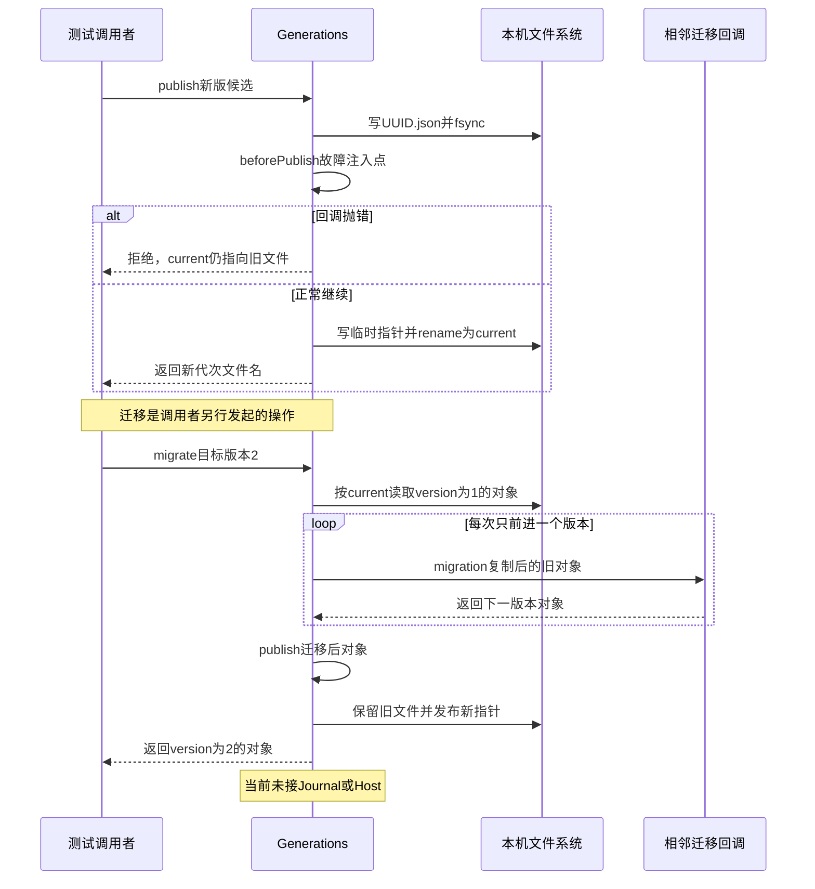

# 007 · 升级数据格式时，先写新文件，再切换读取入口

阶段：R02。唯一前置：完成第 006 步，继续同一个工程。

<!-- harness-own-links:start -->
## 当前练习工程文件

以下链接指向 `harness-own` 的当前累计版本；本课下方的完整代码仍保留当步版本，二者可能不同。

[打开练习工程说明](../../../harness-own/README.md)

| 本课文件 | 当前练习工程文件 |
| --- | --- |
| `src/generation.mjs` | [`harness-own/src/generation.mjs`](../../../harness-own/src/generation.mjs) |
| `tests/007-generation.test.mjs` | [`harness-own/tests/007-generation.test.mjs`](../../../harness-own/tests/007-generation.test.mjs) |

<!-- harness-own-links:end -->

## 什么时候会用到这一页

旧设置记录是{version:1,name:"a"}，新版需要title。先写一个新JSON文件，把name复制为title并version改为2，成功后切current指针；如果切换前出错，读者仍读到旧version:1，旧文件不重写。

### 这次数据怎么走

```text
Generations.publish写UUID.json并fsync → beforePublish故障点 → 写临时current指针 → rename为current → read按指针取JSON；migrate从version1依次执行1→2转换 → publish新文件。
```

### 对应时序图

从上往下读；实线箭头表示调用或发送，虚线箭头表示返回或事件通知。`opt`表示可选操作，`alt`表示不同结果，`loop`表示重复，`par`及其`and`分支表示并行；“未接入”及fixture说明按图中标注理解。



**当前接线位置：**Generations目前仅在007测试直接调用，未接006 Journal、041 Host或后续会话升级。因此后续功能不会自动获得本章新代次迁移保证。

## 这一步具体做什么

写完generation.mjs与测试后运行 bun test ./tests/007-generation.test.mjs。先在测试中找old文件名，再对照故障注入前后store.read().version与旧文件内容；当前值最后应有title:"a"，old文件仍version:1。测试会清理临时目录，不需要迁移真实会话。

需要本章新文件的操作，先按下面代码创建文件，再执行；不要在上一步尚不存在的接口上试错。

## 代码为什么放在这一层

“新代次”就是保留旧文件、另外生成完整新文件；“发布”就是切换读入口current。迁移函数只转换一份副本，指针未切换时，孤立新文件不会被当作当前数据。

## 先看一个具体问题：旧会话怎么升级数据格式

假设旧版保存的数据是：

```json
{"version":1,"name":"a"}
```

新版需要增加`title`字段，把它转换成：

```json
{"version":2,"name":"a","title":"a"}
```

**这里的“迁移”，就是把第一个对象转换成第二个对象。**但转换到一半报错怎么办？本步采用的办法是：旧文件留着，转换结果另存一个文件；新文件写好后，再让程序改读它。

### 磁盘上到底发生了什么

下面用A、B代指两个JSON文件；实际代码使用UUID作为文件名。

```text
① 升级前
   文件A：{"version":1,"name":"a"}
   current文件的内容：A的文件名
   read() → 读current → 得到A的文件名 → 打开A → 返回版本1

② 新数据另存好了，还没切换
   文件A：保留原内容
   文件B：{"version":2,"name":"a","title":"a"}
   current文件的内容：仍是A的文件名
   read() → 仍然打开A → 返回版本1

③ 切换成功
   文件A：仍保留原内容
   文件B：保留新内容
   current文件的内容：换成B的文件名
   read() → 打开B → 返回版本2
```

`current`是一个普通文本文件，里面只有当前选中的JSON文件名。它不是软链接，也不存会话正文。代码先把B的文件名写进临时文件，再用`renameSync`替换`current`；这一步就是“切换读取入口”。

如果第②步之后、切换之前抛错，B虽然留在目录里，程序仍按`current`读取A。它不会扫描目录、猜哪份最新。本步尚未实现这些未被选中的文件的清理，也没有提供手动回退接口。

### 代码里的三个方法分别干什么

| 方法 | 具体动作 |
| --- | --- |
| `read()` | 先读`current`里的文件名，再打开对应JSON文件。 |
| `publish(value)` | 把传入对象另存为一个新JSON文件，再把`current`切到它；它本身不转换字段。 |
| `migrate(2, migrations)` | 读取旧对象，调用你提供的1→2转换函数，再调用`publish`保存并切换。 |

所以原来的“通过新代次发布迁移结果”，拆开就是：**转换旧数据 → 另存新文件 → 让后续读取选中新文件。**“代次”指另存的一份，“发布”指最后那个切换动作。

先用上面的图预测失败时读哪份，再按下文创建文件、用VS Code断点核对预测，最后合上材料自己讲一遍。这一步要学会的是这套失败处理办法。

## 在哪里写、写什么

操作地点：终端中的 `$PROJECT`，编辑器打开同一个目录。只创建或替换下列文件，其他文件保留上一步版本。文件目录不存在先创建。

```sh
mkdir -p src
```

### 创建 [`src/generation.mjs`](../../../harness-own/src/generation.mjs)

````javascript
import { mkdirSync, writeFileSync, readFileSync, renameSync, existsSync, openSync, closeSync, fsyncSync } from 'node:fs'
import { join } from 'node:path'
import { randomUUID } from 'node:crypto'

/** 通过不可变代次和原子指针发布迁移/快照；旧文件不原地重写。 */
export class Generations {
  constructor(root) { this.root = root; mkdirSync(root, { recursive: true }) }
  /** 先完整落盘代次，再发布指针；故障注入位于两者之间。 */
  publish(value, beforePublish = () => {}) {
    const name = randomUUID() + '.json', target = join(this.root, name)
    writeFileSync(target, JSON.stringify(value))
    const file = openSync(target, 'r'); try { fsyncSync(file) } finally { closeSync(file) }
    beforePublish()
    const temporary = join(this.root, 'current.' + randomUUID())
    writeFileSync(temporary, name)
    renameSync(temporary, join(this.root, 'current'))
    // POSIX 目录 fsync；不在 Windows 冒充同样的耐久保证。
    if (process.platform !== 'win32') { const directory = openSync(this.root, 'r'); try { fsyncSync(directory) } finally { closeSync(directory) } }
    return name
  }
  /** 没有指针就没有已发布代次；孤立文件不自行成为当前状态。 */
  read() {
    const pointer = join(this.root, 'current')
    if (!existsSync(pointer)) return undefined
    const name = readFileSync(pointer, 'utf8')
    if (!/^[a-f0-9-]+\.json$/.test(name)) throw Error('代次指针不合法')
    return JSON.parse(readFileSync(join(this.root, name), 'utf8'))
  }
  /** 相邻迁移逐次执行，拒绝缺链与未知未来格式。 */
  migrate(target, migrations) {
    let value = this.read()
    if (!value || value.version > target) throw Error('不支持的格式')
    while (value.version < target) {
      const from = value.version, migration = migrations[from]
      if (!migration) throw Error('缺迁移：' + from)
      value = migration(structuredClone(value))
      if (value.version !== from + 1) throw Error('迁移必须相邻')
    }
    this.publish(value)
    return value
  }
}
````

```sh
mkdir -p tests
```

### 创建 [`tests/007-generation.test.mjs`](../../../harness-own/tests/007-generation.test.mjs)

````javascript
import { test } from 'bun:test'
import assert from 'node:assert/strict'
import { mkdtempSync, rmSync, readFileSync } from 'node:fs'
import { tmpdir } from 'node:os'
import { join } from 'node:path'
import { Generations } from '../src/generation.mjs'

test('发布前崩溃保留旧代次，迁移不改旧文件', () => {
  const root = mkdtempSync(join(tmpdir(), 'own-generation-'))
  try {
    const store = new Generations(root), old = store.publish({ version: 1, name: 'a' })
    assert.throws(() => store.publish({ version: 2 }, () => { throw Error('crash') }))
    assert.equal(store.read().version, 1)
    store.migrate(2, { 1: value => ({ ...value, version: 2, title: value.name }) })
    assert.equal(JSON.parse(readFileSync(join(root, old))).version, 1)
    assert.equal(store.read().title, 'a')
  } finally { rmSync(root, { recursive: true, force: true }) }
})
````

## 运行命令与通过标准

```sh
cd "$PROJECT"
bun test ./tests/007-generation.test.mjs
bun test
```

切指针前注入异常保留旧入口，相邻迁移后不改旧文件。测试的crash是函数抛错，不是真实掉电；单个普通JSON对象也不是原版会话事件、引用和子Session的迁移。

**本步证据的范围：**tests/007-generation.test.mjs有1项测试：发布前抛错、保留旧文件、1→2字段转换。没有真实进程崩溃、并发发布和原版迁移样本验收。

## VS Code：断在哪里、看什么

在VS Code打开练习工程并选中tests/007-generation.test.mjs，选择“Bun：当前测试”按F5启动。在src/generation.mjs的beforePublish()、renameSync与migration(structuredClone(value))打断点。F10到故障点后切换到测试调用者帧，用readFileSync(join(root,"current"),"utf8")观察指针仍是old；F11进入迁移回调看name到title，回到publish监视name/target；只在rename后read才看到新version。

操作位置：VS Code 打开的是自己的 `$PROJECT`，断点也设在这里的源码，不在教材的 `steps` 目录。

上面的说明若指定CLI、子进程、页面或Electron附加调试，就先按该流程操作；下面这组步骤只用于本章测试入口。“当前测试”不会自动附加子进程，也不会命中浏览器或Electron中的断点。

变量只在所属作用域可见：停在方法内部时看this和参数；要看测试里的局部变量，先在“调用堆栈”选择对应测试帧。正在等待的异步调用者不一定保留可求值的帧，此时在测试调用前后加断点再看，不把未定义误判成业务状态丢失。

沿用第 000 步安装的 Bun 扩展与 `.vscode/launch.json`；本章列出替换配置时，使用本章完整版本。

1. 打开本步测试文件 `tests/007-generation.test.mjs`，保持它为当前编辑器文件。
2. 在上面指定的函数内单击行号左侧设置断点。
3. “运行和调试”选择 **Bun：当前测试**，按 F5；它执行当前测试，工作目录固定为 PROJECT。
4. 在“变量 / 监视 / 调用堆栈 / 调试控制台”检查状态；F10 逐行执行，F11 进入函数，Shift+F11 返回，F5 继续，Shift+F5 停止。

验收：断点实际命中，能说出当前输入、状态和下一步；只看到进程启动不算完成。长时间暂停会影响真实取消、审批和网络超时，先检查时序，不删超时断言。修正后在集成终端运行 `bun test ./tests/007-generation.test.mjs`，再运行 `bun test`，保留全部断言。

## 不看答案，确认自己能解释

合上资料用三个文件名画出“旧文件、新文件、current”，标记故障发生在指针切换前时下一次read会选择哪个。

完成后在 LEARNING.md 写一句实际结果和一个卡点。明天只重做这个卡点；第 3 天、第 7 天再做一次，能独立完成就继续下一页，不另开学习路线。

**再改一个条件验证：**在测试副本增加2→3迁移，把title改成displayName；先故意不提供2的回调确认“缺迁移”，再补齐后验收。此变体需要自己写迁移函数，不是原版V3→V4实现。

## 与当前原版还差哪些

对照本仓库固定原版 `687f282e8625c6b8d11ff58211a90524be2e4317`；这里的“当前”指该本地基线，不是未经检查的上游最新版。

**这一页已经实现：**

- 不可变JSON代次、current指针切换、发布前故障注入。
- 逐相邻整数版本迁移、缺链拒绝、旧文件保留。

**原版仍有、或本步尚未对齐的部分：**

- 原版选择版本命名的最高规范generation，不是本章UUID加current指针；原版写open包含源revision复查、无覆盖后继发布及Worker校验。
- 原版format catalog按事件流组合真实历史codec与相邻迁移，包括序号/引用及子会话目录转换；本章只遍历普通对象version，不兼容原版存量数据。

**原版对照位置：**

- [packages/session/session-format/src/chain.ts](../../../deepseek-harness/packages/session/session-format/src/chain.ts)
- [packages/session/session-format/src/catalog.ts](../../../deepseek-harness/packages/session/session-format/src/catalog.ts)
- [packages/session/session-persistence-jsonl/src/generation.ts](../../../deepseek-harness/packages/session/session-persistence-jsonl/src/generation.ts)
- [packages/session/session-persistence-jsonl/src/migration-verifier.ts](../../../deepseek-harness/packages/session/session-persistence-jsonl/src/migration-verifier.ts)

本步测试通过只证明上面的具体行为；完整差距仍看 [COVERAGE.md](../COVERAGE.md)，不以文件数量、同名类或后面出现另一个模块代替接线证据。

下一步：[第 008 步](008.md)
