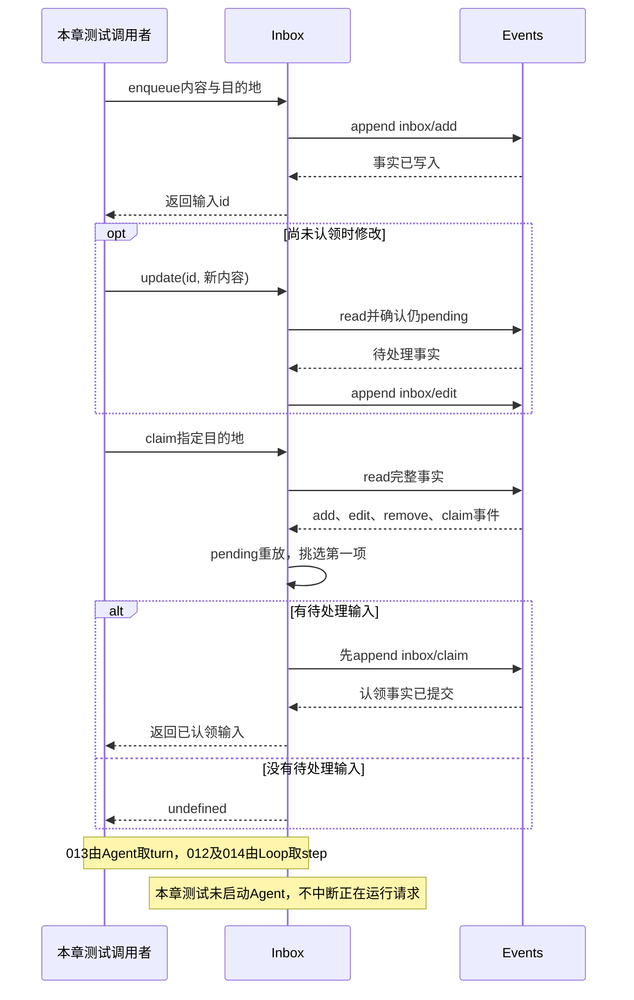

# 009 · 忙时先排队，不把第二条任务丢掉

阶段：R02。唯一前置：完成第 008 步，继续同一个工程。

<!-- harness-own-links:start -->
## 当前练习工程文件

以下链接指向 `harness-own` 的当前累计版本；本课下方的完整代码仍保留当步版本，二者可能不同。

[打开练习工程说明](../../../harness-own/README.md)

| 本课文件 | 当前练习工程文件 |
| --- | --- |
| `src/inbox.mjs` | [`harness-own/src/inbox.mjs`](../../../harness-own/src/inbox.mjs) |
| `tests/009-inbox.test.mjs` | [`harness-own/tests/009-inbox.test.mjs`](../../../harness-own/tests/009-inbox.test.mjs) |

<!-- harness-own-links:end -->

## 什么时候会用到这一页

Agent正在计算时，用户补充“别改测试文件”。这条消息可指定step，在下次模型请求前注入；用户另发“完成后再生成说明”则指定turn排下一轮，不能改写已经发给模型的HTTP正文。

### 这次数据怎么走

```text
Inbox.enqueue写inbox/add → pending重放add/edit/remove/claim → claim(destination)先写inbox/claim再返回输入 → 013 Agent取turn → 012/014 Loop在每次模型step开始取step并追加message/user。
```

### 对应时序图

从上往下读；实线箭头表示调用或发送，虚线箭头表示返回或事件通知。`opt`表示可选操作，`alt`表示不同结果，`loop`表示重复，`par`及其`and`分支表示并行；“未接入”及fixture说明按图中标注理解。



**当前接线位置：**本章为独立队列单测；012 Loop接入step认领，013 Agent接入turn认领。与原版不同，本章新turn的claim本身不合并step队列，step是在runTurn内部再取。

## 这一步具体做什么

写完inbox.mjs及测试后运行 bun test ./tests/009-inbox.test.mjs。按测试查看turn输入从old改new、step输入steer先被claim、第二次claim同一目的地返回undefined。restored只是用同一Events新建Inbox，尚未从磁盘重启Agent。

需要本章新文件的操作，先按下面代码创建文件，再执行；不要在上一步尚不存在的接口上试错。

## 代码为什么放在这一层

Inbox把“接收输入”与“何时执行”分开。认领也是事实，所以重建队列时不会再次返回已认领项；同步claim避免同一进程连续取两次。step只是下一个模型边界，不会打断已运行工具或正在接收的模型流。

## 用户在任务执行中又发消息，什么时候让模型看到

先把两个词说清楚：**turn是一整轮任务；step是这一轮里的一次模型请求，以及它产生的工具调用处理。**一轮任务可能需要“请求模型 → 执行工具 → 再请求模型”，所以一个turn可以包含多个step。

两种目的地最终都可以追加为`user`消息。`destination`决定处理时机，和消息的`role`是两回事。

| 入队时的destination | 谁来取 | 什么时候处理 | 具体例子 |
| --- | --- | --- | --- |
| `turn`，默认值 | 第013步的`Agent.pump()` | Agent空闲时开启一轮；如果正在执行，就等当前turn结束后再开启下一轮 | “这个做完，再帮我检查测试。” |
| `step` | 第012步的`runTurn()` | 当前turn内，下一次请求模型之前取出，追加到历史 | “补充一下，只修改src目录。” |

### step的“扫描注入”具体发生在哪

```text
用户：修复这个问题                         → 开始一个turn
  step 1：请求模型
          模型要求读取文件
          工具正在读取文件
          用户：不要修改测试               → enqueue(..., 'step')，先排队
          工具读取完成，记录工具结果
  step 2：检查step队列                      → claim('step')
          把“不要修改测试”追加为user消息
          整理历史，再请求模型              → 模型这次才看到补充要求
          模型给出最终回答                   → 当前turn结束
```

这里的“扫描”是**执行循环走到请求模型之前，主动检查队列**。没有定时器，也不会修改已经发出去的模型请求；正在运行的工具也不会因为这条消息自动停止。补充要求要到后续模型请求才生效。

下面摘出第012步的关键顺序，帮助理解调用位置；第009步暂时不用创建`loop.mjs`：

```javascript
// 每次请求模型之前，取出等待加入本轮的补充消息。
let input
while ((input = inbox?.claim('step'))) {
  session.append('message/user', {
    role: 'user',
    content: input.content,
    source: 'steer'
  })
}
// 补充消息先进入会话历史，随后构造模型请求。
const history = messages(session.read())
```

这里会按顺序取完当时等待的step消息。`claim('step')`内部调用`pending()`：从会话记录重新算出还没取走的输入，再找第一条目的地为step的消息；它不是扫描工作区文件。取到后先记录`inbox/claim`，下一次就不会再取到同一条。

### 当前实现的一个边界：没有下一step怎么办

如果用户补充时，模型已经在生成最终回答，随后直接结束turn，执行循环就不会再走到下一次请求前的检查点。

**这份实现会把step消息留在队列里，不会自动把它变成下一轮任务，也不会为了它重新开启一轮。**如果之后又开始一个turn，它仍可能在那一轮的step检查点被取出，因为当前Inbox没有把step消息绑定到特定turnId。这是当前代码的行为，不要理解成“发了补充就一定会在当前轮生效”。

### 第009步做到哪里，后面怎么接上

- **第009步：**只实现入队、修改、删除、查询和认领。测试手动调用`claim`，没有启动Agent或模型；`new Inbox(session)`也只是基于同一个session重新计算队列，不证明进程重启恢复。
- **[第012步](012.md)：**在执行循环发起每次模型请求前取step消息，真正追加到模型历史。
- **[第013步](013.md)：**Agent收到输入后先入队，由`pump()`取turn消息开始任务；任务运行期间收到的step消息交给执行循环处理。

读完后合上材料，自己判断两种时机：“工具还在读取文件时收到补充”和“模型已经给出最终回答时收到补充”。再对照上面的顺序核对。学习本步时先用当前测试观察`claim`前后的队列；走到第012、013步再用断点观察真正的注入位置。

## 在哪里写、写什么

操作地点：终端中的 `$PROJECT`，编辑器打开同一个目录。只创建或替换下列文件，其他文件保留上一步版本。文件目录不存在先创建。

```sh
mkdir -p src
```

### 创建 [`src/inbox.mjs`](../../../harness-own/src/inbox.mjs)

````javascript
import { id } from './events.mjs'

/** Inbox 的事实也入 Session；恢复时重新投影，而不是读取遗留内存队列。 */
export class Inbox {
  constructor(session) { this.session = session }
  /** 明确下一 turn 与下一 step 两个目的地。 */
  enqueue(content, destination = 'turn') {
    if (!['turn', 'step'].includes(destination)) throw Error('目的地不合法')
    const messageId = id('input')
    this.session.append('inbox/add', { id: messageId, content, destination })
    return messageId
  }
  /** 未认领前才能编辑或移除；认领后不再改变正在处理的输入。 */
  update(messageId, content) {
    if (!this.pending().some(row => row.id === messageId)) throw Error('输入已认领或不存在')
    this.session.append('inbox/edit', { id: messageId, content })
  }
  remove(messageId) {
    if (!this.pending().some(row => row.id === messageId)) throw Error('输入已认领或不存在')
    this.session.append('inbox/remove', { id: messageId })
  }
  /** 按事实顺序折叠队列，认领和删除都不可二次消费。 */
  pending() {
    const rows = new Map()
    for (const { type, data } of this.session.read()) {
      if (type === 'inbox/add') rows.set(data.id, { ...data })
      if (type === 'inbox/edit' && rows.has(data.id)) rows.get(data.id).content = data.content
      if (type === 'inbox/remove' || type === 'inbox/claim') rows.delete(data.id)
    }
    return [...rows.values()]
  }
  /** 同步持久化认领后才返回输入，避免同进程重复消费。 */
  claim(destination) {
    const row = this.pending().find(row => row.destination === destination)
    if (!row) return undefined
    this.session.append('inbox/claim', { id: row.id })
    return row
  }
}
````

```sh
mkdir -p tests
```

### 创建 [`tests/009-inbox.test.mjs`](../../../harness-own/tests/009-inbox.test.mjs)

````javascript
import { test } from 'bun:test'
import assert from 'node:assert/strict'
import { Events } from '../src/events.mjs'
import { Inbox } from '../src/inbox.mjs'

test('恢复队列、修改/删除、双目的地与单次认领', () => {
  const session = new Events('s'), first = new Inbox(session)
  const turn = first.enqueue('old'), step = first.enqueue('steer', 'step')
  first.update(turn, 'new')
  const restored = new Inbox(session)
  assert.equal(restored.claim('step').id, step)
  assert.equal(restored.claim('turn').content, 'new')
  assert.equal(restored.claim('turn'), undefined)
  assert.throws(() => restored.update(turn, 'late'), /已认领/)
})
````

## 运行命令与通过标准

```sh
cd "$PROJECT"
bun test ./tests/009-inbox.test.mjs
bun test
```

单测验证事件重放、编辑、两个目的地与单次认领；没有实际Agent在运行中接收step的集成测试。step没有下一模型步骤时会留在队列，不会自行启动新turn，也没有绑定特定turnId。

**本步证据的范围：**tests/009-inbox.test.mjs有1项内存测试，验证两Inbox实例共用同一Events的重放；标题提到删除，但当前测试并未实际调用remove，不能据此声称删除路径已验收。

## VS Code：断在哪里、看什么

在VS Code打开练习工程并选中tests/009-inbox.test.mjs，选择“Bun：当前测试”按F5启动。在src/inbox.mjs的rows.set、rows.delete与this.session.append("inbox/claim",...)打断点。F11进入pending，监视type、data.id、rows.size；F10经过claim后再次pending不应包含该id。继续到013时，在Agent.pump的claim("turn")和loop的claim("step")对照两种消费时机。

操作位置：VS Code 打开的是自己的 `$PROJECT`，断点也设在这里的源码，不在教材的 `steps` 目录。

上面的说明若指定CLI、子进程、页面或Electron附加调试，就先按该流程操作；下面这组步骤只用于本章测试入口。“当前测试”不会自动附加子进程，也不会命中浏览器或Electron中的断点。

变量只在所属作用域可见：停在方法内部时看this和参数；要看测试里的局部变量，先在“调用堆栈”选择对应测试帧。正在等待的异步调用者不一定保留可求值的帧，此时在测试调用前后加断点再看，不把未定义误判成业务状态丢失。

沿用第 000 步安装的 Bun 扩展与 `.vscode/launch.json`；本章列出替换配置时，使用本章完整版本。

1. 打开本步测试文件 `tests/009-inbox.test.mjs`，保持它为当前编辑器文件。
2. 在上面指定的函数内单击行号左侧设置断点。
3. “运行和调试”选择 **Bun：当前测试**，按 F5；它执行当前测试，工作目录固定为 PROJECT。
4. 在“变量 / 监视 / 调用堆栈 / 调试控制台”检查状态；F10 逐行执行，F11 进入函数，Shift+F11 返回，F5 继续，Shift+F5 停止。

验收：断点实际命中，能说出当前输入、状态和下一步；只看到进程启动不算完成。长时间暂停会影响真实取消、审批和网络超时，先检查时序，不删超时断言。修正后在集成终端运行 `bun test ./tests/009-inbox.test.mjs`，再运行 `bun test`，保留全部断言。

## 不看答案，确认自己能解释

合上教程，用“当前模型请求、下一个step、下一turn”三个框放置两条输入；解释认领后为什么不能update，以及step为何不等于立即中断。

完成后在 LEARNING.md 写一句实际结果和一个卡点。明天只重做这个卡点；第 3 天、第 7 天再做一次，能独立完成就继续下一页，不另开学习路线。

**再改一个条件验证：**在测试副本enqueue后调用remove，再新建Inbox断言不能claim该项；这需要补一段测试。要练真正运行中steer，需以后在Agent/Loop测试增加确定的请求边界，不能只改destination就声称已演示。

## 与当前原版还差哪些

对照本仓库固定原版 `687f282e8625c6b8d11ff58211a90524be2e4317`；这里的“当前”指该本地基线，不是未经检查的上游最新版。

**这一页已经实现：**

- 输入事件化、重放恢复、未认领编辑/删除和两个目的地。
- 先持久化认领再交付，防同进程重复消费。

**原版仍有、或本步尚未对齐的部分：**

- 原版agent-loop/inbox有经过schema验证的持久splice投影，提供批量认领、替换及插入/丢弃/认领通知；本章每次重新全扫日志，方法与事件格式都不同。
- 原版claim(next-turn,turn)会合并待处理next-step消息并绑定turn；本章step无turn归属、无恢复投影校验，也未覆盖取消后输入转交策略。

**原版对照位置：**

- [packages/core/agent-loop/src/inbox.ts](../../../deepseek-harness/packages/core/agent-loop/src/inbox.ts)
- [packages/core/agent-loop/src/agent.ts](../../../deepseek-harness/packages/core/agent-loop/src/agent.ts)
- [packages/core/agent/src/types.ts](../../../deepseek-harness/packages/core/agent/src/types.ts)

本步测试通过只证明上面的具体行为；完整差距仍看 [COVERAGE.md](../COVERAGE.md)，不以文件数量、同名类或后面出现另一个模块代替接线证据。

下一步：[第 010 步](010.md)
