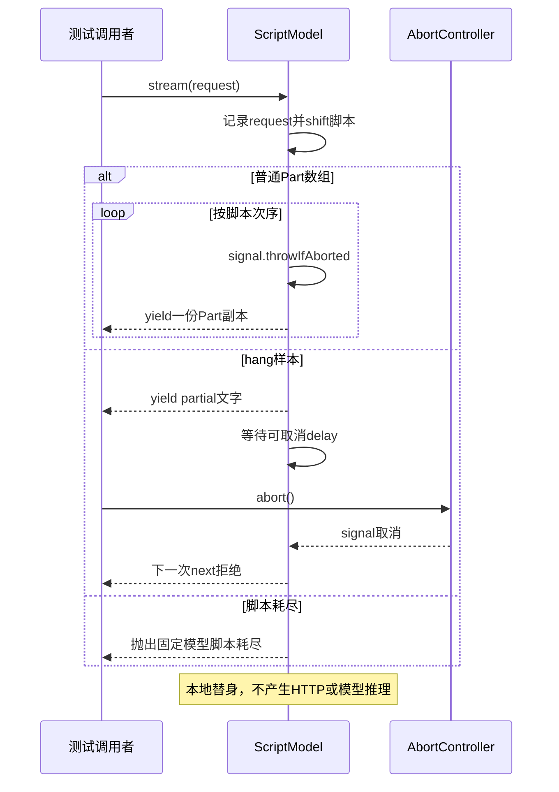

# 010 · 从固定模型开始观察流

阶段：R03。唯一前置：完成第 009 步，继续同一个工程。

<!-- harness-own-links:start -->
## 当前练习工程文件

以下链接指向 `harness-own` 的当前累计版本；本课下方的完整代码仍保留当步版本，二者可能不同。

[打开练习工程说明](../../../harness-own/README.md)

| 本课文件 | 当前练习工程文件 |
| --- | --- |
| `.vscode/launch.json` | 使用本页下方的本节专用配置，不复制累计版本 |
| `src/model.mjs` | [`harness-own/src/model.mjs`](../../../harness-own/src/model.mjs) |
| `tests/010-model.test.mjs` | [`harness-own/tests/010-model.test.mjs`](../../../harness-own/tests/010-model.test.mjs) |

<!-- harness-own-links:end -->

## 什么时候会用到这一页

先固定模型依次要求调用sum、再回答5，才能稳定调试工具循环；另一个样本先返回partial后等待，方便每次在同一点触发取消，而不依赖真实服务随机生成或网络快慢。

### 这次数据怎么走

```text
ScriptModel(script)保存响应队列 → stream(request)记请求并shift一个响应 → 按数组yield Part；hang样本先yield partial → 可取消delay → signal中止等待；answer/call构造stop或tools样本。
```

### 对应时序图

从上往下读；实线箭头表示调用或发送，虚线箭头表示返回或事件通知。`opt`表示可选操作，`alt`表示不同结果，`loop`表示重复，`par`及其`and`分支表示并行；“未接入”及fixture说明按图中标注理解。



**当前接线位置：** 012以此驱动模型→工具→模型，013 demo首次展示Agent。016的DeepSeekModel和020的PiModel也遵守stream接口，但它们才负责模型协议；固定脚本不会自动变成智能模型。

## 这一步具体做什么

完成model.mjs和测试后运行 bun test ./tests/010-model.test.mjs。第一段收集结果应为text、finish；第二段收到partial后abort，再stream.next应拒绝。不要等60秒，测试主动取消会结束等待。

需要本章新文件的操作，先按下面代码创建文件，再执行；不要在上一步尚不存在的接口上试错。

## 代码为什么放在这一层

ScriptModel是可控的模型替身，接口仍是async generator，后续Loop无需判断真假模型。Part表达正文、工具、结束等语义；它不是HTTP字节，也不是SSE帧，finish只结束一次模型请求。

## 本节调试：选什么、为什么、怎么启动

**建议先选：010：本节测试。** 每节的测试入口都固定到本节文件，不依赖编辑器当前打开的 `${file}`。

| 配置名称 | 什么时候选 | 实际入口或目标 | 能观察什么 |
| --- | --- | --- | --- |
| 010：本节测试 | 本节验收 | tests/010-model.test.mjs | 本节 Bun 测试进程；入口固定，不依赖当前编辑器文件。 |

**为什么这样启动：** 本节测试直接调用被测模块，选择这一项即可沿测试进入实现；前序 CLI 或其他语言入口不参与这次调试。

使用下方的[本节专用调试配置](#lesson-debug-config)。它只列本节可用目标；要保留个人配置，请先备份并按名称合并。页面上 `harness-own` 的累计文件链接供看当前工程，不是本节调试配置的答案。

1. VS Code 打开自己的 PROJECT；按本节创建源码与配置，断点设在 PROJECT 文件中。
2. 先用终端运行 `bun test ./tests/010-model.test.mjs` 确认普通验收，再选表中的配置按 F5。
3. 在下方具体观察点停住；F10 跨过当前语句，F11 只进入当前调试目标。异步等待涉及另一进程时，切换调试会话并继续对端。
4. 变量要在所属调用帧查看；看测试局部变量时选测试帧，看 this 和参数时选实现方法帧。

**本节具体断点和预期：** 在VS Code打开练习工程并选中tests/010-model.test.mjs，选择“010：本节测试”按F5启动。在src/model.mjs的this.requests.push(request)、this.script.shift()、yield和await delay打断点。F11进入stream，监视requests.length与response；F10返回partial后在测试controller.abort处继续，下一次next应走取消拒绝。

暂停断点会影响应用自身的 RPC、取消、进程和网络计时。Bun 测试超时放宽不等于这些计时也被关闭；按本节说明分别设置，普通验收恢复原有时限。

观察完成后退出本节启动的调试会话和进程，再运行 `bun test ./tests/010-model.test.mjs`。测试通过只证明本节断言，不代表所有 GUI、外部服务或发布过程均已验证。

## 在哪里写、写什么

操作地点：终端中的 `$PROJECT`，编辑器打开同一个目录。只创建或替换下列文件，其他文件保留上一步版本。文件目录不存在先创建。

```sh
mkdir -p .vscode
```

<a id="lesson-debug-config"></a>

下面是本节专用调试配置，只包含本节入口。program 已固定到本节文件；不是 harness-own 的累计配置。

### 替换 `.vscode/launch.json`

````json
{
  "version": "0.2.0",
  "configurations": [
    {
      "name": "010：本节测试",
      "type": "bun",
      "request": "launch",
      "program": "${workspaceFolder}/tests/010-model.test.mjs",
      "cwd": "${workspaceFolder}",
      "runtime": "bun",
      "runtimeArgs": [
        "test",
        "--preload",
        "${workspaceFolder}/scripts/vscode-debug.mjs",
        "--timeout",
        "3600000"
      ],
      "stopOnEntry": false
    }
  ]
}
````

```sh
mkdir -p src
```

### 创建 [`src/model.mjs`](../../../harness-own/src/model.mjs)

````javascript
import { setTimeout as delay } from 'node:timers/promises'

/** 固定外部模型响应；仍通过与真模型相同的异步事件接口。 */
export class ScriptModel {
  requests = []
  constructor(script) { this.script = [...script] }
  /** request 包含完整历史、工具、配置与 signal，输出是语义增量。 */
  async *stream(request) {
    this.requests.push(request)
    const response = this.script.shift()
    if (response === undefined) throw Error('固定模型脚本耗尽')
    if (response === 'hang') {
      yield { kind: 'text', text: 'partial' }
      await delay(60_000, undefined, { signal: request.signal })
      return
    }
    for (const part of response) { request.signal.throwIfAborted(); yield structuredClone(part) }
  }
}

/** 创建文字样本；finish 只结束一次模型请求，不是整轮任务。 */
export function answer(text) { return [{ kind: 'text', text }, { kind: 'finish', reason: 'stop' }] }

/** 工具样本保留完整调用身份，执行结果必须关联同一个 id。 */
export function call(name, args = {}, id = 'call-1') {
  return [{ kind: 'tool', id, name, arguments: args }, { kind: 'finish', reason: 'tools' }]
}
````

```sh
mkdir -p tests
```

### 创建 [`tests/010-model.test.mjs`](../../../harness-own/tests/010-model.test.mjs)

````javascript
import { test } from 'bun:test'
import assert from 'node:assert/strict'
import { ScriptModel, answer } from '../src/model.mjs'

test('模型按片输出，signal 能结束正在等待的外部流', async () => {
  const model = new ScriptModel([answer('你好'), 'hang']), controller = new AbortController()
  const chunks = []
  for await (const part of model.stream({ signal: controller.signal })) chunks.push(part)
  assert.deepEqual(chunks.map(part => part.kind), ['text', 'finish'])
  const stream = model.stream({ signal: controller.signal })
  assert.equal((await stream.next()).value.text, 'partial')
  controller.abort()
  await assert.rejects(stream.next(), /abort/i)
})
````

## 运行命令与通过标准

```sh
cd "$PROJECT"
bun test ./tests/010-model.test.mjs
bun test
```

证明异步事件接口和signal中止正在等待的流。测试请求只有signal，没有验收完整请求历史、工具schema或usage；更没有访问真实模型服务。

**本步证据的范围：** tests/010-model.test.mjs有1项测试：正常文字结束和partial后取消。所有事件是本地数组，不是模型推理。

## 不看答案，确认自己能解释

闭卷写一份answer("你好")的Part序列，再写call("sum",...)为什么以tools结束；解释“模型一次请求结束”和“整个任务结束”的区别。

完成后在 LEARNING.md 写一句实际结果和一个卡点。明天只重做这个卡点；第 3 天、第 7 天再做一次，能独立完成就继续下一页，不另开学习路线。

**再改一个条件验证：** 把answer文字改成中文多句，再在测试副本加第三次stream验证“脚本耗尽”报错；写完新增断言再运行，不填API Key。

## 与当前原版还差哪些

对照本仓库固定原版 `687f282e8625c6b8d11ff58211a90524be2e4317`；这里的“当前”指该本地基线，不是未经检查的上游最新版。

**这一页已经实现：**

- 固定Part脚本、请求记录、样本耗尽拒绝和可取消等待。
- answer和call快捷样本，保留工具调用id。

**原版仍有、或本步尚未对齐的部分：**

- 原版LlmRuntime有注册适配器、结构化GenerateOptions/StreamChunk、路由与冻结调用配置；本章只是一个脚本队列。
- 原版llm-replay从已记录会话恢复流，关联父子会话与本地压缩调用，并显式覆盖throw/hang；本章没有真实日志回放、录制协议或请求匹配。

**原版对照位置：**

- [packages/llm/llm/src/index.ts](../../../deepseek-harness/packages/llm/llm/src/index.ts)
- [packages/llm/llm/src/types.ts](../../../deepseek-harness/packages/llm/llm/src/types.ts)
- [packages/test-support/llm-replay/src/index.ts](../../../deepseek-harness/packages/test-support/llm-replay/src/index.ts)

本步测试通过只证明上面的具体行为；完整差距仍看 [COVERAGE.md](../COVERAGE.md)，不以文件数量、同名类或后面出现另一个模块代替接线证据。

下一步：[第 011 步](011.md)
