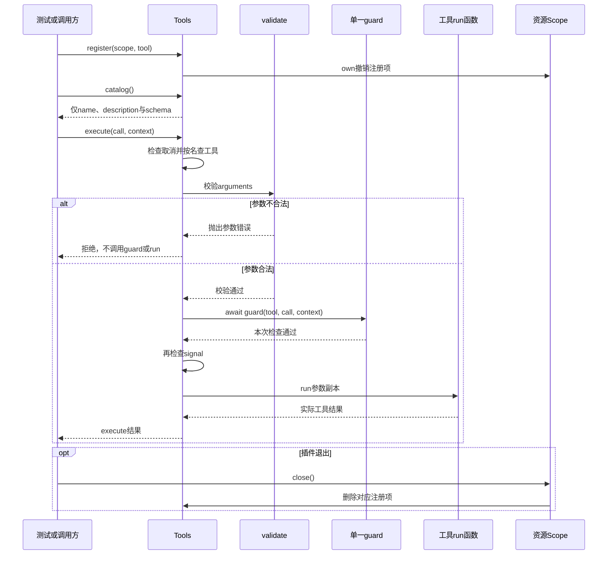

# 011 · 工具声明与执行入口

阶段：R03。唯一前置：完成第 010 步，继续同一个工程。

<!-- harness-own-links:start -->
## 当前练习工程文件

以下链接指向 `harness-own` 的当前累计版本；本课下方的完整代码仍保留当步版本，二者可能不同。

[打开练习工程说明](../../../harness-own/README.md)

| 本课文件 | 当前练习工程文件 |
| --- | --- |
| `.vscode/launch.json` | 使用本页下方的本节专用配置，不复制累计版本 |
| `src/tools.mjs` | [`harness-own/src/tools.mjs`](../../../harness-own/src/tools.mjs) |
| `tests/011-tools.test.mjs` | [`harness-own/tests/011-tools.test.mjs`](../../../harness-own/tests/011-tools.test.mjs) |

<!-- harness-own-links:end -->

## 什么时候会用到这一页

模型请求echo({text:3})时应在执行前被拒绝；echo({text:"ok"})才返回ok。插件卸载后模型即使还保存旧调用名字，也不能继续执行已撤销工具。

### 这次数据怎么走

```text
插件tools.register(scope,definition) → catalog仅导出name/description/schema → execute查名字 → validate参数 → await guard → 再检查取消 → run复制后的参数 → scope.close撤销注册。
```

### 对应时序图

从上往下读；实线箭头表示调用或发送，虚线箭头表示返回或事件通知。`opt`表示可选操作，`alt`表示不同结果，`loop`表示重复，`par`及其`and`分支表示并行；“未接入”及fixture说明按图中标注理解。



**当前接线位置：** 012的Loop实际通过Tools.execute执行sum，022的文件工具及033的MCP包装器复用同一入口。当前guard要由调用方赋值，024后才装粗粒度审批策略；并未获得原版多守卫。

## 这一步具体做什么

完成tools.mjs与测试后运行 bun test ./tests/011-tools.test.mjs。观察错误参数后runs仍0、正确调用后返回ok；关闭scope后再次execute应报未知工具。当前测试直接调用工具运行时，不需要模型发起请求。

需要本章新文件的操作，先按下面代码创建文件，再执行；不要在上一步尚不存在的接口上试错。

## 代码为什么放在这一层

Tools是统一工具注册和执行门。插件、文件工具和后来的MCP工具都可登记到同一张平面Map，来源不需要构成树；Scope只决定登记何时撤销，模型目录不包含run函数或秘密。

## 本节调试：选什么、为什么、怎么启动

**建议先选：011：本节测试。** 每节的测试入口都固定到本节文件，不依赖编辑器当前打开的 `${file}`。

| 配置名称 | 什么时候选 | 实际入口或目标 | 能观察什么 |
| --- | --- | --- | --- |
| 011：本节测试 | 本节验收 | tests/011-tools.test.mjs | 本节 Bun 测试进程；入口固定，不依赖当前编辑器文件。 |

**为什么这样启动：** 本节测试直接调用被测模块，选择这一项即可沿测试进入实现；前序 CLI 或其他语言入口不参与这次调试。

使用下方的[本节专用调试配置](#lesson-debug-config)。它只列本节可用目标；要保留个人配置，请先备份并按名称合并。页面上 `harness-own` 的累计文件链接供看当前工程，不是本节调试配置的答案。

1. VS Code 打开自己的 PROJECT；按本节创建源码与配置，断点设在 PROJECT 文件中。
2. 先用终端运行 `bun test ./tests/011-tools.test.mjs` 确认普通验收，再选表中的配置按 F5。
3. 在下方具体观察点停住；F10 跨过当前语句，F11 只进入当前调试目标。异步等待涉及另一进程时，切换调试会话并继续对端。
4. 变量要在所属调用帧查看；看测试局部变量时选测试帧，看 this 和参数时选实现方法帧。

<details class="debug-details">
<summary>展开本节具体断点和预期</summary>

1. 在VS Code打开练习工程并选中tests/011-tools.test.mjs，选择“011：本节测试”按F5启动。

2. 在src/tools.mjs的validate(tool.schema,call.arguments)、await this.guard和tool.run打断点。

3. F11进入validate。

4. 监视schema.type、value、path和runs。

5. 错误text=3不能到guard/run。

6. 正确调用F10到run后runs=1。

7. 关闭Scope后entries.size应为0。

</details>

暂停断点会影响应用自身的 RPC、取消、进程和网络计时。Bun 测试超时放宽不等于这些计时也被关闭；按本节说明分别设置，普通验收恢复原有时限。

观察完成后退出本节启动的调试会话和进程，再运行 `bun test ./tests/011-tools.test.mjs`。测试通过只证明本节断言，不代表所有 GUI、外部服务或发布过程均已验证。

## 在哪里写、写什么

操作地点：终端中的 `$PROJECT`，编辑器打开同一个目录。只创建或替换下列文件，其他文件保留上一步版本。文件目录不存在先创建。

```sh
mkdir -p .vscode
```

<a id="lesson-debug-config"></a>

下面是本节专用调试配置，只包含本节入口。program 已固定到本节文件；不是 harness-own 的累计配置。

### 替换 `.vscode/launch.json`

````json
{
  "version": "0.2.0",
  "configurations": [
    {
      "name": "011：本节测试",
      "type": "bun",
      "request": "launch",
      "program": "${workspaceFolder}/tests/011-tools.test.mjs",
      "cwd": "${workspaceFolder}",
      "runtime": "bun",
      "runtimeArgs": [
        "test",
        "--preload",
        "${workspaceFolder}/scripts/vscode-debug.mjs",
        "--timeout",
        "3600000"
      ],
      "stopOnEntry": false
    }
  ]
}
````

```sh
mkdir -p src
```

### 创建 [`src/tools.mjs`](../../../harness-own/src/tools.mjs)

````javascript
/** 对本教程公开的 JSON Schema 子集做执行前校验，不能只信模型声明。 */
export function validate(schema, value, path = '$') {
  if (schema.enum && !schema.enum.includes(value)) throw Error(path + ' 不在枚举中')
  if (schema.type === 'object') {
    if (!value || typeof value !== 'object' || Array.isArray(value)) throw Error(path + ' 应为对象')
    for (const key of schema.required ?? []) if (!(key in value)) throw Error(path + ' 缺少 ' + key)
    for (const [key, item] of Object.entries(value)) {
      if (schema.properties?.[key]) validate(schema.properties[key], item, path + '.' + key)
      else if (schema.additionalProperties === false) throw Error(path + ' 未知字段 ' + key)
    }
  } else if (schema.type === 'array') {
    if (!Array.isArray(value)) throw Error(path + ' 应为数组')
    value.forEach((item, index) => validate(schema.items ?? {}, item, path + '[' + index + ']'))
  } else if (schema.type && typeof value !== schema.type) throw Error(path + ' 类型错误')
}

/** 工具注册只描述能力；执行前统一走参数、守卫与取消入口。 */
export class Tools {
  entries = new Map()
  guard = async () => {}
  /** 返回准确撤销当前注册项的函数，插件卸载不会留下幽灵工具。 */
  register(scope, tool) {
    if (this.entries.has(tool.name)) throw Error('重复工具：' + tool.name)
    this.entries.set(tool.name, tool)
    return scope.own(() => { if (this.entries.get(tool.name) === tool) this.entries.delete(tool.name) })
  }
  /** 模型只得到 schema，看不到执行函数和秘密。 */
  catalog() { return [...this.entries.values()].map(({ name, description, schema }) => ({ name, description, schema: structuredClone(schema) })) }
  /** 所有消费者，包括嵌套代码执行，最终都必须进这个门。 */
  async execute(call, context) {
    context.signal.throwIfAborted()
    const tool = this.entries.get(call.name)
    if (!tool) throw Error('未知工具：' + call.name)
    validate(tool.schema, call.arguments)
    await this.guard(tool, call, context)
    context.signal.throwIfAborted()
    return await tool.run(structuredClone(call.arguments), context)
  }
}
````

```sh
mkdir -p tests
```

### 创建 [`tests/011-tools.test.mjs`](../../../harness-own/tests/011-tools.test.mjs)

````javascript
import { test } from 'bun:test'
import assert from 'node:assert/strict'
import { Scope } from '../src/scope.mjs'
import { Tools } from '../src/tools.mjs'

test('参数和未知工具在执行前拒绝，撤销后不能继续调用', async () => {
  const scope = new Scope(), tools = new Tools(), context = { signal: new AbortController().signal }
  let runs = 0
  tools.register(scope, { name: 'echo', description: '回声', schema: { type: 'object', required: ['text'], properties: { text: { type: 'string' } }, additionalProperties: false }, run: args => { runs++; return args.text } })
  await assert.rejects(tools.execute({ name: 'echo', arguments: { text: 3 } }, context), /类型/)
  assert.equal(runs, 0)
  assert.equal(await tools.execute({ name: 'echo', arguments: { text: 'ok' } }, context), 'ok')
  await scope.close()
  await assert.rejects(tools.execute({ name: 'echo', arguments: {} }, context), /未知/)
})
````

## 运行命令与通过标准

```sh
cd "$PROJECT"
bun test ./tests/011-tools.test.mjs
bun test
```

参数类型和撤销路径有效。validate只支持源码列出的Schema子集，不是完整JSON Schema；当前只有一个可覆盖guard属性，不包含多个guard、父子权限继承或restrict。

**本步证据的范围：** tests/011-tools.test.mjs有1项测试：错误类型不执行、正确echo和撤销后未知工具；没有真正模型、多个守卫或并发执行测试。

## 不看答案，确认自己能解释

合上资料写出从execute到run的执行顺序，再说明为什么catalog里不应该包含函数、API Key；说清工具注册平面表与资源Scope树的区别。

完成后在 LEARNING.md 写一句实际结果和一个卡点。明天只重做这个卡点；第 3 天、第 7 天再做一次，能独立完成就继续下一页，不另开学习路线。

**再改一个条件验证：** 在测试副本给echo参数加additionalProperties:false后传一个多余字段，确认run不执行；该字段规则已有实现。不要把补上Schema里未实现的minimum/integer后当成自动生效。

## 与当前原版还差哪些

对照本仓库固定原版 `687f282e8625c6b8d11ff58211a90524be2e4317`；这里的“当前”指该本地基线，不是未经检查的上游最新版。

**这一页已经实现：**

- 可撤销平面工具注册、可见Schema目录和Schema子集校验。
- 执行前后取消检查、单一guard入口和参数复制。

**原版仍有、或本步尚未对齐的部分：**

- 原版dsh-tools有作用域层、restrict交集、全局及作用域多个单调guard；本章只一张Map和一个可被覆盖的guard函数。
- 原版固定流水线含pre/execute/post/result、结构化错误、协作超时、渲染内容与规范结果分离，并支持PTC；本章只直接返回run值或抛错。

**原版对照位置：**

- [packages/core/tools/src/index.ts](../../../deepseek-harness/packages/core/tools/src/index.ts)
- [packages/core/tools/src/json-schema.ts](../../../deepseek-harness/packages/core/tools/src/json-schema.ts)
- [packages/core/tools/src/types.ts](../../../deepseek-harness/packages/core/tools/src/types.ts)
- [packages/core/tools/src/ptc.ts](../../../deepseek-harness/packages/core/tools/src/ptc.ts)

本步测试通过只证明上面的具体行为；完整差距仍看 [COVERAGE.md](../COVERAGE.md)，不以文件数量、同名类或后面出现另一个模块代替接线证据。

下一步：[第 012 步](012.md)
