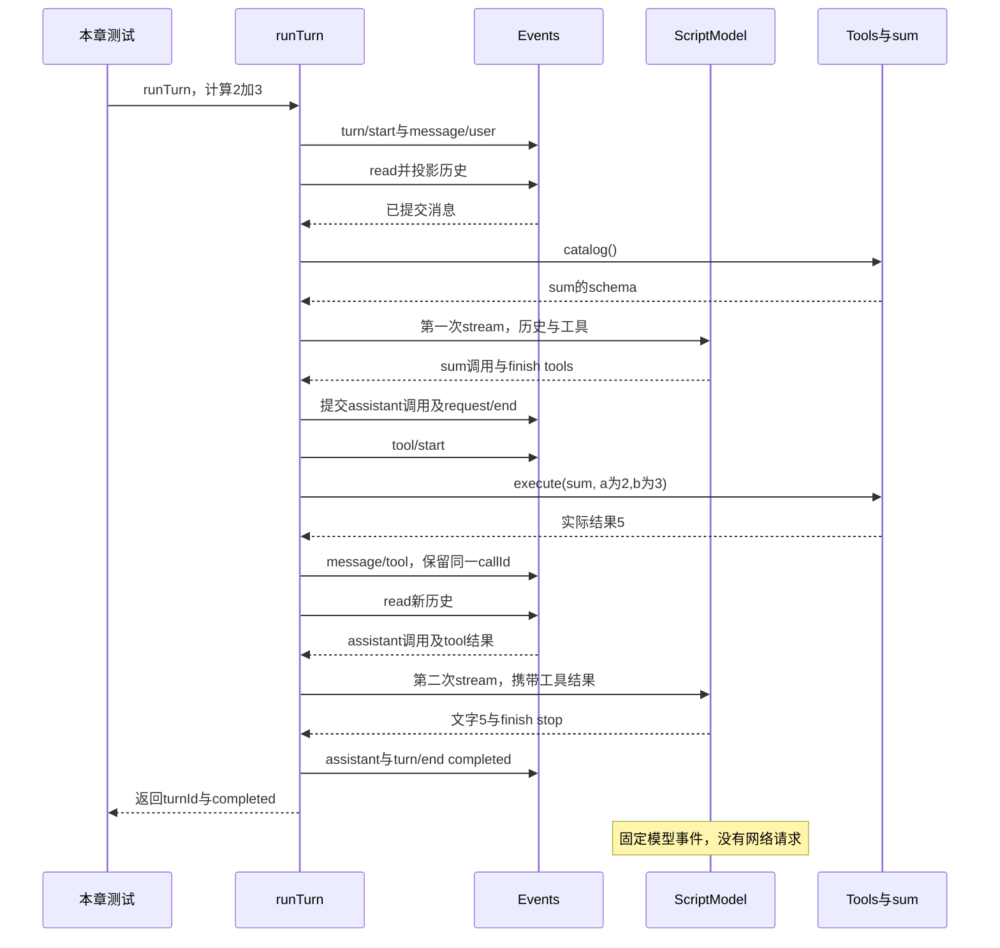

# 012 · 第一次模型—工具—模型循环

阶段：R03。唯一前置：完成第 011 步，继续同一个工程。

<!-- harness-own-links:start -->
## 当前练习工程文件

以下链接指向 `harness-own` 的当前累计版本；本课下方的完整代码仍保留当步版本，二者可能不同。

[打开练习工程说明](../../../harness-own/README.md)

| 本课文件 | 当前练习工程文件 |
| --- | --- |
| `.vscode/launch.json` | 使用本页下方的本节专用配置，不复制累计版本 |
| `src/loop.mjs` | [`harness-own/src/loop_012.mjs`](../../../harness-own/src/loop_012.mjs) |
| `tests/012-loop.test.mjs` | [`harness-own/tests/012-loop.test.mjs`](../../../harness-own/tests/012-loop.test.mjs) |

<!-- harness-own-links:end -->

## 什么时候会用到这一页

用户要算2+3：第一次模型请求输出sum调用，Harness真正执行加法，把结果5作为tool消息放回历史；第二次模型请求读取这个结果并结束。一次turn因此可以包含多个model step。

### 这次数据怎么走

```text
runTurn写turn/start与user消息 → 投影history并取工具catalog → model.stream → 收集assistant及calls → tools.execute(sum) → message/tool关联callId → 第二次stream携带工具结果 → turn/end(completed)。
```

### 对应时序图

从上往下读；实线箭头表示调用或发送，虚线箭头表示返回或事件通知。`opt`表示可选操作，`alt`表示不同结果，`loop`表示重复，`par`及其`and`分支表示并行；“未接入”及fixture说明按图中标注理解。



**当前接线位置：** 013的Agent.pump真实调用runTurn；014替换loop.mjs加入可选batch，016再保存provider replay。当前直接运行本章测试是最短实际调用链。

## 这一步具体做什么

写完loop.mjs及测试后运行 bun test ./tests/012-loop.test.mjs。检查model.requests.length=2、第二次请求最后一条工具结果{ok:true,value:5}、callId=call-1，且turn/end恰好一条。本步无CLI演示入口，013才补可运行demo。

需要本章新文件的操作，先按下面代码创建文件，再执行；不要在上一步尚不存在的接口上试错。

## 代码为什么放在这一层

Loop决定“回答结束还是执行工具后继续”，模型适配器只产Part，Tools负责实际执行，Session记录过程。tool/start表示开始尝试，当前结果用message/tool收尾，没有另外的tool/end事件。

## 本节调试：选什么、为什么、怎么启动

**建议先选：012：本节测试。** 每节的测试入口都固定到本节文件，不依赖编辑器当前打开的 `${file}`。

| 配置名称 | 什么时候选 | 实际入口或目标 | 能观察什么 |
| --- | --- | --- | --- |
| 012：本节测试 | 本节验收 | tests/012-loop.test.mjs | 本节 Bun 测试进程；入口固定，不依赖当前编辑器文件。 |

**为什么这样启动：** 本节测试直接调用被测模块，选择这一项即可沿测试进入实现；前序 CLI 或其他语言入口不参与这次调试。

使用下方的[本节专用调试配置](#lesson-debug-config)。它只列本节可用目标；要保留个人配置，请先备份并按名称合并。页面上 `harness-own` 的累计文件链接供看当前工程，不是本节调试配置的答案。

1. VS Code 打开自己的 PROJECT；按本节创建源码与配置，断点设在 PROJECT 文件中。
2. 先用终端运行 `bun test ./tests/012-loop.test.mjs` 确认普通验收，再选表中的配置按 F5。
3. 在下方具体观察点停住；F10 跨过当前语句，F11 只进入当前调试目标。异步等待涉及另一进程时，切换调试会话并继续对端。
4. 变量要在所属调用帧查看；看测试局部变量时选测试帧，看 this 和参数时选实现方法帧。

<details class="debug-details">
<summary>展开本节具体断点和预期</summary>

1. 在VS Code打开练习工程并选中tests/012-loop.test.mjs，选择“012：本节测试”按F5启动。

2. 在src/loop.mjs的const requestId/history、calls.push(part)、await tools.execute和message/tool追加处打断点。

3. F11进入Tools.execute确认a=2,b=3。

4. 返回后监视result.value=5，F10到下一step看history末项callId与calls[0].id相同。

</details>

暂停断点会影响应用自身的 RPC、取消、进程和网络计时。Bun 测试超时放宽不等于这些计时也被关闭；按本节说明分别设置，普通验收恢复原有时限。

观察完成后退出本节启动的调试会话和进程，再运行 `bun test ./tests/012-loop.test.mjs`。测试通过只证明本节断言，不代表所有 GUI、外部服务或发布过程均已验证。

## 在哪里写、写什么

操作地点：终端中的 `$PROJECT`，编辑器打开同一个目录。只创建或替换下列文件，其他文件保留上一步版本。文件目录不存在先创建。

```sh
mkdir -p .vscode
```

<a id="lesson-debug-config"></a>

下面是本节专用调试配置，只包含本节入口。program 已固定到本节文件；不是 harness-own 的累计配置。

### 替换 `.vscode/launch.json`

````json
{
  "version": "0.2.0",
  "configurations": [
    {
      "name": "012：本节测试",
      "type": "bun",
      "request": "launch",
      "program": "${workspaceFolder}/tests/012-loop.test.mjs",
      "cwd": "${workspaceFolder}",
      "runtime": "bun",
      "runtimeArgs": [
        "test",
        "--preload",
        "${workspaceFolder}/scripts/vscode-debug.mjs",
        "--timeout",
        "3600000"
      ],
      "stopOnEntry": false
    }
  ]
}
````

```sh
mkdir -p src
```

### 创建 [`src/loop.mjs`](../../../harness-own/src/loop_012.mjs)

````javascript
import { id } from './events.mjs'
import { messages } from './projection.mjs'

/** 一个 turn 由多个模型 step 组成；工具调用和结果成组写入事实。 */
export async function runTurn({ session, model, tools, signal, config = {}, inbox, maxSteps = 20 }, content) {
  const turnId = id('turn')
  session.append('turn/start', { turnId })
  session.append('message/user', { role: 'user', content })
  let ending = 'limit', partial = ''
  try {
    for (let step = 0; step < maxSteps; step++) {
      signal.throwIfAborted()
      // 只在 step 边界注入 steer，不改正在传输的请求。
      let input
      while ((input = inbox?.claim('step'))) session.append('message/user', { role: 'user', content: input.content, source: 'steer' })
      const requestId = id('request'), history = messages(session.read()), catalog = tools.catalog()
      session.append('request/start', { turnId, requestId, step, config, messages: history, tools: catalog })
      const calls = [], thinking = []
      let finish
      partial = ''
      for await (const part of model.stream({ messages: history, tools: catalog, config, signal, requestId })) {
        signal.throwIfAborted()
        if (part.kind === 'text') { partial += part.text; session.append('stream/text', { turnId, requestId, text: part.text }) }
        if (part.kind === 'thinking') thinking.push(part)
        if (part.kind === 'tool') {
          if (calls.some(call => call.id === part.id)) throw Error('重复工具调用身份')
          calls.push(part)
        }
        if (part.kind === 'usage') session.append('request/usage', { requestId, ...part })
        if (part.kind === 'replay') session.append('request/replay', { requestId, value: part.value })
        if (part.kind === 'finish') finish = part.reason
      }
      if (!finish) throw Error('模型流提前结束')
      if (calls.length && finish !== 'tools') throw Error('工具组与停止原因不匹配')
      session.append('message/assistant', { role: 'assistant', content: partial, calls, thinking })
      partial = ''
      session.append('request/end', { requestId, reason: finish })
      if (finish !== 'tools') { ending = finish === 'stop' ? 'completed' : 'length'; break }
      if (!calls.length) throw Error('工具结束但没有工具调用')
      for (const call of calls) {
        session.append('tool/start', { turnId, call }) // 行动前的持久边界。
        let result
        try { result = { ok: true, value: await tools.execute(call, { signal, session, turnId }) } }
        catch (error) { result = { ok: false, error: signal.aborted ? 'CANCELLED_OR_OUTCOME_UNKNOWN' : error.message } }
        session.append('message/tool', { role: 'tool', callId: call.id, name: call.name, content: result })
      }
    }
  } catch (error) {
    // 保留取消前真正收到的文字，但不伪装成成功完成。
    if (partial) session.append('message/assistant', { role: 'assistant', content: partial, interrupted: true })
    ending = signal.aborted ? 'cancelled' : 'error'
    if (ending === 'error') session.append('turn/error', { turnId, message: error.message })
  }
  session.append('turn/end', { turnId, reason: ending })
  return { turnId, reason: ending }
}
````

```sh
mkdir -p tests
```

### 创建 [`tests/012-loop.test.mjs`](../../../harness-own/tests/012-loop.test.mjs)

````javascript
import { test } from 'bun:test'
import assert from 'node:assert/strict'
import { Events } from '../src/events.mjs'
import { Tools } from '../src/tools.mjs'
import { Scope } from '../src/scope.mjs'
import { ScriptModel, answer, call } from '../src/model.mjs'
import { runTurn } from '../src/loop.mjs'

test('模型、真实工具、第二次模型构成一轮，调用关联不丢', async () => {
  const session = new Events(), tools = new Tools(), scope = new Scope()
  tools.register(scope, { name: 'sum', description: '加法', schema: { type: 'object' }, run: ({ a, b }) => a + b })
  const model = new ScriptModel([call('sum', { a: 2, b: 3 }), answer('5')])
  const result = await runTurn({ session, tools, model, signal: new AbortController().signal }, '计算')
  assert.equal(result.reason, 'completed')
  assert.equal(model.requests.length, 2)
  assert.deepEqual(model.requests[1].messages.at(-1).content, { ok: true, value: 5 })
  assert.equal(model.requests[1].messages.at(-1).callId, 'call-1')
  assert.equal(session.read().filter(event => event.type === 'turn/end').length, 1)
  await scope.close()
})
````

## 运行命令与通过标准

```sh
cd "$PROJECT"
bun test ./tests/012-loop.test.mjs
bun test
```

一个真实sum函数加固定模型完成两次请求；不证明真实HTTP、持久化、取消异常矩阵或并行工具。直接new Events未带persist，日志事实此时只在内存。

**本步证据的范围：** tests/012-loop.test.mjs有1项模型替身＋真实sum集成测试，检查第二请求历史和唯一turn/end；不包含实际模型服务、文件工具或并发。

## 不看答案，确认自己能解释

闭卷画出两次模型请求之间多出的assistant调用与tool结果，说明为什么不能直接把5打印出来就算模型续轮成功。

完成后在 LEARNING.md 写一句实际结果和一个卡点。明天只重做这个卡点；第 3 天、第 7 天再做一次，能独立完成就继续下一页，不另开学习路线。

**再改一个条件验证：** 在测试副本让sum主动抛Error("演示失败")，再让固定模型回答“计算失败”，断言第二次history带ok:false；这是需新增的失败练习。不要把工具失败等同于整个turn必须立刻结束。

## 与当前原版还差哪些

对照本仓库固定原版 `687f282e8625c6b8d11ff58211a90524be2e4317`；这里的“当前”指该本地基线，不是未经检查的上游最新版。

**这一页已经实现：**

- 多step工具续轮、调用id关联、流文字与提交消息分离。
- 最大步数、工具错误转结果、取消或错误结束标记。

**原版仍有、或本步尚未对齐的部分：**

- 原版agent-loop以扩展点运行pre-step、请求恢复、上下文组装和工具调度，不需所有业务改loop；本章把流程写在单一函数中。
- 原版在取消与步骤失败时给未分发/未结算调用写明确恢复结果，并有请求头和assistant流持久表示；本章未覆盖完整工具组闭合、崩溃恢复和类型化生命周期。

**原版对照位置：**

- [packages/core/agent-loop/src/agent.ts](../../../deepseek-harness/packages/core/agent-loop/src/agent.ts)
- [packages/core/agent-loop/src/assistant-stream.ts](../../../deepseek-harness/packages/core/agent-loop/src/assistant-stream.ts)
- [packages/core/agent-loop/src/tool-calls.ts](../../../deepseek-harness/packages/core/agent-loop/src/tool-calls.ts)
- [packages/core/session/src/repair.ts](../../../deepseek-harness/packages/core/session/src/repair.ts)

本步测试通过只证明上面的具体行为；完整差距仍看 [COVERAGE.md](../COVERAGE.md)，不以文件数量、同名类或后面出现另一个模块代替接线证据。

下一步：[第 013 步](013.md)
