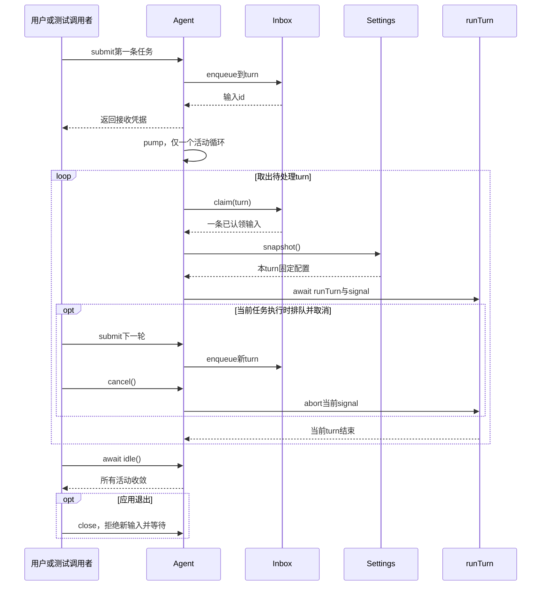

# 013 · 排队、取消和下一轮继续

阶段：R03。唯一前置：完成第 012 步，继续同一个工程。

<!-- harness-own-links:start -->
## 当前练习工程文件

以下链接指向 `harness-own` 的当前累计版本；本课下方的完整代码仍保留当步版本，二者可能不同。

[打开练习工程说明](../../../harness-own/README.md)

| 本课文件 | 当前练习工程文件 |
| --- | --- |
| `src/agent.mjs` | [`harness-own/src/agent.mjs`](../../../harness-own/src/agent.mjs) |
| `src/demo.mjs` | [`harness-own/src/agent-demo.mjs`](../../../harness-own/src/agent-demo.mjs) |
| `tests/013-agent.test.mjs` | [`harness-own/tests/013-agent.test.mjs`](../../../harness-own/tests/013-agent.test.mjs) |

<!-- harness-own-links:end -->

## 什么时候会用到这一页

Agent输出第一片partial时，用户排队一条新任务并取消当前任务；第一轮以cancelled结束，第二轮仍应执行，且第二轮采用用户刚更新的模型配置。取消不是把所有未来任务都清空。

### 这次数据怎么走

```text
Agent.submit → Inbox.enqueue(turn/step) → 单个pump取turn → Settings.snapshot → runTurn → cancel仅abort当前controller → 下一条turn继续 → idle等待活动结束 → close禁止新输入并取消、等待。
```

### 对应时序图

从上往下读；实线箭头表示调用或发送，虚线箭头表示返回或事件通知。`opt`表示可选操作，`alt`表示不同结果，`loop`表示重复，`par`及其`and`分支表示并行；“未接入”及fixture说明按图中标注理解。



**当前接线位置：**本步demo首次贯通Agent→Loop→Tools；016 demo把model提供方换成真实兼容接口，018/020有真实路由装配，041 Host才把Agent放入持久会话管理。

## 这一步具体做什么

完成agent.mjs、demo.mjs和测试后运行 bun src/demo.mjs "/sum 2 3"，应看到工具结果5及completed；运行 bun src/demo.mjs /slow，看到partial后按Ctrl+C，应以cancelled结束。再运行 bun test ./tests/013-agent.test.mjs 验证排队第二轮继续。此时demo明确使用固定模型。

需要本章新文件的操作，先按下面代码创建文件，再执行；不要在上一步尚不存在的接口上试错。

## 代码为什么放在这一层

Agent是会话当前活动的主人；submit返回的是接收输入凭据，不是最终答案。pump保证同一Agent只执行一个turn，idle等到队列处理完，close等到当前异步工作收敛，外层再清工具Scope。

## 在哪里写、写什么

操作地点：终端中的 `$PROJECT`，编辑器打开同一个目录。只创建或替换下列文件，其他文件保留上一步版本。文件目录不存在先创建。

```sh
mkdir -p src
```

### 创建 [`src/agent.mjs`](../../../harness-own/src/agent.mjs)

````javascript
import { Inbox } from './inbox.mjs'
import { runTurn } from './loop.mjs'

/** Agent 是活动的所有者；收到输入不等于开始执行。 */
export class Agent {
  active = undefined
  controller = undefined
  closed = false
  failure = undefined
  constructor(session, model, tools, settings) {
    this.session = session; this.model = model; this.tools = tools; this.settings = settings
    this.inbox = new Inbox(session)
  }
  /** 返回接收凭据，正在运行时也可以排队或 steer。 */
  submit(content, destination = 'turn') {
    if (this.closed) throw Error('Agent 已关闭')
    const receipt = this.inbox.enqueue(content, destination)
    this.pump()
    return receipt
  }
  /** 同一会话单个 pump，配置只在新 turn 请求时固定。 */
  pump() {
    if (this.active || this.closed) return
    this.active = Promise.resolve().then(async () => {
      let input
      while (!this.closed && (input = this.inbox.claim('turn'))) {
        this.controller = new AbortController()
        const config = this.settings.snapshot()
        await runTurn({ session: this.session, tools: this.tools, model: this.model, config, inbox: this.inbox, signal: this.controller.signal }, input.content)
      }
    }).finally(() => { this.controller = undefined; this.active = undefined })
    // 即使接入方只取接收凭据，也不能产生未处理的Promise拒绝。
    this.active.catch(error => { this.failure = error; this.closed = true })
  }
  /** 取消当前活动，不取消未来排队的独立任务。 */
  cancel() { this.controller?.abort(new Error('用户取消')) }
  /** 等待事实与活动都收敛后再报告空闲。 */
  async idle() { while (this.active) await this.active; if (this.failure) throw this.failure }
  /** 禁止新输入，取消当前活动并等待清理。 */
  async close() { this.closed = true; this.cancel(); await this.idle() }
}
````

```sh
mkdir -p src
```

### 创建 [`src/demo.mjs`](../../../harness-own/src/agent-demo.mjs)

````javascript
import { Events } from './events.mjs'
import { Tools } from './tools.mjs'
import { Scope } from './scope.mjs'
import { Settings } from './config.mjs'
import { Agent } from './agent.mjs'
import { ScriptModel, answer, call } from './model.mjs'

// 这是当前已实现能力的演示入口，尚未接真实模型，输出明确标注固定模型。
const text = process.argv.slice(2).join(' ') || '/sum 2 3'
const numbers = text.match(/^\/sum (\d+) (\d+)$/)
const script = numbers ? [call('sum', { a: Number(numbers[1]), b: Number(numbers[2]) }), answer(String(Number(numbers[1]) + Number(numbers[2])))] : text === '/slow' ? ['hang'] : [answer('固定模型收到：' + text)]
const session = new Events(), tools = new Tools(), scope = new Scope()
tools.register(scope, { name: 'sum', effect: 'read', schema: { type: 'object', properties: { a: { type: 'number' }, b: { type: 'number' } }, required: ['a', 'b'], additionalProperties: false }, run: ({ a, b }) => a + b })
const agent = new Agent(session, new ScriptModel(script), tools, new Settings())
session.on(event => console.log(event.seq, event.type, JSON.stringify(event.data)))
process.on('SIGINT', () => agent.cancel())
try { agent.submit(text); await agent.idle() }
finally { await agent.close(); await scope.close() }
````

```sh
mkdir -p tests
```

### 创建 [`tests/013-agent.test.mjs`](../../../harness-own/tests/013-agent.test.mjs)

````javascript
import { test } from 'bun:test'
import assert from 'node:assert/strict'
import { Events } from '../src/events.mjs'
import { Tools } from '../src/tools.mjs'
import { Settings } from '../src/config.mjs'
import { ScriptModel, answer } from '../src/model.mjs'
import { Agent } from '../src/agent.mjs'

test('首片取消、排队第二轮继续，配置快照不串轮', async () => {
  const session = new Events(), settings = new Settings({ model: 'first' }), model = new ScriptModel(['hang', answer('second')])
  const agent = new Agent(session, model, new Tools(), settings)
  session.on(event => {
    if (event.type === 'stream/text' && event.data.text === 'partial') { settings.set({ model: 'second' }); agent.submit('下一轮'); agent.cancel() }
  })
  agent.submit('第一轮')
  await agent.idle()
  assert.deepEqual(session.read().filter(event => event.type === 'turn/end').map(event => event.data.reason), ['cancelled', 'completed'])
  assert.deepEqual(model.requests.map(request => request.config.model), ['first', 'second'])
  await agent.close()
})
````

## 运行命令与通过标准

```sh
cd "$PROJECT"
bun test ./tests/013-agent.test.mjs
bun test
```

测试首片取消、队列继续与两轮配置不串。没有父子Agent权限继承、会话恢复或多用户控制；close也不会自动关闭另外传入的tools Scope，demo的finally负责两者。

**本步证据的范围：**tests/013-agent.test.mjs有1项集成测试，事件监听器在partial处确定性排队并取消，无sleep猜时序；CLI demo用真实sum函数，模型为ScriptModel。

## VS Code：断在哪里、看什么

在VS Code打开练习工程并选中tests/013-agent.test.mjs，选择“Bun：当前测试”按F5启动。在src/agent.mjs的if(this.active||this.closed)、this.inbox.claim("turn")、this.settings.snapshot()和cancel打断点。F10到第一片回调，监视controller.signal.aborted由false变true；继续后查看第二次config.model="second"，active最终undefined。F11进入runTurn可看两次turn/end。

操作位置：VS Code 打开的是自己的 `$PROJECT`，断点也设在这里的源码，不在教材的 `steps` 目录。

上面的说明若指定CLI、子进程、页面或Electron附加调试，就先按该流程操作；下面这组步骤只用于本章测试入口。“当前测试”不会自动附加子进程，也不会命中浏览器或Electron中的断点。

变量只在所属作用域可见：停在方法内部时看this和参数；要看测试里的局部变量，先在“调用堆栈”选择对应测试帧。正在等待的异步调用者不一定保留可求值的帧，此时在测试调用前后加断点再看，不把未定义误判成业务状态丢失。

沿用第 000 步安装的 Bun 扩展与 `.vscode/launch.json`；本章列出替换配置时，使用本章完整版本。

1. 打开本步测试文件 `tests/013-agent.test.mjs`，保持它为当前编辑器文件。
2. 在上面指定的函数内单击行号左侧设置断点。
3. “运行和调试”选择 **Bun：当前测试**，按 F5；它执行当前测试，工作目录固定为 PROJECT。
4. 在“变量 / 监视 / 调用堆栈 / 调试控制台”检查状态；F10 逐行执行，F11 进入函数，Shift+F11 返回，F5 继续，Shift+F5 停止。

验收：断点实际命中，能说出当前输入、状态和下一步；只看到进程启动不算完成。长时间暂停会影响真实取消、审批和网络超时，先检查时序，不删超时断言。修正后在集成终端运行 `bun test ./tests/013-agent.test.mjs`，再运行 `bun test`，保留全部断言。

## 不看答案，确认自己能解释

合上资料写出submit、cancel、idle、close各做什么，再说明为何submit后立即读session末条不一定已经是最终答案。

完成后在 LEARNING.md 写一句实际结果和一个卡点。明天只重做这个卡点；第 3 天、第 7 天再做一次，能独立完成就继续下一页，不另开学习路线。

**再改一个条件验证：**把测试中的第二轮文字改成第三条排队输入，并给ScriptModel补对应answer后验收顺序；必须同时补脚本，否则“脚本耗尽”是正常报错，不是排队实现坏了。

## 与当前原版还差哪些

对照本仓库固定原版 `687f282e8625c6b8d11ff58211a90524be2e4317`；这里的“当前”指该本地基线，不是未经检查的上游最新版。

**这一页已经实现：**

- 单Agent串行pump、持久输入队列接口、每turn配置快照。
- 取消当前活动、保留下一轮、idle等待和关闭拒绝新输入。

**原版仍有、或本步尚未对齐的部分：**

- 原版Agent注册表提供create/resume、作用域上下文、状态投影、会话生命周期和有序撤销；本章只有手工new Agent与四个活动字段。
- 原版循环的边界拦截、输入归属、运行状态和会话恢复异常处理更细；本章无restore、父子作用域、持久状态机及稳定的外部通知接口。

**原版对照位置：**

- [packages/core/agent/src/index.ts](../../../deepseek-harness/packages/core/agent/src/index.ts)
- [packages/core/agent-loop/src/index.ts](../../../deepseek-harness/packages/core/agent-loop/src/index.ts)
- [packages/core/agent-loop/src/agent.ts](../../../deepseek-harness/packages/core/agent-loop/src/agent.ts)

本步测试通过只证明上面的具体行为；完整差距仍看 [COVERAGE.md](../COVERAGE.md)，不以文件数量、同名类或后面出现另一个模块代替接线证据。

下一步：[第 014 步](014.md)

## 现在在终端亲自跑一轮

在 PROJECT 执行，暂不需要网络或模型 Key：

```sh
bun src/demo.mjs "/sum 2 3"
bun src/demo.mjs "/slow"
```

第一条应有两次 request、一个 sum 工具结果 5、一个 completed。第二条看到 partial 后按 Ctrl+C，应产生 cancelled 并正常退出。入口里的固定模型只替代外部模型；Agent、队列、工具与取消都是你刚才写出的实现。
