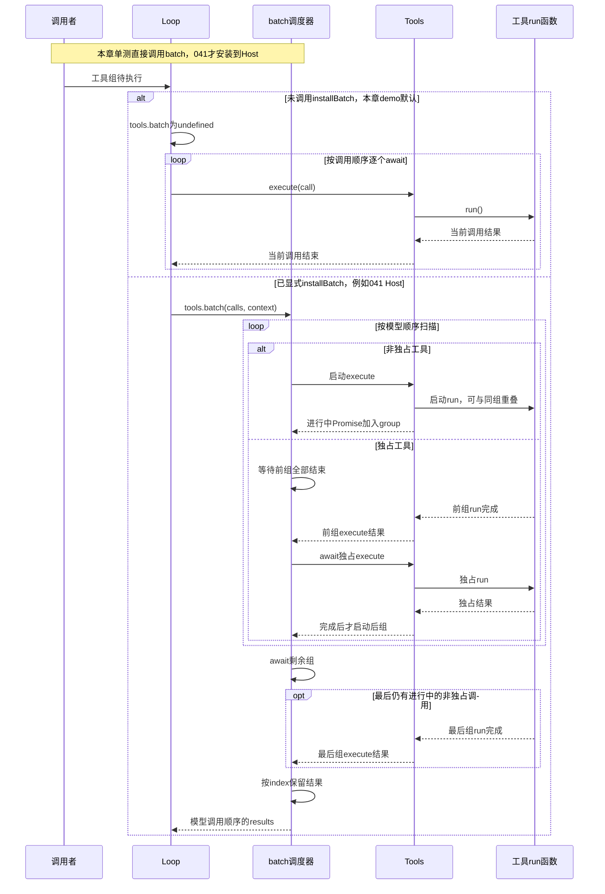

# 014 · 并发工具与独占屏障

阶段：R03。唯一前置：完成第 013 步，继续同一个工程。

<!-- harness-own-links:start -->
## 当前练习工程文件

以下链接指向 `harness-own` 的当前累计版本；本课下方的完整代码仍保留当步版本，二者可能不同。

[打开练习工程说明](../../../harness-own/README.md)

| 本课文件 | 当前练习工程文件 |
| --- | --- |
| `src/batch.mjs` | [`harness-own/src/batch.mjs`](../../../harness-own/src/batch.mjs) |
| `src/loop.mjs` | [`harness-own/src/loop_014.mjs`](../../../harness-own/src/loop_014.mjs) |
| `tests/014-batch.test.mjs` | [`harness-own/tests/014-batch.test.mjs`](../../../harness-own/tests/014-batch.test.mjs) |

<!-- harness-own-links:end -->

## 什么时候会用到这一页

模型同一步要求读A、读B、写C、再读D。两个只读可重叠；写C必须等前两项完成，后面的读D也要等写完。完成快慢可以不同，但回给模型的结果仍按原调用顺序排列。

### 这次数据怎么走

```text
batch遍历calls → 非独占立即加入group → 遇独占先await前组 → 单独执行独占 → 启动下一组 → results[index]按调用位置保存；installBatch装tools.batch后Loop才走这条分支。
```

### 对应时序图

从上往下读；实线箭头表示调用或发送，虚线箭头表示返回或事件通知。`opt`表示可选操作，`alt`表示不同结果，`loop`表示重复，`par`及其`and`分支表示并行；“未接入”及fixture说明按图中标注理解。



**当前接线位置：**014单测仅调用batch；src/demo.mjs当前没有installBatch。041的host.mjs才执行fileTools(...); installBatch(tools)，实际由Host的Loop消费。018/020单工具示例不能证明多工具并发。

## 这一步具体做什么

写完batch.mjs和替换后的loop.mjs，再运行 bun test ./tests/014-batch.test.mjs。对照order确认start2晚于end0、start3晚于end2，results为[0,1,2,3]。该测试直接调用batch，不会自动调用installBatch；不要因为Loop出现三元表达式就认定当前demo已经并发。

需要本章新文件的操作，先按下面代码创建文件，再执行；不要在上一步尚不存在的接口上试错。

## 代码为什么放在这一层

batch负责执行次序，不负责新建工具；exclusive !== false默认保守串行。installBatch是给Tools增加策略入口的装配函数，必须被真实调用才能改变Loop行为；没有装时for...of逐个await仍串行。

## 在哪里写、写什么

操作地点：终端中的 `$PROJECT`，编辑器打开同一个目录。只创建或替换下列文件，其他文件保留上一步版本。文件目录不存在先创建。

```sh
mkdir -p src
```

### 创建 [`src/batch.mjs`](../../../harness-own/src/batch.mjs)

````javascript
/** 非独占工具可并发；独占工具必须等前组结束，后组也等它。 */
export async function batch(calls, isExclusive, execute) {
  const results = new Array(calls.length), group = []
  const run = async (call, index) => {
    try { results[index] = { ok: true, value: await execute(call) } }
    catch (error) { results[index] = { ok: false, error: error.message } }
  }
  for (const [index, call] of calls.entries()) {
    if (isExclusive(call)) {
      await Promise.all(group.splice(0))
      await run(call, index)
    } else group.push(run(call, index))
  }
  await Promise.all(group)
  return results
}

/** 装饰执行器，在不改模型接口的前提下给工具执行增加并发策略。 */
export function installBatch(tools) {
  tools.batch = (calls, context) => batch(calls, call => tools.entries.get(call.name)?.exclusive !== false, call => {
    context.before?.(call)
    return tools.execute(call, context)
  })
}
````

```sh
mkdir -p src
```

### 替换 [`src/loop.mjs`](../../../harness-own/src/loop_014.mjs)

````javascript
import { id } from './events.mjs'
import { messages } from './projection.mjs'

/** 一个 turn 由多个模型 step 组成；工具调用和结果成组写入事实。 */
export async function runTurn({ session, model, tools, signal, config = {}, inbox, maxSteps = 20 }, content) {
  const turnId = id('turn')
  session.append('turn/start', { turnId })
  session.append('message/user', { role: 'user', content })
  let ending = 'limit', partial = ''
  try {
    for (let step = 0; step < maxSteps; step++) {
      signal.throwIfAborted()
      // 只在 step 边界注入 steer，不改正在传输的请求。
      let input
      while ((input = inbox?.claim('step'))) session.append('message/user', { role: 'user', content: input.content, source: 'steer' })
      const requestId = id('request'), history = messages(session.read()), catalog = tools.catalog()
      session.append('request/start', { turnId, requestId, step, config, messages: history, tools: catalog })
      const calls = [], thinking = []
      let finish
      partial = ''
      for await (const part of model.stream({ messages: history, tools: catalog, config, signal, requestId })) {
        signal.throwIfAborted()
        if (part.kind === 'text') { partial += part.text; session.append('stream/text', { turnId, requestId, text: part.text }) }
        if (part.kind === 'thinking') thinking.push(part)
        if (part.kind === 'tool') {
          if (calls.some(call => call.id === part.id)) throw Error('重复工具调用身份')
          calls.push(part)
        }
        if (part.kind === 'usage') session.append('request/usage', { requestId, ...part })
        if (part.kind === 'replay') session.append('request/replay', { requestId, value: part.value })
        if (part.kind === 'finish') finish = part.reason
      }
      if (!finish) throw Error('模型流提前结束')
      if (calls.length && finish !== 'tools') throw Error('工具组与停止原因不匹配')
      session.append('message/assistant', { role: 'assistant', content: partial, calls, thinking })
      partial = ''
      session.append('request/end', { requestId, reason: finish })
      if (finish !== 'tools') { ending = finish === 'stop' ? 'completed' : 'length'; break }
      if (!calls.length) throw Error('工具结束但没有工具调用')
      const execute = async call => {
        session.append('tool/start', { turnId, call }) // 每个副作用前先留下持久事实。
        return await tools.execute(call, { signal, session, turnId })
      }
      // 没装并发策略时仍走同一个执行门；装上后由元数据决定安全并发组。
      const results = tools.batch
        ? await tools.batch(calls, { signal, session, turnId, before: call => session.append('tool/start', { turnId, call }) })
        : await (async () => {
          const rows = []
          for (const call of calls) {
            try { rows.push({ ok: true, value: await execute(call) }) }
            catch (error) { rows.push({ ok: false, error: signal.aborted ? 'CANCELLED_OR_OUTCOME_UNKNOWN' : error.message }) }
          }
          return rows
        })()
      calls.forEach((call, index) => session.append('message/tool', { role: 'tool', callId: call.id, name: call.name, content: results[index] }))
    }
  } catch (error) {
    // 保留取消前真正收到的文字，但不伪装成成功完成。
    if (partial) session.append('message/assistant', { role: 'assistant', content: partial, interrupted: true })
    ending = signal.aborted ? 'cancelled' : 'error'
    if (ending === 'error') session.append('turn/error', { turnId, message: error.message })
  }
  session.append('turn/end', { turnId, reason: ending })
  return { turnId, reason: ending }
}
````

```sh
mkdir -p tests
```

### 创建 [`tests/014-batch.test.mjs`](../../../harness-own/tests/014-batch.test.mjs)

````javascript
import { test } from 'bun:test'
import assert from 'node:assert/strict'
import { batch } from '../src/batch.mjs'
import { setTimeout as delay } from 'node:timers/promises'

test('并发完成顺序可变，结果按调用顺序；独占形成屏障', async () => {
  const order = []
  const results = await batch([{ id: 0 }, { id: 1 }, { id: 2, exclusive: true }, { id: 3 }], call => !!call.exclusive, async call => {
    order.push('start' + call.id); await delay(call.id === 0 ? 15 : 1); order.push('end' + call.id); return call.id
  })
  assert.deepEqual(results.map(result => result.value), [0, 1, 2, 3])
  assert.ok(order.indexOf('start2') > order.indexOf('end0'))
  assert.ok(order.indexOf('start3') > order.indexOf('end2'))
})
````

## 运行命令与通过标准

```sh
cd "$PROJECT"
bun test ./tests/014-batch.test.mjs
bun test
```

单测覆盖非独占重叠、独占屏障和结果位置稳定。未验证installBatch与Tools/Loop集成、取消时尚未启动任务的停止、并发上限；当前函数对每组Promise.all没有数量上限。

**本步证据的范围：**tests/014-batch.test.mjs有1项调度函数单测，用不同delay制造完成顺序；没有调用installBatch或真实文件工具。延时只用于该调度样本，不是原版最大并发或负载测试。

## VS Code：断在哪里、看什么

在VS Code打开练习工程并选中tests/014-batch.test.mjs，选择“Bun：当前测试”按F5启动。在src/batch.mjs的group.push(run(...))、await Promise.all(group.splice(0))和results[index]赋值打断点。F10观察group长度到2，遇id2先等待前组；继续后监视order。要检查接线，在Loop的tools.batch条件处看值：014 demo未装时为undefined，041 Host装后才是函数。

操作位置：VS Code 打开的是自己的 `$PROJECT`，断点也设在这里的源码，不在教材的 `steps` 目录。

上面的说明若指定CLI、子进程、页面或Electron附加调试，就先按该流程操作；下面这组步骤只用于本章测试入口。“当前测试”不会自动附加子进程，也不会命中浏览器或Electron中的断点。

变量只在所属作用域可见：停在方法内部时看this和参数；要看测试里的局部变量，先在“调用堆栈”选择对应测试帧。正在等待的异步调用者不一定保留可求值的帧，此时在测试调用前后加断点再看，不把未定义误判成业务状态丢失。

沿用第 000 步安装的 Bun 扩展与 `.vscode/launch.json`；本章列出替换配置时，使用本章完整版本。

1. 打开本步测试文件 `tests/014-batch.test.mjs`，保持它为当前编辑器文件。
2. 在上面指定的函数内单击行号左侧设置断点。
3. “运行和调试”选择 **Bun：当前测试**，按 F5；它执行当前测试，工作目录固定为 PROJECT。
4. 在“变量 / 监视 / 调用堆栈 / 调试控制台”检查状态；F10 逐行执行，F11 进入函数，Shift+F11 返回，F5 继续，Shift+F5 停止。

验收：断点实际命中，能说出当前输入、状态和下一步；只看到进程启动不算完成。长时间暂停会影响真实取消、审批和网络超时，先检查时序，不删超时断言。修正后在集成终端运行 `bun test ./tests/014-batch.test.mjs`，再运行 `bun test`，保留全部断言。

## 不看答案，确认自己能解释

闭卷为“读A、读B、写C、读D”画三组执行区间，解释Promise.all只在哪里发生，为什么返回结果不能按完成顺序push。

完成后在 LEARNING.md 写一句实际结果和一个卡点。明天只重做这个卡点；第 3 天、第 7 天再做一次，能独立完成就继续下一页，不另开学习路线。

**再改一个条件验证：**在测试副本让id1抛错，断言results[1].ok=false、id2仍待前组收敛后执行；这是需新增的失败练习。若想集成Tools，需显式调用installBatch，不能假定导入即安装。

## 与当前原版还差哪些

对照本仓库固定原版 `687f282e8625c6b8d11ff58211a90524be2e4317`；这里的“当前”指该本地基线，不是未经检查的上游最新版。

**这一页已经实现：**

- 非独占分组重叠、独占前后屏障、按调用序写结果。
- installBatch适配统一Tools.execute，Loop保留未装时串行分支。

**原版仍有、或本步尚未对齐的部分：**

- 原版tool-calls调度器有maxParallelToolCalls并发池、未启动项再分类、按序提交结果/上下文和取消后的排空与跳过标记；教程一次启动整个安全组。
- 原版工具并行模式来自运行时执行策略并纳入原生及PTC分发；本章exclusive字段与可选装饰函数没有完整策略事件和PTC接线。

**原版对照位置：**

- [packages/core/agent-loop/src/tool-calls.ts](../../../deepseek-harness/packages/core/agent-loop/src/tool-calls.ts)
- [packages/core/agent-loop/src/constants.ts](../../../deepseek-harness/packages/core/agent-loop/src/constants.ts)
- [packages/core/tools/src/index.ts](../../../deepseek-harness/packages/core/tools/src/index.ts)
- [packages/core/tools/src/ptc-calls.ts](../../../deepseek-harness/packages/core/tools/src/ptc-calls.ts)

本步测试通过只证明上面的具体行为；完整差距仍看 [COVERAGE.md](../COVERAGE.md)，不以文件数量、同名类或后面出现另一个模块代替接线证据。

下一步：[第 015 步](015.md)
