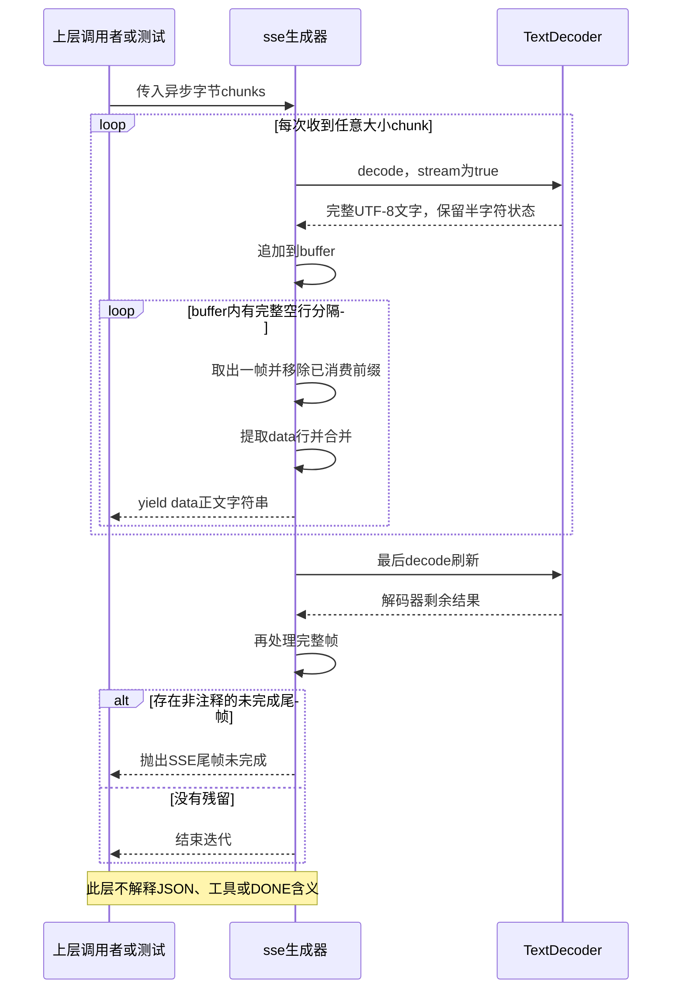
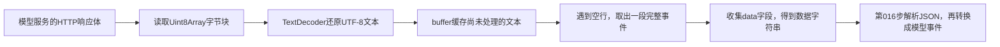

# 015 · 先还原字节，再谈模型事件

阶段：R03。唯一前置：完成第 014 步，继续同一个工程。

<!-- harness-own-links:start -->
## 当前练习工程文件

以下链接指向 `harness-own` 的当前累计版本；本课下方的完整代码仍保留当步版本，二者可能不同。

[打开练习工程说明](../../../harness-own/README.md)

| 本课文件 | 当前练习工程文件 |
| --- | --- |
| `src/sse.mjs` | [`harness-own/src/sse.mjs`](../../../harness-own/src/sse.mjs) |
| `tests/015-sse.test.mjs` | [`harness-own/tests/015-sse.test.mjs`](../../../harness-own/tests/015-sse.test.mjs) |

<!-- harness-own-links:end -->

## 什么时候会用到这一页

模型流把“你好”的UTF-8字节拆到不同网络块，又把两条SSE事件合到一个块里。Harness必须先正确解码并按空行还原事件，不能把一次read当作一次模型消息。

### 这次数据怎么走

```text
字节chunks → TextDecoder(stream:true)保留未完整字符 → buffer累计 → /\r?\n\r?\n/找事件空行 → 按行筛data:并用换行合并 → yield数据正文 → 上层016再解释JSON与[DONE]。
```

### 对应时序图

从上往下读；实线箭头表示调用或发送，虚线箭头表示返回或事件通知。`opt`表示可选操作，`alt`表示不同结果，`loop`表示重复，`par`及其`and`分支表示并行；“未接入”及fixture说明按图中标注理解。



**当前接线位置：**016的DeepSeekModel直接调用sse(response.body)，018固定HTTP demo也经016复用；020换pi-ai后由SDK解析SSE，不再使用本章解析器处理该路径。

## 这一步具体做什么

写完sse.mjs及测试后运行 bun test ./tests/015-sse.test.mjs。测试把含“你好”的原始字节逐字节切开，预期仍输出["你好","a\nb"]；不带空行的data: partial尾帧必须报错。这里没有网络请求，直接喂字节数组。

需要本章新文件的操作，先按下面代码创建文件，再执行；不要在上一步尚不存在的接口上试错。

## 代码为什么放在这一层

SSE解析器只恢复“事件的data字符串”，不负责thinking、工具调用和请求完成；那些由模型适配器解释。LF与CRLF都可形成行结束，两个行结束形成空行；[DONE]是本教程兼容接口正文约定，不是SSE标准的通用终止符。

## 先弄清楚：SSE里的`\r\n`到底是什么

模型服务把数据放在HTTP响应体里陆续发回来。你的程序先收到一块块字节，要先还原文本，再找出完整SSE事件，最后才能解析事件里的JSON。



### 1. 一个换行结束一行，空行结束一条事件

| 写法 | 含义 | 本步怎么处理 |
| --- | --- | --- |
| `\r` | 回车字符CR，字节值13 | 本步只在CRLF组合中处理它 |
| `\n` | 换行字符LF，字节值10 | 可以单独作为行结束符 |
| `\r\n` | CRLF，两个字符合起来作为一个行结束符 | 按一次换行处理 |
| `\n\n` | 用LF结束数据行，再结束一个空行 | 在此切出完整事件 |
| `\r\n\r\n` | 用CRLF结束数据行，再结束一个空行 | 在此切出完整事件 |

比如服务端发来的可见文本是：

```text
data: 你好

data: 世界

```

用转义写法表示同一段数据，可以是`"data: 你好\r\n\r\ndata: 世界\r\n\r\n"`。`data: 你好`后第一个`\r\n`结束这行，第二个结束空行，这时才能确认“你好”这一条事件已经结束。

写在JavaScript字符串里的`'\r\n'`会变成两个真实控制字符；`'\\r\\n'`才是字面量反斜杠加字母。调试器为了方便显示，经常把真实换行显示成`\r\n`，不要因此以为服务端发送的是反斜杠。

#### 标准到底规定用哪种结束

**标准规定用空行结束一条SSE事件，没有规定必须使用LF或CRLF。**LF（`\n`）、CRLF（`\r\n`）和单独CR（`\r`）都可以作为行结束符；CRLF中的两个字符合起来算一次换行。[WHATWG解析规则](https://html.spec.whatwg.org/multipage/server-sent-events.html#parsing-an-event-stream)

| 一条非空data事件的写法，用转义展示 | 标准是否合法 | 第015步代码是否支持 |
| --- | --- | --- |
| `data: 你好\n\n` | 合法：用LF结束数据行，再结束空行 | 支持 |
| `data: 你好\r\n\r\n` | 合法：用CRLF结束数据行，再结束空行 | 支持 |
| `data: 你好\r\r` | 合法：用CR结束数据行，再结束空行 | 尚不支持 |

不要把“一条事件结束”和“整个流结束”混在一起：

```text
data: 第一段\n\n            → 第一条SSE事件结束，还可以继续发
data: 第二段\n\n            → 第二条SSE事件结束，还可以继续发
data: {"choices":[{"index":0,"delta":{},"finish_reason":"stop"}]}\n\n
                           → 模型接口报告本次生成的停止原因
data: [DONE]\n\n            → SSE只提取字符串[DONE]
                           → 第016步适配器识别结束标记，并核对停止原因
```

**SSE没有统一的“整个业务流完成”标记。**`[DONE]`或`message_stop`是具体模型接口的约定，由对应适配器解释；空行只是当前事件的边界，连接断开本身也不能证明模型完整回答了。本教程第016步还会检查模型消息是否按接口约定完整结束。

### 2. 为什么不能收到一块就split或JSON.parse

网络读取不会保证一块刚好是一条事件，甚至可能把`\r\n`从中间拆开。下面每块的内容都用JavaScript字符串写法展示：

| 收到的块 | 追加后的buffer | 此时做什么 |
| --- | --- | --- |
| `"data: A\r"` | `"data: A\r"` | 还没出现完整空行，保留全部内容 |
| `"\n\r"` | `"data: A\r\n\r"` | 仍缺最后一个LF，继续保留 |
| `"\n"` | `"data: A\r\n\r\n"` | 找到分隔符，取出`data: A`，产出`A`，buffer变空 |

如果只在每个chunk里找分隔符，这三块里没有任何一块包含完整的`\r\n\r\n`，事件就会漏掉。因此必须先追加到同一个`buffer`，再检查。

反过来，一块也可能包含三条事件，所以代码用`while`取完已经完整的事件；不足一条的尾部留着，等下一块。这里的“块”是响应流交给程序的一块数据，不等于一个TCP包。

### 3. 对照正则，看每一行具体做什么

```javascript
// 两个行结束符：每个都允许是LF，或CRLF。
/\r?\n\r?\n/

// 一条事件里面，用一个行结束符拆分各行。
/\r?\n/
```

`?`只修饰它前面的`\r`，意思是“这个CR可以出现零次或一次”。因此第一条正则既能匹配`\n\n`，也能匹配`\r\n\r\n`，还允许两次行结束使用不同写法。

可以直接记成：`/\r?\n/`匹配一次换行，`/\r?\n\r?\n/`匹配两次连续换行。前者用于拆行，后者用于找到空行；这两条正则都不支持单独CR。

代码里各个位置的职责是：

1. `decoder.decode(chunk, { stream: true })`：解码字节。一个汉字的UTF-8字节可能被拆开，decoder会保留不完整的字节，等下一块补齐。
2. `buffer += ...`：保存已解码、尚未凑成完整事件的文本。decoder缓存的是半个字符的字节，buffer缓存的是还没处理完的文本，这两者分工不同。
3. 正则的`exec(buffer)`：找到第一个空行。`match.index`是分隔符开始的位置，`match[0].length`是分隔符占用的字符数。
4. `slice(0, match.index)`：取出空行之前的事件内容；另一次`slice`把这段内容和分隔符一起从buffer移除，留下后续数据。
5. `frame.split(/\r?\n/)`：把事件拆成行，再筛选`data:`行。`slice(5)`移除前缀，`replace(/^ /, '')`只移除冒号后可选的一个空格，不是trim整段正文。

同一条事件也可以包含多行data：

```text
data: A
data: B

```

代码把这两行的数据用`join('\n')`合起来，得到一个包含真实换行的字符串`"A\nB"`，只产出一条事件。

**SSE本身不要求data必须是JSON。**第015步只还原数据字符串；第016步的模型适配器才对它调用`JSON.parse`。JSON字符串内部的`\n`转义，也不要和外层SSE用于分隔行的真实换行混为一谈。

### 4. 在VS Code里亲眼看一次拼接

完成下面的文件后，打开自己工程的`src/sse.mjs`，在`buffer += decoder.decode(...)`这一行和`if (data) yield data`处设置断点。打开`tests/015-sse.test.mjs`，选择“Bun：当前测试”，按F5。

在“监视”里添加`JSON.stringify(buffer)`。测试把原始数据按单字节切开，逐步执行时应看到：中文先由decoder攒齐，文本再进入buffer；收到第一个CR或第一个CRLF时还不产出“你好”，等整个空行到齐才产出。`JSON.stringify`显示的反斜杠只是方便你查看控制字符。

当前测试同时覆盖：中文单字节切分、CRLF分隔符被拆开、LF格式、多行data合并，以及断流时尾部不完整会报错。终端运行`bun test ./tests/015-sse.test.mjs`核对结果，不需要调用真实模型。

### 5. 这份简化实现有哪些边界

标准SSE还允许单独CR作为行结束符，并定义了`event`、`id`、`retry`和空data事件等行为。本步只提取data，支持LF与CRLF；单独CR、空data事件及上述字段的完整语义尚未实现，不能把它当成完整EventSource解析器。[WHATWG解析规则](https://html.spec.whatwg.org/multipage/server-sent-events.html#parsing-an-event-stream)

当前代码还有自己更严格的断流策略：部分未完成的非注释尾部会抛出“SSE尾帧未完成”，不是标准EventSource的全部处理行为。`[DONE]`也不是SSE通用结束符；如果某个模型接口使用它，需要由那个模型适配器解释。

合上材料，自己画出上面三个chunk到来后buffer的变化；次日不看正则，再解释为什么不能直接对每个chunk调用`JSON.parse`。能独立说明“字节、字符、事件、JSON”这四层，才算理解这一段。

## 在哪里写、写什么

操作地点：终端中的 `$PROJECT`，编辑器打开同一个目录。只创建或替换下列文件，其他文件保留上一步版本。文件目录不存在先创建。

```sh
mkdir -p src
```

### 创建 [`src/sse.mjs`](../../../harness-own/src/sse.mjs)

````javascript
/** 字节块不是事件；用流式 UTF-8 解码，再按空行还原 SSE 帧。 */
export async function* sse(chunks) {
  const decoder = new TextDecoder('utf-8', { fatal: true })
  let buffer = ''
  const frames = function* () {
    let match
    while ((match = /\r?\n\r?\n/.exec(buffer))) {
      const frame = buffer.slice(0, match.index)
      buffer = buffer.slice(match.index + match[0].length)
      const data = frame.split(/\r?\n/).filter(line => line.startsWith('data:')).map(line => line.slice(5).replace(/^ /, '')).join('\n')
      if (data) yield data
    }
  }
  for await (const chunk of chunks) { buffer += decoder.decode(chunk, { stream: true }); yield* frames() }
  buffer += decoder.decode(); yield* frames()
  if (buffer.trim() && !buffer.trim().startsWith(':')) throw Error('SSE 尾帧未完成')
}
````

```sh
mkdir -p tests
```

### 创建 [`tests/015-sse.test.mjs`](../../../harness-own/tests/015-sse.test.mjs)

````javascript
import { test } from 'bun:test'
import assert from 'node:assert/strict'
import { sse } from '../src/sse.mjs'

test('按单字节分割中文、CRLF、多行 data，残帧拒绝', async () => {
  const raw = Buffer.from('data: 你好\r\n\r\ndata: a\ndata: b\n\n'), pieces = [...raw].map(byte => Uint8Array.of(byte)), received = []
  for await (const value of sse(pieces)) received.push(value)
  assert.deepEqual(received, ['你好', 'a\nb'])
  await assert.rejects(async () => { for await (const value of sse([Buffer.from('data: partial')])) {} }, /尾帧/)
})
````

## 运行命令与通过标准

```sh
cd "$PROJECT"
bun test ./tests/015-sse.test.mjs
bun test
```

覆盖单字节中文、CRLF、多行data和未完成尾帧。当前正则只支持LF/CRLF，不支持单独CR；不保存event/id/retry、会忽略空data，也没有完整EventSource重连和无限buffer防护。

**本步证据的范围：**tests/015-sse.test.mjs有1项纯字节测试；有效覆盖分块和尾帧，未覆盖SSE全部标准字段、单CR或内存预算。

## VS Code：断在哪里、看什么

在VS Code打开练习工程并选中tests/015-sse.test.mjs，选择“Bun：当前测试”按F5启动。在src/sse.mjs的decoder.decode(chunk,{stream:true})、正则exec与yield data打断点。F10喂“你”的前两个字节时观察buffer尚无完整字符，第三字节才出现“你”；监视match.index和buffer，只有空行完整后才yield。F11看上层next收到的是数据正文，不是网络块。

操作位置：VS Code 打开的是自己的 `$PROJECT`，断点也设在这里的源码，不在教材的 `steps` 目录。

上面的说明若指定CLI、子进程、页面或Electron附加调试，就先按该流程操作；下面这组步骤只用于本章测试入口。“当前测试”不会自动附加子进程，也不会命中浏览器或Electron中的断点。

变量只在所属作用域可见：停在方法内部时看this和参数；要看测试里的局部变量，先在“调用堆栈”选择对应测试帧。正在等待的异步调用者不一定保留可求值的帧，此时在测试调用前后加断点再看，不把未定义误判成业务状态丢失。

沿用第 000 步安装的 Bun 扩展与 `.vscode/launch.json`；本章列出替换配置时，使用本章完整版本。

1. 打开本步测试文件 `tests/015-sse.test.mjs`，保持它为当前编辑器文件。
2. 在上面指定的函数内单击行号左侧设置断点。
3. “运行和调试”选择 **Bun：当前测试**，按 F5；它执行当前测试，工作目录固定为 PROJECT。
4. 在“变量 / 监视 / 调用堆栈 / 调试控制台”检查状态；F10 逐行执行，F11 进入函数，Shift+F11 返回，F5 继续，Shift+F5 停止。

验收：断点实际命中，能说出当前输入、状态和下一步；只看到进程启动不算完成。长时间暂停会影响真实取消、审批和网络超时，先检查时序，不删超时断言。修正后在集成终端运行 `bun test ./tests/015-sse.test.mjs`，再运行 `bun test`，保留全部断言。

## 不看答案，确认自己能解释

闭卷写出一条data: 中文加空行的SSE字节文本，圈出网络块可任意切的位置与不可据此判断事件的位置。

完成后在 LEARNING.md 写一句实际结果和一个卡点。明天只重做这个卡点；第 3 天、第 7 天再做一次，能独立完成就继续下一页，不另开学习路线。

**再改一个条件验证：**在测试副本把分块改成一块含两个完整事件，结果应与逐字节分块相同；再让CRLF分隔恰好跨块。这是改已有输入数组，不访问远端服务。

## 与当前原版还差哪些

对照本仓库固定原版 `687f282e8625c6b8d11ff58211a90524be2e4317`；这里的“当前”指该本地基线，不是未经检查的上游最新版。

**这一页已经实现：**

- 流式UTF-8解码、LF/CRLF空行边界、多行data合并。
- 事件未完尾部拒绝，不把任意chunk误判为消息。

**原版仍有、或本步尚未对齐的部分：**

- 原版llm-deepseek使用eventsource-parser/stream库并处理heartbeat注释活动、事件类型一致性与结构化错误；教程手写data子集，没有watchdog接线。
- 原版Messages由message_stop及内容块状态机校验完成；本章只做通用分帧，既不等同原版Messages协议，也不独立证明一次assistant完整结束。

**原版对照位置：**

- [packages/llm/llm-deepseek/src/sse.ts](../../../deepseek-harness/packages/llm/llm-deepseek/src/sse.ts)
- [packages/llm/llm-deepseek/src/translate.ts](../../../deepseek-harness/packages/llm/llm-deepseek/src/translate.ts)
- [packages/llm/llm-deepseek/src/transport.ts](../../../deepseek-harness/packages/llm/llm-deepseek/src/transport.ts)

本步测试通过只证明上面的具体行为；完整差距仍看 [COVERAGE.md](../COVERAGE.md)，不以文件数量、同名类或后面出现另一个模块代替接线证据。

下一步：[第 016 步](016.md)
