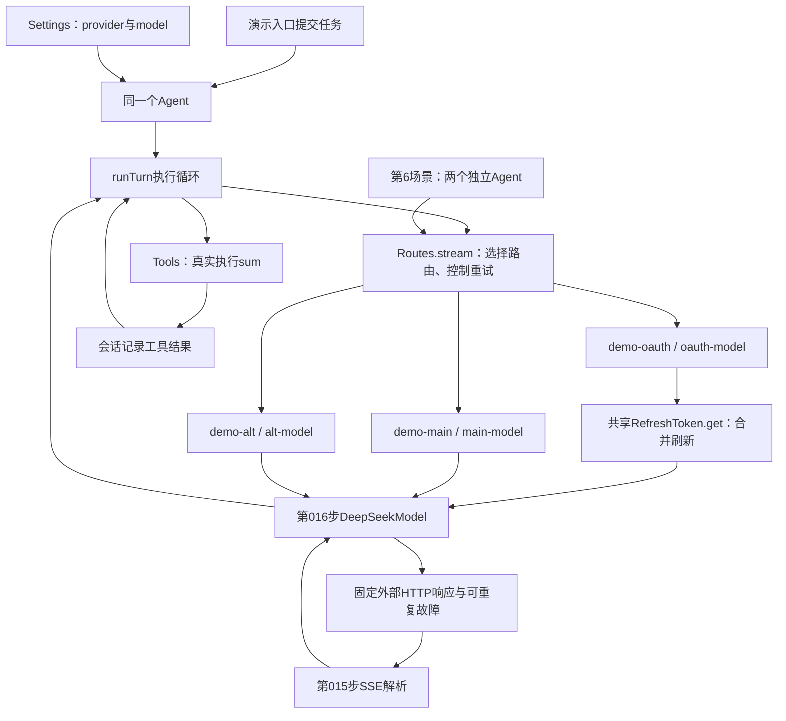
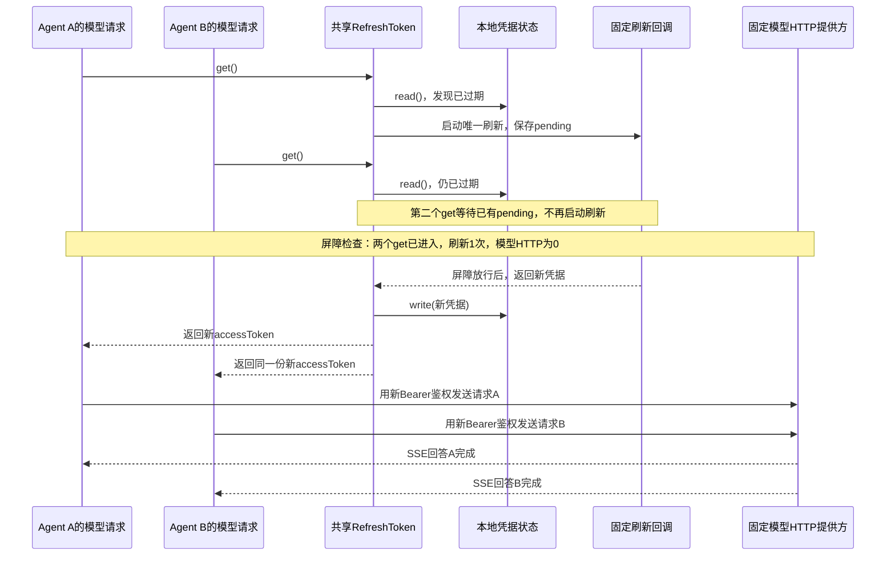

# 018 · 把模型路由、重试和凭据刷新真正装进Agent

阶段：R03。唯一前置：完成第 017 步，继续同一个工程。

## 什么时候会用到这一页

网络在任何Part交付之前断开时，同一个逻辑请求最多再试一次；已经交付半句正文后断开则不重试，避免重复输出。另有两个Agent同时拿到过期凭据，必须合并为一次刷新，并且都等新凭据保存后再发模型请求。

### 这次数据怎么走

```text
Agent取配置快照 → Routes按provider/model选实例 → provider.stream → 未published失败时重试一次 → DeepSeekModel解析 → sum执行 → 下一step；并发鉴权路径先await token.get → 共用pending刷新并保存 → 各请求以新token构造Bearer → 再HTTP。
```

**当前接线位置：**018的routes-demo确实把Routes、RefreshToken、DeepSeekModel、Agent和Tools串起来；020的pi-demo也使用Routes。041 Host未统一改成此Routes装配，故独立demo通过不代表所有Web/ACP请求都自动采用这套重试与刷新。

## 这一步具体做什么

完成本章所有源文件与测试后运行 bun src/routes-demo.mjs，再运行 bun test ./tests/018-routes.test.mjs ./tests/018-routes-demo.test.mjs。按六场景日志看首片前重试、切路由、半句后不重试、未知模型、两次失败耗尽、双请求单刷新；最后摘要中refreshes=1、modelHTTP=2、两个usedNewToken=true。此demo固定外部HTTP，不读真实模型Key。

需要本章新文件的操作，先按下面代码创建文件，再执行；不要在上一步尚不存在的接口上试错。

## 代码为什么放在这一层

Routes负责模型路由与有限重试；RefreshToken负责共享正在刷新的Promise。published不是“是否有正文”，任意Part（包括usage）交给Loop后即为true。三个gate只是demo确认两个请求都已到达再放行刷新，不是生产token锁；生产合并来自RefreshToken.pending。

## 先把018装进一个能直接运行的应用

本步新增`src/routes-demo.mjs`，保留原来的`src/demo.mjs`。按下文创建本步文件后，在自己的PROJECT终端执行：

```sh
bun src/routes-demo.mjs
```

**不用选择模式，一次按顺序跑完六个场景。**它不读取真实模型Key，不发送收费请求。外部模型响应、故障和凭据刷新结果使用本地样本；Agent、Routes、RefreshToken、DeepSeekModel、SSE解析器、配置快照和sum工具都使用前面已经写好的真实实现。第6场景把刷新真正接到模型请求鉴权之前。

### 真正接起来的位置



入口里的关键装配就是：

```javascript
// 注册两个提供方及它们允许使用的模型名，撤销函数归scope管理。
scope.own(routes.add('demo-main', ['main-model'], main))
scope.own(routes.add('demo-alt', ['alt-model'], alternate))

// Agent拿到Routes；Loop调用同样的stream接口，具体模型由Routes选择。
const agent = new Agent(session, routes, tools, settings)
```

这里的main和alternate都是`DeepSeekModel`实例，分别装入固定的fetcher。它们会真实构造Chat Completions请求、解析返回的Response和SSE，而不是绕过适配器直接产出“成功”。

### 六个场景分别证明什么

| 顺序 | 具体发生什么 | 应当观察到什么 |
| --- | --- | --- |
| 1 | 主路由第一次HTTP调用在任何Part产出前抛错；Routes重试，同一次模型请求随后返回sum调用；工具计算出5，再发下一次模型请求 | 主路由HTTP #1失败，#2返回工具调用，#3返回最终5；sum只执行1次，turn以completed结束 |
| 2 | 同一个Agent空闲后，Settings改成demo-alt/alt-model，再提交下一轮 | 只有备用路由HTTP #1被调用，正文来自备用路由；这一轮主路由增加0次 |
| 3 | 配置改回主路由，服务端先返回“已经输出的半句”，随后没有finish_reason和[DONE]就结束响应 | 只有主路由HTTP #4；半句保存为interrupted，turn以error结束；不重试，也不自动调用备用路由 |
| 4 | 选择已注册提供方中的missing-model | 直接报“未知模型路由”；HTTP调用增加0次，没有换成默认模型 |
| 5 | 主路由连续两次在任何Part产出前失败 | HTTP #5、#6各失败一次，随后turn以error结束；没有第7次无限重试，也不自动换提供方 |
| 6 | 两个独立会话的Agent同时请求demo-oauth，共用已过期凭据；鉴权型提供方先调用token.get，再用返回值创建DeepSeekModel | 两次get只触发1次刷新、1次保存；刷新等待期间模型HTTP为0；保存后才发出2次模型HTTP，请求头都使用新凭据，两个turn均completed |

**第3～5场景的error是演示故意制造的预期失败。**程序会从实际会话事件、HTTP计数及鉴权头检查结果中核对行为，六个场景均符合预期才打印“验收结果”并正常退出；不是把error当成成功回答。第6场景包含两个并发turn，不是把两条输入塞到同一个Agent后假称并发。

第1个场景还会检查第二次模型请求的历史：其中必须包含assistant的reasoning_content、sum工具调用，以及真实计算得到的`role: tool`结果5。少了这些关联，就算终端打印5，演示也会因断言失败而非零退出。

### 逻辑请求和HTTP尝试不是一个数量

```text
一轮用户任务：计算2加3
  逻辑请求A（step 0）
    HTTP #1：尚无任何Part，抛错
    HTTP #2：同一个request重试，返回sum调用
  真实执行sum → 结果5写入会话
  逻辑请求B（step 1）
    HTTP #3：带着调用及结果继续，返回最终答案5
  turn/end：completed
```

因此第1个场景应有**2条request/start、3次HTTP尝试、1次工具执行**。Routes在一次`stream(request)`内部重试，不会因此再创建一个用户turn或再写一条request/start。当前Routes也没有为每次HTTP尝试追加独立的持久attempt事件；演示的HTTP编号只是可见计数。

### 为什么首片后不再试

Routes把提供方产出的**任何Part**都视为published，不只是文字：usage、thinking、tool等也算。如果已经把一部分结果交给Loop，再从头请求一遍，可能造成重复文字或重复调用意图，所以当前策略直接交回错误。

反过来，“还没产出Part”不代表服务器一定没收到请求，只表示Harness还没有向Loop交付结果。当前实现只做有限重试，没有精细区分401、网络故障等错误是否值得重试，也不能据此承诺外部操作恰好执行一次。它不会自动切换提供方。

### 用具体失败场景理解published

**published不是“回复完成了”，也不是“已经显示正文了”。它记录的是：本次尝试有没有向Loop交付过任何Part。**每次重试开始都会重新设为false；只要进入一次`yield part`，就先设为true。

#### 场景一：用户让模型计算2加3，网络在首个Part之前失败

```text
用户提交“计算2加3”
→ 请求模型，尚未向Loop交付任何Part
→ 网络报错
→ published=false，attempt=0，用户也没取消
→ Routes允许再尝试一次
→ 重试成功，模型提出sum调用，Loop执行工具
```

此时Harness尚未交付正文或调用意图，所以当前策略允许有限重试。这对应demo第1场景；不是重新提交一轮用户任务，也不会因为这次网络重试就执行两遍sum。

#### 场景二：用户已经看到半句回答，随后断流

```text
模型返回正文“已经输出的半句”
→ DeepSeekModel产出text Part
→ Routes先设published=true，再交给Loop
→ Loop记录stream/text，展示端可以显示这半句
→ 响应缺少完整结束信息就断了
→ Routes直接抛错，不再从头请求一遍
```

如果自动重试，新请求可能再次生成同一句，或生成另一份不同答案，无法直接接到旧半句后面。当前Loop把已收到的非空正文保存为`interrupted: true`，turn以error结束。这对应demo第3场景。

#### 场景三：只收到usage，还没有任何正文，随后失败

假设服务端先返回用量`{ "prompt_tokens": 100, "completion_tokens": 0 }`，之后响应中断，没有正文、没有工具调用，也没有完整结束信息：

```text
DeepSeekModel产出usage Part
→ Routes把published设为true
→ Loop记录request/usage
→ 后续解析发现模型消息未完整结束，抛错
→ published=true，所以当前代码不重试
```

**即使用户屏幕上一个字都没出现，当前代码仍然会禁止重试。**这是因为它把usage和正文一概视为“已交付Part”，不代表usage本身一定不能重试，也不代表工具已经执行。

这里是当前实现偏保守的地方。如果后续要允许“只交付usage后失败”重试，需要分开管理两件事：哪些内容已经交付、是否可以重试，以及每次attempt的用量。比如第一次尝试收到usage后失败、第二次成功，两次用量应能分别追踪，不能悄悄丢掉第一次，也不能把不同尝试的用量误记成一次成功请求；同一次尝试的多个用量快照如何汇总，还要看提供方语义。**这些是改进方向，本步没有据此修改重试规则。**

#### 场景四：还没有结果，但用户主动取消

```text
模型请求还在等待，published=false
→ 用户取消当前任务，signal.aborted=true
→ 请求因取消而抛错
→ Routes不重试，Loop将turn记为cancelled
```

用户已经要求停止，即使没有交付任何Part，也不能自动再发一次请求。这里阻止重试的是signal，而不是published。

#### 场景五：连续两次都在首个Part之前失败

```text
第1次：attempt=0，published=false → 失败后允许再试一次
第2次：attempt=1，published=false → 失败后直接抛错
```

这里阻止第3次请求的是`attempt >= 1`。即使一直没有结果，也不能无限请求。这对应demo第5场景。

| 失败前发生了什么 | published | 其他条件 | 当前是否重试 |
| --- | --- | --- | --- |
| 首次尝试还没交付任何Part | false | 未取消、attempt=0 | 允许再试一次 |
| 已交付正文片段 | true | 即使attempt=0 | 不重试，保留中断正文 |
| 只交付了usage | true | 即使没有正文或工具调用 | 不重试，属于当前保守策略 |
| 用户取消，还没有交付Part | false | signal.aborted=true | 不重试 |
| 第二次尝试仍没有交付Part | false | attempt=1 | 不再重试 |

表中前两类及次数上限已有对应demo；usage和取消在这里补充的是规则说明，没有新增demo场景。调试时在Routes的catch分支观察`published、request.signal.aborted、attempt`，就能指出究竟是哪一个条件阻止了重试。

最后注意：**网络收到SSE事件，不等于Routes已经向Loop交付Part。**例如第016步会暂存thinking和工具参数，完整校验后才产出相应Part；因此不能仅凭“服务端已经返回thinking字段”就断定published已经为true。判断依据是提供方的`stream()`是否已经实际yield出Part。

### RefreshToken真正接在模型鉴权前

前5个场景保留固定演示Key；第6个场景另注册鉴权型提供方`demo-oauth`。两个独立Agent共享同一个Routes，并最终进入同一个RefreshToken实例。下面摘出该提供方的关键顺序，完整代码中的计数和屏障在此省略：

```javascript
// 每次模型请求先拿到有效凭据，不能复用创建提供方时已经过期的key。
const accessToken = await token.get()
request.signal.throwIfAborted()

// 只给这次请求创建模型实例，不通过修改共享model.key来传递凭据。
const model = new DeepSeekModel({
  baseURL: 'https://oauth-model.invalid',
  model: 'oauth-model',
  key: accessToken,
  fetcher
})
yield* model.stream(request)
```

`DeepSeekModel.stream()`随后才构造`Authorization: Bearer ...`。所以不是调用一次get做个演示，却仍拿固定Key发请求；模型实例实际使用的key就是这次get返回的值。



#### 把gate理解成一道手动放行的闸门

**这里的“屏障”就是一个还没完成的Promise：某段代码await它，就先停在那里；另一段代码调用release，才允许它继续。**暂停的是等待它的异步函数，其他请求和协调代码仍然可以运行，不是把整个JavaScript线程堵住。

为什么要故意暂停？我们要验证的是“刷新还没完成时，另一个请求也来取凭据，两者共用这次刷新”。如果刷新太快，实际可能是：

```text
A取凭据 → 刷新已经完成 → B才来取凭据
```

这种情况虽然也只刷新一次，但没有验证两个请求重叠时的合并。因此demo先让刷新停在闸门前，等两个请求都到达，再放行。

`gate()`的实现很短：

```javascript
// 创建一道一次性闸门，返回“等它打开”和“打开它”两个入口。
function gate() {
  // 保存Promise的完成函数，交给协调代码在条件满足后调用。
  let release
  const promise = new Promise(resolve => { release = resolve })
  return { promise, release }
}
```

`await 某个gate.promise`表示等待通知；`某个gate.release()`表示发出通知。如果先release、后await，后来的等待者也能直接通过。这不是一扇会自动关回去的门：同一个gate只完成一次，重复release没有额外效果。

#### 三个gate分别由谁通知、由谁等待

| 名字 | 白话含义 | 谁调用release | 谁等待promise |
| --- | --- | --- | --- |
| `arrivals` | “两个模型请求都已调用token.get了” | 提供方入口看到`stats.getCalls === 2`时 | 负责验收和放行刷新的协调代码 |
| `started` | “刷新回调确实启动了” | 刷新回调在`stats.refreshes++`后 | 同一段协调代码 |
| `finishRefresh` | “现在允许刷新完成” | 协调代码确认前两个通知到齐、计数正确后 | 刷新回调中的`await finishRefresh.promise` |

前两个主要是**报到通知**；第三个才是**人为延迟刷新完成的闸门**。`arrivals`打开不表示已经拿到新token，`started`打开也不表示刷新已经完成。

三个通知配合起来是下面这个过程。为方便说明，把先到的请求叫A；程序不依赖A、B标签的先后顺序：

```text
A调用token.get
  → 发现凭据过期，创建共享刷新任务this.pending
  → 刷新回调启动，started.release()：“我开始刷新了”
  → 刷新回调await finishRefresh.promise，暂不返回新凭据

B也调用token.get
  → 到达计数变成2，arrivals.release()：“两个请求都到了”
  → RefreshToken发现已有this.pending，等待已有刷新

协调代码等到arrivals和started两个通知
  → 检查getCalls=2、refreshes=1、modelHTTP=0、pending存在
  → finishRefresh.release()：“现在可以完成刷新了”

刷新回调返回新凭据 → write保存
  → A、B各自的token.get返回新凭据
  → A、B分别构造模型鉴权头并发送请求
```

`arrivals`和`started`可以按任意顺序打开，协调代码用`Promise.all`等它们都完成，而不是猜谁会先到。源码外层的`Promise.race`还检查“两位Agent是否已经提前结束”：若它们没走到预期等待点就都结束了，立即报错；它不是让A、B争抢刷新资格。

所以不能把这段改成`sleep(100)`来理解：“等100毫秒”只说明时间过去了，不保证另一个请求已经进入get，也不保证刷新真的启动。当前gate等的是明确发生的事情，能够稳定复现并发重叠。刷新完成后A、B谁先发送HTTP不作要求。

#### gate和RefreshToken.pending的区别

| 对象 | 管什么 | 在本例里存什么 |
| --- | --- | --- |
| 三个gate | 控制demo的复现时机，让协调代码知道何时检查、何时放行 | “到齐了”“启动了”“允许完成”的一次性通知 |
| `RefreshToken`的`this.pending` | 真正合并并发刷新，保证后来者等待已有刷新任务 | 刷新、保存、返回新accessToken这一整段工作的Promise |
| 提供方里的`const pending = token.get()` | 当前这一次调用等待有效凭据 | 此次get返回的Promise，不是共享实例上的那个属性 |

**只保留gate、去掉this.pending的合并，两个请求仍可能各刷新一次；保留this.pending、去掉demo的gate，实际刷新仍能合并，只是本地演示不能保证每次都碰到重叠时机。**生产中的慢速刷新接口会自然产生等待，本例用gate人为制造这段等待。

另外，get是async方法，不要通过比较两次`token.get()`返回的Promise对象是否`===`来验证合并。关键是内部有没有复用同一个刷新任务，以及最终是否只刷新、保存一次、两个请求都拿到新凭据。

`finally`中再次调用`finishRefresh.release()`也是为了收尾：即使某个验收断言失败，也先打开demo自己关住的闸门，再关闭Agent；否则Agent可能一直等着被人为暂停的刷新。重复release不会再刷新一次，刷新次数由this.pending及刷新回调决定。

**为什么是两个Agent？**第013步的同一Agent会串行执行turn。同一个Agent先后submit两条任务，只会让第二条等待第一条，无法证明刷新期间的并发合并；本场景使用两个会话、两个Agent，只有鉴权管理器和Routes共用。

模型fetcher会读取两个实际请求的Authorization头，比较它们是否使用刷新后的凭据、发送前新凭据是否已经保存。摘要只保存`usedNewToken`、`savedBeforeSend`两个布尔值，不保存或打印token。真实OAuth登录、授权码换票、远端刷新端点和磁盘凭据加密仍未接入；这里验证的是刷新管理器已经进入真实的模型鉴权调用链，刷新服务的响应由本地回调固定提供。

### 运行后怎样验收

先按下文创建文件，再在自己的PROJECT终端运行：

```sh
bun src/routes-demo.mjs
bun test ./tests/018-routes-demo.test.mjs
bun test ./tests/018-routes.test.mjs
bun test
```

终端输出应能顺序对上上表。最后一行以`018验收结果：`开头，包含从实际运行计算的JSON摘要：

- 六个场景reason依次是`completed、completed、error、error、error、completed`；第6场景内部两个turn都应completed。
- 原前5场景计数保持`mainHTTP: 6`、`altHTTP: 1`、`toolRuns: 1`、`replayChecked: true`。
- `oauth.beforeRelease`应为`getCalls: 2、refreshes: 1、modelHTTP: 0、pending: true`，证明不是先把一个请求做完再运行另一个。
- 第6场景最终`oauth.refreshes: 1、writes: 1、modelHTTP: 2`；A、B请求的`usedNewToken`和`savedBeforeSend`均为true，正文分别为A完成、B完成。
- `oauth.pendingCleared`为true，两个并发Agent均关闭、监听归零、临时鉴权路由撤销。
- 清理结果为`agentClosed: true`，routes、tools、listeners均为0。

新增测试会真正启动`bun src/routes-demo.mjs`这个CLI子进程并检查这些结果；直接运行入口也会执行同样的应用流程。不要把六个场景的输出替换成手工打印的预期字符串。

第6场景还应该看到以下日志；A、B发送及完成的相对顺序可以不同，但都必须发生在新凭据保存后：

```text
[凭据刷新] 开始刷新；先等待两个模型请求都进入token.get()
[刷新等待点] 两个get已进入、刷新1次、模型HTTP仍为0；现在放行刷新
[凭据保存] 新凭据已保存，不输出凭据值
[鉴权请求 A] 使用新token=true，保存完成后发送=true
[鉴权请求 B] 使用新token=true，保存完成后发送=true
[并发Agent A] turn/end=completed
[并发Agent B] turn/end=completed
```

### 用VS Code附加到实际demo，而不是只调独立测试

在自己的PROJECT的`.vscode/launch.json`中，将下面这个对象加到现有`configurations`数组里，保留之前的配置：

```json
{
  "name": "Bun：018路由演示（附加）",
  "type": "bun",
  "request": "attach",
  "url": "ws://127.0.0.1:6499/routes-018"
}
```

打开`src/routes-demo.mjs`和`src/routes.mjs`，先设置断点，再在PROJECT集成终端运行：

```sh
bun --inspect-brk=127.0.0.1:6499/routes-018 src/routes-demo.mjs
```

进入“运行和调试”，选择“Bun：018路由演示（附加）”，按F5连接，再按F5继续到断点。终端等待连接是正常行为。

| 断点位置 | 观察什么 |
| --- | --- |
| demo中`new Agent(session, routes, tools, settings)` | 传给Agent的model是routes，而不是某一个DeepSeekModel |
| routes中`this.providers.get(request.config.provider)` | 第一轮选择demo-main/main-model；第二轮选择demo-alt/alt-model，配置在turn边界取得快照 |
| routes中`if (published ... ) throw error` | 第1次失败attempt=0、published=false，允许重试；第3场景published=true，不重试；第5场景第二次失败attempt=1，停止重试 |
| demo中main fetcher的`stats.mainHTTP++` | 每进入一次才是真正的一次HTTP尝试，和Loop的request/start数量分开数 |
| demo中sum的run函数 | 只在第1场景命中一次，检查参数a=2、b=3，工具返回5 |
| demo中refreshScene的`const pending = token.get()`，以及routes.mjs中RefreshToken.get的`this.pending ??=` | 第一个请求创建pending，第二个请求复用已有pending；不要在调试控制台额外调用get，以免改变计数 |
| demo中`stats.beforeRelease = ...` | 两个get已经进入，refreshes=1、modelHTTP=0，token.pending存在；尚未发送带过期凭据的模型请求 |
| demo中的`const accessToken = await pending`之后和`new DeepSeekModel(...)` | 两个请求都在刷新保存完成后继续；只观察writes计数与流程，不把凭据值复制到日志或笔记 |
| demo中鉴权fetcher的`const usedNewToken = ...`之后 | A、B的usedNewToken和savedBeforeSend都为true；不要打印整个options.headers |

原有“Bun：当前测试”仍可调`tests/018-routes.test.mjs`中的Routes分支。新增CLI集成测试会另开子进程，若要逐步观察demo本身，就使用上面的attach方法，不要以为父测试停住就已经附加到子进程。

先不看结果表，自己预测每一轮会增加几次HTTP调用，再实际运行对照。合上材料讲清“第1轮为什么3次HTTP却只执行1次工具”和“第6场景为什么两个get只刷新一次”。次日只重做仍讲不清的那一处。临时把RefreshToken中的`this.pending ??=`改成`this.pending =`，预测第6场景的刷新次数，运行后应因重复刷新导致验收失败；恢复原代码并重跑。不要改掉计数断言让错误实现通过。

## 在哪里写、写什么

操作地点：终端中的 `$PROJECT`，编辑器打开同一个目录。只创建或替换下列文件，其他文件保留上一步版本。文件目录不存在先创建。

```sh
mkdir -p src
```

### 创建 `src/routes-demo.mjs`

````javascript
import assert from 'node:assert/strict'
import { Agent } from './agent.mjs'
import { Settings } from './config.mjs'
import { DeepSeekModel } from './deepseek.mjs'
import { Events } from './events.mjs'
import { Routes, RefreshToken } from './routes.mjs'
import { Scope } from './scope.mjs'
import { Tools } from './tools.mjs'

/** 构造OpenAI兼容增量；固定外部响应，不替换Routes、Agent或Loop。 */
const delta = (value, finish = null) => ({ choices: [{ index: 0, delta: value, finish_reason: finish }] })
/** 用真实Response和SSE正文驱动第016步解析器；可故意省略结束信息。 */
function response(events, done = true) {
  const body = events.map(event => 'data: ' + JSON.stringify(event) + '\n\n').join('')
  return new Response(body + (done ? 'data: [DONE]\n\n' : ''), { headers: { 'content-type': 'text/event-stream' } })
}

/** 显式同步两个请求的到达时机；靠屏障控制并发，不靠sleep碰运气。 */
function gate() {
  let release
  const promise = new Promise(resolve => { release = resolve })
  return { promise, release }
}

/** 两个独立Agent共用一个RefreshToken，在构造模型鉴权头之前合并刷新。 */
async function refreshScene(scope, routes, write) {
  const owner = scope.child(), arrivals = gate(), started = gate(), finishRefresh = gate()
  // 仅为离线演示生成本地假凭据，日志和验收摘要都不输出其值。
  const expired = crypto.randomUUID(), renewed = crypto.randomUUID()
  let credential = { accessToken: expired, expiresAt: 0 }
  const stats = { getCalls: 0, refreshes: 0, writes: 0, modelHTTP: 0, requests: [] }
  const agents = [], sessions = []
  const token = new RefreshToken(
    () => credential,
    async () => {
      stats.refreshes++
      write('[凭据刷新] 开始刷新；先等待两个模型请求都进入token.get()')
      started.release()
      await finishRefresh.promise
      return { accessToken: renewed, expiresAt: Date.now() + 3_600_000 }
    },
    next => { credential = next; stats.writes++; write('[凭据保存] 新凭据已保存，不输出凭据值') },
  )
  try {
    // 只在鉴权型提供方装配这层；不修改共享DeepSeekModel实例上的key。
    owner.own(routes.add('demo-oauth', ['oauth-model'], { async *stream(request) {
      stats.getCalls++
      const pending = token.get()
      if (stats.getCalls === 2) arrivals.release()
      const accessToken = await pending
      request.signal.throwIfAborted()
      // token.get完成并保存新凭据后，模型才用本次拿到的token构造Bearer鉴权头。
      const model = new DeepSeekModel({ baseURL: 'https://oauth-model.invalid', model: 'oauth-model', key: accessToken, fetcher: async (url, options) => {
        const body = JSON.parse(options.body), headers = new Headers(options.headers)
        const label = body.messages.findLast(message => message.role === 'user').content
        const usedNewToken = headers.get('authorization') === 'Bearer ' + renewed
        const savedBeforeSend = stats.writes === 1 && credential.accessToken === renewed
        stats.modelHTTP++
        stats.requests.push({ label, usedNewToken, savedBeforeSend })
        write(`[鉴权请求 ${label}] 使用新token=${usedNewToken}，保存完成后发送=${savedBeforeSend}`)
        // 只断言布尔值，失败也不把Authorization头或token值暴露在输出里。
        assert.ok(usedNewToken, '模型请求没有使用刷新后的凭据')
        assert.ok(savedBeforeSend, '模型请求在新凭据保存前发出')
        assert.equal(body.model, 'oauth-model')
        return response([delta({ content: label + '完成' }, 'stop')])
      } })
      yield* model.stream(request)
    } }))
    for (const label of ['A', 'B']) {
      // 同一个Agent会串行执行turn；这里用两个会话的Agent，才能产生真实并发模型请求。
      const session = new Events(), tools = new Tools()
      const settings = new Settings({ provider: 'demo-oauth', model: 'oauth-model' })
      const agent = new Agent(session, routes, tools, settings)
      sessions.push(session); agents.push(agent)
      owner.own(session.on(event => {
        if (event.type === 'turn/end') write(`[并发Agent ${label}] turn/end=${event.data.reason}`)
      }))
      owner.own(() => agent.close())
      agent.submit(label)
    }
    const completed = Promise.all(agents.map(agent => agent.idle()))
    // 两个请求已经调用get且刷新已经启动，才放行刷新；HTTP此时必须仍为0。
    await Promise.race([
      Promise.all([arrivals.promise, started.promise]),
      completed.then(() => { throw Error('并发请求未进入预期的刷新等待点') }),
    ])
    stats.beforeRelease = { getCalls: stats.getCalls, refreshes: stats.refreshes, modelHTTP: stats.modelHTTP, pending: token.pending !== undefined }
    assert.deepEqual(stats.beforeRelease, { getCalls: 2, refreshes: 1, modelHTTP: 0, pending: true })
    write('[刷新等待点] 两个get已进入、刷新1次、模型HTTP仍为0；现在放行刷新')
    finishRefresh.release()
    await completed
    stats.reasons = sessions.map(session => session.read().findLast(event => event.type === 'turn/end')?.data.reason)
    stats.texts = sessions.map(session => session.read().filter(event => event.type === 'message/assistant').map(event => event.data.content).join(''))
    stats.pendingCleared = token.pending === undefined
    assert.equal(stats.refreshes, 1); assert.equal(stats.writes, 1); assert.equal(stats.modelHTTP, 2)
    assert.deepEqual(stats.reasons, ['completed', 'completed'])
    assert.deepEqual(stats.texts, ['A完成', 'B完成'])
    assert.ok(stats.pendingCleared)
  } finally {
    // 即使验收失败，也放行本地屏障，避免Agent清理永远等待演示自己挂起的刷新。
    finishRefresh.release()
    await owner.close()
  }
  stats.cleanup = { agentsClosed: agents.every(agent => agent.closed), listeners: sessions.reduce((sum, session) => sum + session.listeners.size, 0), routeRemoved: !routes.providers.has('demo-oauth') }
  assert.deepEqual(stats.cleanup, { agentsClosed: true, listeners: 0, routeRemoved: true })
  return stats
}

/** 顺序演示路由及重试，最后让两个Agent并发验证鉴权刷新；不读取真实模型Key。 */
export async function runRoutesDemo(write = console.log) {
  // 这些都是真实领域对象；唯一固定的是外部模型返回的HTTP响应。
  const scope = new Scope(), session = new Events(), tools = new Tools(), routes = new Routes()
  const settings = new Settings({ provider: 'demo-main', model: 'main-model' })
  const stats = { mainHTTP: 0, altHTTP: 0, toolRuns: 0, replayChecked: false }
  const report = { scenarios: [], stats }
  write('018路由演示：外部HTTP响应固定；Agent、Routes、SSE解析和sum工具真实执行，不发送收费请求。')

  // 每次真实调用fetcher才计数，区分一次逻辑模型请求与其内部HTTP重试。
  const main = new DeepSeekModel({ baseURL: 'https://main.invalid', key: 'demo-only', model: 'main-model', fetcher: async (url, options) => {
    const body = JSON.parse(options.body)
    stats.mainHTTP++
    write(`[主路由 HTTP #${stats.mainHTTP}] ${body.model} ${url}`)
    assert.equal(body.model, 'main-model')
    if ([1, 5, 6].includes(stats.mainHTTP)) throw Error('演示网络失败：尚未返回任何Part')
    if (stats.mainHTTP === 2) return response([
      delta({ reasoning_content: '先调用sum', tool_calls: [{ index: 0, id: 'sum-018', type: 'function', function: { name: 'sum', arguments: '{"a":2,"b":3}' } }] }, 'tool_calls'),
    ])
    if (stats.mainHTTP === 3) {
      // 下一step必须真的带上assistant调用与工具结果，不能直接打印预设成功。
      const assistant = body.messages.find(message => message.tool_calls?.some(call => call.id === 'sum-018'))
      const result = body.messages.find(message => message.role === 'tool' && message.tool_call_id === 'sum-018')
      assert.equal(assistant?.reasoning_content, '先调用sum')
      assert.deepEqual(JSON.parse(result.content), { ok: true, value: 5 })
      stats.replayChecked = true
      return response([delta({ content: '5' }, 'stop')])
    }
    if (stats.mainHTTP === 4) return response([delta({ content: '已经输出的半句' })], false)
    throw Error('出现了演示计划之外的额外HTTP调用')
  } })
  // 第二个提供方让“按配置切换路由”可见；不会作为主路由失败后的自动兜底。
  const alternate = new DeepSeekModel({ baseURL: 'https://alternate.invalid', key: 'demo-only', model: 'alt-model', fetcher: async (url, options) => {
    const body = JSON.parse(options.body)
    stats.altHTTP++
    write(`[备用路由 HTTP #${stats.altHTTP}] ${body.model} ${url}`)
    assert.equal(body.model, 'alt-model')
    return response([delta({ content: '来自备用路由的回答' }, 'stop')])
  } })

  // 路由注册和工具注册都归scope；退出时撤销，不修改旧demo入口。
  scope.own(routes.add('demo-main', ['main-model'], main))
  scope.own(routes.add('demo-alt', ['alt-model'], alternate))
  tools.register(scope, { name: 'sum', description: '计算两个数之和', schema: { type: 'object', required: ['a', 'b'], properties: { a: { type: 'number' }, b: { type: 'number' } }, additionalProperties: false }, run: args => { stats.toolRuns++; return args.a + args.b } })
  scope.own(session.on(event => {
    if (event.type === 'request/start') write(`[请求] ${event.data.config.provider}/${event.data.config.model} step=${event.data.step}`)
    if (event.type === 'stream/text') write(`[正文] ${event.data.text}`)
    if (event.type === 'tool/start') write(`[工具开始] ${event.data.call.name}`)
    if (event.type === 'message/tool') write(`[工具结果] ${JSON.stringify(event.data.content)}`)
    if (event.type === 'message/assistant' && event.data.interrupted) write('[回复状态] interrupted=true，保留半句但不记为完整完成')
    if (event.type === 'turn/error') write(`[轮次错误] ${event.data.message}`)
    if (event.type === 'turn/end') write(`[轮次结束] ${event.data.reason}`)
  }))
  // 关键接线：Agent拿到的是Routes，而不是直接拿main或alternate。
  const agent = new Agent(session, routes, tools, settings)
  scope.own(() => agent.close())

  /** 从会话事实计算验收结果，不把预期值当成实际运行结果。 */
  async function scene(name, config, prompt) {
    const before = session.records.length, mainBefore = stats.mainHTTP, altBefore = stats.altHTTP
    write(`\n=== ${name} ===`)
    settings.set(config)
    agent.submit(prompt)
    await agent.idle()
    const records = session.read(before - 1)
    const result = { name, reason: records.findLast(record => record.type === 'turn/end')?.data.reason,
      mainHTTP: stats.mainHTTP - mainBefore, altHTTP: stats.altHTTP - altBefore,
      requests: records.filter(record => record.type === 'request/start').length,
      text: records.filter(record => record.type === 'message/assistant').map(record => record.data.content).join(''),
      interrupted: records.some(record => record.type === 'message/assistant' && record.data.interrupted),
      error: records.find(record => record.type === 'turn/error')?.data.message ?? '' }
    report.scenarios.push(result)
    return result
  }

  try {
    const retried = await scene('1 首片前失败，重试成功并执行工具', { provider: 'demo-main', model: 'main-model' }, '计算2加3')
    assert.equal(retried.reason, 'completed'); assert.equal(retried.mainHTTP, 3); assert.equal(retried.requests, 2)
    assert.equal(retried.text, '5'); assert.equal(stats.toolRuns, 1); assert.equal(stats.replayChecked, true)
    const switched = await scene('2 改配置，下一turn使用备用路由', { provider: 'demo-alt', model: 'alt-model' }, '说明当前使用的路由')
    assert.equal(switched.reason, 'completed'); assert.equal(switched.mainHTTP, 0); assert.equal(switched.altHTTP, 1)
    assert.equal(switched.text, '来自备用路由的回答')
    const partial = await scene('3 首片后断流，不重试、不自动换路由', { provider: 'demo-main', model: 'main-model' }, '演示输出后断流')
    assert.equal(partial.reason, 'error'); assert.equal(partial.mainHTTP, 1); assert.equal(partial.altHTTP, 0)
    assert.equal(partial.text, '已经输出的半句'); assert.equal(partial.interrupted, true)
    const unknown = await scene('4 未注册模型直接拒绝，不发送HTTP', { provider: 'demo-main', model: 'missing-model' }, '不允许偷偷切默认模型')
    assert.equal(unknown.reason, 'error'); assert.equal(unknown.mainHTTP + unknown.altHTTP, 0)
    assert.match(unknown.error, /未知模型路由/)
    const exhausted = await scene('5 连续首片前失败，最多尝试两次', { provider: 'demo-main', model: 'main-model' }, '演示有限重试')
    assert.equal(exhausted.reason, 'error'); assert.equal(exhausted.mainHTTP, 2); assert.equal(exhausted.altHTTP, 0)
    write('\n=== 6 两个并发请求共用过期凭据，只刷新一次后再鉴权发送 ===')
    report.oauth = await refreshScene(scope, routes, write)
    report.scenarios.push({ name: '6 并发模型请求合并刷新', reason: 'completed', mainHTTP: 0, altHTTP: 0, requests: 2,
      text: report.oauth.texts.join('、'), interrupted: false, error: '', oauthHTTP: report.oauth.modelHTTP, refreshes: report.oauth.refreshes })
  } finally { await scope.close() }

  // 成功和预期错误都走完后，再核对资源清理；任何断言失败都会使CLI非零退出。
  report.cleanup = { agentClosed: agent.closed, routes: routes.providers.size, tools: tools.entries.size, listeners: session.listeners.size }
  assert.deepEqual(report.cleanup, { agentClosed: true, routes: 0, tools: 0, listeners: 0 })
  write('\n六个场景均符合预期；第3～5个场景的error是故意演示的失败，已按事实验收。')
  write('018验收结果：' + JSON.stringify(report))
  return report
}

// 可直接作为Bun入口；测试导入时不会自动运行演示或请求真实模型。
if (import.meta.main) await runRoutesDemo()
````

```sh
mkdir -p src
```

### 创建 `src/routes.mjs`

````javascript
import { setTimeout as delay } from 'node:timers/promises'

/** 模型提供方注册与目录；Loop 始终只见 stream 契约。 */
export class Routes {
  providers = new Map()
  /** 注册目录和实例，未知路由必须失败，不偷换默认模型。 */
  add(name, models, provider) { if (this.providers.has(name)) throw Error('重复提供方'); this.providers.set(name, { models, provider }); return () => this.providers.delete(name) }
  /** 配置已经在 turn 边界冻结；重试前仍使用同一份快照。 */
  async *stream(request) {
    const route = this.providers.get(request.config.provider)
    if (!route || !route.models.includes(request.config.model)) throw Error('未知模型路由')
    for (let attempt = 0; ; attempt++) {
      let published = false
      try {
        for await (const part of route.provider.stream(request)) { published = true; yield part }
        return
      } catch (error) {
        // 输出开始后不盲重试，避免重复文字/工具副作用。
        if (published || request.signal.aborted || attempt >= 1) throw error
        await delay(10 * (attempt + 1), undefined, { signal: request.signal })
      }
    }
  }
}

/** OAuth 刷新采用 single-flight，多个请求不会同时改写 refresh token。 */
export class RefreshToken {
  pending = undefined
  constructor(read, refresh, write) { this.read = read; this.refresh = refresh; this.write = write }
  async get() {
    const value = await this.read()
    if (value.expiresAt > Date.now() + 60_000) return value.accessToken
    this.pending ??= Promise.resolve().then(async () => { const next = await this.refresh(value); await this.write(next); return next.accessToken }).finally(() => { this.pending = undefined })
    return await this.pending
  }
}
````

```sh
mkdir -p tests
```

### 创建 `tests/018-routes-demo.test.mjs`

````javascript
import { test } from 'bun:test'
import assert from 'node:assert/strict'
import { spawnSync } from 'node:child_process'

/** 启动学习者实际运行的CLI入口，验收完整Agent/路由/解析/工具链及清理。 */
test('018独立demo贯通路由重试、工具及并发鉴权前的单次刷新', () => {
  const result = spawnSync(process.execPath, ['src/routes-demo.mjs'], { cwd: process.cwd(), env: { ...process.env }, encoding: 'utf8' })
  assert.equal(result.status, 0, result.stdout + result.stderr)
  const summary = result.stdout.split('\n').find(line => line.startsWith('018验收结果：'))
  assert.ok(summary, result.stdout)
  const report = JSON.parse(summary.slice('018验收结果：'.length))
  assert.deepEqual(report.scenarios.map(scene => scene.reason), ['completed', 'completed', 'error', 'error', 'error', 'completed'])
  assert.deepEqual(report.scenarios.map(scene => [scene.mainHTTP, scene.altHTTP]), [[3, 0], [0, 1], [1, 0], [0, 0], [2, 0], [0, 0]])
  assert.equal(report.scenarios[0].requests, 2)
  assert.equal(report.scenarios[0].text, '5')
  assert.equal(report.scenarios[2].text, '已经输出的半句')
  assert.equal(report.scenarios[2].interrupted, true)
  assert.deepEqual(report.stats, { mainHTTP: 6, altHTTP: 1, toolRuns: 1, replayChecked: true })
  // 不只数刷新次数：还检查等待阶段没有发HTTP，以及两个实际请求头都已更新。
  assert.deepEqual(report.oauth.beforeRelease, { getCalls: 2, refreshes: 1, modelHTTP: 0, pending: true })
  assert.equal(report.oauth.refreshes, 1); assert.equal(report.oauth.writes, 1); assert.equal(report.oauth.modelHTTP, 2)
  assert.deepEqual(report.oauth.requests.map(request => [request.label, request.usedNewToken, request.savedBeforeSend]).sort(), [['A', true, true], ['B', true, true]])
  assert.deepEqual(report.oauth.reasons, ['completed', 'completed'])
  assert.deepEqual(report.oauth.texts, ['A完成', 'B完成'])
  assert.equal(report.oauth.pendingCleared, true)
  assert.deepEqual(report.oauth.cleanup, { agentsClosed: true, listeners: 0, routeRemoved: true })
  assert.deepEqual(report.cleanup, { agentClosed: true, routes: 0, tools: 0, listeners: 0 })
})
````

```sh
mkdir -p tests
```

### 创建 `tests/018-routes.test.mjs`

````javascript
import { test } from 'bun:test'
import assert from 'node:assert/strict'
import { Routes, RefreshToken } from '../src/routes.mjs'

test('请求前失败可重试，首片之后不重试；刷新并发合并', async () => {
  const routes = new Routes(); let attempts = 0, refreshes = 0
  routes.add('p', ['m'], { async *stream() { attempts++; if (attempts === 1) throw Error('network'); yield { kind: 'text', text: 'a' }; throw Error('broken') } })
  await assert.rejects(async () => { for await (const part of routes.stream({ config: { provider: 'p', model: 'm' }, signal: new AbortController().signal })) {} }, /broken/)
  assert.equal(attempts, 2)
  let value = { accessToken: 'old', expiresAt: 0 }
  const token = new RefreshToken(() => value, async () => { refreshes++; return { accessToken: 'new', expiresAt: Date.now() + 100_000 } }, next => { value = next })
  assert.deepEqual(await Promise.all([token.get(), token.get()]), ['new', 'new'])
  assert.equal(refreshes, 1)
})
````

## 运行命令与通过标准

```sh
cd "$PROJECT"
bun src/routes-demo.mjs
bun test ./tests/018-routes-demo.test.mjs
bun test ./tests/018-routes.test.mjs
bun test
```

两项测试分别覆盖路由/刷新原语和真实CLI全链路，demo有6个场景；其中3～5的error是预期结果。没有真实OAuth登录服务器、跨进程token事务或按HTTP错误种类分类，usage-only失败目前同样不重试。

**本步证据的范围：**018-routes.test.mjs有1项原语测试，018-routes-demo.test.mjs有1项真实Bun CLI测试。后者验证工具续轮、半句中断、实际请求头使用更新凭据和退出清理；HTTP与刷新返回值均固定，无付费调用。

## VS Code：断在哪里、看什么

在VS Code先选tests/018-routes.test.mjs，选择“Bun：当前测试”按F5；在src/routes.mjs的published=true、catch和this.pending ??=打断点，F10监视attempt、published、pending与测试调用者的attempts/refreshes。要调实际六场景，按下方现有attach配置运行 bun --inspect-brk=127.0.0.1:6499/routes-018 src/routes-demo.mjs 并附加；在refreshScene放行finishRefresh前查看beforeRelease应为getCalls=2、refreshes=1、modelHTTP=0。CLI测试spawn的子进程不会自动跟随F11调试。

操作位置：VS Code 打开的是自己的 `$PROJECT`，断点也设在这里的源码，不在教材的 `steps` 目录。

上面的说明若指定CLI、子进程、页面或Electron附加调试，就先按该流程操作；下面这组步骤只用于本章测试入口。“当前测试”不会自动附加子进程，也不会命中浏览器或Electron中的断点。

变量只在所属作用域可见：停在方法内部时看this和参数；要看测试里的局部变量，先在“调用堆栈”选择对应测试帧。正在等待的异步调用者不一定保留可求值的帧，此时在测试调用前后加断点再看，不把未定义误判成业务状态丢失。

沿用第 000 步安装的 Bun 扩展与 `.vscode/launch.json`；本章列出替换配置时，使用本章完整版本。

1. 打开本步测试文件 `tests/018-routes.test.mjs`，保持它为当前编辑器文件。
2. 在上面指定的函数内单击行号左侧设置断点。
3. “运行和调试”选择 **Bun：当前测试**，按 F5；它执行当前测试，工作目录固定为 PROJECT。
4. 在“变量 / 监视 / 调用堆栈 / 调试控制台”检查状态；F10 逐行执行，F11 进入函数，Shift+F11 返回，F5 继续，Shift+F5 停止。

验收：断点实际命中，能说出当前输入、状态和下一步；只看到进程启动不算完成。长时间暂停会影响真实取消、审批和网络超时，先检查时序，不删超时断言。修正后在集成终端运行 `bun test ./tests/018-routes.test.mjs`，再运行 `bun test`，保留全部断言。

## 不看答案，确认自己能解释

闭卷给“HTTP之前失败、只收到usage、已输出半句、用户取消”四种情况写当前实现是否重试，再画token.get等待者与pending的关系。

完成后在 LEARNING.md 写一句实际结果和一个卡点。明天只重做这个卡点；第 3 天、第 7 天再做一次，能独立完成就继续下一页，不另开学习路线。

**再改一个条件验证：**在routes.test的副本把第一Part改成usage后抛错，断言attempts不再增加；这是需新增的策略边界测试。若要让usage-only重试，需另外设计计费归属，当前教程未实现，不能只删published判断。

## 与当前原版还差哪些

对照本仓库固定原版 `687f282e8625c6b8d11ff58211a90524be2e4317`；这里的“当前”指该本地基线，不是未经检查的上游最新版。

**这一页已经实现：**

- 显式路由、未知模型拒绝、首Part前最多一次重试。
- 进行中刷新合并、鉴权前等待保存、确定并发到达的6场景演示。

**原版仍有、或本步尚未对齐的部分：**

- 原版llm-retry接agent/request-recover，按提供方策略和结构化失败分类处理，记录可恢复退避事实并读取Retry-After；本章固定10ms且所有首Part前错误最多重试一次。
- 原版pi-ai鉴权桥使用credentials记录与带排他的modify刷新，authorization负责登录；本章refresh回调是本地假凭据，pending只协调同一实例，不能保证多进程刷新不冲突。

**原版对照位置：**

- [packages/llm/llm/src/index.ts](../../../deepseek-harness/packages/llm/llm/src/index.ts)
- [packages/llm/llm-retry/src/index.ts](../../../deepseek-harness/packages/llm/llm-retry/src/index.ts)
- [packages/llm/llm/src/retry-policy.ts](../../../deepseek-harness/packages/llm/llm/src/retry-policy.ts)
- [packages/llm/llm-pi-ai/src/auth.ts](../../../deepseek-harness/packages/llm/llm-pi-ai/src/auth.ts)
- [packages/credentials/credentials/src/index.ts](../../../deepseek-harness/packages/credentials/credentials/src/index.ts)

本步测试通过只证明上面的具体行为；完整差距仍看 [COVERAGE.md](../COVERAGE.md)，不以文件数量、同名类或后面出现另一个模块代替接线证据。

下一步：[第 019 步](019.md)
