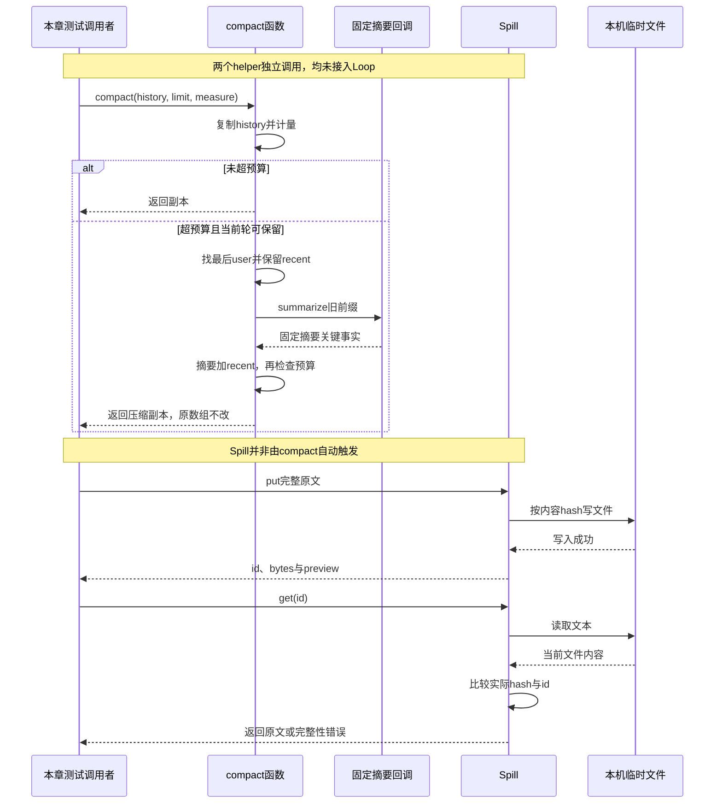

# 019 · 上下文压缩与大结果原文

阶段：R03。唯一前置：完成第 018 步，继续同一个工程。

## 什么时候会用到这一页

一条旧工具结果很长，下一次请求会超预算：历史日志应保留原文，模型副本可用摘要替代较旧轮次；当前轮次的工具调用和结果必须一起留着。另把完整长结果落盘，摘要旁提供hash定位，后续能取回并校验。

### 这次数据怎么走

```text
compact复制history → measure未超则返回 → 找最后user作为当前轮起点 → 保留recent → summarize旧前缀 → 组成摘要消息+recent → 再measure；Spill.put完整文本落盘并给id/preview → get按hash验原文。
```

### 对应时序图

从上往下读；实线箭头表示调用或发送，虚线箭头表示返回或事件通知。`opt`表示可选操作，`alt`表示不同结果，`loop`表示重复，`par`及其`and`分支表示并行；“未接入”及fixture说明按图中标注理解。



**当前接线位置：**compact与new Spill目前只见019测试，未接Loop、Tools或041 Host；后续模型请求不会自动调用本章压缩。即使前面sum和后面Web能跑，也不能据此判断长上下文已处理。

## 这一步具体做什么

完成context.mjs和测试后运行 bun test ./tests/019-context.test.mjs。预期长500字符的旧history不被修改，压缩副本最后仍是next；Spill先取回“完整原文”，再被测试改坏文件后get报完整性错误。当前测试直接调用两个helper，没有模型HTTP。

需要本章新文件的操作，先按下面代码创建文件，再执行；不要在上一步尚不存在的接口上试错。

## 代码为什么放在这一层

compact控制模型请求副本，不删除事实日志；Spill控制长结果的原文存放，不等于自动压缩模型上下文。两个函数需接在真实请求/工具结果路径上才会起作用，本章只建立并测试基础算法。

## 在哪里写、写什么

操作地点：终端中的 `$PROJECT`，编辑器打开同一个目录。只创建或替换下列文件，其他文件保留上一步版本。文件目录不存在先创建。

```sh
mkdir -p src
```

### 创建 `src/context.mjs`

````javascript
import { createHash } from 'node:crypto'
import { writeFileSync, readFileSync, mkdirSync } from 'node:fs'
import { join } from 'node:path'

/** 大结果保存原文，模型看短摘要和可校验定位。 */
export class Spill {
  constructor(root) { this.root = root; mkdirSync(root, { recursive: true }) }
  put(text) { const id = createHash('sha256').update(text).digest('hex'); writeFileSync(join(this.root, id), text); return { id, bytes: Buffer.byteLength(text), preview: text.slice(0, 256) } }
  get(id) {
    if (!/^[a-f0-9]{64}$/.test(id)) throw Error('Spill 身份不合法')
    const text = readFileSync(join(this.root, id), 'utf8')
    if (createHash('sha256').update(text).digest('hex') !== id) throw Error('Spill 完整性错误')
    return text
  }
}

/** 压缩作用于模型可见副本；日志仍保留完整工具组与请求事实。 */
export async function compact(history, { limit, measure, summarize, signal }) {
  const copy = structuredClone(history)
  if (measure(copy) <= limit) return copy
  // 从最后一条 user 开始保留当前 turn，工具调用与结果不拆开。
  let split = copy.length - 1
  while (split > 0 && copy[split].role !== 'user') split--
  const recent = copy.slice(split)
  if (split === 0 || measure(recent) > limit) throw Error('当前轮次本身超限')
  signal.throwIfAborted()
  const summary = await summarize(copy.slice(0, split), signal)
  const result = [{ role: 'user', content: '此前工作摘要：' + summary }, ...recent]
  if (measure(result) > limit) throw Error('摘要后仍超限')
  return result
}
````

```sh
mkdir -p tests
```

### 创建 `tests/019-context.test.mjs`

````javascript
import { test } from 'bun:test'
import assert from 'node:assert/strict'
import { compact, Spill } from '../src/context.mjs'
import { mkdtempSync, rmSync, writeFileSync } from 'node:fs'
import { join } from 'node:path'
import { tmpdir } from 'node:os'

test('压缩不改日志，不拆当前工具组，溢出原文有完整性校验', async () => {
  const history = [{ role: 'user', content: 'x'.repeat(500) }, { role: 'assistant', content: 'old' }, { role: 'user', content: 'next' }]
  const result = await compact(history, { limit: 180, measure: value => JSON.stringify(value).length, summarize: async () => '关键事实', signal: new AbortController().signal })
  assert.equal(history[0].content.length, 500)
  assert.equal(result.at(-1).content, 'next')
  const root = mkdtempSync(join(tmpdir(), 'own-spill-'))
  try { const spill = new Spill(root), ref = spill.put('完整原文'); assert.equal(spill.get(ref.id), '完整原文'); writeFileSync(join(root, ref.id), 'bad'); assert.throws(() => spill.get(ref.id), /完整性/) }
  finally { rmSync(root, { recursive: true, force: true }) }
})
````

## 运行命令与通过标准

```sh
cd "$PROJECT"
bun test ./tests/019-context.test.mjs
bun test
```

1项测试证明旧数组不被改、短摘要可放回预算、原文hash可检测篡改。measure实际用JSON字符串长度，不是token；测试没有当前轮工具组，也没有证明流式大文件、自动触发压缩或模型摘要质量。

**本步证据的范围：**tests/019-context.test.mjs有1项临时磁盘＋内存测试，摘要函数固定返回“关键事实”；没有请求模型，也没有测试名称所暗示的当前工具组样本。

## VS Code：断在哪里、看什么

在VS Code选tests/019-context.test.mjs，选择“Bun：当前测试”按F5。在src/context.mjs的const recent、await summarize、measure(result)和完整性比较打断点。F10监视split、copy.length、recent、result；回到测试帧确认history[0].content.length仍500。F11进入Spill.get，在测试篡改后预期hash与id不相等而抛错。

操作位置：VS Code 打开的是自己的 `$PROJECT`，断点也设在这里的源码，不在教材的 `steps` 目录。

上面的说明若指定CLI、子进程、页面或Electron附加调试，就先按该流程操作；下面这组步骤只用于本章测试入口。“当前测试”不会自动附加子进程，也不会命中浏览器或Electron中的断点。

变量只在所属作用域可见：停在方法内部时看this和参数；要看测试里的局部变量，先在“调用堆栈”选择对应测试帧。正在等待的异步调用者不一定保留可求值的帧，此时在测试调用前后加断点再看，不把未定义误判成业务状态丢失。

沿用第 000 步安装的 Bun 扩展与 `.vscode/launch.json`；本章列出替换配置时，使用本章完整版本。

1. 打开本步测试文件 `tests/019-context.test.mjs`，保持它为当前编辑器文件。
2. 在上面指定的函数内单击行号左侧设置断点。
3. “运行和调试”选择 **Bun：当前测试**，按 F5；它执行当前测试，工作目录固定为 PROJECT。
4. 在“变量 / 监视 / 调用堆栈 / 调试控制台”检查状态；F10 逐行执行，F11 进入函数，Shift+F11 返回，F5 继续，Shift+F5 停止。

验收：断点实际命中，能说出当前输入、状态和下一步；只看到进程启动不算完成。长时间暂停会影响真实取消、审批和网络超时，先检查时序，不删超时断言。修正后在集成终端运行 `bun test ./tests/019-context.test.mjs`，再运行 `bun test`，保留全部断言。

## 不看答案，确认自己能解释

闭卷分别说明“摘要副本”和“落盘原文”解决哪件事，再画出旧轮次被摘要、当前轮次完整保留的历史。指出JSON长度为什么不能叫真实token数。

完成后在 LEARNING.md 写一句实际结果和一个卡点。明天只重做这个卡点；第 3 天、第 7 天再做一次，能独立完成就继续下一页，不另开学习路线。

**再改一个条件验证：**在测试副本把recent内容也扩成超过limit，断言“当前轮次本身超限”；这是需新增的已有分支练习。想用工具组验证需自己补assistant calls与tool消息，不要说原测试已覆盖。

## 与当前原版还差哪些

对照本仓库固定原版 `687f282e8625c6b8d11ff58211a90524be2e4317`；这里的“当前”指该本地基线，不是未经检查的上游最新版。

**这一页已经实现：**

- 副本摘要、保留最后user起始后缀、压缩前后预算检查。
- 内容hash原文存取与简单preview、完整性检查。

**原版仍有、或本步尚未对齐的部分：**

- 原版compaction-basic按模型容量、预留输出token、压力策略和surface范围工作，记录压缩事实并处理溢出重试；本章无token meter、请求恢复接线或持久压缩事件。
- 原版spill-policy在工具后置策略中按token预算裁剪完整图文结果，提供可恢复地址并保持规范值；本章仅文本同步文件helper，未覆盖图像计价、生命周期保留/清理及真实结果处理。

**原版对照位置：**

- [packages/compaction/compaction-basic/src/index.ts](../../../deepseek-harness/packages/compaction/compaction-basic/src/index.ts)
- [packages/compaction/compaction-basic/src/region.ts](../../../deepseek-harness/packages/compaction/compaction-basic/src/region.ts)
- [packages/compaction/compaction/src/tool-pairing.ts](../../../deepseek-harness/packages/compaction/compaction/src/tool-pairing.ts)
- [packages/spill/spill-policy/src/index.ts](../../../deepseek-harness/packages/spill/spill-policy/src/index.ts)
- [packages/spill/spill-local/src/store.ts](../../../deepseek-harness/packages/spill/spill-local/src/store.ts)

本步测试通过只证明上面的具体行为；完整差距仍看 [COVERAGE.md](../COVERAGE.md)，不以文件数量、同名类或后面出现另一个模块代替接线证据。

下一步：[第 020 步](020.md)
