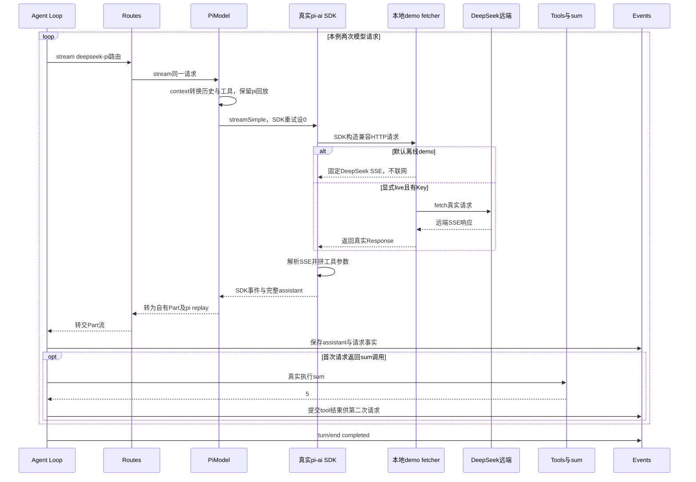
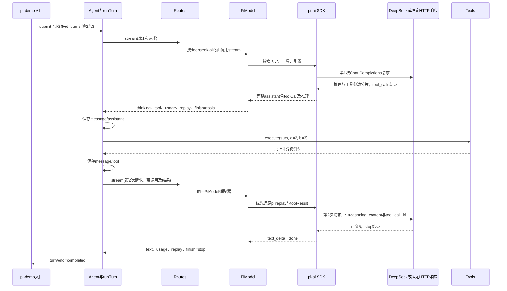

# 020 · 把PiModel接进Routes，仍调用DeepSeek跑通工具续轮

阶段：R03。唯一前置：完成第 019 步，继续同一个工程。

## 什么时候会用到这一页

仍然调用DeepSeek，但不再自己写HTTP与SSE协议解析：Routes选PiModel，pi-ai发请求并组装工具参数，Harness仍执行sum并把结果送回下一模型请求。换的是访问库，不是把DeepSeek换成另一家模型。

### 这次数据怎么走

```text
Agent → Routes(deepseek-pi) → PiModel.context映射历史 → pi-ai streamSimple → DeepSeek兼容响应 → SDK事件转自有Part → Loop执行sum → tool结果和pi replay → 第二次请求 → 正文5 → Scope清理。
```

### 对应时序图

从上往下读；实线箭头表示调用或发送，虚线箭头表示返回或事件通知。`opt`表示可选操作，`alt`表示不同结果，`loop`表示重复，`par`及其`and`分支表示并行；“未接入”及fixture说明按图中标注理解。



**当前接线位置：**pi-demo确实把PiModel接进Routes、Agent和Tools，并检查第二请求的关联与推理回放；这不是只有独立适配器测试。但后续041 Host仍接受modelFactory，未自动改默认模型提供方为此demo。

## 这一步具体做什么

完成本章package.json、源文件和测试后运行 bun install，再运行 bun src/pi-demo.mjs，随后 bun test ./tests/020-pi.test.mjs ./tests/020-pi-demo.test.mjs。默认demo强制离线固定HTTP，即使本机有Key也不收费；摘要应requests=2、http=2、toolRuns=1、finalText="5"、reasoningReplayed=true。--live会调用真实模型，此轮不需要运行。

需要本章新文件的操作，先按下面代码创建文件，再执行；不要在上一步尚不存在的接口上试错。

## 代码为什么放在这一层

PiModel把第三方SDK概念限制在提供方层，Loop继续使用自己的stream(request)与Part；replay保留SDK完整assistant，避免丢推理/工具信息。Routes掌管重试，因此SDK maxRetries设0，不能叠两套重试。

## 先讲清楚：这里想替换什么，DeepSeek还在不在

**这里想替换的是“访问模型服务的代码”，模型服务本身可以仍然是DeepSeek。**DeepSeek和pi-ai不在同一层：

| 名字 | 在这一层负责什么 |
| --- | --- |
| DeepSeek | 远端模型服务，收到请求后生成推理、正文和工具调用 |
| 第016步的DeepSeekModel | 我们自己写的访问适配器：构造HTTP请求、解析SSE、拼接工具参数，再产出Harness的Part |
| pi-ai | 访问模型服务的SDK，让SDK承担请求和协议解析工作 |
| 本步的PiModel | 我们自己写的转换层：把Harness历史转成SDK输入，再把SDK事件转回Part |

对照两条调用链看，替换位置在Loop下面：

```text
016的方式：
Loop → DeepSeekModel → 自己发HTTP、解析SSE、拼接工具参数 → DeepSeek

020新增的可替换实现：
Loop → PiModel → pi-ai负责HTTP和协议解析 → 模型服务（可以仍然配置DeepSeek）
```

本步新增`src/pi-demo.mjs`，把第二条调用链真正接进Routes和Agent，远端仍配置为DeepSeek。**换SDK不等于换模型，接入SDK也不等于整个Harness交给SDK管理。**Loop、Tools、权限、配置快照和会话事实仍由我们的代码负责。

### 为什么用了SDK，还要写PiModel

因为Loop只认识我们定义的`stream(request)`和Part，不认识pi-ai的事件名、工具结果类型和模型上下文结构。PiModel主要做两次转换：

```text
请求方向：
Harness历史、工具、配置 → PiModel.context() → pi-ai需要的上下文

响应方向：
pi-ai的text_delta / done等事件 → PiModel.stream() → text / tool / usage / replay / finish等Part
```

例如SDK返回`text_delta`，本步转成`{ kind: 'text', text: ... }`；SDK完整回复中的toolCall转成`kind: 'tool'`。完整assistant消息保存到`replay`，后续请求优先还原它，减少丢失SDK或提供方专有字段的风险。

因此，调用Loop的一方可以选择把DeepSeekModel或PiModel交进去，Loop继续使用同一个Part接口。这是接口可以替换的原因，而不是因为两者内部代码相同。

## 本步实际接线：Routes里注册PiModel

本步新增`src/pi-demo.mjs`，保留之前的演示文件。入口使用同一套Agent、Routes、Tools、Settings和Events；远端配置保持DeepSeek，访问实现改为PiModel加固定版本`@earendil-works/pi-ai@1.1.0`。

```javascript
// model.provider仍是deepseek，api选择OpenAI兼容Chat Completions入口。
const adapter = new PiModel(model, key, fetcher)

// deepseek-pi是我们注册表里的路由名，用来说明采用哪种访问实现。
scope.own(routes.add('deepseek-pi', [modelId], adapter))

// settings中provider=deepseek-pi，Agent仍拿Routes，不直接绕过路由找模型。
const agent = new Agent(session, routes, tools, settings)
```

两个provider名字不要混淆：Settings中的`deepseek-pi`用于查自己的Routes；SDK模型配置中的`provider: 'deepseek'`说明远端模型属于DeepSeek。`api: 'openai-completions'`说明使用兼容协议，不代表调用OpenAI公司的模型。默认目标是`deepseek-flash`与`https://api.deepseek.com/chat/completions`。[DeepSeek官方调用方式](https://api-docs.deepseek.com/zh-cn/)

### 同一条任务怎样完成模型→工具→模型



模型只提出调用意图，真正相加的是本机Tools中的sum函数。第二次请求的HTTP观察点会检查：assistant调用和tool结果使用相同ID、工具结果确实是`{ ok: true, value: 5 }`、reasoning_content正确回传。终端打印5但没走这些步骤，demo仍会验收失败。[DeepSeek工具续轮示例](https://api-docs.deepseek.com/zh-cn/guides/tool_calls/)

## 按顺序运行：先确定性验收，再真实调用DeepSeek

先按下文在自己的PROJECT创建本步文件，沿用第016步的`.env.example`；在PROJECT终端安装本步锁定依赖：

```sh
cp "$COURSE/locks/020.bun.lock" bun.lock
bun install --frozen-lockfile --ignore-scripts
bun src/pi-demo.mjs
bun test ./tests/020-pi-demo.test.mjs
bun test ./tests/020-pi.test.mjs
bun test
```

无参数运行固定HTTP响应，不读真实Key、不发网络请求，但真实使用pi-ai SDK解析SSE和拼接工具参数，真实执行Routes、Agent和sum。它没有直接调用第016步的DeepSeekModel。原有适配器测试保留，新集成测试实际启动同一个CLI入口。

离线验收日志应依次包含：

```text
[请求] deepseek-pi/deepseek-flash step=0
[HTTP #1] deepseek-flash /chat/completions，携带工具结果=false
[工具开始] sum
[工具结果] {"ok":true,"value":5}
[请求] deepseek-pi/deepseek-flash step=1
[HTTP #2] deepseek-flash /chat/completions，携带工具结果=true
[正文] 5
[轮次结束] completed
```

固定样本通过后，用编辑器打开自己的PROJECT/.env，沿用第016步已配置的Key，不覆盖已有凭据。如果尚未创建.env，先将.env.example复制为.env，再只在本机编辑器填写：

```dotenv
DEEPSEEK_API_KEY=
DSH_MODEL=deepseek-flash
DEEPSEEK_BASE_URL=https://api.deepseek.com
```

随后执行真实请求：

```sh
bun --env-file=.env src/pi-demo.mjs --live
```

`--live`使用同一条Agent→Routes→PiModel→pi-ai链，只将外部HTTP换成实际fetch；会消耗模型额度。缺少Key就非零退出，不会偷偷改跑离线模式。默认不传--live仍是固定样本，即使环境里已有Key也不会自动发真实请求。

演示任务固定为先调用sum计算2加3，最多放行两次HTTP请求；模型没有按预期调用工具、返回错误或超过这个演示预算，都会明确失败。这里是小范围贯通验收，不是允许任意任务的产品CLI。模型配置中的cost零系数只是SDK字段占位，不能把它当作真实费用统计。

### 两种运行都怎样算完成

最后一行以`020验收结果：`开头，由实际会话事件和HTTP观察点生成，必须满足：

- route为`deepseek-pi`，SDK provider为`deepseek`，model默认`deepseek-flash`，api为`openai-completions`。
- `requests: 2`、`http: 2`、`toolRuns: 1`、`reason: completed`、`finalText: "5"`。
- `historyChecked: true`、`reasoningReplayed: true`，两条assistant的`replayProviders`均为pi。
- `agentClosed: true`，注册路由、工具和监听均归零。
- 固定响应时mode为offline，真实请求时mode必须为live；不能拿offline记录代替真实模型证据。

本次维护者已实际使用本机既有凭据调用DeepSeek，得到两次HTTP、一次sum执行及最终5，推理和工具结果回传核对通过；摘要见[真实请求记录](../evidence/020-pi-live.json)。真实响应措辞可能不同，demo要求最终正文去掉首尾空白后是数字5。

原有`tests/020-pi.test.mjs`仍直接验证SDK适配边界；新增`tests/020-pi-demo.test.mjs`验证完整CLI链及真实模式缺Key拒绝。自动化测试只跑固定HTTP响应，不会批量调用真实API。

## VS Code：附加到020的实际demo

在自己的PROJECT/.vscode/launch.json中，把下面对象加到已有configurations数组，保留之前的配置：

```json
{
  "name": "Bun：020 pi-ai（附加）",
  "type": "bun",
  "request": "attach",
  "url": "ws://127.0.0.1:6499/pi-020"
}
```

先在PROJECT终端启动固定响应演示：

```sh
bun --inspect-brk=127.0.0.1:6499/pi-020 src/pi-demo.mjs
```

在VS Code选择“Bun：020 pi-ai（附加）”，按F5连接，再按F5继续到断点。离线链看懂后，停止本次进程，在同一终端启动真实模式，再用同一配置附加：

```sh
bun --env-file=.env --inspect-brk=127.0.0.1:6499/pi-020 src/pi-demo.mjs --live
```

| 断点位置 | 应该观察什么 |
| --- | --- |
| pi-demo中`routes.add('deepseek-pi', ...)`和`new Agent(...)` | 注册对象是PiModel，Agent拿到Routes，SDK model.provider仍是deepseek |
| routes.mjs中`this.providers.get(...)` | request.config.provider匹配deepseek-pi，不再调用DeepSeekModel |
| pi.mjs中`context(request)` | 第1次历史是用户输入；第2次多出完整SDK assistant replay和toolResult |
| pi.mjs中`if (event.type === 'done')` | 第1次是toolUse并含完整toolCall与thinking；第2次是stop |
| pi-demo中sum的run | 参数a=2、b=3，实际返回5，只执行一次 |
| pi-demo的fetcher中`if (index === 1)`之后 | 第二次请求已经通过tool_call_id、工具结果和reasoning_content校验；不要打印鉴权头或Key |

PiModel把SDK的maxRetries设为0，由Routes掌握有限重试，避免两层重试叠加。每次SDK请求有30秒超时；真实模式在长时间暂停后可能超时，先用离线模式理解流程，不删除超时或断言来通过验收。当前模型ID必须和Routes选择一致，未知或不一致配置不能悄悄改用默认模型。

## 本步边界与闭卷回忆

新demo确实将PiModel接进Routes和Agent，也实际验证了DeepSeek模型→工具→模型的续轮；旧的demo及DeepSeekModel仍保留。本步不证明所有协议、所有提供方、跨适配器旧历史迁移、完整取消矩阵和产品发布资格都已完成。固定SDK版本和当前路由的证据不能扩大成全provider等价。

先合上代码，自己画出两条调用链，说明仍用DeepSeek时替换了哪层。然后指出第二次HTTP请求的工具结果从哪来、为何必须保留replay；次日只闭卷重做这两个卡点。调试或记录时不把Key、鉴权头和实际推理正文复制进学习笔记。

## 在哪里写、写什么

操作地点：终端中的 `$PROJECT`，编辑器打开同一个目录。只创建或替换下列文件，其他文件保留上一步版本。文件目录不存在先创建。

### 替换 `package.json`

````json
{
  "name": "harness-own",
  "version": "0.1.0",
  "type": "module",
  "private": true,
  "engines": {
    "bun": "1.3.14"
  },
  "scripts": {
    "start": "bun src/main.mjs",
    "test": "bun test ./tests"
  },
  "dependencies": {
    "@earendil-works/pi-ai": "1.1.0"
  },
  "packageManager": "bun@1.3.14"
}
````

```sh
mkdir -p src
```

### 创建 `src/pi-demo.mjs`

````javascript
import assert from 'node:assert/strict'
import { Agent } from './agent.mjs'
import { Settings } from './config.mjs'
import { Events } from './events.mjs'
import { PiModel } from './pi.mjs'
import { Routes } from './routes.mjs'
import { Scope } from './scope.mjs'
import { Tools } from './tools.mjs'

/** 创建DeepSeek兼容的SSE响应，SDK负责解析及工具参数拼接。 */
function fixtureResponse(events) {
  return new Response(events.map(event => 'data: ' + JSON.stringify(event) + '\n\n').join('') + 'data: [DONE]\n\n', { headers: { 'content-type': 'text/event-stream' } })
}
/** 固定HTTP样本中的单候选增量，停止原因仍走真实SDK解析。 */
const chunk = (delta, finish = null) => ({ choices: [{ index: 0, delta, finish_reason: finish }] })

/** 实际装配Routes和PiModel；默认固定外部响应，--live才访问DeepSeek。 */
export async function runPiDemo({ live = false, key, baseURL = 'https://api.deepseek.com', modelId = 'deepseek-flash', write = console.log } = {}) {
  if (live && !key) throw Error('真实请求缺少DEEPSEEK_API_KEY，请先配置本机.env；不会回退到离线样本')
  // 所有输出统一遮盖本次凭据；不打印请求头、模型实例或整个环境变量。
  const log = message => write(live && key ? String(message).replaceAll(key, '[已隐藏]') : message)
  const scope = new Scope(), session = new Events(), tools = new Tools(), routes = new Routes()
  const stats = { http: [], toolRuns: 0, historyChecked: false, reasoningReplayed: false }
  // 远端仍是DeepSeek，只有访问实现换成PiModel与pi-ai；不是OpenAI模型。
  const model = { id: modelId, name: modelId, api: 'openai-completions', provider: 'deepseek', baseUrl: baseURL.replace(/\/+$/, ''),
    reasoning: true, input: ['text'], contextWindow: 32768, maxTokens: 4096,
    // 本课不维护价格目录，零系数只是SDK必填占位，不能用来推断真实请求免费。
    cost: { input: 0, output: 0, cacheRead: 0, cacheWrite: 0 },
    compat: { supportsStore: false, supportsDeveloperRole: false, supportsStrictMode: false, supportsReasoningEffort: true,
      maxTokensField: 'max_tokens', requiresReasoningContentOnAssistantMessages: true, thinkingFormat: 'deepseek' } }
  const settings = new Settings({ provider: 'deepseek-pi', model: modelId, reasoning: 'low', maxTokens: 4096,
    system: '你正在验收工具调用。必须先调用sum工具计算用户给出的两个数，收到工具结果后只输出结果数字。' })
  log(`[运行方式] ${live ? '真实DeepSeek请求，会使用模型额度' : '离线：DeepSeek协议响应固定，不发送网络请求'}`)
  log(`[调用链] Agent → Routes(deepseek-pi) → PiModel → pi-ai → DeepSeek(${modelId})`)

  // SDK真正生成请求；这里只观察正文中的调用关联，隐藏鉴权，最多放行两次HTTP。
  const fetcher = async (input, init) => {
    const request = new Request(input, init)
    const body = await request.clone().json()
    if (stats.http.length >= 2) throw Error('020演示最多发送两次HTTP；模型未按预期完成工具续轮')
    assert.equal(body.model, modelId)
    assert.ok(new URL(request.url).pathname.endsWith('/chat/completions'))
    assert.equal(body.tools[0].function.name, 'sum')
    assert.equal(body.thinking.type, 'enabled')
    const index = stats.http.length
    if (index === 1) {
      // 工具结果必须来自真正执行，且和上一条assistant调用使用同一个身份。
      const assistant = body.messages.findLast(message => message.role === 'assistant' && message.tool_calls?.length)
      const result = body.messages.findLast(message => message.role === 'tool')
      assert.ok(assistant && result, '第二次请求缺少assistant调用或tool结果')
      assert.equal(result.tool_call_id, assistant.tool_calls[0].id)
      assert.deepEqual(JSON.parse(result.content), { ok: true, value: 5 })
      assert.equal(typeof assistant.reasoning_content, 'string')
      if (!live) assert.equal(assistant.reasoning_content, '先调用sum计算')
      stats.historyChecked = true
      stats.reasoningReplayed = true
    }
    stats.http.push({ model: body.model, toolResultIncluded: index === 1 })
    log(`[HTTP #${index + 1}] ${modelId} /chat/completions，携带工具结果=${index === 1}`)
    if (live) return await fetch(request)
    // 只替换外部HTTP：真实SDK仍需拼接工具JSON，真实Loop仍需实际执行sum。
    if (index === 0) return fixtureResponse([
      chunk({ role: 'assistant', reasoning_content: '先调用sum计算' }),
      chunk({ tool_calls: [{ index: 0, id: 'sum-020', type: 'function', function: { name: 'sum', arguments: '{"a":2,' } }] }),
      chunk({ tool_calls: [{ index: 0, function: { arguments: '"b":3}' } }] }),
      chunk({}, 'tool_calls'), { choices: [], usage: { prompt_tokens: 10, completion_tokens: 8, total_tokens: 18 } },
    ])
    return fixtureResponse([chunk({ role: 'assistant', content: '5' }, 'stop'), { choices: [], usage: { prompt_tokens: 20, completion_tokens: 1, total_tokens: 21 } }])
  }
  const adapter = new PiModel(model, live ? key : 'offline-only', fetcher)
  scope.own(routes.add('deepseek-pi', [modelId], adapter))
  tools.register(scope, { name: 'sum', description: '计算两个数之和，必须调用本工具获得结果', schema: { type: 'object', required: ['a', 'b'], properties: { a: { type: 'number' }, b: { type: 'number' } }, additionalProperties: false }, run: args => {
    stats.toolRuns++
    assert.deepEqual(args, { a: 2, b: 3 })
    return args.a + args.b
  } })
  scope.own(session.on(event => {
    if (event.type === 'request/start') log(`[请求] ${event.data.config.provider}/${event.data.config.model} step=${event.data.step}`)
    if (event.type === 'tool/start') log(`[工具开始] ${event.data.call.name}`)
    if (event.type === 'message/tool') log(`[工具结果] ${JSON.stringify(event.data.content)}`)
    if (event.type === 'stream/text') log(`[正文] ${event.data.text}`)
    if (event.type === 'turn/error') log(`[轮次错误] ${event.data.message}`)
    if (event.type === 'turn/end') log(`[轮次结束] ${event.data.reason}`)
  }))
  const agent = new Agent(session, routes, tools, settings)
  scope.own(() => agent.close())
  let report
  try {
    agent.submit('请务必先调用sum工具计算2加3，取得工具结果后只输出结果数字。')
    await agent.idle()
    const records = session.read(), messages = records.filter(event => event.type === 'message/assistant')
    report = { mode: live ? 'live' : 'offline', route: 'deepseek-pi', provider: model.provider, model: modelId, api: model.api,
      reason: records.findLast(event => event.type === 'turn/end')?.data.reason,
      requests: records.filter(event => event.type === 'request/start').length,
      http: stats.http.length, toolRuns: stats.toolRuns, historyChecked: stats.historyChecked, reasoningReplayed: stats.reasoningReplayed,
      usageEvents: records.filter(event => event.type === 'request/usage').length,
      replayProviders: messages.map(event => event.data.replay?.provider), finalText: messages.at(-1)?.data.content.trim() ?? '' }
    assert.equal(report.reason, 'completed')
    assert.equal(report.requests, 2); assert.equal(report.http, 2); assert.equal(report.toolRuns, 1)
    assert.ok(report.historyChecked && report.reasoningReplayed)
    assert.deepEqual(report.replayProviders, ['pi', 'pi'])
    assert.equal(report.finalText, '5')
  } finally { await scope.close() }
  report.cleanup = { agentClosed: agent.closed, routes: routes.providers.size, tools: tools.entries.size, listeners: session.listeners.size }
  assert.deepEqual(report.cleanup, { agentClosed: true, routes: 0, tools: 0, listeners: 0 })
  log('020验收结果：' + JSON.stringify(report))
  return report
}

// 命令行默认离线；真实请求必须显式指定--live并提供Key，失败非零退出。
if (import.meta.main) {
  const live = process.argv.slice(2).includes('--live')
  const key = live ? process.env.DEEPSEEK_API_KEY : undefined
  try {
    if (process.argv.slice(2).some(arg => arg !== '--live')) throw Error('只支持无参数或--live；演示任务固定为调用sum计算2加3')
    await runPiDemo({ live, key, baseURL: live ? process.env.DEEPSEEK_BASE_URL ?? 'https://api.deepseek.com' : 'https://api.deepseek.com',
      modelId: live ? process.env.DSH_MODEL ?? 'deepseek-flash' : 'deepseek-flash' })
  } catch (error) {
    const message = live && key ? String(error.message).replaceAll(key, '[已隐藏]') : error.message
    console.error('020演示失败：' + message)
    process.exitCode = 1
  }
}
````

```sh
mkdir -p src
```

### 创建 `src/pi.mjs`

````javascript
import { normalizeContext } from '@earendil-works/pi-ai'
import { streamSimple } from '@earendil-works/pi-ai/api/openai-completions'

/** pi-ai 专管模型访问，Harness 继续拥有 Loop、工具、权限和持久事实。 */
export class PiModel {
  constructor(model, apiKey, fetcher = fetch, stream = streamSimple) { this.model = model; this.key = apiKey; this.fetcher = fetcher; this.start = stream }
  /** 完整 assistant replay 优先，避免把 provider 特有签名转换丢失。 */
  context(request) {
    const zero = { input: 0, output: 0, cacheRead: 0, cacheWrite: 0, totalTokens: 0, cost: { input: 0, output: 0, cacheRead: 0, cacheWrite: 0, total: 0 } }
    return normalizeContext({ systemPrompt: request.config?.system ?? '',
      messages: request.messages.map(message => {
        if (message.replay?.provider === 'pi') return structuredClone(message.replay.message)
        if (message.role === 'user') return { role: 'user', content: message.content, timestamp: 0 }
        if (message.role === 'tool') return { role: 'toolResult', toolCallId: message.callId, toolName: message.name, isError: !message.content.ok, content: [{ type: 'text', text: JSON.stringify(message.content) }], timestamp: 0 }
        return { role: 'assistant', content: [...(message.content ? [{ type: 'text', text: message.content }] : []), ...(message.calls ?? []).map(call => ({ type: 'toolCall', id: call.id, name: call.name, arguments: call.arguments }))], api: this.model.api, provider: this.model.provider, model: this.model.id, stopReason: message.calls?.length ? 'toolUse' : 'stop', usage: zero, timestamp: 0 }
      }), tools: request.tools.map(tool => ({ name: tool.name, description: tool.description, parameters: tool.schema })) })
  }
  /** 接口事件转回自己定义的 Part，Loop 不依赖任何 pi-ai 字段。 */
  async *stream(request) {
    request.signal.throwIfAborted()
    if (request.config?.model && request.config.model !== this.model.id) throw Error('PiModel配置与路由模型不一致')
    let ended = false
    // 重试交给Routes统一管理，SDK不再叠加重试；推理设置沿用本轮配置快照。
    for await (const event of this.start(this.model, this.context(request), { apiKey: this.key, signal: request.signal, fetch: this.fetcher,
      maxTokens: request.config?.maxTokens ?? 2048, reasoning: request.config?.reasoning ?? 'off', maxRetries: 0,
      timeoutMs: request.config?.timeoutMs ?? 30_000 })) {
      request.signal.throwIfAborted()
      if (event.type === 'text_delta') yield { kind: 'text', text: event.delta }
      if (event.type === 'error') throw Error(event.error.errorMessage ?? 'pi-ai 请求失败')
      if (event.type === 'done') {
        if (!['toolUse', 'stop', 'length'].includes(event.reason)) throw Error('pi-ai异常停止原因：' + event.reason)
        ended = true
        for (const block of event.message.content) {
          if (block.type === 'toolCall') yield { kind: 'tool', id: block.id, name: block.name, arguments: block.arguments }
          if (block.type === 'thinking') yield { kind: 'thinking', text: block.thinking, signature: block.thinkingSignature }
        }
        yield { kind: 'usage', ...event.message.usage }
        yield { kind: 'replay', value: { provider: 'pi', message: event.message } }
        yield { kind: 'finish', reason: event.reason === 'toolUse' ? 'tools' : event.reason === 'stop' ? 'stop' : 'length' }
      }
    }
    if (!ended) throw Error('pi-ai 流提前结束')
  }
}
````

```sh
mkdir -p tests
```

### 创建 `tests/020-pi-demo.test.mjs`

````javascript
import { test } from 'bun:test'
import assert from 'node:assert/strict'
import { spawnSync } from 'node:child_process'

/** 启动用户实际运行的入口，验证真实SDK、Routes、Agent和工具续轮，而非只测适配器。 */
test('020的CLI经pi-ai和DeepSeek路由贯通模型工具模型', () => {
  const result = spawnSync(process.execPath, ['src/pi-demo.mjs'], { cwd: process.cwd(), env: { ...process.env }, encoding: 'utf8' })
  assert.equal(result.status, 0, result.stdout + result.stderr)
  const line = result.stdout.split('\n').find(value => value.startsWith('020验收结果：'))
  assert.ok(line, result.stdout)
  const report = JSON.parse(line.slice('020验收结果：'.length))
  assert.equal(report.mode, 'offline'); assert.equal(report.route, 'deepseek-pi')
  assert.equal(report.provider, 'deepseek'); assert.equal(report.model, 'deepseek-flash')
  assert.equal(report.reason, 'completed'); assert.equal(report.requests, 2); assert.equal(report.http, 2)
  assert.equal(report.toolRuns, 1); assert.equal(report.finalText, '5')
  assert.equal(report.historyChecked, true); assert.equal(report.reasoningReplayed, true)
  assert.deepEqual(report.replayProviders, ['pi', 'pi']); assert.equal(report.usageEvents, 2)
  assert.deepEqual(report.cleanup, { agentClosed: true, routes: 0, tools: 0, listeners: 0 })
})

/** 显式真实模式缺少Key必须失败，不能偷偷改跑固定响应后宣称真实通过。 */
test('020真实模式缺少凭据拒绝运行，不回退离线', () => {
  const result = spawnSync(process.execPath, ['src/pi-demo.mjs', '--live'], { cwd: process.cwd(), env: { ...process.env, DEEPSEEK_API_KEY: '' }, encoding: 'utf8' })
  assert.equal(result.status, 1)
  assert.match(result.stderr, /缺少DEEPSEEK_API_KEY/)
  assert.ok(!result.stdout.includes('020验收结果：'))
})
````

```sh
mkdir -p tests
```

### 创建 `tests/020-pi.test.mjs`

````javascript
import { test } from 'bun:test'
import assert from 'node:assert/strict'
import { PiModel } from '../src/pi.mjs'

test('真正 pi-ai SDK 解析固定 HTTP 流，领域层只见自己的 Part', async () => {
  const model = { id: 'test', name: 'test', api: 'openai-completions', provider: 'openai', baseUrl: 'http://model/v1', reasoning: false, input: ['text'], contextWindow: 8000, maxTokens: 2048, cost: { input: 0, output: 0, cacheRead: 0, cacheWrite: 0 } }
  const raw = [{ choices: [{ index: 0, delta: { role: 'assistant', content: '你好' }, finish_reason: null }] }, { choices: [{ index: 0, delta: {}, finish_reason: 'stop' }] }]
  const adapter = new PiModel(model, 'test', async () => new Response(raw.map(value => 'data: ' + JSON.stringify(value) + '\n\n').join('') + 'data: [DONE]\n\n'))
  const received = []
  for await (const part of adapter.stream({ config: {}, messages: [{ role: 'user', content: 'hi' }], tools: [], signal: new AbortController().signal })) received.push(part)
  assert.equal(received.filter(part => part.kind === 'text').map(part => part.text).join(''), '你好')
  assert.equal(received.at(-1).reason, 'stop')
  assert.equal(received.find(part => part.kind === 'replay').value.provider, 'pi')
})
````

## 运行命令与通过标准

```sh
cd "$PROJECT"
cp "$COURSE/locks/020.bun.lock" bun.lock
bun install --frozen-lockfile --ignore-scripts
bun src/pi-demo.mjs
bun test ./tests/020-pi-demo.test.mjs
bun test ./tests/020-pi.test.mjs
bun test
```

3项测试验证真实SDK解析、真实CLI两次请求与工具续轮、显式live缺Key拒绝。默认HTTP是固定样本，不能声称重新验证真实模型；model配置中的零价格是SDK必填占位，不代表API免费。

**本步证据的范围：**020-pi.test.mjs有1项实际SDK＋固定HTTP测试，020-pi-demo.test.mjs有2项真实CLI测试。离线全链路真实执行SDK、Routes、Agent与sum，外部HTTP固定；真实模式需另行显式运行并独立记录，不能把历史live证据当本次重新实跑。

## VS Code：断在哪里、看什么

在VS Code先选tests/020-pi.test.mjs，选择“Bun：当前测试”按F5；在src/pi.mjs的this.context(request)、event.type === "done"和yield replay打断点，F11进入context看工具结果映射，F10观察event.message.content与stopReason。完整demo按下方attach配置运行 bun --inspect-brk=127.0.0.1:6499/pi-020 src/pi-demo.mjs；在fetcher第二次调用看assistant.tool_calls、tool_call_id与stats.toolRuns=1。CLI子进程测试不会自动跟随当前调试会话。

操作位置：VS Code 打开的是自己的 `$PROJECT`，断点也设在这里的源码，不在教材的 `steps` 目录。

上面的说明若指定CLI、子进程、页面或Electron附加调试，就先按该流程操作；下面这组步骤只用于本章测试入口。“当前测试”不会自动附加子进程，也不会命中浏览器或Electron中的断点。

变量只在所属作用域可见：停在方法内部时看this和参数；要看测试里的局部变量，先在“调用堆栈”选择对应测试帧。正在等待的异步调用者不一定保留可求值的帧，此时在测试调用前后加断点再看，不把未定义误判成业务状态丢失。

沿用第 000 步安装的 Bun 扩展与 `.vscode/launch.json`；本章列出替换配置时，使用本章完整版本。

1. 打开本步测试文件 `tests/020-pi.test.mjs`，保持它为当前编辑器文件。
2. 在上面指定的函数内单击行号左侧设置断点。
3. “运行和调试”选择 **Bun：当前测试**，按 F5；它执行当前测试，工作目录固定为 PROJECT。
4. 在“变量 / 监视 / 调用堆栈 / 调试控制台”检查状态；F10 逐行执行，F11 进入函数，Shift+F11 返回，F5 继续，Shift+F5 停止。

验收：断点实际命中，能说出当前输入、状态和下一步；只看到进程启动不算完成。长时间暂停会影响真实取消、审批和网络超时，先检查时序，不删超时断言。修正后在集成终端运行 `bun test ./tests/020-pi.test.mjs`，再运行 `bun test`，保留全部断言。

## 不看答案，确认自己能解释

合上资料写出016和020两条调用链，圈出被替换的一段；再说明HTTP由谁发、sum由谁执行、重试由谁决定。

完成后在 LEARNING.md 写一句实际结果和一个卡点。明天只重做这个卡点；第 3 天、第 7 天再做一次，能独立完成就继续下一页，不另开学习路线。

**再改一个条件验证：**在离线pi-demo的副本中把第一SSE的工具arguments拆成三段，保留完整JSON后运行，应仍得到5；需改固定样本后再运行。任务与断言固定2+3，不要只改输入数字而忘记同步fixture/验收。

## 与当前原版还差哪些

对照本仓库固定原版 `687f282e8625c6b8d11ff58211a90524be2e4317`；这里的“当前”指该本地基线，不是未经检查的上游最新版。

**这一页已经实现：**

- 真实pi-ai SDK与自有模型接口适配、Pi历史/工具结果与replay。
- 离线和显式live入口、Route接线、真实sum续轮、有限HTTP和清理验收。

**原版仍有、或本步尚未对齐的部分：**

- 原版llm-pi-ai从配置和SDK目录解析多个provider/model，支持模型发现、能力/容量、登录及凭据桥；本章手写一个DeepSeek model对象，没有目录与配置服务。
- 原版stream映射含AUTH/RATE_LIMIT/TRANSPORT/上下文超限等结构化失败、流内容与usage统一表示；本章普通Error及有限Part映射，未覆盖多模态、完整失败分类和原版上下文更新能力。

**原版对照位置：**

- [packages/llm/llm-pi-ai/src/adapter.ts](../../../deepseek-harness/packages/llm/llm-pi-ai/src/adapter.ts)
- [packages/llm/llm-pi-ai/src/context.ts](../../../deepseek-harness/packages/llm/llm-pi-ai/src/context.ts)
- [packages/llm/llm-pi-ai/src/stream.ts](../../../deepseek-harness/packages/llm/llm-pi-ai/src/stream.ts)
- [packages/llm/llm-pi-ai/src/discovery.ts](../../../deepseek-harness/packages/llm/llm-pi-ai/src/discovery.ts)
- [packages/llm/llm-pi-ai/src/auth.ts](../../../deepseek-harness/packages/llm/llm-pi-ai/src/auth.ts)

本步测试通过只证明上面的具体行为；完整差距仍看 [COVERAGE.md](../COVERAGE.md)，不以文件数量、同名类或后面出现另一个模块代替接线证据。

下一步：[第 021 步](021.md)
