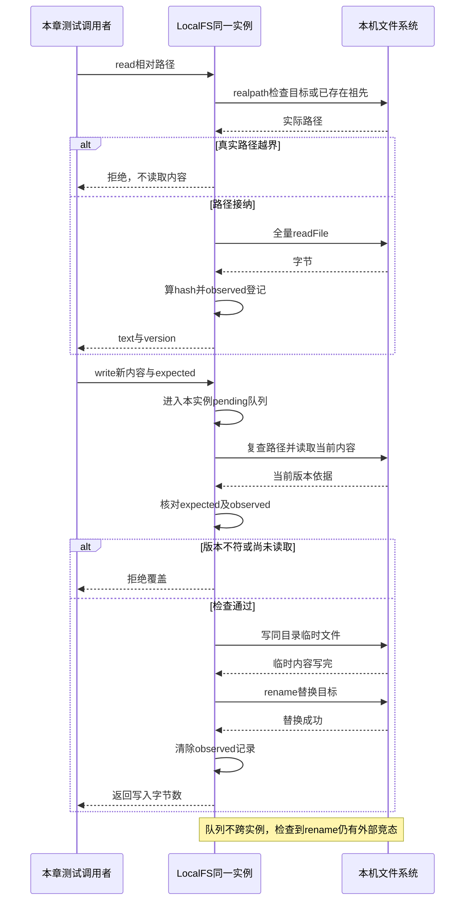

# 021 · 真实文件与观察版本

阶段：R04。唯一前置：完成第 020 步，继续同一个工程。

<!-- harness-own-links:start -->
## 当前练习工程文件

以下链接指向 `harness-own` 的当前累计版本；本课下方的完整代码仍保留当步版本，二者可能不同。

[打开练习工程说明](../../../harness-own/README.md)

| 本课文件 | 当前练习工程文件 |
| --- | --- |
| `src/filesystem.mjs` | [`harness-own/src/filesystem.mjs`](../../../harness-own/src/filesystem.mjs) |
| `tests/021-filesystem.test.mjs` | [`harness-own/tests/021-filesystem.test.mjs`](../../../harness-own/tests/021-filesystem.test.mjs) |

<!-- harness-own-links:end -->

## 什么时候会用到这一页

Agent读到a.txt内容one，准备改成two；外部编辑器已经改过时，应拒绝旧版本覆盖。另有link指向工作区外的secret，应在真实路径检查时拒绝读取，避免只检查表面文件名。

### 这次数据怎么走

```text
LocalFS.path检查词法相对路径与已存在祖先realpath → read全量读字节、算SHA-256并记observed → write进入同实例pending队列 → 重读版本并核对expected/observed → 同目录临时文件 → rename目标 → 清除observed。
```

### 对应时序图

从上往下读；实线箭头表示调用或发送，虚线箭头表示返回或事件通知。`opt`表示可选操作，`alt`表示不同结果，`loop`表示重复，`par`及其`and`分支表示并行；“未接入”及fixture说明按图中标注理解。



**当前接线位置：**021只在文件提供方单测使用；022 fileTools与edit-demo接入统一Tools.execute，041 Host为每个会话创建LocalFS(header.cwd)。不同会话实例的pending不会互相串行。

## 这一步具体做什么

写完filesystem.mjs和测试后运行 bun test ./tests/021-filesystem.test.mjs。测试会在系统临时目录建workspace、outside和link；首次新建允许，读取后写two允许，再用旧version写stale拒绝，读取越界链接拒绝。别在自己的工作区造真实机密链接。

需要本章新文件的操作，先按下面代码创建文件，再执行；不要在上一步尚不存在的接口上试错。

## 代码为什么放在这一层

LocalFS是实际读写磁盘的提供方，022才把它包装成模型工具。expected核对调用者依据的版本，observed核对本实例确实读过它；临时文件再rename避免半份内容暴露，但不是原子“检查版本并替换”。

## 读完文件后别人又改了，怎么处理冲突

**观察版本负责发现冲突，不负责自动合并。**它是读取时对文件内容计算出的SHA-256指纹，不是Git版本，也不是递增编号。下面用V1、V2代指不同内容的指纹，方便看清顺序。

### 一个具体例子：两个人都想改config.json

原文件是：

```json
{"port":3000,"timeout":30}
```

A、B都读取了这份内容，拿到V1，但想做不同的修改：

| 谁在改 | 修改意图 | 基于旧文件准备的完整内容 |
| --- | --- | --- |
| A | 把port改成4000 | `{"port":4000,"timeout":30}` |
| B | 把timeout改成60 | `{"port":3000,"timeout":60}` |

假设通过同一个LocalFS实例提交写入，A先成功：

```text
A携带V1写入
  → 当前内容仍是V1，且读取记录匹配
  → 写入成功，文件变成port=4000、timeout=30，记为V2
  → 清除这份文件的读取记录

B仍携带V1写入
  → 写入前重新读取磁盘，当前指纹已经是V2
  → 拒绝：文件已变化或尚未读取
  → 文件保持A写入后的内容
```

如果无条件接受B准备的整份旧文件，就会把A刚改好的port从4000退回3000。**拒绝旧版本，是为了防止这种覆盖；即使改的是不同字段，也不能直接用旧的完整文件覆盖。**

### 冲突后正确的操作：重新读取，再应用修改意图

```text
B重新read，拿到最新正文和V2
  最新正文：port=4000、timeout=30

B保留自己的意图：“把timeout改成60”
  在最新正文上重做修改：port=4000、timeout=60

B携带V2提交新正文
  → 如果期间没有新变化，写入成功
  → 如果又有人修改，继续报冲突，不能绕过版本检查
```

这里保留的是“我要修改哪个字段、达到什么效果”，不是反复提交自己最初准备的旧正文。仅仅把expected换成最新版本、正文却仍用旧的完整文件，也会覆盖别人的修改，不能这样解决。

这不是LocalFS自动完成的：它只抛出错误。接入Loop之后，工具执行失败会被记录为类似下面的结果，并进入下一次模型请求：

```json
{"ok":false,"error":"文件已变化或尚未读取"}
```

模型可以据此再次调用read，理解最新内容，再提出新的write或edit调用。**Loop不会自动重读、自动合并或自动替用户决定覆盖哪一份。**目前021提供文件实现，022注册文件工具，041的Host才把它们与Agent实际装配。

### 如果两个人改的是同一处呢

例如A把port改为4000，B希望改为5000。重新读取只能让B知道“A已经改成4000”，不能说明5000一定应该覆盖4000。

这时需要根据明确的任务要求决定取舍；若要求不明确，应报告冲突、让用户决定，而不是为了让写入成功就悄悄覆盖。即使改的是不同字段，也要检查语义关系，例如新的端口和超时配置是否仍符合应用要求。

### 自动合并需要额外做什么

想实现三方合并，需要同时比较三份内容：

| 内容 | 用来判断什么 |
| --- | --- |
| 最初读取的正文 | 修改前是什么样，即共同基线 |
| 自己准备写入的正文 | 自己相对基线改了哪里 |
| 磁盘上的最新正文 | 别人相对基线改了哪里 |

不同位置的修改有机会合并；同一位置的不同修改需要冲突规则或人工决策。合并后仍应拿最新指纹作为expected进行写入，如果期间又有变化，合并结果也不能直接强行覆盖。

**当前LocalFS.observed只保存指纹，没有实现三方合并，也没有保留用于合并的完整基线正文。**如果后续做自动合并，上层还需要保存基线和修改意图，不能靠一个hash还原原文。当前例子描述的是冲突处理流程，不代表本步已经实现自动合并。

### 保证到哪里，怎么用断点核对

`this.pending`只让同一个LocalFS实例中的写操作排队。不同实例、不同进程或编辑器并不共享这条队列；别的进程仍可能在“检查当前内容”之后、“最终写入”之前改文件。临时文件加rename不等于跨进程的条件写入保证，更强的一致性还需要额外的协调机制。

用VS Code打开本步测试，在write中比较`expected`、`current`和`this.observed.get(path)`的判断处设置断点。已有测试先读one、成功写two，再携带旧指纹写stale，应当停在拒绝分支，文件不会被旧请求覆盖。这个测试证明的是旧版本拒绝，不是自动合并。

合上材料，自己复述：“B如何修改timeout而不把A的port改回去？”答案必须包含重新读取、保留修改意图、基于最新内容重做修改和再次校验版本，不能只有“再试一次”。

## 在哪里写、写什么

操作地点：终端中的 `$PROJECT`，编辑器打开同一个目录。只创建或替换下列文件，其他文件保留上一步版本。文件目录不存在先创建。

```sh
mkdir -p src
```

### 创建 [`src/filesystem.mjs`](../../../harness-own/src/filesystem.mjs)

````javascript
import { realpath, readFile, writeFile, rename, mkdir, stat } from 'node:fs/promises'
import { resolve, relative, dirname, basename, join } from 'node:path'
import { createHash, randomUUID } from 'node:crypto'

/** 路径接纳与文件执行是一个可替换提供方，不混进模型或 Loop。 */
export class LocalFS {
  constructor(root) { this.root = resolve(root); this.observed = new Map() }
  /** 同时检查词法路径与已存在祖先的真实路径。 */
  async path(name) {
    const root = await realpath(this.root), target = resolve(root, name)
    const inside = value => { const rel = relative(root, value); if (rel === '..' || rel.startsWith('../') || rel.startsWith('..\\') || resolve(root, rel) !== value) throw Error('越出工作区') }
    inside(target)
    let ancestor = target
    for (;;) {
      try { inside(await realpath(ancestor)); break }
      catch (error) { if (error.code !== 'ENOENT') throw error; const parent = dirname(ancestor); if (parent === ancestor) throw error; ancestor = parent }
    }
    return target
  }
  /** 读取时记录实际内容指纹，后续编辑必须基于这份 observed version。 */
  async read(name) {
    const path = await this.path(name), bytes = await readFile(path)
    const version = createHash('sha256').update(bytes).digest('hex')
    this.observed.set(path, version)
    return { text: bytes.toString('utf8'), version }
  }
  /** 同进程编辑串行化；跨进程 CAS 需要由更强文件提供方保证。 */
  pending = Promise.resolve()
  write(name, text, expected = undefined) {
    const operation = this.pending.then(async () => {
      const path = await this.path(name)
      let current
      try { current = createHash('sha256').update(await readFile(path)).digest('hex') } catch (error) { if (error.code !== 'ENOENT') throw error }
      if (current !== undefined && (!expected || expected !== current || this.observed.get(path) !== current)) throw Error('文件已变化或尚未读取')
      if (current === undefined && expected !== undefined) throw Error('文件已被删除')
      await mkdir(dirname(path), { recursive: true })
      const temporary = join(dirname(path), '.' + basename(path) + '.' + randomUUID())
      await writeFile(temporary, text, { mode: 0o600, flag: 'wx' })
      await rename(temporary, path)
      this.observed.delete(path) // 每次修改后必须重新观察。
      return { bytes: Buffer.byteLength(text) }
    })
    this.pending = operation.catch(() => {})
    return operation
  }
}
````

```sh
mkdir -p tests
```

### 创建 [`tests/021-filesystem.test.mjs`](../../../harness-own/tests/021-filesystem.test.mjs)

````javascript
import { test } from 'bun:test'
import assert from 'node:assert/strict'
import { mkdtemp, rm, writeFile, symlink, mkdir } from 'node:fs/promises'
import { tmpdir } from 'node:os'
import { join } from 'node:path'
import { LocalFS } from '../src/filesystem.mjs'

test('真实文件先读后改、旧版本拒绝、符号链接越界拒绝', async () => {
  const root = await mkdtemp(join(tmpdir(), 'own-fs-'))
  try {
    await mkdir(join(root, 'workspace')); await writeFile(join(root, 'outside'), 'secret')
    const fs = new LocalFS(join(root, 'workspace'))
    await fs.write('中文 a.txt', 'one')
    const observed = await fs.read('中文 a.txt')
    await fs.write('中文 a.txt', 'two', observed.version)
    await assert.rejects(fs.write('中文 a.txt', 'stale', observed.version), /变化|读取/)
    await symlink(join(root, 'outside'), join(root, 'workspace', 'link'))
    await assert.rejects(fs.read('link'), /越出/)
  } finally { await rm(root, { recursive: true, force: true }) }
})
````

## 运行命令与通过标准

```sh
cd "$PROJECT"
bun test ./tests/021-filesystem.test.mjs
bun test
```

1项真实文件测试验证先读后改、旧版本拒绝和链接越界。pending只在同一个实例生效，注释“同进程”范围偏宽；两个实例、外部进程不共用锁，版本检查与rename之间仍可能被外部修改插入。

**本步证据的范围：**tests/021-filesystem.test.mjs有1项真实临时磁盘测试；没有并发两实例、检查后修改、失败临时文件清理或大文件分片读取验收。

## VS Code：断在哪里、看什么

在VS Code选tests/021-filesystem.test.mjs，选择“Bun：当前测试”按F5。在src/filesystem.mjs的inside(await realpath(...))、observed.set、版本条件及rename打断点。F11进入read，监视path/version；写入时看this.observed.get(path)与current/expected，F10后observed应清空。链接场景realpath指向outside，应在inside抛错而不进入readFile。

操作位置：VS Code 打开的是自己的 `$PROJECT`，断点也设在这里的源码，不在教材的 `steps` 目录。

上面的说明若指定CLI、子进程、页面或Electron附加调试，就先按该流程操作；下面这组步骤只用于本章测试入口。“当前测试”不会自动附加子进程，也不会命中浏览器或Electron中的断点。

变量只在所属作用域可见：停在方法内部时看this和参数；要看测试里的局部变量，先在“调用堆栈”选择对应测试帧。正在等待的异步调用者不一定保留可求值的帧，此时在测试调用前后加断点再看，不把未定义误判成业务状态丢失。

沿用第 000 步安装的 Bun 扩展与 `.vscode/launch.json`；本章列出替换配置时，使用本章完整版本。

1. 打开本步测试文件 `tests/021-filesystem.test.mjs`，保持它为当前编辑器文件。
2. 在上面指定的函数内单击行号左侧设置断点。
3. “运行和调试”选择 **Bun：当前测试**，按 F5；它执行当前测试，工作目录固定为 PROJECT。
4. 在“变量 / 监视 / 调用堆栈 / 调试控制台”检查状态；F10 逐行执行，F11 进入函数，Shift+F11 返回，F5 继续，Shift+F5 停止。

验收：断点实际命中，能说出当前输入、状态和下一步；只看到进程启动不算完成。长时间暂停会影响真实取消、审批和网络超时，先检查时序，不删超时断言。修正后在集成终端运行 `bun test ./tests/021-filesystem.test.mjs`，再运行 `bun test`，保留全部断言。

## 不看答案，确认自己能解释

闭卷给“只拿到别人传来的hash”“本实例读过但外部已改”“本实例刚新建”三种情况写出当前write结果，说明原子替换与原子版本检查为何不同。

完成后在 LEARNING.md 写一句实际结果和一个卡点。明天只重做这个卡点；第 3 天、第 7 天再做一次，能独立完成就继续下一页，不另开学习路线。

**再改一个条件验证：**在测试副本读取后用writeFile把临时目标改成external，再带旧版本调用fs.write，断言external被保留；这是需新增的检查前冲突练习，不证明检查之后的竞态已解决。

## 与当前原版还差哪些

对照本仓库固定原版 `687f282e8625c6b8d11ff58211a90524be2e4317`；这里的“当前”指该本地基线，不是未经检查的上游最新版。

**这一页已经实现：**

- 工作区词法/真实祖先检查、全量文本读取与内容版本。
- 同实例写入排队、先观察后覆盖、临时文件原子替换。

**原版仍有、或本步尚未对齐的部分：**

- 原版Fs契约提供resolve/stat/readText/streamText/readByteRange/list/write/edit等，fs-local按targetKey排队且保留修改结果与mode；本章单一全实例队列、全量UTF-8文本及简单bytes结果，缺分片读取等接口。
- 原版先读后改由独立fs-observation-policy按Session owner记录，再通过intent给提供方条件；本章把observed绑定LocalFS实例并写后删除，不能复刻会话共享策略。
- 原版文件约束还由fs-sandbox接入；本章路径检查存在TOCTOU窗口，临时文件失败清理、原权限保留、跨实例并发与掉电持久性未验收。

**原版对照位置：**

- [packages/fs/fs/src/types.ts](../../../deepseek-harness/packages/fs/fs/src/types.ts)
- [packages/fs/fs-local/src/index.ts](../../../deepseek-harness/packages/fs/fs-local/src/index.ts)
- [packages/fs/fs-local/src/fsio.ts](../../../deepseek-harness/packages/fs/fs-local/src/fsio.ts)
- [packages/fs/fs-observation-policy/src/index.ts](../../../deepseek-harness/packages/fs/fs-observation-policy/src/index.ts)
- [packages/fs/fs-sandbox/src/containment.ts](../../../deepseek-harness/packages/fs/fs-sandbox/src/containment.ts)

本步测试通过只证明上面的具体行为；完整差距仍看 [COVERAGE.md](../COVERAGE.md)，不以文件数量、同名类或后面出现另一个模块代替接线证据。

下一步：[第 022 步](022.md)
