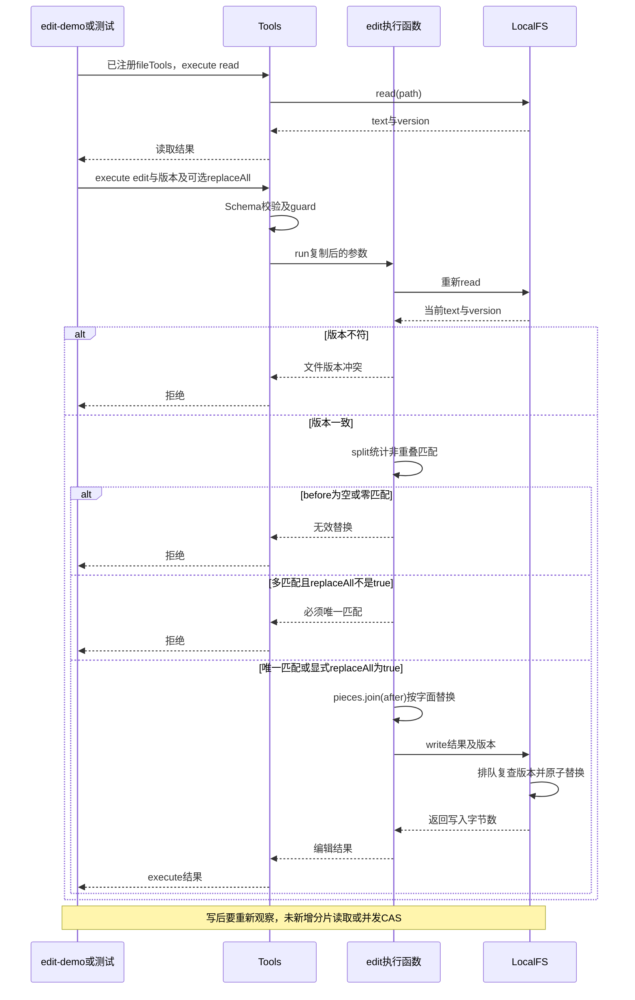

# 022 · 文件编辑默认唯一匹配，显式replaceAll才全部替换

阶段：R04。唯一前置：完成第 021 步，继续同一个工程。

## 什么时候会用到这一页

文件a.txt为“x x”，模型只说把x改y时默认拒绝，因为无法判断要改哪个。明确replaceAll:true后才一次改为“y y”；旧version不能接着改，重新读取后可用更具体before做唯一替换。

### 这次数据怎么走

```text
fileTools注册read/write/edit → Tools.execute先校验Schema和guard → read取text/version → edit重新读并核对传入version → split统计非重叠匹配 → 默认唯一或显式全量 → join按字面拼结果 → LocalFS.write再核对版本并发布。
```

### 对应时序图

从上往下读；实线箭头表示调用或发送，虚线箭头表示返回或事件通知。`opt`表示可选操作，`alt`表示不同结果，`loop`表示重复，`par`及其`and`分支表示并行；“未接入”及fixture说明按图中标注理解。



**当前接线位置：**本章edit-demo通过真实Tools与LocalFS执行；041 Host会注册fileTools并由Agent Loop使用。后续教程没有自动补齐原版read分片、图片读取和文件搜索全集，不能把Host接线等同文件能力全量实现。

## 这一步具体做什么

完成本章代码后运行 bun src/edit-demo.mjs，再运行 bun test ./tests/022-edit.test.mjs。依次应看到默认多匹配拒绝、显式全量得到y y、旧版本拒绝、重新读取后唯一替换得到z y；demo只操作临时目录，退出自动清理。不要用自己的源文件验证删除和替换边界。

需要本章新文件的操作，先按下面代码创建文件，再执行；不要在上一步尚不存在的接口上试错。

## 代码为什么放在这一层

fileTools把021的文件能力变成模型可见Schema。replaceAll是可选布尔值，省略或false仍要唯一匹配；只在本次调用传true才允许全部。pieces.join(after)按普通字符串替换，after里的$&不会触发JS替换模板。

## 先看具体例子：默认只改一处，明确开启才全部替换

假设`a.txt`的内容是`x x`，你通过read工具拿到了当前version。接下来调用edit，行为如下：

| 参数中的关键区别 | 结果 | 文件内容 |
| --- | --- | --- |
| `before: 'x'`，不传replaceAll | 拒绝：有两个匹配，位置不唯一 | 仍是`x x` |
| `before: 'x', replaceAll: false` | 同样拒绝，false没有开启全量替换 | 仍是`x x` |
| `before: 'x', after: 'y', replaceAll: true` | 明确替换全部匹配 | 变成`y y` |
| `before: 'x ', after: 'y '`，不传replaceAll | 允许：更具体的`x `只出现一次 | 变成`y x` |
| `replaceAll: 'true'` | 拒绝：这是字符串，不是布尔值 | 文件不变 |

上表各行都从同样的原文独立开始，不是让你沿用旧version连续操作。**每次写入后，再编辑前必须重新读取版本；replaceAll不会取消版本检查。**

### 在自己的代码里怎么调用

下面使用已经注册fileTools的tools和context，所有操作都经过`Tools.execute()`。示例中的version来自实际read，不是手工填写的固定字符串：

```javascript
// 先读取当前内容与版本，接下来这一笔修改基于这次读取。
const current = await tools.execute({
  name: 'read',
  arguments: { path: 'a.txt' }
}, context)

// 明确传布尔true，表示把所有x替换为y。
await tools.execute({
  name: 'edit',
  arguments: {
    path: 'a.txt',
    before: 'x',
    after: 'y',
    version: current.version,
    replaceAll: true
  }
}, context)
```

默认唯一替换则省略replaceAll，或明确传false。它是可选参数，schema的required只列path、before、after、version；不能沿用本文件中“把全部properties列为required”的object助手来定义edit，否则旧调用会因为没传replaceAll而失败。

### 代码怎样决定能不能写

```text
Tools.execute
  → 校验schema：replaceAll若存在，必须是boolean
  → 经过工具guard和取消检查
  → 读取当前文件，比较调用方的version
  → before不能为空
  → 按before拆分文本，得到匹配数
  → 0个匹配：报错
  → 未开启replaceAll且不是1个匹配：报错
  → 用after连接片段，构造完整新文本
  → LocalFS.write再次检查版本，并完成一次写入
```

例如`'x x'.split('x')`得到`['', ' ', '']`，片段数3减1说明有2个匹配。默认模式因此拒绝；显式开启全量替换后，`pieces.join('y')`得到`y y`。唯一匹配时也可以使用join，因为校验已经保证只有一个待替换位置。

before按**普通字符串、非重叠匹配**处理，不是正则；after也按字面文本写入。例如after为`$&`，结果就是`$& $&`，不会被JavaScript当作“保留原匹配”的特殊替换语法。after为空字符串表示删除所有匹配，但before为空字符串始终拒绝。

即使replaceAll为true，以下情况仍会失败：

- before没有任何匹配：报“未找到待替换内容”，不会把没改东西记为成功。
- 文件在读取后发生变化：报版本冲突，保留外部修改。
- replaceAll传成字符串、数字或null：由schema在执行守卫之前拒绝。

**一次替换多处，不等于并发写文件。**这里先在内存生成完整文本，再调用一次LocalFS.write；同一实例的写入排队和第021步的版本保护都继续生效。它不自动合并两个编辑者的冲突，也不提供跨进程CAS。

## 直接运行完整使用例子

本步新增`src/edit-demo.mjs`。先按下文创建文件，再在自己的PROJECT终端执行：

```sh
bun src/edit-demo.mjs
bun test ./tests/022-edit.test.mjs
bun test
```

demo使用真实临时文件与统一工具入口，不修改PROJECT里的已有文件。应顺序看到：

```text
默认多匹配：拒绝；文件仍为 x x
replaceAll=true：成功；文件变为 y y
沿用旧版本：拒绝；文件仍为 y y
重新读取后唯一替换：成功；文件变为 z y
演示完成，临时文件及工具注册已清理。
```

临时目录会在finally删除，运行结束后文件不存在是正常清理结果。要亲眼查看中间文件内容，在调试器暂停到写入之后、finally之前，打开开头打印的临时目录。

当前测试通过真实文件验证6类场景：默认和false拒绝多匹配、默认和false允许唯一匹配、true全量替换及字面文本/删除、错误开关类型、空before及零匹配、全量模式仍拒绝旧版本。失败场景都检查文件未被误改。

## VS Code Debug看分支怎么走

打开自己PROJECT的`tests/022-edit.test.mjs`，使用已有“Bun：当前测试”启动。在`src/file-tools.mjs`中设置断点：

1. edit的`const current = await fs.read(...)`：比较current.version与args.version。
2. `const pieces = ...`之后：用监视查看args.replaceAll、pieces、matches；默认多匹配时matches=2，唯一模式拒绝；true时允许继续。
3. `return fs.write(...)`：确认传入的是完整新文本，以及本次读取对应的版本。

若要直接观察demo，可沿用前面章节的Bun attach方法：在launch.json的configurations中加入下列对象，保留已有配置。

```json
{
  "name": "Bun：022文件替换（附加）",
  "type": "bun",
  "request": "attach",
  "url": "ws://127.0.0.1:6499/edit-022"
}
```

随后在PROJECT终端运行，选择“Bun：022文件替换（附加）”按F5连接：

```sh
bun --inspect-brk=127.0.0.1:6499/edit-022 src/edit-demo.mjs
```

先不看代码，预测同样的`x x`在省略、false和true三种参数下分别会怎样，再运行核对。合上材料解释“全量替换为什么仍然需要version”；次日将before改成不存在的字符串，确认明确失败后再恢复，不删除断言让测试通过。

## 在哪里写、写什么

操作地点：终端中的 `$PROJECT`，编辑器打开同一个目录。只创建或替换下列文件，其他文件保留上一步版本。文件目录不存在先创建。

```sh
mkdir -p src
```

### 创建 `src/edit-demo.mjs`

````javascript
import assert from 'node:assert/strict'
import { mkdtemp, rm } from 'node:fs/promises'
import { join } from 'node:path'
import { tmpdir } from 'node:os'
import { LocalFS } from './filesystem.mjs'
import { Tools } from './tools.mjs'
import { Scope } from './scope.mjs'
import { fileTools } from './file-tools.mjs'

// 只操作新建临时目录，不修改学习者自己的文件。
const root = await mkdtemp(join(tmpdir(), 'edit-022-')), scope = new Scope()
const fs = new LocalFS(root), tools = new Tools(), context = { signal: new AbortController().signal }
try {
  fileTools(scope, tools, fs)
  console.log('演示目录：' + root)
  await tools.execute({ name: 'write', arguments: { path: 'a.txt', text: 'x x' } }, context)
  const original = await tools.execute({ name: 'read', arguments: { path: 'a.txt' } }, context)
  // 不传replaceAll：两个x必须被拒绝，而不是悄悄替换其中一个或全部。
  await assert.rejects(tools.execute({ name: 'edit', arguments: { path: 'a.txt', before: 'x', after: 'y', version: original.version } }, context), /唯一/)
  assert.equal((await fs.read('a.txt')).text, 'x x')
  console.log('默认多匹配：拒绝；文件仍为 x x')
  // 明确传布尔true：同一版本的两个x全部替换为y。
  await tools.execute({ name: 'edit', arguments: { path: 'a.txt', before: 'x', after: 'y', version: original.version, replaceAll: true } }, context)
  assert.equal((await fs.read('a.txt')).text, 'y y')
  console.log('replaceAll=true：成功；文件变为 y y')
  // 每次写入后重新读取版本，旧版本不能用于下一次全量替换。
  await assert.rejects(tools.execute({ name: 'edit', arguments: { path: 'a.txt', before: 'y', after: 'z', version: original.version, replaceAll: true } }, context), /版本冲突/)
  console.log('沿用旧版本：拒绝；文件仍为 y y')
  const current = await tools.execute({ name: 'read', arguments: { path: 'a.txt' } }, context)
  // 用更具体、只出现一次的before，省略replaceAll仍可执行唯一替换。
  await tools.execute({ name: 'edit', arguments: { path: 'a.txt', before: 'y ', after: 'z ', version: current.version } }, context)
  assert.equal((await fs.read('a.txt')).text, 'z y')
  console.log('重新读取后唯一替换：成功；文件变为 z y')
} finally { await scope.close(); await rm(root, { recursive: true, force: true }) }
console.log('演示完成，临时文件及工具注册已清理。')
````

```sh
mkdir -p src
```

### 创建 `src/file-tools.mjs`

````javascript
/** 工具消费者只依赖 fs 契约；更换远端提供方不用改工具 Schema。 */
export function fileTools(scope, tools, fs) {
  const object = properties => ({ type: 'object', properties, required: Object.keys(properties), additionalProperties: false })
  const string = { type: 'string' }
  tools.register(scope, { name: 'read', description: '读取文本并记录版本', exclusive: false, effect: 'read', schema: object({ path: string }), run: args => fs.read(args.path) })
  tools.register(scope, { name: 'write', description: '新建文件或基于读取版本写入', effect: 'write', schema: { type: 'object', properties: { path: string, text: string, version: string }, required: ['path', 'text'], additionalProperties: false }, run: args => fs.write(args.path, args.text, args.version) })
  tools.register(scope, { name: 'edit', description: '必须先读；默认唯一匹配，显式replaceAll=true才替换全部', effect: 'write',
    // replaceAll是可选布尔值；不用上面的object助手，避免把它也列为必填参数。
    schema: { type: 'object', properties: { path: string, before: string, after: string, version: string,
      replaceAll: { type: 'boolean', description: '仅true表示替换所有非重叠匹配；省略或false要求唯一匹配' } },
      required: ['path', 'before', 'after', 'version'], additionalProperties: false }, async run(args) {
    const current = await fs.read(args.path)
    if (current.version !== args.version) throw Error('文件版本冲突')
    if (!args.before) throw Error('待替换内容不能为空')
    // 按普通字符串拆分，片段数减一就是非重叠匹配数；不把before当正则表达式。
    const pieces = current.text.split(args.before), matches = pieces.length - 1
    if (matches === 0) throw Error('未找到待替换内容')
    if (args.replaceAll !== true && matches !== 1) throw Error('替换必须唯一匹配')
    // 默认模式已确认只有一个匹配；全量模式允许多个。join让after里的$&等字符保持原样。
    return fs.write(args.path, pieces.join(args.after), args.version)
  } })
}
````

```sh
mkdir -p tests
```

### 创建 `tests/022-edit.test.mjs`

````javascript
import { test } from 'bun:test'
import assert from 'node:assert/strict'
import { mkdtemp, rm, writeFile } from 'node:fs/promises'
import { join } from 'node:path'
import { tmpdir } from 'node:os'
import { LocalFS } from '../src/filesystem.mjs'
import { Tools } from '../src/tools.mjs'
import { Scope } from '../src/scope.mjs'
import { fileTools } from '../src/file-tools.mjs'

/** 每个场景使用真实临时文件及统一工具入口，结束后清理Scope和文件。 */
async function withFile(text, run) {
  const root = await mkdtemp(join(tmpdir(), 'own-edit-')), scope = new Scope()
  try {
    const fs = new LocalFS(root), tools = new Tools(), context = { signal: new AbortController().signal }
    fileTools(scope, tools, fs)
    await tools.execute({ name: 'write', arguments: { path: 'a', text } }, context)
    await run({ fs, tools, context, path: join(root, 'a') })
  } finally { await scope.close(); await rm(root, { recursive: true, force: true }) }
}

/** 省略和显式false都保留原来的唯一匹配保护，不产生隐式全替换。 */
test('edit默认和replaceAll=false都拒绝多个匹配且文件不变', async () => {
  await withFile('x x', async ({ fs, tools, context }) => {
    const { version } = await tools.execute({ name: 'read', arguments: { path: 'a' } }, context)
    for (const extra of [{}, { replaceAll: false }]) {
      await assert.rejects(tools.execute({ name: 'edit', arguments: { path: 'a', before: 'x', after: 'y', version, ...extra } }, context), /唯一/)
      assert.equal((await fs.read('a')).text, 'x x')
    }
  })
})

/** 原来的唯一替换调用方式无需新增参数，仍能通过统一入口实际修改文件。 */
test('edit省略replaceAll时允许唯一匹配，显式false也允许', async () => {
  for (const extra of [{}, { replaceAll: false }]) await withFile('x z', async ({ fs, tools, context }) => {
    const { version } = await tools.execute({ name: 'read', arguments: { path: 'a' } }, context)
    await tools.execute({ name: 'edit', arguments: { path: 'a', before: 'x', after: 'y', version, ...extra } }, context)
    assert.equal((await fs.read('a')).text, 'y z')
  })
})

/** 全量替换是显式能力；替换文本按字面处理，空after表示删除所有匹配。 */
test('edit replaceAll=true替换全部，支持字面$&和删除', async () => {
  const cases = [{ after: 'y', expected: 'y y' }, { after: '$&', expected: '$& $&' }, { after: '', expected: ' ' }]
  for (const example of cases) await withFile('x x', async ({ fs, tools, context }) => {
    const { version } = await tools.execute({ name: 'read', arguments: { path: 'a' } }, context)
    await tools.execute({ name: 'edit', arguments: { path: 'a', before: 'x', after: example.after, version, replaceAll: true } }, context)
    assert.equal((await fs.read('a')).text, example.expected)
  })
})

/** 不能把字符串true等当成开启开关；schema在权限守卫和文件操作前拒绝错误类型。 */
test('edit replaceAll仅接受布尔值，错误类型不进入执行守卫', async () => {
  await withFile('x x', async ({ fs, tools, context }) => {
    const { version } = await tools.execute({ name: 'read', arguments: { path: 'a' } }, context)
    let guarded = 0
    tools.guard = async () => { guarded++ }
    for (const replaceAll of ['true', 1, null]) {
      await assert.rejects(tools.execute({ name: 'edit', arguments: { path: 'a', before: 'x', after: 'y', version, replaceAll } }, context), /类型/)
    }
    assert.equal(guarded, 0)
    assert.equal((await fs.read('a')).text, 'x x')
  })
})

/** 两种模式都拒绝空查找串和零匹配，不能把没有修改伪装成成功。 */
test('edit两种模式都拒绝空before和没有匹配，原文保持不变', async () => {
  await withFile('x x', async ({ fs, tools, context }) => {
    const { version } = await tools.execute({ name: 'read', arguments: { path: 'a' } }, context)
    for (const replaceAll of [false, true]) {
      await assert.rejects(tools.execute({ name: 'edit', arguments: { path: 'a', before: '', after: 'y', version, replaceAll } }, context), /不能为空/)
      await assert.rejects(tools.execute({ name: 'edit', arguments: { path: 'a', before: 'missing', after: 'y', version, replaceAll } }, context), /未找到/)
    }
    assert.equal((await fs.read('a')).text, 'x x')
  })
})

/** 显式全量替换仍必须基于当前读取版本，不能覆盖期间发生的外部修改。 */
test('edit replaceAll=true仍拒绝旧版本并保留外部修改', async () => {
  await withFile('x x', async ({ fs, tools, context, path }) => {
    const { version } = await tools.execute({ name: 'read', arguments: { path: 'a' } }, context)
    await writeFile(path, '外部修改 x x')
    await assert.rejects(tools.execute({ name: 'edit', arguments: { path: 'a', before: 'x', after: 'y', version, replaceAll: true } }, context), /版本冲突/)
    assert.equal((await fs.read('a')).text, '外部修改 x x')
  })
})
````

## 运行命令与通过标准

```sh
cd "$PROJECT"
bun src/edit-demo.mjs
bun test ./tests/022-edit.test.mjs
bun test
```

6项真实文件测试覆盖默认/false、多处与唯一匹配、true全量、字面$&、空after删除、错误flag类型、空/无匹配、旧版本。read仍只有path，全量读取；replaceAll既不提供分片读，也不解决并发编辑。

**本步证据的范围：**tests/022-edit.test.mjs有6项真实临时文件测试，edit-demo真实执行与清理；它们未调用模型。全量替换只覆盖已声明的字面与版本语义，不包含大文件、并发实例或跨进程CAS保证。

## VS Code：断在哪里、看什么

在VS Code选tests/022-edit.test.mjs，选择“Bun：当前测试”按F5。在src/file-tools.mjs的current.version比较、matches赋值和return fs.write打断点；监视args.replaceAll、matches、pieces与current.version。F10默认遇matches=2应拒绝，true应进入write；F11进LocalFS.write再看expected=current及observed。要调CLI按下方attach配置运行bun --inspect-brk=127.0.0.1:6499/edit-022 src/edit-demo.mjs。

操作位置：VS Code 打开的是自己的 `$PROJECT`，断点也设在这里的源码，不在教材的 `steps` 目录。

上面的说明若指定CLI、子进程、页面或Electron附加调试，就先按该流程操作；下面这组步骤只用于本章测试入口。“当前测试”不会自动附加子进程，也不会命中浏览器或Electron中的断点。

变量只在所属作用域可见：停在方法内部时看this和参数；要看测试里的局部变量，先在“调用堆栈”选择对应测试帧。正在等待的异步调用者不一定保留可求值的帧，此时在测试调用前后加断点再看，不把未定义误判成业务状态丢失。

沿用第 000 步安装的 Bun 扩展与 `.vscode/launch.json`；本章列出替换配置时，使用本章完整版本。

1. 打开本步测试文件 `tests/022-edit.test.mjs`，保持它为当前编辑器文件。
2. 在上面指定的函数内单击行号左侧设置断点。
3. “运行和调试”选择 **Bun：当前测试**，按 F5；它执行当前测试，工作目录固定为 PROJECT。
4. 在“变量 / 监视 / 调用堆栈 / 调试控制台”检查状态；F10 逐行执行，F11 进入函数，Shift+F11 返回，F5 继续，Shift+F5 停止。

验收：断点实际命中，能说出当前输入、状态和下一步；只看到进程启动不算完成。长时间暂停会影响真实取消、审批和网络超时，先检查时序，不删超时断言。修正后在集成终端运行 `bun test ./tests/022-edit.test.mjs`，再运行 `bun test`，保留全部断言。

## 不看答案，确认自己能解释

闭卷写出省略、false、true、字符串"true"四种flag的结果，再说明before空串、零匹配、after空串分别如何处理。

完成后在 LEARNING.md 写一句实际结果和一个卡点。明天只重做这个卡点；第 3 天、第 7 天再做一次，能独立完成就继续下一页，不另开学习路线。

**再改一个条件验证：**在临时测试副本用“a.b a.b”验证before按普通字符串处理而非正则；再用after="$&"验证按字面保留。需自己补case再运行，不能用全量模式当成“不检查版本”的开关。

## 与当前原版还差哪些

对照本仓库固定原版 `687f282e8625c6b8d11ff58211a90524be2e4317`；这里的“当前”指该本地基线，不是未经检查的上游最新版。

**这一页已经实现：**

- read/write/edit统一工具入口，默认唯一与显式replaceAll。
- 字面替换、空after删除、版本保护、真实demo和6项测试。

**原版仍有、或本步尚未对齐的部分：**

- 原版tool-fs/read支持行号offset/limit、字节与单行预算及大文件stream阈值，并有read_image和搜索工具；教程read只有path，不支持分片或图片。
- 原版edit通过fs/edit-intent取得Session观察版本并由fs.editText执行，返回前后内容、修改结果及展示metadata；本章工具先全量读取再写，只返回bytes，缺diff和完整展示/沙箱接线。
- 原版parseEditArgs拒绝old_string与new_string相同的无操作；教程before===after仍可写入，参数名也使用path/before/after/replaceAll而非原版file_path/old_string/new_string/replace_all。

**原版对照位置：**

- [packages/fs/tool-fs/src/read.ts](../../../deepseek-harness/packages/fs/tool-fs/src/read.ts)
- [packages/fs/tool-fs/src/edit.ts](../../../deepseek-harness/packages/fs/tool-fs/src/edit.ts)
- [packages/fs/tool-fs/src/write.ts](../../../deepseek-harness/packages/fs/tool-fs/src/write.ts)
- [packages/fs/fs-observation-policy/src/index.ts](../../../deepseek-harness/packages/fs/fs-observation-policy/src/index.ts)
- [packages/fs/tool-fs/src/diff.ts](../../../deepseek-harness/packages/fs/tool-fs/src/diff.ts)

本步测试通过只证明上面的具体行为；完整差距仍看 [COVERAGE.md](../COVERAGE.md)，不以文件数量、同名类或后面出现另一个模块代替接线证据。

下一步：[第 023 步](023.md)
