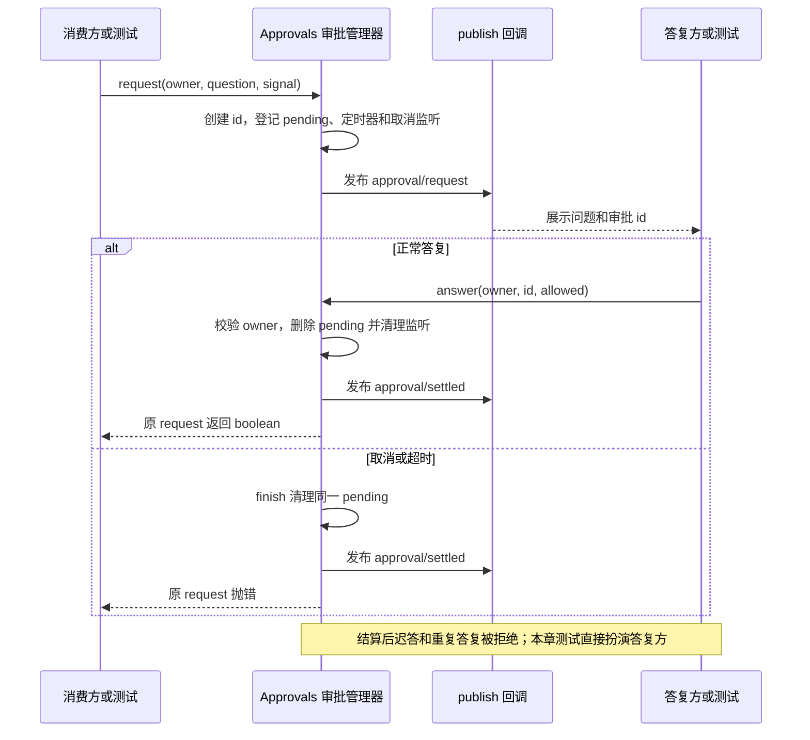

# 023 · 一次审批只唤醒一次调用

阶段：R04。唯一前置：完成第 022 步，继续同一个工程。

<!-- harness-own-links:start -->
## 当前练习工程文件

以下链接指向 `harness-own` 的当前累计版本；本课下方的完整代码仍保留当步版本，二者可能不同。

[打开练习工程说明](../../../harness-own/README.md)

| 本课文件 | 当前练习工程文件 |
| --- | --- |
| `.vscode/launch.json` | 使用本页下方的本节专用配置，不复制累计版本 |
| `src/approval.mjs` | [`harness-own/src/approval.mjs`](../../../harness-own/src/approval.mjs) |
| `tests/023-approval.test.mjs` | [`harness-own/tests/023-approval.test.mjs`](../../../harness-own/tests/023-approval.test.mjs) |

<!-- harness-own-links:end -->

## 什么时候会用到这一页

用户要求修改配置文件，但执行前必须确认。两个页面都显示了同一张审批卡：第一次回答应唤醒工具，另一张旧卡的回答必须失效；会话取消时也不能留下永远等待的Promise。

### 这次数据怎么走

```text
Tools的消费方发起Approvals.request(owner, question, signal) → pending登记 → publish审批事件 → UI或测试调用answer(owner,id,allowed) → finish删除pending并清理定时器/监听器 → 原调用继续或报错
```

### 对应时序图

从上往下读；实线箭头表示调用或发送，虚线箭头表示返回或事件通知。`opt`表示可选操作，`alt`表示不同结果，`loop`表示重复，`par`及其`and`分支表示并行；“未接入”及fixture说明按图中标注理解。



**当前接线位置：** 023本章只有独立测试。024将它接到工具守卫，041 Host把审批发布为会话事件；032跨进程demo复用它处理真人/自动答复。后续接线没有把其boolean结果补成原版完整审批词汇。

## 这一步具体做什么

先写完本章src/approval.mjs和tests/023-approval.test.mjs，再在练习工程根目录运行 bun test ./tests/023-approval.test.mjs。观察测试先让s2回答s1的问题并被拒绝，再取消s1；随后另建审批器，在publish回调中立即回答true，确认同步回答也不会丢失。此章没有真人审批界面，不要等待终端出现y/n。

需要本章新文件的操作，先按下面代码创建文件，再执行；不要在上一步尚不存在的接口上试错。

## 代码为什么放在这一层

Approvals是一次性等待与唤醒的登记簿，不决定哪些工具要审批。owner回答“谁的问题”，id回答“哪一次问题”，pending.delete保证同一请求只能结算一次。权限策略在024决定要不要问；自由文本问答属于另一种交互。

## 本节调试：选什么、为什么、怎么启动

**建议先选：023：本节测试。** 每节的测试入口都固定到本节文件，不依赖编辑器当前打开的 `${file}`。

| 配置名称 | 什么时候选 | 实际入口或目标 | 能观察什么 |
| --- | --- | --- | --- |
| 023：本节测试 | 本节验收 | tests/023-approval.test.mjs | 本节 Bun 测试进程；入口固定，不依赖当前编辑器文件。 |

### 调试路线：先启动谁，再启动谁

本节有 **1 个调试配置、1 条调试路线**。配置是启动或附加按钮；一条路线可能连续使用多个配置。请选择一条路线，不必把所有入口都启动。

| 路线 | 用哪些配置，按顺序 | 谁创建进程 | 结果在哪里看 |
| --- | --- | --- | --- |
| A 自动测试 | “023：本节测试” | F5的launch配置创建；子目标按下方步骤自动创建 | `tests/023-approval.test.mjs`与下方列出的本章实现断点 |

先完成本节源码并安装[本节专用调试配置](#lesson-debug-config)。下面的路线只对应本节，不沿用前章端口或旧会话。

本章目前只有这一条已配置路线；源码中未接入测试或没有独立调试入口的能力，不因为后面存在同名模块就自动可调。

<details class="debug-route">
<summary>路线 A：自动测试——启动、断点和退出</summary>

1. 先打开`tests/023-approval.test.mjs`及下方“具体断点和预期”列出的实现文件，设置本章断点。
2. 选择“023：本节测试”按F5，配置固定到本章测试；不需要先运行前章服务或CLI。
3. 测试直接驱动本章实现；在同一Bun调试会话内按F10/F11观察，不必另建服务会话。
4. 按下方本章观察点检查变量和断言；断点停顿可能触发实现自己的计时，必要时先继续完成当前调用。

**断点与观察位置：** `tests/023-approval.test.mjs`与下方列出的本章实现断点

**结束方式：** 断言结束后测试退出；测试清理自己创建的资源。异常中止后检查本章临时进程，不把尚在等待当作测试通过。

</details>


**为什么这样启动：** 本节测试直接调用被测模块，选择这一项即可沿测试进入实现；前序 CLI 或其他语言入口不参与这次调试。

使用下方的[本节专用调试配置](#lesson-debug-config)。它只列本节可用目标；要保留个人配置，请先备份并按名称合并。页面上 `harness-own` 的累计文件链接供看当前工程，不是本节调试配置的答案。

1. VS Code 打开自己的 PROJECT；按本节创建源码与配置，断点设在 PROJECT 文件中。
2. 先用终端运行 `bun test ./tests/023-approval.test.mjs` 确认普通验收，再选表中的配置按 F5。
3. 在下方具体观察点停住；F10 跨过当前语句，F11 只进入当前调试目标。异步等待涉及另一进程时，切换调试会话并继续对端。
4. 变量要在所属调用帧查看；看测试局部变量时选测试帧，看 this 和参数时选实现方法帧。

<details class="debug-details">
<summary>展开本节具体断点和预期</summary>

1. 选择“023：本节测试”按F5直接启动测试，不需要手动附加。

2. 在src/approval.mjs的this.pending.set(requestId, ...)与if (!this.pending.delete(requestId)) return打断点。

3. F10登记后看pending.size从0到1。

4. 在answer的owner检查处看错误调用owner="s2"、记录owner="s1"。

5. 继续到abort路径，F11进finish，看删除后size=0。

6. 同步回答场景在publish内F11进入answer，确认计时器和监听先于发布已准备好。

</details>

暂停断点会影响应用自身的 RPC、取消、进程和网络计时。Bun 测试超时放宽不等于这些计时也被关闭；按本节说明分别设置，普通验收恢复原有时限。

观察完成后退出本节启动的调试会话和进程，再运行 `bun test ./tests/023-approval.test.mjs`。测试通过只证明本节断言，不代表所有 GUI、外部服务或发布过程均已验证。

## 在哪里写、写什么

操作地点：终端中的 `$PROJECT`，编辑器打开同一个目录。只创建或替换下列文件，其他文件保留上一步版本。文件目录不存在先创建。

```sh
mkdir -p .vscode
```

<a id="lesson-debug-config"></a>

下面是本节专用调试配置，只包含本节入口。program 已固定到本节文件；不是 harness-own 的累计配置。

### 替换 `.vscode/launch.json`

````json
{
  "version": "0.2.0",
  "configurations": [
    {
      "name": "023：本节测试",
      "type": "bun",
      "request": "launch",
      "program": "${workspaceFolder}/tests/023-approval.test.mjs",
      "cwd": "${workspaceFolder}",
      "runtime": "bun",
      "runtimeArgs": [
        "test",
        "--preload",
        "${workspaceFolder}/scripts/vscode-debug.mjs",
        "--timeout",
        "3600000"
      ],
      "stopOnEntry": false
    }
  ]
}
````

```sh
mkdir -p src
```

### 创建 [`src/approval.mjs`](../../../harness-own/src/approval.mjs)

````javascript
import { id } from './events.mjs'

/** 审批是一次性的等待对象；所有权、迟答、取消各有明确语义。 */
export class Approvals {
  pending = new Map()
  constructor(publish = () => {}) { this.publish = publish }
  /** 先挂好监听和 pending，再发布，允许 UI 同步答复。 */
  request(owner, question, signal, timeout = 30_000) {
    signal.throwIfAborted()
    return new Promise((resolve, reject) => {
      const requestId = id('approval')
      let timer
      const finish = (answer, error) => {
        if (!this.pending.delete(requestId)) return
        clearTimeout(timer); signal.removeEventListener('abort', abort)
        this.publish({ type: 'approval/settled', id: requestId, owner })
        if (error) reject(error); else resolve(answer)
      }
      const abort = () => finish(false, new Error('审批已取消'))
      this.pending.set(requestId, { owner, question, finish })
      signal.addEventListener('abort', abort, { once: true })
      timer = setTimeout(() => finish(false, Error('审批超时')), timeout)
      try { this.publish({ type: 'approval/request', id: requestId, owner, question }) }
      catch (error) { finish(false, error) }
    })
  }
  /** 一旦结算，旧页面和另一客户端不能再答第二次。 */
  answer(owner, requestId, allowed) {
    const pending = this.pending.get(requestId)
    if (!pending || pending.owner !== owner) throw Error('审批不存在或不属于当前会话')
    pending.finish(allowed === true)
  }
}
````

```sh
mkdir -p tests
```

### 创建 [`tests/023-approval.test.mjs`](../../../harness-own/tests/023-approval.test.mjs)

````javascript
import { test } from 'bun:test'
import assert from 'node:assert/strict'
import { Approvals } from '../src/approval.mjs'

test('同步答复、跨会话拒绝、取消清理和迟答失效', async () => {
  const events = [], signal = new AbortController()
  const approvals = new Approvals(event => events.push(event))
  const promise = approvals.request('s1', 'write?', signal.signal)
  const requestId = events[0].id
  assert.throws(() => approvals.answer('s2', requestId, true), /不属于/)
  signal.abort()
  await assert.rejects(promise, /取消/)
  assert.equal(approvals.pending.size, 0)
  assert.throws(() => approvals.answer('s1', requestId, true), /不存在/)
  const immediate = new Approvals(event => { if (event.type === 'approval/request') immediate.answer('s', event.id, true) })
  assert.equal(await immediate.request('s', 'yes?', new AbortController().signal), true)
})
````

## 运行命令与通过标准

```sh
cd "$PROJECT"
bun test ./tests/023-approval.test.mjs
bun test
```

测试应1项通过，跨owner回答报错、取消后pending.size为0、旧id迟答报错、同步允许返回true。测试没有验证超时路径、持久化故障或真实UI，不能把通过理解为完整审批产品。

**本步证据的范围：** 023-approval.test.mjs的一个测试直接调用真实Approvals，验证跨会话拒绝、取消清理、迟答失效和publish内同步答复；没有调用模型。

## 不看答案，确认自己能解释

合上approval.mjs，在纸上画出request→answer与request→abort两条路径，指出两条路径共用哪一个删除操作；再说明为什么必须先登记pending、再publish。

完成后在 LEARNING.md 写一句实际结果和一个卡点。明天只重做这个卡点；第 3 天、第 7 天再做一次，能独立完成就继续下一页，不另开学习路线。

**再改一个条件验证：** 安全练习：只在临时测试中把相同id回答两次，断言第二次报“审批不存在”；另用很短timeout验证超时后pending为空。自由文本和“选项＋自填”目前未实现，不能把allowed改成字符串冒充问答。

## 与当前原版还差哪些

对照本仓库固定原版 `687f282e8625c6b8d11ff58211a90524be2e4317`；这里的“当前”指该本地基线，不是未经检查的上游最新版。

**这一页已经实现：**

- owner与请求id校验
- 登记先于发布，支持同步答复
- 允许/拒绝、取消、超时共用一次性结算清理

**原版仍有、或本步尚未对齐的部分：**

- 原版user-approval区分allowed-once、denied、cancelled、unavailable；教程只返回boolean或抛错。
- 原版要求未结束轮次，并持久记录approval/asked与approval/decided；本章publish回调没有这些轮次与审计提交保证。
- 原版应答者采用作用域waterfall并在缺失/失败时拒绝；本章没有应答者组合协议。
- 通用问题与选择输入由原版user-questions/tool-ask-user承担；023没有实现。

**原版对照位置：**

- [packages/interaction/user-approval/README.zh.md](../../../deepseek-harness/packages/interaction/user-approval/README.zh.md)
- [packages/interaction/user-approval/src/index.ts](../../../deepseek-harness/packages/interaction/user-approval/src/index.ts)
- [packages/interaction/user-questions/README.zh.md](../../../deepseek-harness/packages/interaction/user-questions/README.zh.md)
- [packages/interaction/tool-ask-user/README.zh.md](../../../deepseek-harness/packages/interaction/tool-ask-user/README.zh.md)

本步测试通过只证明上面的具体行为；完整差距仍看 [COVERAGE.md](../COVERAGE.md)，不以文件数量、同名类或后面出现另一个模块代替接线证据。

下一步：[第 024 步](024.md)

## 补充教程：单选、多选与文本问答

<details>
<summary>展开：Approvals只有允许／拒绝，QA弹窗应该怎样设计？</summary>

本章Approvals.answer会把答案转成allowed === true，所以不能把选项ID或文本直接塞进allowed。问答需要独立的问题类型、答案校验和取消状态，但可以复用“先登记、后发布、一次结算、清理超时与监听”的设计思路。

继续阅读[二级教程：从单选弹窗到调用方继续执行](../supplements/023-user-questions.md)。包含领域区别、可运行页面、文件结构、完整收发顺序、中文注释源码、测试、断点、问题与结算的eventlog设计、重启恢复策略及后续接入Agent的边界。示例是独立问答实验，不修改023基础Approvals，也未自动接入现有Host或模型。

</details>
