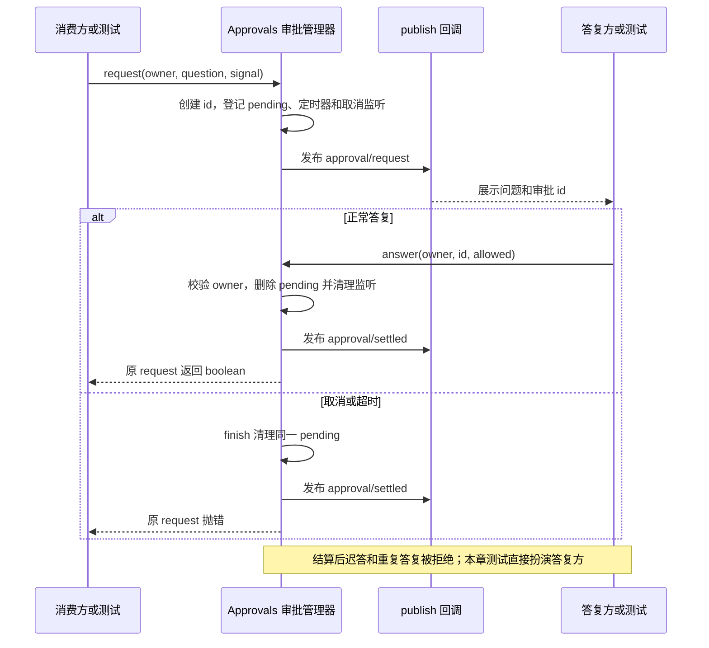

# 023 · 一次审批只唤醒一次调用

阶段：R04。唯一前置：完成第 022 步，继续同一个工程。

## 什么时候会用到这一页

用户要求修改配置文件，但执行前必须确认。两个页面都显示了同一张审批卡：第一次回答应唤醒工具，另一张旧卡的回答必须失效；会话取消时也不能留下永远等待的Promise。

### 这次数据怎么走

```text
Tools的消费方发起Approvals.request(owner, question, signal) → pending登记 → publish审批事件 → UI或测试调用answer(owner,id,allowed) → finish删除pending并清理定时器/监听器 → 原调用继续或报错
```

### 对应时序图

从上往下读；实线箭头表示调用或发送，虚线箭头表示返回或事件通知。`opt`表示可选操作，`alt`表示不同结果，`loop`表示重复，`par`及其`and`分支表示并行；“未接入”及fixture说明按图中标注理解。



**当前接线位置：**023本章只有独立测试。024将它接到工具守卫，041 Host把审批发布为会话事件；032跨进程demo复用它处理真人/自动答复。后续接线没有把其boolean结果补成原版完整审批词汇。

## 这一步具体做什么

先写完本章src/approval.mjs和tests/023-approval.test.mjs，再在练习工程根目录运行 bun test ./tests/023-approval.test.mjs。观察测试先让s2回答s1的问题并被拒绝，再取消s1；随后另建审批器，在publish回调中立即回答true，确认同步回答也不会丢失。此章没有真人审批界面，不要等待终端出现y/n。

需要本章新文件的操作，先按下面代码创建文件，再执行；不要在上一步尚不存在的接口上试错。

## 代码为什么放在这一层

Approvals是一次性等待与唤醒的登记簿，不决定哪些工具要审批。owner回答“谁的问题”，id回答“哪一次问题”，pending.delete保证同一请求只能结算一次。权限策略在024决定要不要问；自由文本问答属于另一种交互。

## 在哪里写、写什么

操作地点：终端中的 `$PROJECT`，编辑器打开同一个目录。只创建或替换下列文件，其他文件保留上一步版本。文件目录不存在先创建。

```sh
mkdir -p src
```

### 创建 `src/approval.mjs`

````javascript
import { id } from './events.mjs'

/** 审批是一次性的等待对象；所有权、迟答、取消各有明确语义。 */
export class Approvals {
  pending = new Map()
  constructor(publish = () => {}) { this.publish = publish }
  /** 先挂好监听和 pending，再发布，允许 UI 同步答复。 */
  request(owner, question, signal, timeout = 30_000) {
    signal.throwIfAborted()
    return new Promise((resolve, reject) => {
      const requestId = id('approval')
      let timer
      const finish = (answer, error) => {
        if (!this.pending.delete(requestId)) return
        clearTimeout(timer); signal.removeEventListener('abort', abort)
        this.publish({ type: 'approval/settled', id: requestId, owner })
        if (error) reject(error); else resolve(answer)
      }
      const abort = () => finish(false, new Error('审批已取消'))
      this.pending.set(requestId, { owner, question, finish })
      signal.addEventListener('abort', abort, { once: true })
      timer = setTimeout(() => finish(false, Error('审批超时')), timeout)
      try { this.publish({ type: 'approval/request', id: requestId, owner, question }) }
      catch (error) { finish(false, error) }
    })
  }
  /** 一旦结算，旧页面和另一客户端不能再答第二次。 */
  answer(owner, requestId, allowed) {
    const pending = this.pending.get(requestId)
    if (!pending || pending.owner !== owner) throw Error('审批不存在或不属于当前会话')
    pending.finish(allowed === true)
  }
}
````

```sh
mkdir -p tests
```

### 创建 `tests/023-approval.test.mjs`

````javascript
import { test } from 'bun:test'
import assert from 'node:assert/strict'
import { Approvals } from '../src/approval.mjs'

test('同步答复、跨会话拒绝、取消清理和迟答失效', async () => {
  const events = [], signal = new AbortController()
  const approvals = new Approvals(event => events.push(event))
  const promise = approvals.request('s1', 'write?', signal.signal)
  const requestId = events[0].id
  assert.throws(() => approvals.answer('s2', requestId, true), /不属于/)
  signal.abort()
  await assert.rejects(promise, /取消/)
  assert.equal(approvals.pending.size, 0)
  assert.throws(() => approvals.answer('s1', requestId, true), /不存在/)
  const immediate = new Approvals(event => { if (event.type === 'approval/request') immediate.answer('s', event.id, true) })
  assert.equal(await immediate.request('s', 'yes?', new AbortController().signal), true)
})
````

## 运行命令与通过标准

```sh
cd "$PROJECT"
bun test ./tests/023-approval.test.mjs
bun test
```

测试应1项通过，跨owner回答报错、取消后pending.size为0、旧id迟答报错、同步允许返回true。测试没有验证超时路径、持久化故障或真实UI，不能把通过理解为完整审批产品。

**本步证据的范围：**023-approval.test.mjs的一个测试直接调用真实Approvals，验证跨会话拒绝、取消清理、迟答失效和publish内同步答复；没有调用模型。

## VS Code：断在哪里、看什么

用VS Code附加本章Bun测试进程。在src/approval.mjs的this.pending.set(requestId, ...)与if (!this.pending.delete(requestId)) return打断点；F10登记后看pending.size从0到1。在answer的owner检查处看错误调用owner="s2"、记录owner="s1"。继续到abort路径，F11进finish，看删除后size=0；同步回答场景在publish内F11进入answer，确认计时器和监听先于发布已准备好。

操作位置：VS Code 打开的是自己的 `$PROJECT`，断点也设在这里的源码，不在教材的 `steps` 目录。

上面的说明若指定CLI、子进程、页面或Electron附加调试，就先按该流程操作；下面这组步骤只用于本章测试入口。“当前测试”不会自动附加子进程，也不会命中浏览器或Electron中的断点。

变量只在所属作用域可见：停在方法内部时看this和参数；要看测试里的局部变量，先在“调用堆栈”选择对应测试帧。正在等待的异步调用者不一定保留可求值的帧，此时在测试调用前后加断点再看，不把未定义误判成业务状态丢失。

沿用第 000 步安装的 Bun 扩展与 `.vscode/launch.json`；本章列出替换配置时，使用本章完整版本。

1. 打开本步测试文件 `tests/023-approval.test.mjs`，保持它为当前编辑器文件。
2. 在上面指定的函数内单击行号左侧设置断点。
3. “运行和调试”选择 **Bun：当前测试**，按 F5；它执行当前测试，工作目录固定为 PROJECT。
4. 在“变量 / 监视 / 调用堆栈 / 调试控制台”检查状态；F10 逐行执行，F11 进入函数，Shift+F11 返回，F5 继续，Shift+F5 停止。

验收：断点实际命中，能说出当前输入、状态和下一步；只看到进程启动不算完成。长时间暂停会影响真实取消、审批和网络超时，先检查时序，不删超时断言。修正后在集成终端运行 `bun test ./tests/023-approval.test.mjs`，再运行 `bun test`，保留全部断言。

## 不看答案，确认自己能解释

合上approval.mjs，在纸上画出request→answer与request→abort两条路径，指出两条路径共用哪一个删除操作；再说明为什么必须先登记pending、再publish。

完成后在 LEARNING.md 写一句实际结果和一个卡点。明天只重做这个卡点；第 3 天、第 7 天再做一次，能独立完成就继续下一页，不另开学习路线。

**再改一个条件验证：**安全练习：只在临时测试中把相同id回答两次，断言第二次报“审批不存在”；另用很短timeout验证超时后pending为空。自由文本和“选项＋自填”目前未实现，不能把allowed改成字符串冒充问答。

## 与当前原版还差哪些

对照本仓库固定原版 `687f282e8625c6b8d11ff58211a90524be2e4317`；这里的“当前”指该本地基线，不是未经检查的上游最新版。

**这一页已经实现：**

- owner与请求id校验
- 登记先于发布，支持同步答复
- 允许/拒绝、取消、超时共用一次性结算清理

**原版仍有、或本步尚未对齐的部分：**

- 原版user-approval区分allowed-once、denied、cancelled、unavailable；教程只返回boolean或抛错。
- 原版要求未结束轮次，并持久记录approval/asked与approval/decided；本章publish回调没有这些轮次与审计提交保证。
- 原版应答者采用作用域waterfall并在缺失/失败时拒绝；本章没有应答者组合协议。
- 通用问题与选择输入由原版user-questions/tool-ask-user承担；023没有实现。

**原版对照位置：**

- [packages/interaction/user-approval/README.zh.md](../../../deepseek-harness/packages/interaction/user-approval/README.zh.md)
- [packages/interaction/user-approval/src/index.ts](../../../deepseek-harness/packages/interaction/user-approval/src/index.ts)
- [packages/interaction/user-questions/README.zh.md](../../../deepseek-harness/packages/interaction/user-questions/README.zh.md)
- [packages/interaction/tool-ask-user/README.zh.md](../../../deepseek-harness/packages/interaction/tool-ask-user/README.zh.md)

本步测试通过只证明上面的具体行为；完整差距仍看 [COVERAGE.md](../COVERAGE.md)，不以文件数量、同名类或后面出现另一个模块代替接线证据。

下一步：[第 024 步](024.md)
