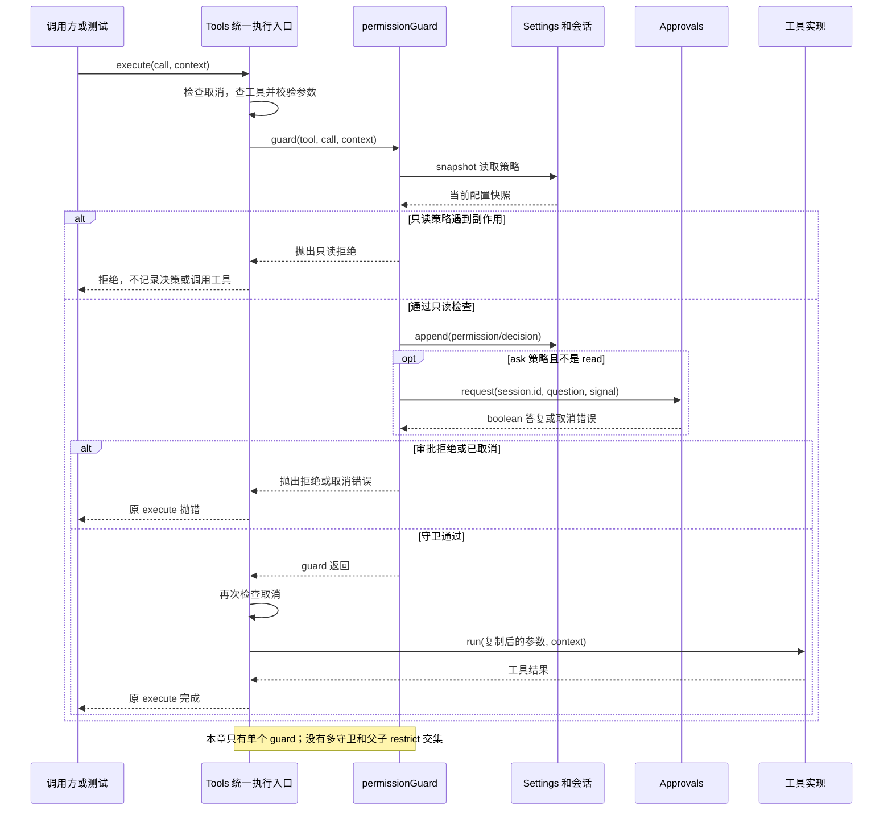

# 024 · 所有工具执行前都过权限门

阶段：R04。唯一前置：完成第 023 步，继续同一个工程。

## 什么时候会用到这一页

同一个write工具，在“询问”模式下需要你同意，在“只读”模式下即使想批准也应直接拒绝。具体任务是阻止一次写配置的工具产生副作用。

### 这次数据怎么走

```text
Tools.execute(call,context) → 参数校验 → tools.guard(tool,call,context) → permissionGuard读取settings.snapshot → 只读拒绝或Approvals.request → 检查取消 → tool.run
```

### 对应时序图

从上往下读；实线箭头表示调用或发送，虚线箭头表示返回或事件通知。`opt`表示可选操作，`alt`表示不同结果，`loop`表示重复，`par`及其`and`分支表示并行；“未接入”及fixture说明按图中标注理解。



**当前接线位置：**041 Host确实安装permissionGuard，051扩展工具继续经过同一个Tools入口。后续没有把单guard改成原版多guard注册，也没有实现作用域继承的restrict。

## 这一步具体做什么

先写完src/permissions.mjs和本章测试，在练习工程运行 bun test ./tests/024-permissions.test.mjs。测试注册计数器write工具，第一次审批回false，第二次settings.set({ permission: "read-only" })；两次均检查writes===0。这里没有实际改磁盘。

需要本章新文件的操作，先按下面代码创建文件，再执行；不要在上一步尚不存在的接口上试错。

## 代码为什么放在这一层

permissionGuard是工具执行前的一道策略门：根据effect决定放行、拒绝或询问。它不负责操作系统隔离，也没有管理多个guard。当前tools.guard是一个属性，再赋值会覆盖旧值。

## 在哪里写、写什么

操作地点：终端中的 `$PROJECT`，编辑器打开同一个目录。只创建或替换下列文件，其他文件保留上一步版本。文件目录不存在先创建。

```sh
mkdir -p src
```

### 创建 `src/permissions.mjs`

````javascript
/** 效果分类和 OS confinement 分开；审批允许不代表可以跳过沙箱。 */
export function permissionGuard(settings, approvals) {
  return async (tool, call, context) => {
    const policy = settings.snapshot().permission ?? 'ask'
    if (!['read', 'write', 'execute', 'network'].includes(tool.effect)) throw Error('工具缺少效果声明')
    if (policy === 'read-only' && tool.effect !== 'read') throw Error('只读策略拒绝副作用')
    const mustAsk = policy === 'ask' && tool.effect !== 'read'
    context.session.append('permission/decision', { tool: call.name, effect: tool.effect, policy, mustAsk })
    if (mustAsk && !await approvals.request(context.session.id, { call, effect: tool.effect }, context.signal)) throw Error('用户拒绝')
    context.signal.throwIfAborted()
  }
}
````

```sh
mkdir -p tests
```

### 创建 `tests/024-permissions.test.mjs`

````javascript
import { test } from 'bun:test'
import assert from 'node:assert/strict'
import { permissionGuard } from '../src/permissions.mjs'
import { Settings } from '../src/config.mjs'
import { Events } from '../src/events.mjs'
import { Approvals } from '../src/approval.mjs'
import { Tools } from '../src/tools.mjs'
import { Scope } from '../src/scope.mjs'

test('执行工具统一过守卫，拒绝后没有副作用', async () => {
  const tools = new Tools(), scope = new Scope(), settings = new Settings({ permission: 'ask' }), session = new Events('s')
  let writes = 0
  const approvals = new Approvals(event => { if (event.type === 'approval/request') approvals.answer('s', event.id, false) })
  tools.guard = permissionGuard(settings, approvals)
  tools.register(scope, { name: 'write', effect: 'write', schema: { type: 'object' }, run: () => writes++ })
  await assert.rejects(tools.execute({ name: 'write', arguments: {} }, { session, signal: new AbortController().signal }), /用户拒绝/)
  assert.equal(writes, 0)
  settings.set({ permission: 'read-only' })
  await assert.rejects(tools.execute({ name: 'write', arguments: {} }, { session, signal: new AbortController().signal }), /只读/)
  await scope.close()
})
````

## 运行命令与通过标准

```sh
cd "$PROJECT"
bun test ./tests/024-permissions.test.mjs
bun test
```

测试应1项通过，错误分别包含“用户拒绝”和“只读”，writes一直为0。不能据此证明父子权限叠加、路径限制或沙箱已经实现；这些都不是本章测试范围。

**本步证据的范围：**024-permissions.test.mjs调用真实Tools.execute，验证审批拒绝和只读拒绝都不进入计数工具；没有父子Agent或OS沙箱测试。

## VS Code：断在哪里、看什么

在src/tools.mjs的await this.guard(tool, call, context)与src/permissions.mjs的const policy、if (mustAsk...)打断点。F11从Tools.execute进入守卫，第一次看tool.effect="write"、policy="ask"、mustAsk=true；继续到审批答false后观察throw，tool.run不会命中。第二次F10看到policy="read-only"，在请求审批前就抛错。

操作位置：VS Code 打开的是自己的 `$PROJECT`，断点也设在这里的源码，不在教材的 `steps` 目录。

上面的说明若指定CLI、子进程、页面或Electron附加调试，就先按该流程操作；下面这组步骤只用于本章测试入口。“当前测试”不会自动附加子进程，也不会命中浏览器或Electron中的断点。

变量只在所属作用域可见：停在方法内部时看this和参数；要看测试里的局部变量，先在“调用堆栈”选择对应测试帧。正在等待的异步调用者不一定保留可求值的帧，此时在测试调用前后加断点再看，不把未定义误判成业务状态丢失。

沿用第 000 步安装的 Bun 扩展与 `.vscode/launch.json`；本章列出替换配置时，使用本章完整版本。

1. 打开本步测试文件 `tests/024-permissions.test.mjs`，保持它为当前编辑器文件。
2. 在上面指定的函数内单击行号左侧设置断点。
3. “运行和调试”选择 **Bun：当前测试**，按 F5；它执行当前测试，工作目录固定为 PROJECT。
4. 在“变量 / 监视 / 调用堆栈 / 调试控制台”检查状态；F10 逐行执行，F11 进入函数，Shift+F11 返回，F5 继续，Shift+F5 停止。

验收：断点实际命中，能说出当前输入、状态和下一步；只看到进程启动不算完成。长时间暂停会影响真实取消、审批和网络超时，先检查时序，不删超时断言。修正后在集成终端运行 `bun test ./tests/024-permissions.test.mjs`，再运行 `bun test`，保留全部断言。

## 不看答案，确认自己能解释

不看源码写出同一次write在ask、read-only两种策略下的顺序；解释为什么审批允许不等于有操作系统文件权限。

完成后在 LEARNING.md 写一句实际结果和一个卡点。明天只重做这个卡点；第 3 天、第 7 天再做一次，能独立完成就继续下一页，不另开学习路线。

**再改一个条件验证：**安全练习：在临时测试中新增effect="read"的计数工具，证明ask模式下不调用Approvals。父子restrict取交集、多守卫注册属于尚未实现的后续补全方向，不要把给tools.guard第二次赋值当叠加。

## 与当前原版还差哪些

对照本仓库固定原版 `687f282e8625c6b8d11ff58211a90524be2e4317`；这里的“当前”指该本地基线，不是未经检查的上游最新版。

**这一页已经实现：**

- 读取运行时permission快照
- read/write/execute/network效果校验
- ask审批与read-only拒绝
- 拒绝发生在tool.run之前

**原版仍有、或本步尚未对齐的部分：**

- 原版tools.restrict叠加允许/拒绝集合，父子作用域只会继续收窄；本章没有工具可见性限制。
- 原版tools.guard可注册多个，检查全局和作用域链；本章单属性会覆盖。
- 原版pre-execute策略、审批和最终guard是分开的执行阶段；教程合在一个函数中。
- 原版权限预设组合沙箱与审批服务；本章没有可配置预设和对应上下文展示。

**原版对照位置：**

- [packages/core/tools/src/index.ts](../../../deepseek-harness/packages/core/tools/src/index.ts)
- [packages/core/tools/README.zh.md](../../../deepseek-harness/packages/core/tools/README.zh.md)
- [packages/interaction/permission-presets/README.zh.md](../../../deepseek-harness/packages/interaction/permission-presets/README.zh.md)
- [packages/interaction/user-approval/README.zh.md](../../../deepseek-harness/packages/interaction/user-approval/README.zh.md)

本步测试通过只证明上面的具体行为；完整差距仍看 [COVERAGE.md](../COVERAGE.md)，不以文件数量、同名类或后面出现另一个模块代替接线证据。

下一步：[第 025 步](025.md)
