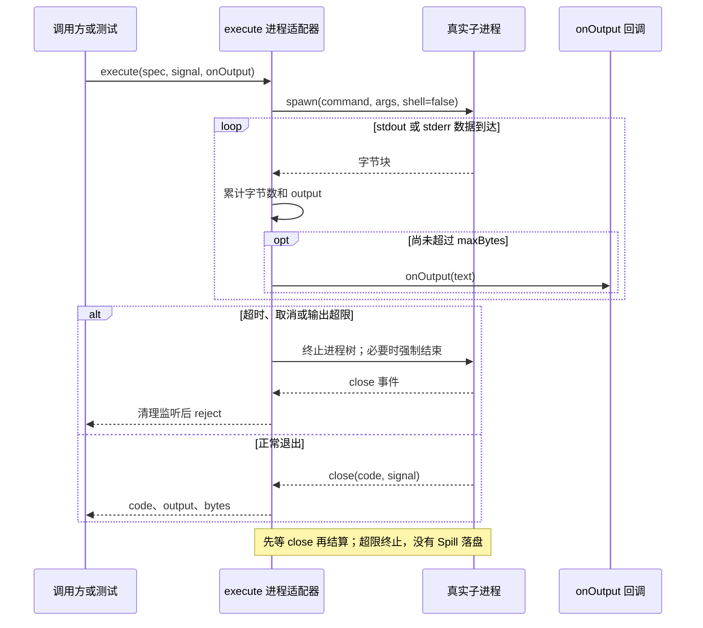
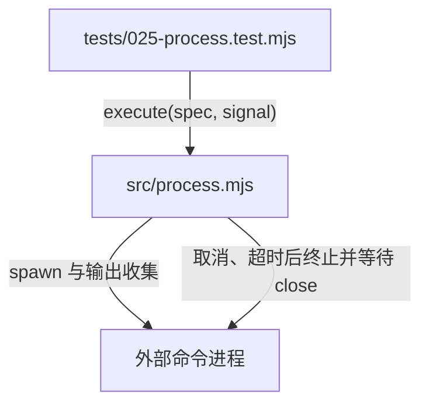
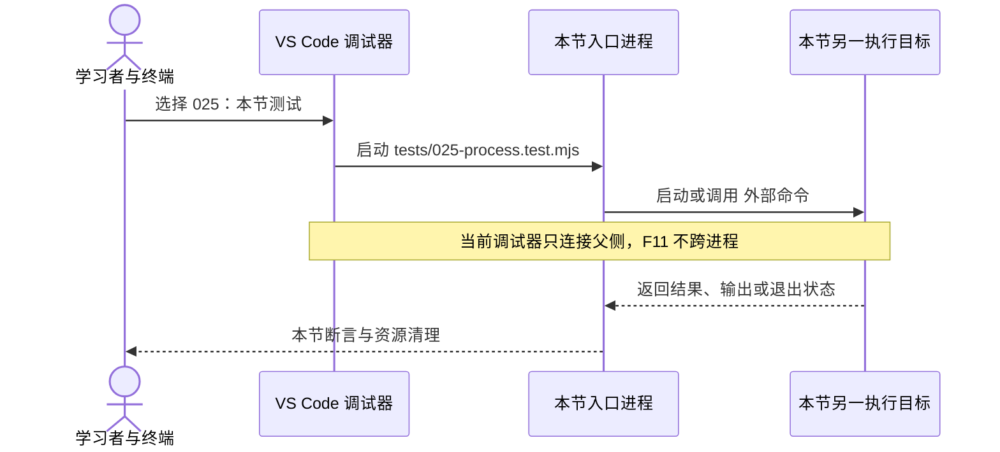

# 025 · 运行真实进程并收回进程树

阶段：R04。唯一前置：完成第 024 步，继续同一个工程。

<!-- harness-own-links:start -->
## 当前练习工程文件

以下链接指向 `harness-own` 的当前累计版本；本课下方的完整代码仍保留当步版本，二者可能不同。

[打开练习工程说明](../../../harness-own/README.md)

| 本课文件 | 当前练习工程文件 |
| --- | --- |
| `.vscode/launch.json` | 使用本页下方的本节专用配置，不复制累计版本 |
| `src/process.mjs` | [`harness-own/src/process.mjs`](../../../harness-own/src/process.mjs) |
| `tests/025-process.test.mjs` | [`harness-own/tests/025-process.test.mjs`](../../../harness-own/tests/025-process.test.mjs) |

<!-- harness-own-links:end -->

## 什么时候会用到这一页

Agent运行测试命令，需要拿到非零退出码；测试卡住时能超时；用户取消时终止命令；某条命令疯狂打印时不能无限占用宿主内存。

### 这次数据怎么走

```text
execute(spec,signal,onOutput) → spawn(command,args,shell:false) → stdout/stderr收集 → 正常close返回code/output，或超时/取消/超限发信号 → 等close后reject
```

### 对应时序图

从上往下读；实线箭头表示调用或发送，虚线箭头表示返回或事件通知。`opt`表示可选操作，`alt`表示不同结果，`loop`表示重复，`par`及其`and`分支表示并行；“未接入”及fixture说明按图中标注理解。



**当前接线位置：** 本章独立测试真实子进程。029复用execute启动ssh；040用它启动Office转换器；051把它接成run和job_start工具。原版溢出落盘逻辑没有在后续补齐。

## 先看目录与调用关系

目录只列本节文件及图中直接用到的前置实现；不是累计工程的完整文件清单。

```text
PROJECT/
├── .vscode/
│   └── launch.json  # 本节创建或替换
├── src/
│   └── process.mjs  # 本节创建或替换
└── tests/
    └── 025-process.test.mjs  # 本节创建或替换
```

### 本节入口怎样调用这些文件

箭头写明实际调用或进程启动；标为“未接入”的文件不是本节测试能命中的目标。




## 这一步具体做什么

写完src/process.mjs和tests/025-process.test.mjs再运行 bun test ./tests/025-process.test.mjs。第一个真实Bun子进程打印ok并退出3；其余子进程分别制造100000字符、长时间运行、取消。测试会主动终止自己启动的进程，不用手动kill。

需要本章新文件的操作，先按下面代码创建文件，再执行；不要在上一步尚不存在的接口上试错。

## 代码为什么放在这一层

execute是一次性进程执行器，不是Shell解释器。command和args分开避免经过本地Shell；想用管道、cd等Shell语法必须明确启动Shell。这里的输出预算超限会杀进程，是教学简化。

## 本节调试：选什么、为什么、怎么启动

**建议先选：025：本节测试。** 每节的测试入口都固定到本节文件，不依赖编辑器当前打开的 `${file}`。

| 配置名称 | 什么时候选 | 实际入口或目标 | 能观察什么 |
| --- | --- | --- | --- |
| 025：本节测试 | 本节验收 | tests/025-process.test.mjs | 本节 Bun 测试进程；入口固定，不依赖当前编辑器文件。 |

**为什么这样启动：** 本节测试直接调用被测模块，选择这一项即可沿测试进入实现；前序 CLI 或其他语言入口不参与这次调试。 本节调试 Bun 的进程管理与输出收集，外部命令不属于父进程调用栈。短超时断言请连续运行。

使用下方的[本节专用调试配置](#lesson-debug-config)。它只列本节可用目标；要保留个人配置，请先备份并按名称合并。页面上 `harness-own` 的累计文件链接供看当前工程，不是本节调试配置的答案。

1. VS Code 打开自己的 PROJECT；按本节创建源码与配置，断点设在 PROJECT 文件中。
2. 先用终端运行 `bun test ./tests/025-process.test.mjs` 确认普通验收，再选表中的配置按 F5。
3. 在下方具体观察点停住；F10 跨过当前语句，F11 只进入当前调试目标。异步等待涉及另一进程时，切换调试会话并继续对端。
4. 变量要在所属调用帧查看；看测试局部变量时选测试帧，看 this 和参数时选实现方法帧。

<details class="debug-details">
<summary>展开本节具体断点和预期</summary>

在src/process.mjs的spawn、bytes +=、stop、child.on("close")回调打断点。第一个调用F10看child.pid与args，F11进入collect后看bytes增长；超限调用看到bytes>maxBytes后进stop。超时调用停在stop看reason.message="执行超时"，继续到close才观察Promise结算。调试停顿会影响短timeout，先单独观察第一条正常命令或在临时调试副本提高timeout。

</details>

### 本节调试启动时序

这张图解释如何创建并连接调试目标；上面的业务时序图解释任务本身怎样执行。



暂停断点会影响应用自身的 RPC、取消、进程和网络计时。Bun 测试超时放宽不等于这些计时也被关闭；按本节说明分别设置，普通验收恢复原有时限。

观察完成后退出本节启动的调试会话和进程，再运行 `bun test ./tests/025-process.test.mjs`。测试通过只证明本节断言，不代表所有 GUI、外部服务或发布过程均已验证。

## 在哪里写、写什么

操作地点：终端中的 `$PROJECT`，编辑器打开同一个目录。只创建或替换下列文件，其他文件保留上一步版本。文件目录不存在先创建。

```sh
mkdir -p .vscode
```

<a id="lesson-debug-config"></a>

下面是本节专用调试配置，只包含本节入口。program 已固定到本节文件；不是 harness-own 的累计配置。

### 替换 `.vscode/launch.json`

````json
{
  "version": "0.2.0",
  "configurations": [
    {
      "name": "025：本节测试",
      "type": "bun",
      "request": "launch",
      "program": "${workspaceFolder}/tests/025-process.test.mjs",
      "cwd": "${workspaceFolder}",
      "runtime": "bun",
      "runtimeArgs": [
        "test",
        "--preload",
        "${workspaceFolder}/scripts/vscode-debug.mjs",
        "--timeout",
        "3600000"
      ],
      "stopOnEntry": false
    }
  ]
}
````

```sh
mkdir -p src
```

### 创建 [`src/process.mjs`](../../../harness-own/src/process.mjs)

````javascript
import { spawn } from 'node:child_process'

/** 显式 argv 执行；取消和超时终止进程树，返回实际退出码。 */
export function execute({ command, args = [], cwd, env = process.env, timeout = 5000, maxBytes = 64 * 1024 }, signal, onOutput = () => {}) {
  signal.throwIfAborted()
  return new Promise((resolve, reject) => {
    const child = spawn(command, args, { cwd, env, shell: false, detached: process.platform !== 'win32', stdio: ['ignore', 'pipe', 'pipe'] })
    let output = '', bytes = 0, failure, forceTimer
    const stop = reason => {
      failure ??= reason
      if (!child.pid) return
      if (process.platform === 'win32') spawn('taskkill', ['/pid', String(child.pid), '/T', '/F'], { stdio: 'ignore' }).on('error', () => child.kill())
      else {
        try { process.kill(-child.pid, 'SIGTERM') } catch {}
        forceTimer ??= setTimeout(() => { try { process.kill(-child.pid, 'SIGKILL') } catch {} }, 200)
      }
    }
    const abort = () => stop(Error('执行已取消'))
    signal.addEventListener('abort', abort, { once: true })
    const timer = setTimeout(() => stop(Error('执行超时')), timeout)
    const collect = data => {
      bytes += Buffer.isBuffer(data) ? data.length : Buffer.byteLength(data)
      if (bytes > maxBytes) { stop(Error('输出超限')); return }
      const text = data.toString(); output += text; onOutput(text)
    }
    child.stdout.setEncoding('utf8'); child.stderr.setEncoding('utf8')
    child.stdout.on('data', collect); child.stderr.on('data', collect)
    child.on('error', error => { failure = error })
    child.on('close', (code, terminationSignal) => {
      clearTimeout(timer); clearTimeout(forceTimer); signal.removeEventListener('abort', abort)
      if (failure) reject(failure); else resolve({ code, signal: terminationSignal, output, bytes })
    })
  })
}
````

```sh
mkdir -p tests
```

### 创建 [`tests/025-process.test.mjs`](../../../harness-own/tests/025-process.test.mjs)

````javascript
import { test } from 'bun:test'
import assert from 'node:assert/strict'
import { execute } from '../src/process.mjs'

test('真实进程非零退出、输出超限、超时和取消', async () => {
  const signal = new AbortController().signal
  const result = await execute({ command: process.execPath, args: ['-e', 'console.log("ok");process.exit(3)'] }, signal)
  assert.equal(result.code, 3); assert.match(result.output, /ok/)
  await assert.rejects(execute({ command: process.execPath, args: ['-e', 'console.log("x".repeat(100000))'] }, signal), /超限/)
  await assert.rejects(execute({ command: process.execPath, args: ['-e', 'setInterval(()=>{},1000)'], timeout: 30 }, signal), /超时/)
  const controller = new AbortController(), pending = execute({ command: process.execPath, args: ['-e', 'setInterval(()=>{},1000)'] }, controller.signal)
  controller.abort(); await assert.rejects(pending, /取消/)
})
````

## 运行命令与通过标准

```sh
cd "$PROJECT"
bun test ./tests/025-process.test.mjs
bun test
```

测试应1项通过，正常返回code=3且含ok，超限/超时/取消分别reject。测试没有验证复杂孙进程树、Windows实际taskkill、stdout/stderr分别读取或输出落盘。

**本步证据的范围：** 025-process.test.mjs确实启动当前process.execPath（Bun），验证code=3、输出超限、30ms超时与立即取消；没有远端命令或收费模型请求。

## 不看答案，确认自己能解释

闭卷写出“取消信号已发出”和“进程close已到达”的区别，并列出execute成功返回的code、signal、output、bytes四项。

完成后在 LEARNING.md 写一句实际结果和一个卡点。明天只重做这个卡点；第 3 天、第 7 天再做一次，能独立完成就继续下一页，不另开学习路线。

**再改一个条件验证：** 安全练习：在测试隔离子进程里分别打印stdout与stderr，观察当前实现合并到同一个output；再运行输出恰好低于maxBytes的命令。不要在学习工程启动无限日志任务。

## 与当前原版还差哪些

对照本仓库固定原版 `687f282e8625c6b8d11ff58211a90524be2e4317`；这里的“当前”指该本地基线，不是未经检查的上游最新版。

**这一页已经实现：**

- 显式argv且shell:false
- 非零退出码和增量输出
- timeout、AbortSignal与POSIX进程组终止
- 等待close后结算

**原版仍有、或本步尚未对齐的部分：**

- 原版subprocess-local与bash-local管理stdout/stderr各自有界尾部、spill文件和磁盘预算；本章合并输出并在超限时杀进程。
- 原版shell执行器把非零退出、超时、取消投影为描述性结果；本章超时/取消主要reject。
- 原版managed-range、凭据环境清理、优雅终止与输出排空规则更完整；教程200ms强杀不是等价实现。

**原版对照位置：**

- [packages/subprocess/subprocess-local/README.zh.md](../../../deepseek-harness/packages/subprocess/subprocess-local/README.zh.md)
- [packages/shell/bash-local/README.zh.md](../../../deepseek-harness/packages/shell/bash-local/README.zh.md)
- [packages/shell/tool-bash/src/render.ts](../../../deepseek-harness/packages/shell/tool-bash/src/render.ts)

本步测试通过只证明上面的具体行为；完整差距仍看 [COVERAGE.md](../COVERAGE.md)，不以文件数量、同名类或后面出现另一个模块代替接线证据。

下一步：[第 026 步](026.md)
