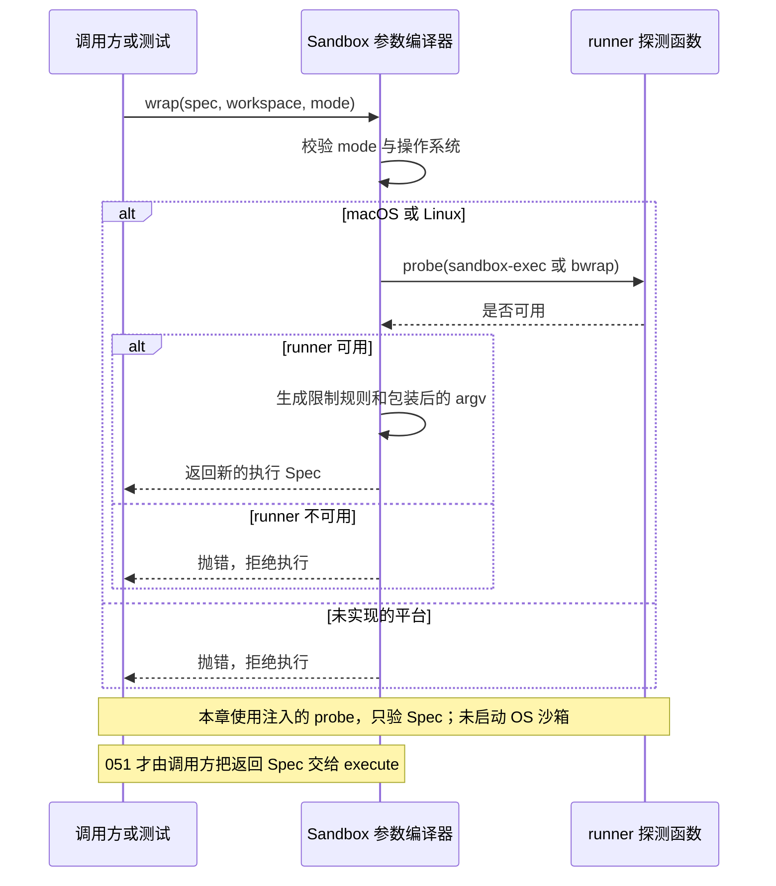

# 028 · 让OS沙箱缺失时明确拒绝

阶段：R04。唯一前置：完成第 027 步，继续同一个工程。

<!-- harness-own-links:start -->
## 当前练习工程文件

以下链接指向 `harness-own` 的当前累计版本；本课下方的完整代码仍保留当步版本，二者可能不同。

[打开练习工程说明](../../../harness-own/README.md)

| 本课文件 | 当前练习工程文件 |
| --- | --- |
| `.vscode/launch.json` | 使用本页下方的本节专用配置，不复制累计版本 |
| `src/sandbox.mjs` | [`harness-own/src/sandbox.mjs`](../../../harness-own/src/sandbox.mjs) |
| `tests/028-sandbox.test.mjs` | [`harness-own/tests/028-sandbox.test.mjs`](../../../harness-own/tests/028-sandbox.test.mjs) |

<!-- harness-own-links:end -->

## 什么时候会用到这一页

模型获准运行一个命令，但不应该因此能写任意宿主路径。执行之前要把“只读/工作区可写”的策略转换成操作系统沙箱启动参数；缺少沙箱程序应拒绝运行。

### 这次数据怎么走

```text
Sandbox.wrap(spec,{workspace,mode}) → 检查mode与平台 → probe runner → 生成sandbox-exec或bwrap启动Spec → 调用者再交execute；本章测试只检查生成结果
```

### 对应时序图

从上往下读；实线箭头表示调用或发送，虚线箭头表示返回或事件通知。`opt`表示可选操作，`alt`表示不同结果，`loop`表示重复，`par`及其`and`分支表示并行；“未接入”及fixture说明按图中标注理解。



**当前接线位置：** 028本章只验证编译参数。051确实将sandbox.wrap传给execute，连接run与job_start；但并未扩大成本章原版的多平台功能探测和强制能力报告。

## 这一步具体做什么

写完src/sandbox.mjs和测试后运行 bun test ./tests/028-sandbox.test.mjs。先看伪探测返回false时拒绝，再看linux探测true时返回command=bwrap且最后一个参数仍为hello world，最后检查win32明确拒绝。这不是在本机Linux沙箱里执行命令。

需要本章新文件的操作，先按下面代码创建文件，再执行；不要在上一步尚不存在的接口上试错。

## 代码为什么放在这一层

本章是“策略转启动参数”的编译器，不是审批器，也不是完整沙箱。wrap不启动进程；真正限制是否生效，必须由实际runner执行并用越界读写测试证明。命令argv保持分离避免二次解释。

## 本节调试：选什么、为什么、怎么启动

**建议先选：028：本节测试。** 每节的测试入口都固定到本节文件，不依赖编辑器当前打开的 `${file}`。

| 配置名称 | 什么时候选 | 实际入口或目标 | 能观察什么 |
| --- | --- | --- | --- |
| 028：本节测试 | 本节验收 | tests/028-sandbox.test.mjs | 本节 Bun 测试进程；入口固定，不依赖当前编辑器文件。 |

**为什么这样启动：** 本节测试直接调用被测模块，选择这一项即可沿测试进入实现；前序 CLI 或其他语言入口不参与这次调试。

使用下方的[本节专用调试配置](#lesson-debug-config)。它只列本节可用目标；要保留个人配置，请先备份并按名称合并。页面上 `harness-own` 的累计文件链接供看当前工程，不是本节调试配置的答案。

1. VS Code 打开自己的 PROJECT；按本节创建源码与配置，断点设在 PROJECT 文件中。
2. 先用终端运行 `bun test ./tests/028-sandbox.test.mjs` 确认普通验收，再选表中的配置按 F5。
3. 在下方具体观察点停住；F10 跨过当前语句，F11 只进入当前调试目标。异步等待涉及另一进程时，切换调试会话并继续对端。
4. 变量要在所属调用帧查看；看测试局部变量时选测试帧，看 this 和参数时选实现方法帧。

<details class="debug-details">
<summary>展开本节具体断点和预期</summary>

1. 在src/sandbox.mjs的if (!this.probe(...))与return {...spec,command:"bwrap"...}打断点。

2. F10检查platform="linux"、workspace="/tmp/a"、spec.args=["hello world"]。

3. 展开result.args，确认hello world仍是一个参数。

4. Windows分支应直接throw，不应到execute。

5. 测试没有子进程可附加。

</details>

暂停断点会影响应用自身的 RPC、取消、进程和网络计时。Bun 测试超时放宽不等于这些计时也被关闭；按本节说明分别设置，普通验收恢复原有时限。

观察完成后退出本节启动的调试会话和进程，再运行 `bun test ./tests/028-sandbox.test.mjs`。测试通过只证明本节断言，不代表所有 GUI、外部服务或发布过程均已验证。

## 在哪里写、写什么

操作地点：终端中的 `$PROJECT`，编辑器打开同一个目录。只创建或替换下列文件，其他文件保留上一步版本。文件目录不存在先创建。

```sh
mkdir -p .vscode
```

<a id="lesson-debug-config"></a>

下面是本节专用调试配置，只包含本节入口。program 已固定到本节文件；不是 harness-own 的累计配置。

### 替换 `.vscode/launch.json`

````json
{
  "version": "0.2.0",
  "configurations": [
    {
      "name": "028：本节测试",
      "type": "bun",
      "request": "launch",
      "program": "${workspaceFolder}/tests/028-sandbox.test.mjs",
      "cwd": "${workspaceFolder}",
      "runtime": "bun",
      "runtimeArgs": [
        "test",
        "--preload",
        "${workspaceFolder}/scripts/vscode-debug.mjs",
        "--timeout",
        "3600000"
      ],
      "stopOnEntry": false
    }
  ]
}
````

```sh
mkdir -p src
```

### 创建 [`src/sandbox.mjs`](../../../harness-own/src/sandbox.mjs)

````javascript
import { spawnSync } from 'node:child_process'

/** OS confinement 的编译器；探测失败必须拒绝，绝不降级为裸执行。 */
export class Sandbox {
  constructor(platform = process.platform, probe = command => spawnSync(command, ['--help'], { stdio: 'ignore' }).error === undefined) { this.platform = platform; this.probe = probe }
  /** 显式构造可审计执行Spec，调用方最终仍交给subprocess提供方。 */
  wrap(spec, { workspace, mode = 'workspace-write' }) {
    if (!['read-only', 'workspace-write'].includes(mode)) throw Error('未知沙箱模式')
    if (this.platform === 'darwin') {
      if (!this.probe('/usr/bin/sandbox-exec')) throw Error('Seatbelt 不可用，拒绝执行')
      const path = JSON.stringify(workspace)
      const profile = `(version 1)(deny default)(allow process*)(allow sysctl-read)(allow mach-lookup)(allow file-read*)(allow file-write* (literal "/dev/null")${mode === 'workspace-write' ? ` (subpath ${path})` : ''})`
      return { ...spec, command: '/usr/bin/sandbox-exec', args: ['-p', profile, spec.command, ...(spec.args ?? [])] }
    }
    if (this.platform === 'linux') {
      if (!this.probe('bwrap')) throw Error('bwrap 不可用，拒绝执行')
      return { ...spec, command: 'bwrap', args: ['--die-with-parent', '--unshare-all', '--ro-bind', '/', '/', ...(mode === 'workspace-write' ? ['--bind', workspace, workspace] : []), '--dev', '/dev', '--proc', '/proc', '--chdir', workspace, '--', spec.command, ...(spec.args ?? [])] }
    }
    // Windows 必须新增真实 ACL/令牌提供方后才开放，不能拿路径校验充数。
    throw Error('当前平台沙箱尚未实现，拒绝执行')
  }
}
````

```sh
mkdir -p tests
```

### 创建 [`tests/028-sandbox.test.mjs`](../../../harness-own/tests/028-sandbox.test.mjs)

````javascript
import { test } from 'bun:test'
import assert from 'node:assert/strict'
import { Sandbox } from '../src/sandbox.mjs'

test('沙箱缺失拒绝，命令与参数仍分离，未知平台不裸跑', () => {
  const spec = { command: '/bin/echo', args: ['hello world'] }
  assert.throws(() => new Sandbox('linux', () => false).wrap(spec, { workspace: '/tmp/a' }), /拒绝/)
  const result = new Sandbox('linux', () => true).wrap(spec, { workspace: '/tmp/a' })
  assert.equal(result.command, 'bwrap'); assert.equal(result.args.at(-1), 'hello world')
  assert.throws(() => new Sandbox('win32').wrap(spec, { workspace: 'C:\\a' }), /尚未实现/)
})
````

## 运行命令与通过标准

```sh
cd "$PROJECT"
bun test ./tests/028-sandbox.test.mjs
bun test
```

测试应1项通过，证明缺失不裸跑、参数边界保留、未实现平台拒绝。它不证明macOS Seatbelt或Linux bwrap能实际隔离，也没有验证网络策略。

**本步证据的范围：** 028-sandbox.test.mjs仅用注入probe检查Spec和拒绝逻辑，没有启动bwrap/sandbox-exec或测试实际越界读写。

## 不看答案，确认自己能解释

闭卷写出审批允许、路径校验、OS沙箱三者各负责哪一层；指出wrap返回Spec为什么不能当作“限制已生效”的证据。

完成后在 LEARNING.md 写一句实际结果和一个卡点。明天只重做这个卡点；第 3 天、第 7 天再做一次，能独立完成就继续下一页，不另开学习路线。

**再改一个条件验证：** 安全练习：给wrap传mode="unknown"并断言拒绝；检查read-only生成参数没有可写工作区绑定。真实隔离验证需要另建临时目录并显式执行runner，当前测试未提供，不能拿手写预期字符串替代。

## 与当前原版还差哪些

对照本仓库固定原版 `687f282e8625c6b8d11ff58211a90524be2e4317`；这里的“当前”指该本地基线，不是未经检查的上游最新版。

**这一页已经实现：**

- read-only/workspace-write两种mode
- macOS与Linux命令包装
- 不可用和未知平台拒绝，不降级裸跑

**原版仍有、或本步尚未对齐的部分：**

- 原版sandbox-local有runner功能探测、候选选择与缓存、结构化不可用/失败签名。
- 原版报告full/partial强制能力并支持Windows ACL以及其他Linux机制；本章Windows一律未实现，只判断程序是否可启动。
- 原版sandbox-policy与shell/fs提供方配套生成权限；本章固定宽泛策略模板不是等价安全边界。

**原版对照位置：**

- [packages/sandbox/sandbox/README.zh.md](../../../deepseek-harness/packages/sandbox/sandbox/README.zh.md)
- [packages/sandbox/sandbox-local/README.zh.md](../../../deepseek-harness/packages/sandbox/sandbox-local/README.zh.md)
- [packages/sandbox/sandbox-policy/README.zh.md](../../../deepseek-harness/packages/sandbox/sandbox-policy/README.zh.md)
- [packages/sandbox/sandbox-windows-acl/README.zh.md](../../../deepseek-harness/packages/sandbox/sandbox-windows-acl/README.zh.md)

本步测试通过只证明上面的具体行为；完整差距仍看 [COVERAGE.md](../COVERAGE.md)，不以文件数量、同名类或后面出现另一个模块代替接线证据。

下一步：[第 029 步](029.md)
