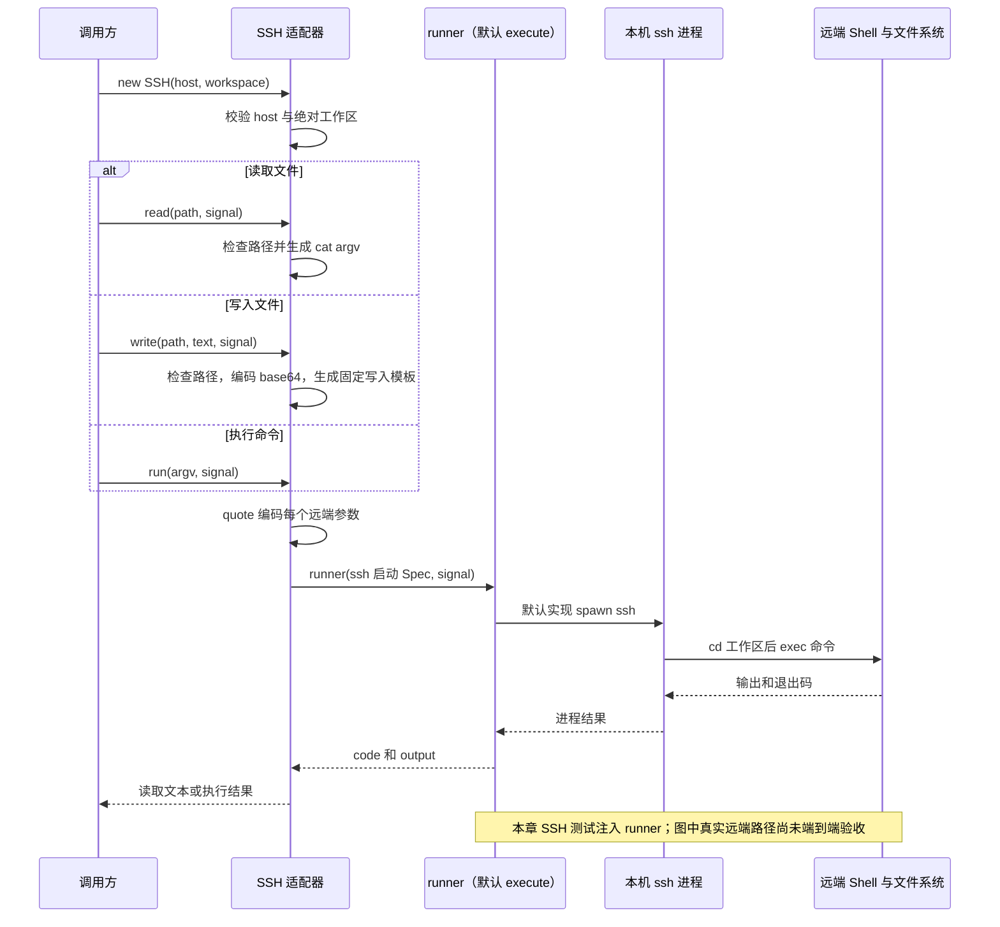

# 029 · 用同一SSH配置读写文件和执行命令

阶段：R04。唯一前置：完成第 028 步，继续同一个工程。

## 什么时候会用到这一页

代码在远端服务器/home/project，Harness在本机。读文件、写文件和运行测试必须都指向这同一个远端项目，否则容易改本机文件却测远端旧代码。

### 这次数据怎么走

```text
SSH(host,workspace) → read/write/run共用run(argv) → quote逐个编码远端参数 → 本机execute启动ssh → 远端Shell cd工作区并exec命令
```

### 对应时序图

从上往下读；实线箭头表示调用或发送，虚线箭头表示返回或事件通知。`opt`表示可选操作，`alt`表示不同结果，`loop`表示重复，`par`及其`and`分支表示并行；“未接入”及fixture说明按图中标注理解。



**当前接线位置：**029仅独立适配器测试。后续Host仍实例化LocalFS，051没有挂载SSH；因此没有真正切换成远端文件/执行/PTY能力组。

## 这一步具体做什么

先写完src/ssh.mjs和测试，再运行 bun test ./tests/029-ssh.test.mjs。真实本地/bin/sh先验证带单引号与分号的文字不变；SSH部分使用注入runner记录spec，不需要账户也不会连接服务器。查看specs中的host、远端cd和cat/写入模板，最后验证../secret拒绝。

需要本章新文件的操作，先按下面代码创建文件，再执行；不要在上一步尚不存在的接口上试错。

## 代码为什么放在这一层

029是SSH命令适配器：本地通过argv启动ssh，远端仍解析命令字符串，所以quote必需。write先把正文转Base64避免正文被当Shell语法。它不是原版远端helper或通用文件系统接口。

## 在哪里写、写什么

操作地点：终端中的 `$PROJECT`，编辑器打开同一个目录。只创建或替换下列文件，其他文件保留上一步版本。文件目录不存在先创建。

```sh
mkdir -p src
```

### 创建 `src/ssh.mjs`

````javascript
import { execute } from './process.mjs'

/** POSIX argv 的单引号编码；Host 名称单独验证，不能变成 ssh 参数。 */
export function quote(value) { return "'" + String(value).replaceAll("'", "'\\''") + "'" }

/** 同一个远端对象同时提供文件和执行，避免本地读/远端执行混在一起。 */
export class SSH {
  constructor(host, workspace, runner = execute) {
    if (!/^[a-zA-Z0-9_.@-]+$/.test(host) || host.startsWith('-')) throw Error('SSH 主机不合法')
    if (!workspace.startsWith('/')) throw Error('远端工作区必须绝对路径')
    this.host = host; this.workspace = workspace; this.runner = runner
  }
  /** 命令仅在远端执行，配置与秘密不由模型拼 ssh 命令。 */
  run(argv, signal) {
    return this.runner({ command: 'ssh', args: ['-T', '-o', 'BatchMode=yes', this.host, 'cd ' + quote(this.workspace) + ' && exec ' + argv.map(quote).join(' ')] }, signal)
  }
  /** 远端文件路径拒绝向上跳转；更强隔离仍交给远端沙箱。 */
  async read(path, signal) {
    if (path.startsWith('/') || path.split(/[\\/]/).includes('..')) throw Error('远端路径越界')
    const result = await this.run(['cat', '--', path], signal)
    if (result.code !== 0) throw Error('远端读取失败：' + result.output)
    return result.output
  }
  async write(path, text, signal) {
    if (path.startsWith('/') || path.split(/[\\/]/).includes('..')) throw Error('远端路径越界')
    const encoded = Buffer.from(text).toString('base64')
    // 只执行固定模板；文本通过base64编码，不能变成shell操作符。
    return this.run(['sh', '-c', 'printf %s ' + quote(encoded) + ' | base64 -d > ' + quote(path)], signal)
  }
}
````

```sh
mkdir -p tests
```

### 创建 `tests/029-ssh.test.mjs`

````javascript
import { test } from 'bun:test'
import assert from 'node:assert/strict'
import { SSH, quote } from '../src/ssh.mjs'
import { execute } from '../src/process.mjs'

test('真实Shell验证参数编码，SSH文件与执行共享远端Spec', async () => {
  const signal = new AbortController().signal, text = "a ' ; echo BAD"
  const encoded = await execute({ command: '/bin/sh', args: ['-c', 'printf %s ' + quote(text)] }, signal)
  assert.equal(encoded.output, text)
  const specs = [], ssh = new SSH('user@host', '/home/project', async spec => { specs.push(spec); return { code: 0, output: 'remote' } })
  assert.equal(await ssh.read('a.txt', signal), 'remote')
  await ssh.write('a.txt', '中文', signal)
  assert.ok(specs.every(spec => spec.args[3] === 'user@host'))
  await assert.rejects(ssh.read('../secret', signal), /越界/)
})
````

## 运行命令与通过标准

```sh
cd "$PROJECT"
bun test ./tests/029-ssh.test.mjs
bun test
```

测试应1项通过：本地Shell输出精确等于原参数、read返回替代runner的remote、所有spec指向user@host、越界拒绝。没有真实SSH握手、远端磁盘效果、断连、远端终止或文件版本验收。

**本步证据的范围：**029-ssh.test.mjs只有quote经过本地真实Shell；SSH读写用替代runner检查命令Spec，不能称为真实SSH端到端验证。

## VS Code：断在哪里、看什么

在src/ssh.mjs的run返回this.runner(...)与write里的const encoded打断点。F10看argv每项、quote(text)及spec.args最后一项；read("a.txt")应生成远端cat，write中文应看到Base64而非原正文。测试注入runner处看specs长度增长，此时不会有ssh子进程；不要附加一个不存在的远端进程。

操作位置：VS Code 打开的是自己的 `$PROJECT`，断点也设在这里的源码，不在教材的 `steps` 目录。

上面的说明若指定CLI、子进程、页面或Electron附加调试，就先按该流程操作；下面这组步骤只用于本章测试入口。“当前测试”不会自动附加子进程，也不会命中浏览器或Electron中的断点。

变量只在所属作用域可见：停在方法内部时看this和参数；要看测试里的局部变量，先在“调用堆栈”选择对应测试帧。正在等待的异步调用者不一定保留可求值的帧，此时在测试调用前后加断点再看，不把未定义误判成业务状态丢失。

沿用第 000 步安装的 Bun 扩展与 `.vscode/launch.json`；本章列出替换配置时，使用本章完整版本。

1. 打开本步测试文件 `tests/029-ssh.test.mjs`，保持它为当前编辑器文件。
2. 在上面指定的函数内单击行号左侧设置断点。
3. “运行和调试”选择 **Bun：当前测试**，按 F5；它执行当前测试，工作目录固定为 PROJECT。
4. 在“变量 / 监视 / 调用堆栈 / 调试控制台”检查状态；F10 逐行执行，F11 进入函数，Shift+F11 返回，F5 继续，Shift+F5 停止。

验收：断点实际命中，能说出当前输入、状态和下一步；只看到进程启动不算完成。长时间暂停会影响真实取消、审批和网络超时，先检查时序，不删超时断言。修正后在集成终端运行 `bun test ./tests/029-ssh.test.mjs`，再运行 `bun test`，保留全部断言。

## 不看答案，确认自己能解释

闭卷画出本地argv与远端Shell解析两层，解释为什么本地shell:false仍不能省略远端quote；说明杀本地ssh不等于确认远端进程树已停。

完成后在 LEARNING.md 写一句实际结果和一个卡点。明天只重做这个卡点；第 3 天、第 7 天再做一次，能独立完成就继续下一页，不另开学习路线。

**再改一个条件验证：**安全练习：给quote测试加包含美元符号、空格和换行的普通文字，仍用本地printf比较原值。真实服务器试验必须使用专门空目录与现有SSH授权；029没有准备远端资源，不要把占位user@host当可运行目标。

## 与当前原版还差哪些

对照本仓库固定原版 `687f282e8625c6b8d11ff58211a90524be2e4317`；这里的“当前”指该本地基线，不是未经检查的上游最新版。

**这一页已经实现：**

- 固定host与远端绝对工作区
- POSIX参数引用和host校验
- 文件读写与执行共用远端Spec
- 拒绝绝对文件路径和..段

**原版仍有、或本步尚未对齐的部分：**

- 原版ssh复用连接，启动已部署helper并校验协议与摘要；029每次操作启动ssh并拼cat/sh。
- 原版fs-ssh用结构化fs.readText、流读取、字节窗口及版本/原子修改接口；教程没有。
- 原版subprocess-ssh管理远端进程、独立流、PTY与控制；教程复用025合并输出。
- 原版helper通过EOF、信号与心跳租约清理，且断连不自动重放副作用；教程没有远端租约或结果不确定性处理。
- 本章路径字符串检查不能阻止远端符号链接越界，也不是远端沙箱。

**原版对照位置：**

- [packages/ssh/ssh/README.zh.md](../../../deepseek-harness/packages/ssh/ssh/README.zh.md)
- [packages/ssh/ssh/src/index.ts](../../../deepseek-harness/packages/ssh/ssh/src/index.ts)
- [packages/ssh/fs-ssh/README.zh.md](../../../deepseek-harness/packages/ssh/fs-ssh/README.zh.md)
- [packages/ssh/subprocess-ssh/README.zh.md](../../../deepseek-harness/packages/ssh/subprocess-ssh/README.zh.md)
- [packages/ssh/ssh-helper-runtime/README.zh.md](../../../deepseek-harness/packages/ssh/ssh-helper-runtime/README.zh.md)

本步测试通过只证明上面的具体行为；完整差距仍看 [COVERAGE.md](../COVERAGE.md)，不以文件数量、同名类或后面出现另一个模块代替接线证据。

下一步：[第 030 步](030.md)
