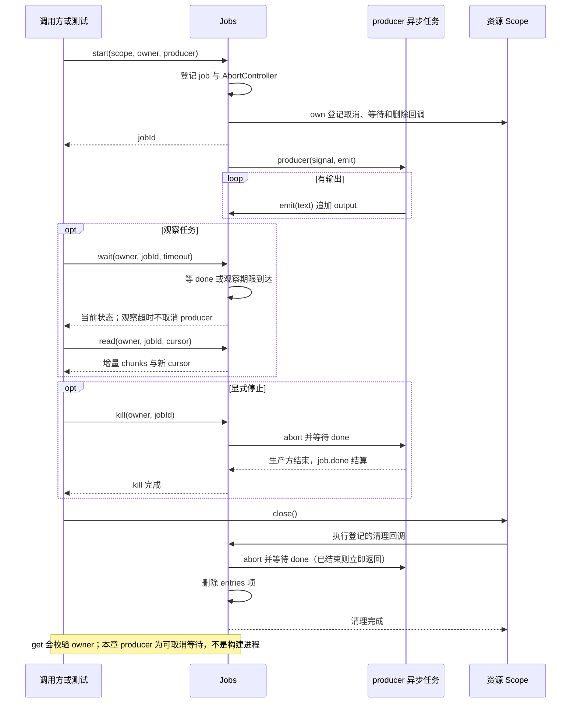

# 030 · 后台Job的wait和kill分开

阶段：R04。唯一前置：完成第 029 步，继续同一个工程。

<!-- harness-own-links:start -->
## 当前练习工程文件

以下链接指向 `harness-own` 的当前累计版本；本课下方的完整代码仍保留当步版本，二者可能不同。

[打开练习工程说明](../../../harness-own/README.md)

| 本课文件 | 当前练习工程文件 |
| --- | --- |
| `.vscode/launch.json` | 使用本页下方的本节专用配置，不复制累计版本 |
| `src/jobs.mjs` | [`harness-own/src/jobs.mjs`](../../../harness-own/src/jobs.mjs) |
| `tests/030-jobs.test.mjs` | [`harness-own/tests/030-jobs.test.mjs`](../../../harness-own/tests/030-jobs.test.mjs) |

<!-- harness-own-links:end -->

## 什么时候会用到这一页

运行一个耗时构建时，Agent不应一直阻塞。先获得任务id，过10ms询问状态仍显示running，稍后读取新日志；只有明确kill或owner关闭才请求终止。

### 这次数据怎么走

```text
Jobs.start(scope,owner,producer) → 登记job与AbortController → producer异步emit输出 → wait只观察done或时间到 → read按块cursor取增量 → kill/Scope.close取消并等待done
```

### 对应时序图

从上往下读；实线箭头表示调用或发送，虚线箭头表示返回或事件通知。`opt`表示可选操作，`alt`表示不同结果，`loop`表示重复，`par`及其`and`分支表示并行；“未接入”及fixture说明按图中标注理解。



**当前接线位置：** 030独立producer测试；051实际注册job_start/wait/read/kill，并用025 execute作生产方。该execute仍有默认5秒执行期限，所以当前job_start并不等于原版无前台截止的长期后台Shell。

## 这一步具体做什么

写完src/jobs.mjs与测试后运行 bun test ./tests/030-jobs.test.mjs。测试producer先emit first再等待60秒，但wait(10)返回running；用s2读取s1任务应拒绝，随后kill让producer因signal中止，最后close把entries清空。测试不真的等待60秒。

需要本章新文件的操作，先按下面代码创建文件，再执行；不要在上一步尚不存在的接口上试错。

## 代码为什么放在这一层

Jobs管理“谁拥有一份持续工作，以及怎么观察它”，生产方才负责具体做事。wait的timeout是观察期限，不是执行期限；read的cursor是输出块下标，不是027的字符串offset。取消是协作式，producer必须理会signal。

## 本节调试：选什么、为什么、怎么启动

**建议先选：030：本节测试。** 每节的测试入口都固定到本节文件，不依赖编辑器当前打开的 `${file}`。

| 配置名称 | 什么时候选 | 实际入口或目标 | 能观察什么 |
| --- | --- | --- | --- |
| 030：本节测试 | 本节验收 | tests/030-jobs.test.mjs | 本节 Bun 测试进程；入口固定，不依赖当前编辑器文件。 |

### 调试路线：先启动谁，再启动谁

本节有 **1 个调试配置、1 条调试路线**。配置是启动或附加按钮；一条路线可能连续使用多个配置。请选择一条路线，不必把所有入口都启动。

| 路线 | 用哪些配置，按顺序 | 谁创建进程 | 结果在哪里看 |
| --- | --- | --- | --- |
| A 自动测试 | “030：本节测试” | F5的launch配置创建；子目标按下方步骤自动创建 | `tests/030-jobs.test.mjs`与下方列出的本章实现断点 |

先完成本节源码并安装[本节专用调试配置](#lesson-debug-config)。下面的路线只对应本节，不沿用前章端口或旧会话。

本章目前只有这一条已配置路线；源码中未接入测试或没有独立调试入口的能力，不因为后面存在同名模块就自动可调。

<details class="debug-route">
<summary>路线 A：自动测试——启动、断点和退出</summary>

1. 先打开`tests/030-jobs.test.mjs`及下方“具体断点和预期”列出的实现文件，设置本章断点。
2. 选择“030：本节测试”按F5，配置固定到本章测试；不需要先运行前章服务或CLI。
3. 测试直接驱动本章实现；在同一Bun调试会话内按F10/F11观察，不必另建服务会话。
4. 按下方本章观察点检查变量和断言；断点停顿可能触发实现自己的计时，必要时先继续完成当前调用。

**断点与观察位置：** `tests/030-jobs.test.mjs`与下方列出的本章实现断点

**结束方式：** 断言结束后测试退出；测试清理自己创建的资源。异常中止后检查本章临时进程，不把尚在等待当作测试通过。

</details>


**为什么这样启动：** 本节测试直接调用被测模块，选择这一项即可沿测试进入实现；前序 CLI 或其他语言入口不参与这次调试。

使用下方的[本节专用调试配置](#lesson-debug-config)。它只列本节可用目标；要保留个人配置，请先备份并按名称合并。页面上 `harness-own` 的累计文件链接供看当前工程，不是本节调试配置的答案。

1. VS Code 打开自己的 PROJECT；按本节创建源码与配置，断点设在 PROJECT 文件中。
2. 先用终端运行 `bun test ./tests/030-jobs.test.mjs` 确认普通验收，再选表中的配置按 F5。
3. 在下方具体观察点停住；F10 跨过当前语句，F11 只进入当前调试目标。异步等待涉及另一进程时，切换调试会话并继续对端。
4. 变量要在所属调用帧查看；看测试局部变量时选测试帧，看 this 和参数时选实现方法帧。

<details class="debug-details">
<summary>展开本节具体断点和预期</summary>

1. 在src/jobs.mjs的this.entries.set、Promise.race和job.controller.abort打断点。

2. start后看job.state="running"。

3. F10通过wait返回时看仍running且controller.signal.aborted=false。

4. kill时F11进入producer的delay中止路径，done处理后state="cancelled"。

5. 最后scope清理删除id。

6. 短等待测试受断点影响，应看state/信号而非测精确毫秒。

</details>

暂停断点会影响应用自身的 RPC、取消、进程和网络计时。Bun 测试超时放宽不等于这些计时也被关闭；按本节说明分别设置，普通验收恢复原有时限。

观察完成后退出本节启动的调试会话和进程，再运行 `bun test ./tests/030-jobs.test.mjs`。测试通过只证明本节断言，不代表所有 GUI、外部服务或发布过程均已验证。

## 在哪里写、写什么

操作地点：终端中的 `$PROJECT`，编辑器打开同一个目录。只创建或替换下列文件，其他文件保留上一步版本。文件目录不存在先创建。

```sh
mkdir -p .vscode
```

<a id="lesson-debug-config"></a>

下面是本节专用调试配置，只包含本节入口。program 已固定到本节文件；不是 harness-own 的累计配置。

### 替换 `.vscode/launch.json`

````json
{
  "version": "0.2.0",
  "configurations": [
    {
      "name": "030：本节测试",
      "type": "bun",
      "request": "launch",
      "program": "${workspaceFolder}/tests/030-jobs.test.mjs",
      "cwd": "${workspaceFolder}",
      "runtime": "bun",
      "runtimeArgs": [
        "test",
        "--preload",
        "${workspaceFolder}/scripts/vscode-debug.mjs",
        "--timeout",
        "3600000"
      ],
      "stopOnEntry": false
    }
  ]
}
````

```sh
mkdir -p src
```

### 创建 [`src/jobs.mjs`](../../../harness-own/src/jobs.mjs)

````javascript
import { id } from './events.mjs'
import { setTimeout as delay } from 'node:timers/promises'

/** 后台任务有独立生产方、owner和输出游标；wait超时不会kill。 */
export class Jobs {
  entries = new Map()
  start(scope, owner, producer) {
    const job = { id: id('job'), owner, state: 'running', output: [], controller: new AbortController() }
    this.entries.set(job.id, job)
    job.done = Promise.resolve().then(() => producer(job.controller.signal, text => job.output.push(text)))
      .then(value => { job.state = 'completed'; job.value = value }, error => { job.state = job.controller.signal.aborted ? 'cancelled' : 'failed'; job.error = error.message })
    scope.own(async () => { job.controller.abort(); await job.done; this.entries.delete(job.id) })
    return job.id
  }
  get(owner, jobId) { const job = this.entries.get(jobId); if (!job || job.owner !== owner) throw Error('没有任务权限'); return job }
  /** 只等待观察，超时返回当前状态。 */
  async wait(owner, jobId, timeout = 1000) {
    const job = this.get(owner, jobId), clock = new AbortController()
    try { await Promise.race([job.done, delay(timeout, undefined, { signal: clock.signal }).catch(() => {})]) }
    finally { clock.abort() }
    return { id: job.id, state: job.state, value: job.value, error: job.error }
  }
  read(owner, jobId, cursor = 0) { const job = this.get(owner, jobId); return { cursor: job.output.length, chunks: job.output.slice(cursor) } }
  async kill(owner, jobId) { const job = this.get(owner, jobId); job.controller.abort(); await job.done }
}
````

```sh
mkdir -p tests
```

### 创建 [`tests/030-jobs.test.mjs`](../../../harness-own/tests/030-jobs.test.mjs)

````javascript
import { test } from 'bun:test'
import assert from 'node:assert/strict'
import { setTimeout as delay } from 'node:timers/promises'
import { Jobs } from '../src/jobs.mjs'
import { Scope } from '../src/scope.mjs'

test('wait超时不杀任务，跨owner拒绝，kill才终止生产方', async () => {
  const jobs = new Jobs(), scope = new Scope()
  const jobId = jobs.start(scope, 's1', async (signal, emit) => { emit('first'); await delay(60_000, undefined, { signal }) })
  assert.equal((await jobs.wait('s1', jobId, 10)).state, 'running')
  assert.throws(() => jobs.read('s2', jobId), /权限/)
  assert.deepEqual(jobs.read('s1', jobId).chunks, ['first'])
  await jobs.kill('s1', jobId)
  assert.equal((await jobs.wait('s1', jobId)).state, 'cancelled')
  await scope.close(); assert.equal(jobs.entries.size, 0)
})
````

## 运行命令与通过标准

```sh
cd "$PROJECT"
bun test ./tests/030-jobs.test.mjs
bun test
```

测试应1项通过：wait超时仍running、输出first可读、跨owner拒绝、kill后cancelled、关闭后entries=0。没有输出内存上限、任务持久化或非协作producer强杀保证。

**本步证据的范围：** 030-jobs.test.mjs用真实可取消的timers/promises等待作生产方，验证观察、权限、终止和清理；没有启动真实后台构建。

## 不看答案，确认自己能解释

闭卷说明wait(10)与kill的区别；画出owner关闭时为什么既要abort又要await done，而不能只从Map删除id。

完成后在 LEARNING.md 写一句实际结果和一个卡点。明天只重做这个卡点；第 3 天、第 7 天再做一次，能独立完成就继续下一页，不另开学习路线。

**再改一个条件验证：** 安全练习：用会主动结束的producer emit两段，第一次read存cursor，第二次读取只拿新块；不要用忽略signal的无限循环，因为当前Jobs不能强制中断它。

## 与当前原版还差哪些

对照本仓库固定原版 `687f282e8625c6b8d11ff58211a90524be2e4317`；这里的“当前”指该本地基线，不是未经检查的上游最新版。

**这一页已经实现：**

- owner校验、稳定job id
- producer信号与输出块游标
- 观察超时不取消
- 作用域关闭取消、等待、删除

**原版仍有、或本步尚未对齐的部分：**

- 原版jobs-local维护有界输出环、stdout/stderr/log分流、绝对字节观察游标与独立模型消耗游标；本章output数组无界。
- 原版注册控制器、生命周期事件、完成通知、进度、列表与显式移除；教程没有完整接口。
- 原版受管进程后台句柄无前台deadline；051复用execute默认超时不等价。
- 原版持久记录任务元数据并明确重启语义；本章只在内存中。

**原版对照位置：**

- [packages/jobs/jobs/README.zh.md](../../../deepseek-harness/packages/jobs/jobs/README.zh.md)
- [packages/jobs/jobs-local/README.zh.md](../../../deepseek-harness/packages/jobs/jobs-local/README.zh.md)
- [packages/jobs/tool-jobs/README.zh.md](../../../deepseek-harness/packages/jobs/tool-jobs/README.zh.md)
- [packages/shell/bash-local/README.zh.md](../../../deepseek-harness/packages/shell/bash-local/README.zh.md)

本步测试通过只证明上面的具体行为；完整差距仍看 [COVERAGE.md](../COVERAGE.md)，不以文件数量、同名类或后面出现另一个模块代替接线证据。

下一步：[第 031 步](031.md)
